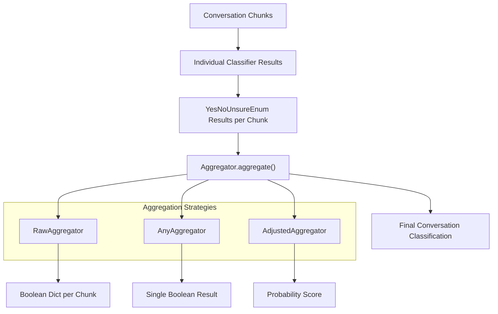
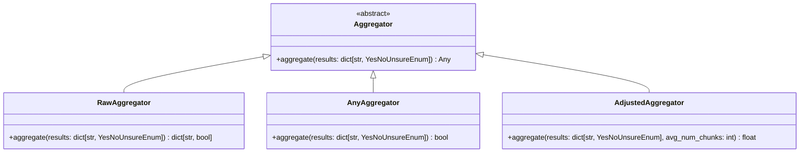
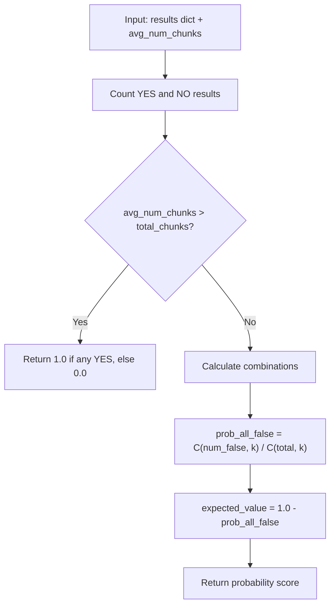
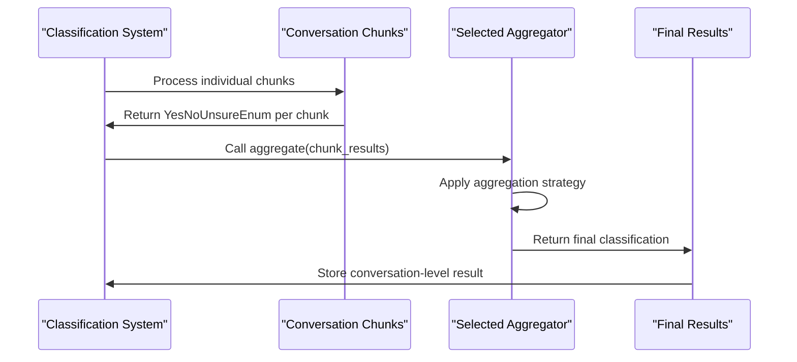

<!-- source: DeepWiki mcp.deepwiki.com · repo openai/emoclassifiers · page 3.2 Result Aggregation · fetched 2026-10-26 -->

# Result Aggregation

<details>
<summary>Relevant source files</summary>

The following files were used as context for generating this wiki page:

- [emoclassifiers/aggregation.py](emoclassifiers/aggregation.py)

</details>


This document explains how individual chunk-level classification results are combined into final conversation-level classifications within the EmoClassifiers system. The aggregation system provides multiple strategies for consolidating `YesNoUnsureEnum` results from conversation chunks into meaningful final outcomes.

For information about how conversations are initially segmented, see [Conversation Chunking](#3.1). For details about the classification pipeline that generates the raw results being aggregated, see [Core Classification System](#3).

## Overview

The aggregation system operates at the final stage of the classification pipeline, after individual conversation chunks have been processed by classifiers. Each chunk produces a `YesNoUnsureEnum` result for each classifier, and the aggregation system combines these chunk-level results into a single conversation-level classification.

### Aggregation Pipeline Flow



Sources: [emoclassifiers/aggregation.py:1-77]()

## Aggregator Interface

The aggregation system is built around the abstract `Aggregator` base class that defines a common interface for all aggregation strategies.

### Base Aggregator Class



The base `Aggregator` class requires subclasses to implement the `aggregate` method that takes a dictionary mapping chunk identifiers to `YesNoUnsureEnum` values and returns the aggregated result.

Sources: [emoclassifiers/aggregation.py:8-16]()

## Aggregation Strategies

The system provides three distinct aggregation strategies, each serving different analytical purposes:

### RawAggregator

The `RawAggregator` provides the most direct aggregation by converting each `YesNoUnsureEnum.YES` to `True` and all other values to `False`. This preserves granular information about individual chunk classifications.

| Input | Output |
|-------|--------|
| `YesNoUnsureEnum.YES` | `True` |
| `YesNoUnsureEnum.NO` | `False` |  
| `YesNoUnsureEnum.UNSURE` | `False` |

The implementation returns a dictionary mapping each chunk identifier to its boolean conversion:

```python
{
    k: val == YesNoUnsureEnum.YES
    for k, val in results.items()
}
```

Sources: [emoclassifiers/aggregation.py:19-27]()

### AnyAggregator

The `AnyAggregator` implements an "any positive" strategy, returning `True` if any chunk in the conversation received a `YesNoUnsureEnum.YES` classification. This is useful for identifying conversations where the target behavior or emotion appears at least once.

The aggregation logic uses Python's `any()` function to check if any chunk result equals `YesNoUnsureEnum.YES`.

Sources: [emoclassifiers/aggregation.py:29-34]()

### AdjustedAggregator  

The `AdjustedAggregator` implements a sophisticated probabilistic approach that accounts for sampling bias when conversations have different numbers of chunks. It calculates the probability that a random sample would contain at least one positive classification.

#### Statistical Model

The aggregator uses combinatorial probability to compute the expected likelihood of detecting a positive signal:



The key calculation computes the probability that all sampled chunks would be negative:

- `combinations_all_false = comb(num_false, avg_num_chunks)`
- `total_combinations = comb(num_elems, avg_num_chunks)`  
- `prob_all_false = combinations_all_false / total_combinations`

The final result is `1.0 - prob_all_false`, representing the probability of detecting at least one positive case.

Sources: [emoclassifiers/aggregation.py:36-71]()

## Integration with Classification System

The aggregation system integrates with the broader classification pipeline through the `AGGREGATOR_DICT` mapping, which allows string-based selection of aggregation strategies:

| String Key | Aggregator Class |
|------------|------------------|
| `"raw"` | `RawAggregator` |
| `"any"` | `AnyAggregator` |
| `"adjusted"` | `AdjustedAggregator` |

### Usage in Classification Pipeline



The aggregation occurs after all chunks of a conversation have been processed by a classifier, combining the chunk-level `YesNoUnsureEnum` results into the final conversation-level classification that gets written to the output.

Sources: [emoclassifiers/aggregation.py:73-77]()

---

