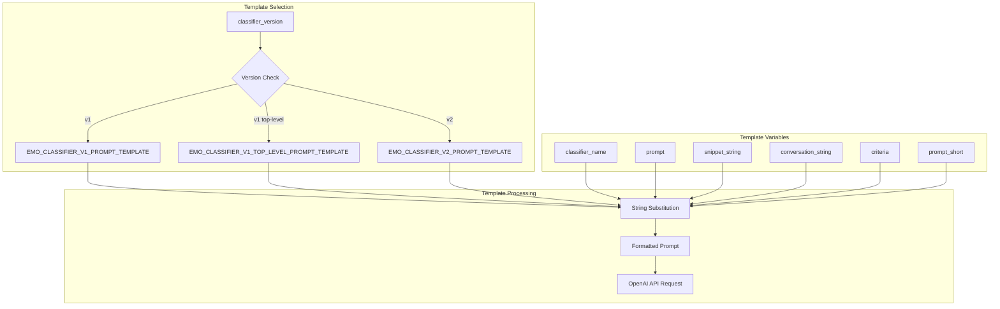
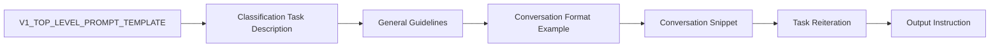
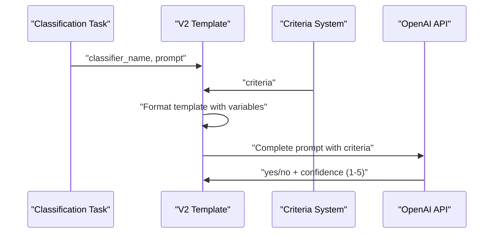
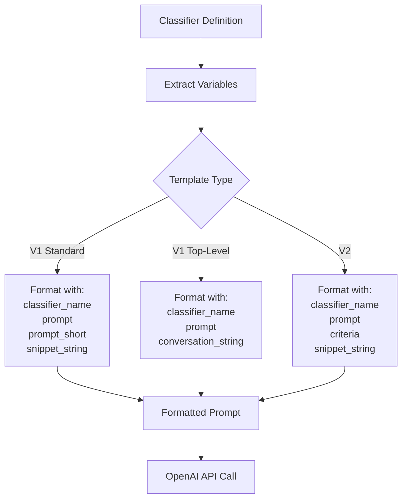
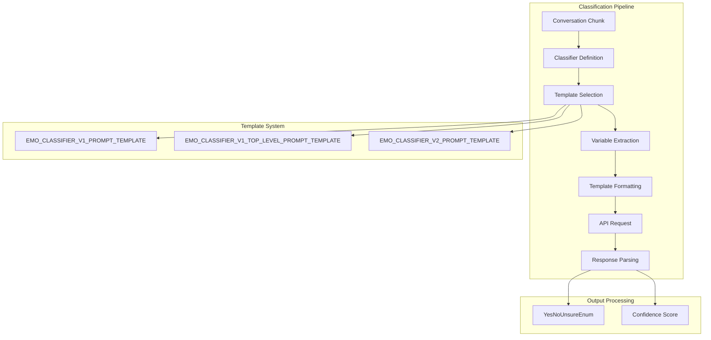

<!-- source: DeepWiki mcp.deepwiki.com · repo openai/emoclassifiers · page 3.3 Prompt Templates · fetched 2026-10-26 -->

# Prompt Templates

Relevant source files

The following files were used as context for generating this wiki page:

- [emoclassifiers/prompt_templates.py](emoclassifiers/prompt_templates.py)

This document covers the prompt engineering system used by the EmoClassifiers to generate structured prompts for the OpenAI API. The prompt templates define how conversation snippets and classifier definitions are formatted into classification requests that produce consistent yes/no/unsure responses.

For information about how these templates are used within the classification pipeline, see [Core Classification System](#3). For details on the different classifier versions that use these templates, see [Classifier Versions](#4).

## Template Overview

The system provides three distinct prompt templates, each optimized for different classification approaches and output requirements:

| Template | Purpose | Output Format | Used By |
|----------|---------|---------------|---------|
| `EMO_CLASSIFIER_V1_PROMPT_TEMPLATE` | Standard hierarchical classification | yes/no/unsure | V1 sub-classifiers |
| `EMO_CLASSIFIER_V1_TOP_LEVEL_PROMPT_TEMPLATE` | Top-level conversation analysis | yes/no/unsure | V1 top-level classifiers |
| `EMO_CLASSIFIER_V2_PROMPT_TEMPLATE` | Criteria-based behavioral classification | yes/no + confidence (1-5) | V2 behavioral indicators |

## Template Architecture

**Sources:** [emoclassifiers/prompt_templates.py:1-86]()

## V1 Standard Template

The `EMO_CLASSIFIER_V1_PROMPT_TEMPLATE` is designed for message-level classification in hierarchical systems. It focuses on analyzing the final message in a conversation snippet, using previous messages only for context.

### Key Features

- **Message-level focus**: Classifies only the message marked with `[*USER*]` or `[*ASSISTANT*]` tags
- **Context provision**: Includes previous messages for contextual understanding
- **Standardized guidelines**: Handles fictional content and image generation edge cases
- **Simple output**: Expects "yes", "no", or "unsure" responses

### Template Variables

| Variable | Purpose | Example |
|----------|---------|---------|
| `classifier_name` | Display name for the classification task | "IS_LONELINESS" |
| `prompt` | Full classification question | "Does this message indicate the user is experiencing loneliness?" |
| `prompt_short` | Abbreviated classification question | "IS_LONELINESS" |
| `snippet_string` | Formatted conversation snippet | "[USER]: I feel so alone\n[*USER*]: Nobody understands me" |

**Sources:** [emoclassifiers/prompt_templates.py:1-27]()

## V1 Top-Level Template

The `EMO_CLASSIFIER_V1_TOP_LEVEL_PROMPT_TEMPLATE` analyzes entire conversation snippets rather than individual messages. This template is used by top-level classifiers in the hierarchical V1 system.

### Differences from Standard V1 Template

- **Conversation-level analysis**: Evaluates the entire conversation snippet
- **No message highlighting**: Does not use `[*USER*]` or `[*ASSISTANT*]` markup
- **Holistic approach**: Considers the overall emotional tone and content
- **Uses `conversation_string` instead of `snippet_string`**

### Template Structure

**Sources:** [emoclassifiers/prompt_templates.py:30-53]()

## V2 Template

The `EMO_CLASSIFIER_V2_PROMPT_TEMPLATE` introduces criteria-based classification with confidence scoring. This template supports the more sophisticated behavioral indicator system used in V2.

### Enhanced Features

- **Criteria integration**: Includes specific classification criteria in the prompt
- **Confidence scoring**: Requests both yes/no classification and confidence level (1-5)
- **Behavioral focus**: Optimized for detecting specific behavioral patterns
- **Structured output**: Expects both classification and confidence in response

### Template Flow

### Unique Variables

| Variable | Purpose | Example |
|----------|---------|---------|
| `criteria` | Specific classification criteria | "Look for expressions of attachment, dependency, or emotional reliance on the assistant" |

**Sources:** [emoclassifiers/prompt_templates.py:56-85]()

## Template Variable Substitution

All templates use Python string formatting to substitute variables into the prompt structure. The substitution process follows this pattern:

**Sources:** [emoclassifiers/prompt_templates.py:1-86]()

## Common Guidelines

All templates include standardized guidelines that handle edge cases and ensure consistent classification behavior:

### Content Exclusions
- **Fictional content**: Stories and creative writing requests are excluded from emotional analysis
- **Image generation**: Image prompts are not considered in emotional classification
- **Insufficient content**: Very short messages may be classified as "no" due to lack of information

### Conversation Formatting
All templates expect conversations in a standardized format:
- `[USER]:` for user messages
- `[ASSISTANT]:` for chatbot responses  
- `[*USER*]` or `[*ASSISTANT*]` for the target message being classified (V1 and V2 only)

### Output Requirements
- **V1 Templates**: Must output one of "yes", "no", or "unsure"
- **V2 Template**: Must output classification (true/false) and confidence (1-5)

**Sources:** [emoclassifiers/prompt_templates.py:5-10, 34-38, 63-67]()

## Integration with Classification System

The prompt templates integrate with the broader classification system through a structured workflow:

**Sources:** [emoclassifiers/prompt_templates.py:1-86]()

---

