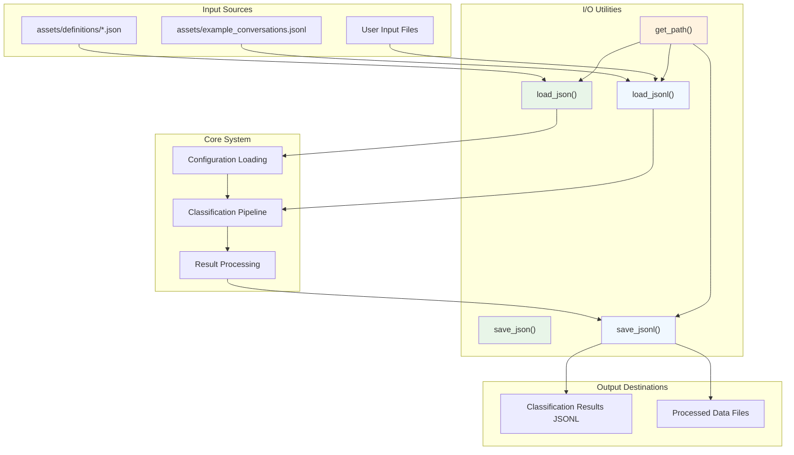
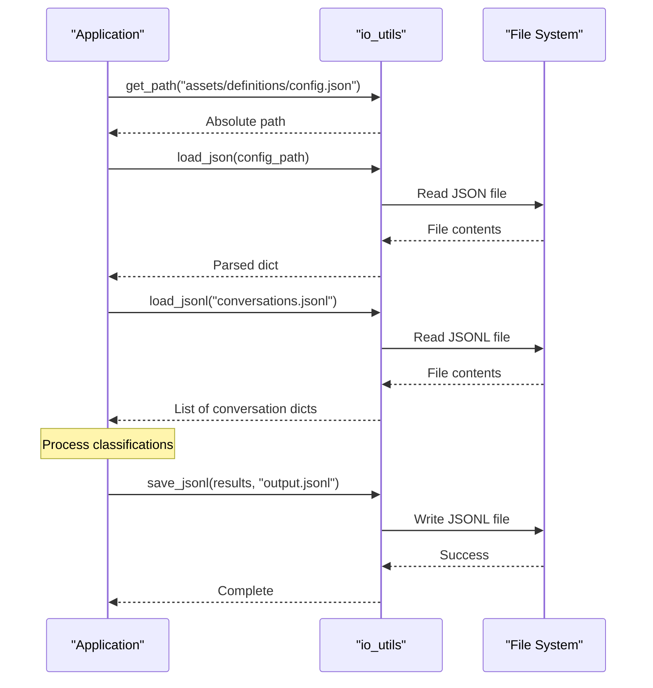

<!-- source: DeepWiki mcp.deepwiki.com · repo openai/emoclassifiers · page 3.4 I/O Utilities · fetched 2026-10-26 -->

# I/O Utilities

<details>
<summary>Relevant source files</summary>

The following files were used as context for generating this wiki page:

- [emoclassifiers/io_utils.py](emoclassifiers/io_utils.py)

</details>


The I/O utilities module provides fundamental file loading and saving operations for the EmoClassifiers system. This module handles all JSON and JSONL file operations used throughout the classification pipeline, including loading conversation data, saving classification results, and accessing configuration files.

For information about the broader classification system architecture, see [Core Classification System](#3). For details on configuration file formats, see [Configuration System](#5).

## Overview

The `io_utils` module serves as the central data access layer for the EmoClassifiers system. It provides standardized functions for reading and writing the two primary data formats used throughout the system: JSON for configuration files and JSONL (JSON Lines) for conversation data and results.

**Key Functions:**
- JSON file operations for configuration data
- JSONL file operations for conversation datasets
- Project-relative path resolution for asset files

## Core Functions

### JSON Operations

The module provides basic JSON file handling through `load_json()` and `save_json()` functions.

```python
# Load JSON configuration
def load_json(path: str) -> dict

# Save JSON data  
def save_json(data: dict, path: str)
```

These functions are used throughout the system to load classifier definitions, dependency configurations, and other structured configuration data from the `assets/definitions/` directory.

**Sources:** [emoclassifiers/io_utils.py:5-18]()

### JSONL Operations

JSONL (JSON Lines) format is used for conversation datasets and classification results, where each line contains a separate JSON object.

```python
# Load JSONL conversation data
def load_jsonl(path: str) -> list[dict]

# Save JSONL results
def save_jsonl(data: list[dict], path: str)
```

The `load_jsonl()` function reads each line as a separate JSON object and returns a list of dictionaries. The `save_jsonl()` function writes each dictionary as a separate line with proper JSON encoding.

**Sources:** [emoclassifiers/io_utils.py:21-35]()

### Path Resolution

The `get_path()` function provides project-relative path resolution for accessing asset files.

```python
def get_path(rel_path: str) -> str
```

This function resolves relative paths from the project root directory, enabling consistent access to configuration files and example data regardless of the current working directory.

**Sources:** [emoclassifiers/io_utils.py:38-43]()

## Data Flow Architecture

The following diagram shows how I/O utilities integrate with the broader classification system:



**Sources:** [emoclassifiers/io_utils.py:1-44]()

## Function Usage Patterns

The I/O utilities follow consistent patterns throughout the system:

| Function | Primary Use Cases | Return Type | Error Handling |
|----------|------------------|-------------|----------------|
| `load_json()` | Configuration files, classifier definitions | `dict` | File not found, invalid JSON |
| `save_json()` | Processed configurations, metadata | `None` | Write permissions, invalid data |
| `load_jsonl()` | Conversation datasets, batch results | `list[dict]` | File not found, malformed lines |
| `save_jsonl()` | Classification results, processed conversations | `None` | Write permissions, serialization errors |
| `get_path()` | Asset file resolution | `str` | Path construction |

### Typical Usage Flow



**Sources:** [emoclassifiers/io_utils.py:5-43]()

## File Format Specifications

### JSON Format
Standard JSON files used for configuration data with proper UTF-8 encoding. All configuration files in `assets/definitions/` follow this format.

### JSONL Format  
JSON Lines format where each line contains a complete, valid JSON object. Used for:
- Conversation datasets with `id`, `messages`, and metadata fields
- Classification results with conversation IDs and classifier outputs
- Batch processing inputs and outputs

**Sources:** [emoclassifiers/io_utils.py:21-35]()

## Integration Points

The I/O utilities integrate with several system components:

- **Classification Pipeline**: Loads input conversations and saves results
- **Configuration System**: Loads classifier definitions and dependency files  
- **Command Line Tools**: Handles file I/O for batch processing scripts
- **Example Scripts**: Provides data access for demonstration code

All file operations in the EmoClassifiers system route through these utilities to ensure consistent error handling and data formatting.

**Sources:** [emoclassifiers/io_utils.py:1-44]()

---

