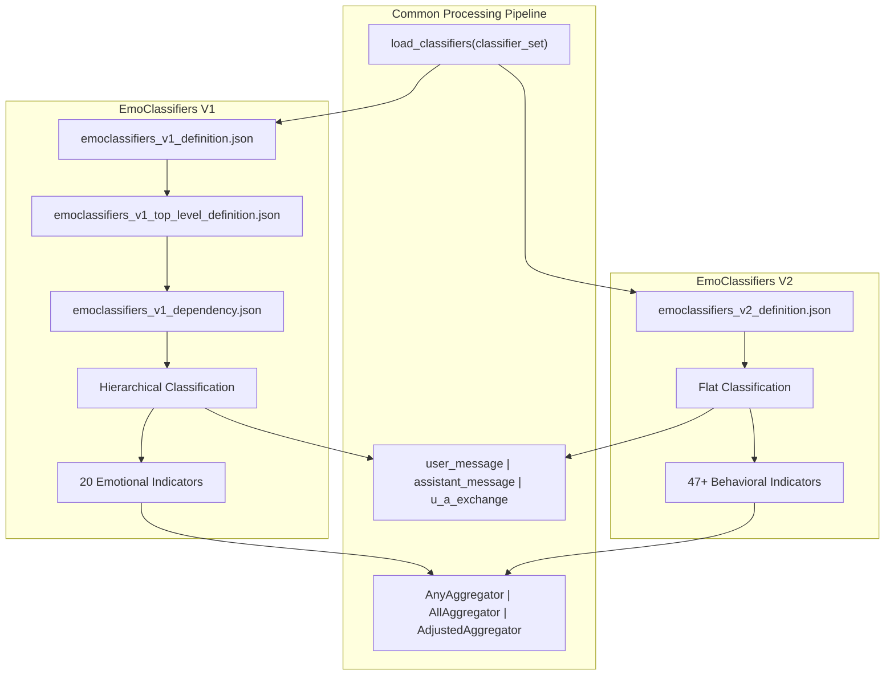
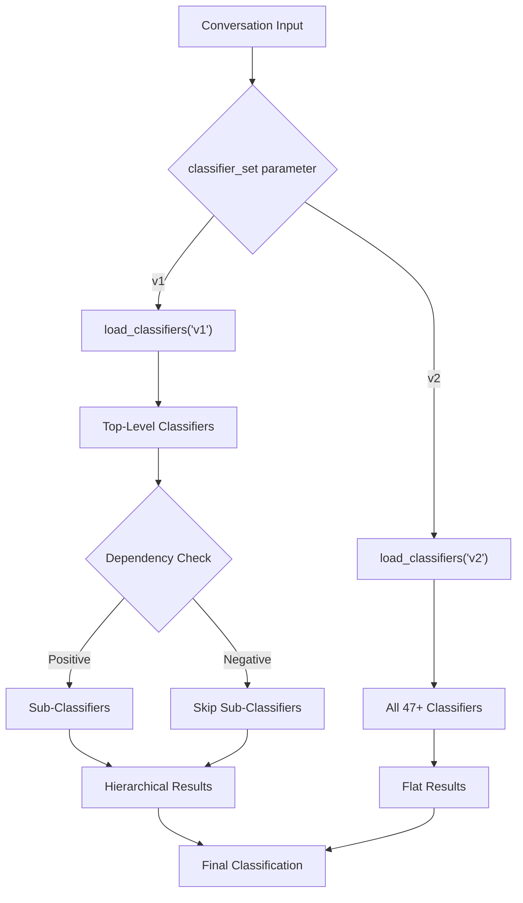
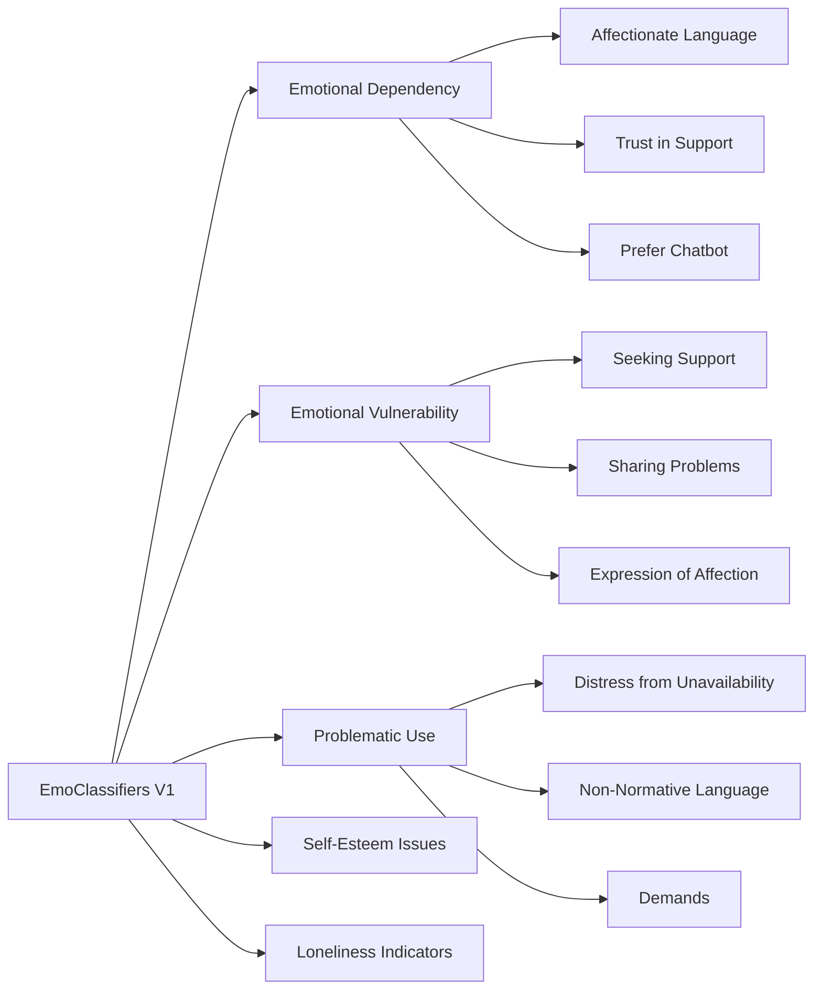
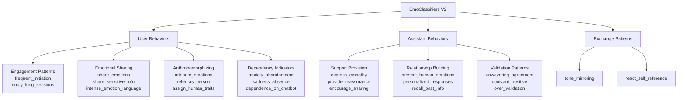
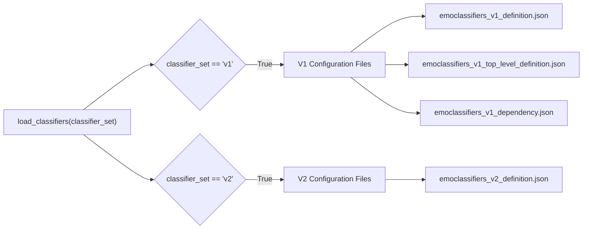

<!-- source: DeepWiki mcp.deepwiki.com · repo openai/emoclassifiers · page 4 Classifier Versions · fetched 2026-10-26 -->

# Classifier Versions

<details>
<summary>Relevant source files</summary>

The following files were used as context for generating this wiki page:

- [README.md](README.md)
- [assets/definitions/emoclassifiers_v1_definition.json](assets/definitions/emoclassifiers_v1_definition.json)
- [assets/definitions/emoclassifiers_v2_definition.json](assets/definitions/emoclassifiers_v2_definition.json)

</details>


This document provides a comparative overview of the two major versions of emotion classifiers in the EmoClassifiers system. It explains the architectural differences, design philosophies, and usage patterns between EmoClassifiers V1 and V2. For detailed implementation specifics of each version, see [EmoClassifiers V1 - Hierarchical System](#4.1) and [EmoClassifiers V2 - Behavioral Indicators](#4.2). For information about configuring these classifiers, see [Configuration System](#5).

## System Architecture Comparison

The EmoClassifiers system implements two distinct approaches to emotion classification, each designed for different analysis scenarios and research objectives.

### Version Architecture Overview



Sources: [assets/definitions/emoclassifiers_v1_definition.json:1-122](), [assets/definitions/emoclassifiers_v2_definition.json:1-538](), [README.md:33-34]()

### Classification Strategy Comparison



Sources: [README.md:100-102](), [README.md:79-97]()

## Key Differences

| Aspect | EmoClassifiers V1 | EmoClassifiers V2 |
|--------|------------------|------------------|
| **Classification Strategy** | Hierarchical with dependencies | Flat, all classifiers run |
| **Number of Classifiers** | 20 emotional indicators | 47+ behavioral indicators |
| **Prompt Structure** | Simple yes/no questions | Criteria-based with examples |
| **Focus Areas** | Emotional dependency detection | Comprehensive behavioral analysis |
| **Configuration Files** | 3 files (definition, dependency, top-level) | 1 file (definition only) |
| **Execution Efficiency** | Conditional execution based on dependencies | Full execution of all classifiers |
| **Research Application** | Targeted emotional vulnerability analysis | Broad behavioral pattern detection |

Sources: [assets/definitions/emoclassifiers_v1_definition.json:1-122](), [assets/definitions/emoclassifiers_v2_definition.json:1-538]()

## Classifier Categories and Scope

### V1 Emotional Indicators
EmoClassifiers V1 focuses on detecting emotional dependency and problematic usage patterns through 20 targeted classifiers:



Sources: [assets/definitions/emoclassifiers_v1_definition.json:2-121]()

### V2 Behavioral Indicators
EmoClassifiers V2 provides comprehensive behavioral analysis through 47+ granular classifiers:



Sources: [assets/definitions/emoclassifiers_v2_definition.json:2-537]()

## Loading and Configuration System

The classifier versions are loaded through the `load_classifiers()` function with the `classifier_set` parameter:

### Version Selection Code Pattern
```python
# Loading V1 classifiers
classifiers_v1 = load_classifiers(classifier_set="v1")

# Loading V2 classifiers  
classifiers_v2 = load_classifiers(classifier_set="v2")
```

### Configuration File Mapping



Sources: [README.md:33-34](), [README.md:118]()

## Chunking Strategy Consistency

Both versions utilize the same chunking strategies but apply them differently:

| Chunker Type | Description | V1 Usage | V2 Usage |
|-------------|-------------|----------|----------|
| `user_message` | Individual user messages | 11 classifiers | 26 classifiers |
| `assistant_message` | Individual assistant messages | 7 classifiers | 12 classifiers |
| `u_a_exchange` | User-assistant exchange pairs | 2 classifiers | 3 classifiers |

The chunking approach remains consistent across versions, enabling comparable analysis granularity while supporting different classification objectives.

Sources: [assets/definitions/emoclassifiers_v1_definition.json:5-42](), [assets/definitions/emoclassifiers_v2_definition.json:9-465]()

## Migration and Usage Considerations

### When to Use V1
- Research focused on emotional dependency detection
- Analysis of potentially problematic user-AI relationships  
- Scenarios requiring efficient processing through hierarchical filtering
- Studies examining specific emotional vulnerability indicators

### When to Use V2
- Comprehensive behavioral pattern analysis
- Research requiring granular interaction categorization
- Studies examining both user and assistant behaviors
- Analysis of conversation dynamics and tone patterns

Both versions can be executed using the same command-line tools with the `--classifier_set` parameter, making migration straightforward for existing analysis pipelines.

Sources: [README.md:82-97](), [README.md:105-110]()

---

