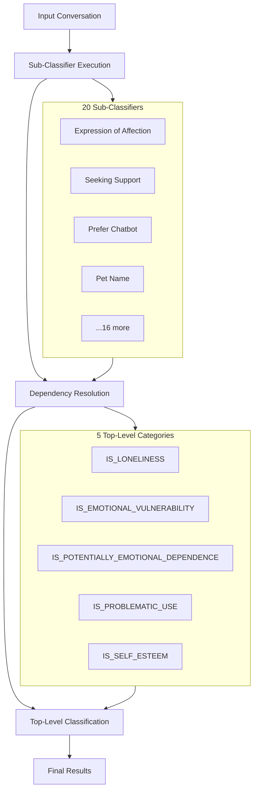
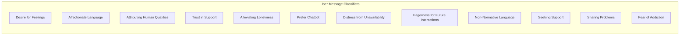
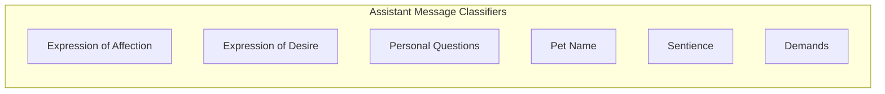
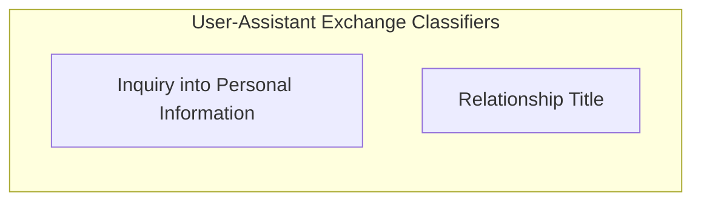
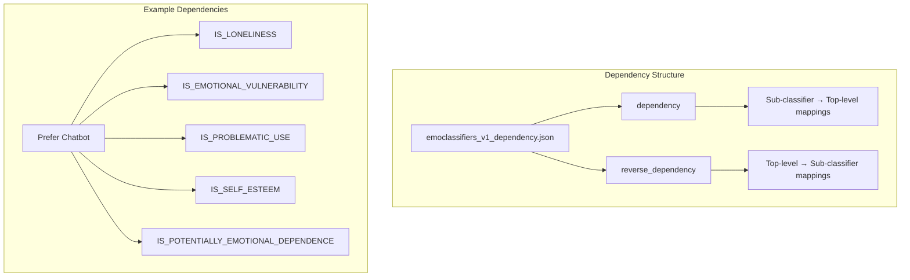
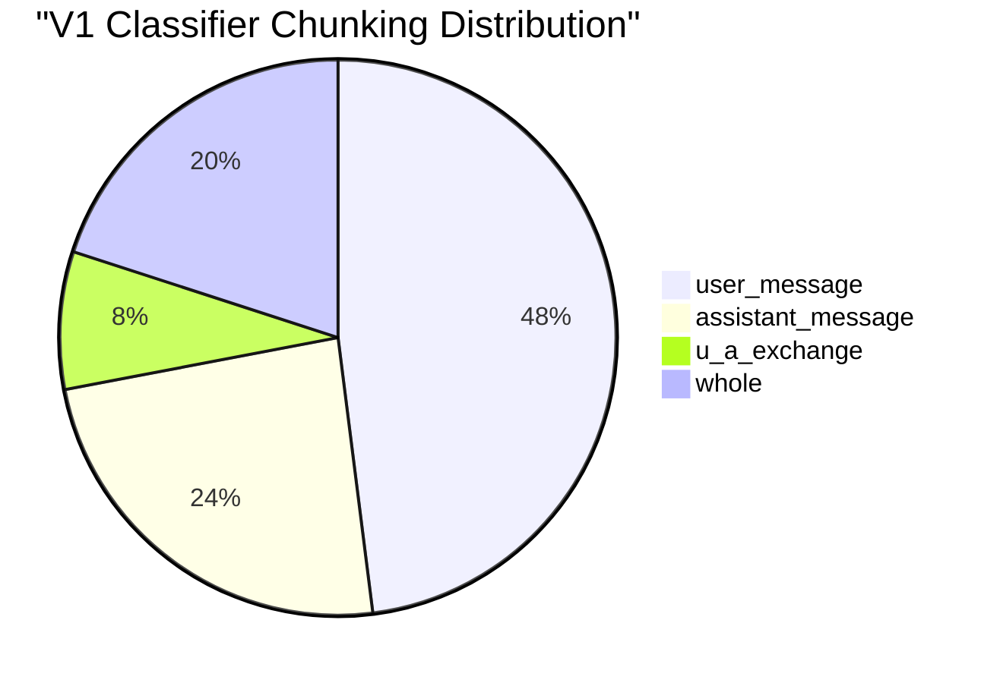
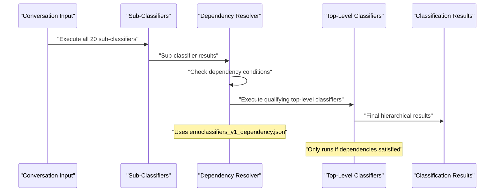

<!-- source: DeepWiki mcp.deepwiki.com · repo openai/emoclassifiers · page 4.1 EmoClassifiers V1 - Hierarchical System · fetched 2026-10-26 -->

# EmoClassifiers V1 - Hierarchical System

Relevant source files

The following files were used as context for generating this wiki page:

- [assets/definitions/emoclassifiers_v1_definition.json](assets/definitions/emoclassifiers_v1_definition.json)
- [assets/definitions/emoclassifiers_v1_dependency.json](assets/definitions/emoclassifiers_v1_dependency.json)
- [assets/definitions/emoclassifiers_v1_top_level_definition.json](assets/definitions/emoclassifiers_v1_top_level_definition.json)

## Purpose and Scope

This document describes the EmoClassifiers V1 hierarchical classification system, which uses a two-tier architecture to detect emotional indicators in user-chatbot conversations. The system consists of 20 sub-classifiers that feed into 5 top-level emotional categories through a dependency-based execution model.

For information about the V2 flat classification system with behavioral indicators, see [EmoClassifiers V2 - Behavioral Indicators](#4.2). For general configuration details, see [Configuration System](#5).

## System Architecture

The V1 hierarchical system operates through a dependency-driven classification pipeline where sub-classifiers execute first, and their results determine which top-level classifiers run.

### V1 Hierarchical Classification Flow

**Sources:** [assets/definitions/emoclassifiers_v1_definition.json:1-122](), [assets/definitions/emoclassifiers_v1_dependency.json:1-160](), [assets/definitions/emoclassifiers_v1_top_level_definition.json:1-32]()

## Top-Level Categories

The V1 system classifies conversations into five primary emotional states, each targeting specific aspects of problematic human-AI relationships.

| Category | Purpose | Chunking Strategy |
|----------|---------|-------------------|
| `IS_LONELINESS` | Detects users seeking socialization or companionship | `whole` |
| `IS_EMOTIONAL_VULNERABILITY` | Identifies emotionally vulnerable users | `whole` |
| `IS_POTENTIALLY_EMOTIONAL_DEPENDENCE` | Flags emotional dependency indicators | `whole` |
| `IS_PROBLEMATIC_USE` | Detects addiction or unhealthy usage patterns | `whole` |
| `IS_SELF_ESTEEM` | Identifies users with self-esteem issues | `whole` |

All top-level classifiers use the `whole` chunking strategy, analyzing entire conversations for comprehensive context.

**Sources:** [assets/definitions/emoclassifiers_v1_top_level_definition.json:1-32]()

## Sub-Classifier Categories

The 20 sub-classifiers are organized by their target analysis focus and chunking strategies:

### User Behavior Analysis (`user_message` chunking)

### Assistant Behavior Analysis (`assistant_message` chunking)

### Exchange Pattern Analysis (`u_a_exchange` chunking)

**Sources:** [assets/definitions/emoclassifiers_v1_definition.json:1-122]()

## Dependency System

The hierarchical structure is defined through dependency mappings that determine execution flow:

### V1 Dependency Mapping Structure

### Top-Level Category Dependencies

| Top-Level Category | Contributing Sub-Classifiers (Count) |
|-------------------|--------------------------------------|
| `IS_LONELINESS` | 14 sub-classifiers |
| `IS_EMOTIONAL_VULNERABILITY` | 13 sub-classifiers |
| `IS_POTENTIALLY_EMOTIONAL_DEPENDENCE` | 17 sub-classifiers |
| `IS_PROBLEMATIC_USE` | 4 sub-classifiers |
| `IS_SELF_ESTEEM` | 2 sub-classifiers |

**Sources:** [assets/definitions/emoclassifiers_v1_dependency.json:96-159]()

## Chunking Strategies

The V1 system employs four distinct chunking strategies to optimize analysis granularity:

| Strategy | Usage | Classifier Count | Purpose |
|----------|-------|------------------|---------|
| `user_message` | Individual user messages | 12 | Analyze user-specific behaviors |
| `assistant_message` | Individual assistant messages | 6 | Detect assistant behavior patterns |
| `u_a_exchange` | User-assistant message pairs | 2 | Examine interaction dynamics |
| `whole` | Complete conversations | 5 (top-level only) | Comprehensive conversation analysis |

### Chunking Strategy Distribution

**Sources:** [assets/definitions/emoclassifiers_v1_definition.json:5-122](), [assets/definitions/emoclassifiers_v1_top_level_definition.json:5-31]()

## Execution Model

The V1 hierarchical system follows a dependency-driven execution pattern:

### V1 Classification Pipeline

The system executes sub-classifiers first, then uses the `dependency` mapping in [assets/definitions/emoclassifiers_v1_dependency.json:2-95]() to determine which top-level classifiers should run based on positive sub-classifier results.

**Sources:** [assets/definitions/emoclassifiers_v1_dependency.json:1-95](), [assets/definitions/emoclassifiers_v1_top_level_definition.json:1-32]()

---

