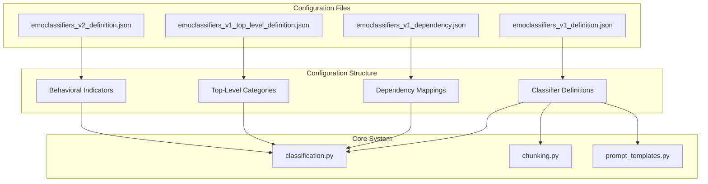
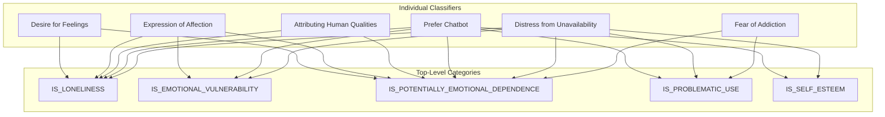
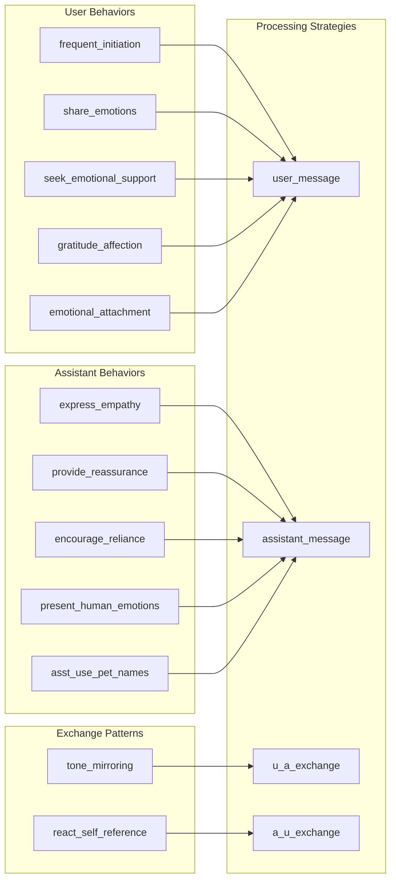
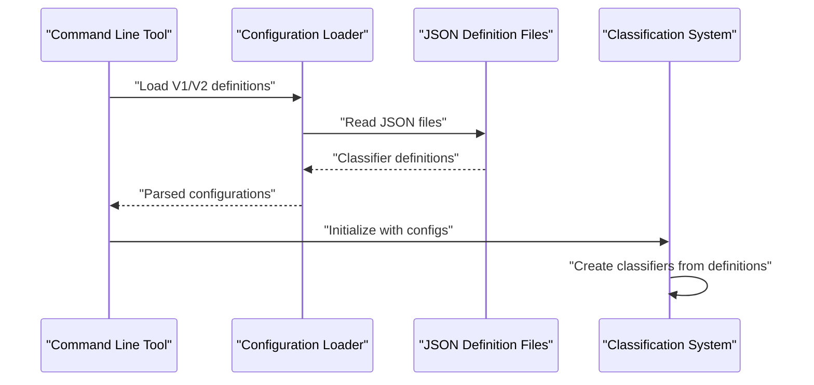

<!-- source: DeepWiki mcp.deepwiki.com · repo openai/emoclassifiers · page 5 Configuration System · fetched 2026-10-26 -->

# Configuration System

<details>
<summary>Relevant source files</summary>

The following files were used as context for generating this wiki page:

- [assets/definitions/emoclassifiers_v1_definition.json](assets/definitions/emoclassifiers_v1_definition.json)
- [assets/definitions/emoclassifiers_v1_dependency.json](assets/definitions/emoclassifiers_v1_dependency.json)
- [assets/definitions/emoclassifiers_v1_top_level_definition.json](assets/definitions/emoclassifiers_v1_top_level_definition.json)
- [assets/definitions/emoclassifiers_v2_definition.json](assets/definitions/emoclassifiers_v2_definition.json)

</details>


This document covers the JSON-based configuration system used to define emotion classifiers, their prompts, processing strategies, and hierarchical relationships. The configuration system enables data-driven definition of classifiers without requiring code changes.

For information about how these configurations are used during classification, see [Core Classification System](#3). For details about the two major classifier versions, see [Classifier Versions](#4).

## Overview

The EmoClassifiers system uses JSON configuration files to define classifier behavior, enabling flexible modification of classification logic without code changes. The configuration system supports two major versions with different architectural approaches.



Sources: [assets/definitions/emoclassifiers_v1_definition.json](), [assets/definitions/emoclassifiers_v1_dependency.json](), [assets/definitions/emoclassifiers_v1_top_level_definition.json](), [assets/definitions/emoclassifiers_v2_definition.json]()

## Configuration File Structure

Each configuration file follows a specific JSON schema that defines classifier properties, processing instructions, and relationships.

### Common Configuration Properties

| Property | Purpose | Example Values |
|----------|---------|----------------|
| `name` / `full_name` | Classifier identifier | `"Desire for Feelings"`, `"frequent_initiation"` |
| `prompt` | Classification instruction text | `"Does the user express..."` |
| `chunker` | Processing strategy | `"user_message"`, `"assistant_message"`, `"u_a_exchange"` |
| `version` | Configuration version | `"v1"`, `"v2"`, `"v1_top_level"` |

### V1-Specific Properties

| Property | Purpose | Example |
|----------|---------|---------|
| `dependency` | Maps classifiers to top-level categories | `"Desire for Feelings": ["IS_LONELINESS"]` |
| `reverse_dependency` | Maps categories to constituent classifiers | `"IS_LONELINESS": ["Desire for Feelings", ...]` |

### V2-Specific Properties

| Property | Purpose | Example |
|----------|---------|---------|
| `criteria` | Detailed classification examples | `["The user says they talk often: Example: ..."]` |
| `full_name` | Extended classifier description | `"Evidence of Frequent Initiation"` |

Sources: [assets/definitions/emoclassifiers_v1_definition.json:1-121](), [assets/definitions/emoclassifiers_v2_definition.json:1-538]()

## V1 Hierarchical Configuration System

The V1 system implements a two-tier hierarchical classification approach with individual classifiers feeding into top-level emotional categories.



### Dependency Structure

The dependency system in [assets/definitions/emoclassifiers_v1_dependency.json]() creates relationships between 20 individual classifiers and 5 top-level categories:

**Top-Level Categories:**
- `IS_LONELINESS` - Indicators of social isolation and companionship seeking
- `IS_EMOTIONAL_VULNERABILITY` - Signs of emotional fragility or openness
- `IS_POTENTIALLY_EMOTIONAL_DEPENDENCE` - Evidence of attachment to the assistant
- `IS_PROBLEMATIC_USE` - Patterns suggesting unhealthy usage
- `IS_SELF_ESTEEM` - Indicators of self-worth issues

### V1 Chunking Strategies

| Chunker | Usage | Example Classifiers |
|---------|-------|-------------------|
| `user_message` | Analyzes individual user messages | `"Affectionate Language"`, `"Alleviating Loneliness"` |
| `assistant_message` | Analyzes assistant responses | `"Expression of Affection"`, `"Pet Name"` |
| `u_a_exchange` | Analyzes user-assistant message pairs | `"Inquiry into Personal Information"`, `"Relationship Title"` |
| `whole` | Analyzes entire conversations | All top-level classifiers |

Sources: [assets/definitions/emoclassifiers_v1_definition.json:5-121](), [assets/definitions/emoclassifiers_v1_dependency.json:1-160](), [assets/definitions/emoclassifiers_v1_top_level_definition.json:1-32]()

## V2 Flat Configuration System

The V2 system implements a flat classification approach with 47+ behavioral indicators, each containing detailed criteria and examples.



### V2 Criteria-Based Classification

Each V2 classifier includes detailed `criteria` arrays with specific examples:

**Example Structure from `frequent_initiation`:**
```json
{
  "criteria": [
    "The user says they talk often: Example: 'I'm here to talk to you again, as usual.'",
    "The user explicitly states they've been chatting more frequently: Example: 'I've been talking to you a lot more recently.'"
  ]
}
```

### V2 Chunking Strategies

| Chunker | Purpose | Example Usage |
|---------|---------|---------------|
| `user_message` | Individual user message analysis | `"share_emotions"`, `"seek_emotional_support"` |
| `assistant_message` | Individual assistant message analysis | `"express_empathy"`, `"provide_reassurance"` |
| `u_a_exchange` | User message followed by assistant response | `"tone_mirroring"` |
| `a_u_exchange` | Assistant message followed by user response | `"react_self_reference"` |

Sources: [assets/definitions/emoclassifiers_v2_definition.json:1-538]()

## Configuration Loading and Usage

The configuration system enables runtime loading of classifier definitions without code modification.



### Configuration File Locations

All configuration files are stored in the `assets/definitions/` directory:

| File | Purpose | Classifiers |
|------|---------|-------------|
| `emoclassifiers_v1_definition.json` | V1 individual classifiers | 20 classifiers |
| `emoclassifiers_v1_top_level_definition.json` | V1 top-level categories | 5 categories |
| `emoclassifiers_v1_dependency.json` | V1 hierarchical relationships | Dependency mappings |
| `emoclassifiers_v2_definition.json` | V2 behavioral indicators | 47+ indicators |

### Version Selection

The system determines which configuration to load based on the `version` field in each classifier definition:

- `"v1"` - Individual V1 classifiers
- `"v1_top_level"` - V1 top-level categories  
- `"v2"` - V2 behavioral indicators

Sources: [assets/definitions/emoclassifiers_v1_definition.json:6](), [assets/definitions/emoclassifiers_v1_top_level_definition.json:6](), [assets/definitions/emoclassifiers_v2_definition.json:10]()

## Customizing Configurations

The JSON-based configuration system allows modification of classifier behavior without code changes.

### Adding New Classifiers

To add a new V2 classifier:

1. **Define the classifier structure:**
```json
{
  "new_classifier_name": {
    "full_name": "Descriptive Name",
    "prompt": "Classification question with context",
    "criteria": [
      "Specific example: Example: 'Sample text'",
      "Another example: Example: 'Another sample'"
    ],
    "chunker": "user_message|assistant_message|u_a_exchange|a_u_exchange",
    "version": "v2"
  }
}
```

2. **Add to appropriate definition file** in `assets/definitions/`

### Modifying Existing Classifiers

Common modifications include:

| Property | Modification Type | Impact |
|----------|------------------|---------|
| `prompt` | Instruction refinement | Changes classification behavior |
| `criteria` | Example updates | Improves classification accuracy |
| `chunker` | Processing strategy | Changes what text is analyzed |

### V1 Dependency Modifications

For V1 classifiers, modify both dependency directions in `emoclassifiers_v1_dependency.json`:

```json
{
  "dependency": {
    "New Classifier": ["IS_LONELINESS", "IS_EMOTIONAL_VULNERABILITY"]
  },
  "reverse_dependency": {
    "IS_LONELINESS": ["New Classifier", "existing_classifiers..."],
    "IS_EMOTIONAL_VULNERABILITY": ["New Classifier", "existing_classifiers..."]
  }
}
```

Sources: [assets/definitions/emoclassifiers_v1_dependency.json:1-160](), [assets/definitions/emoclassifiers_v2_definition.json:1-538]()

---

