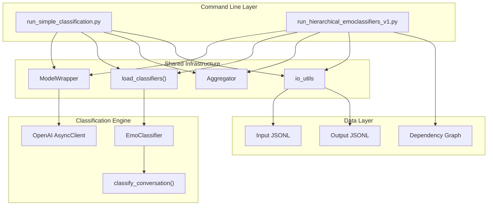
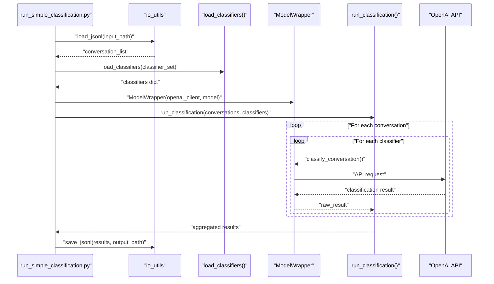
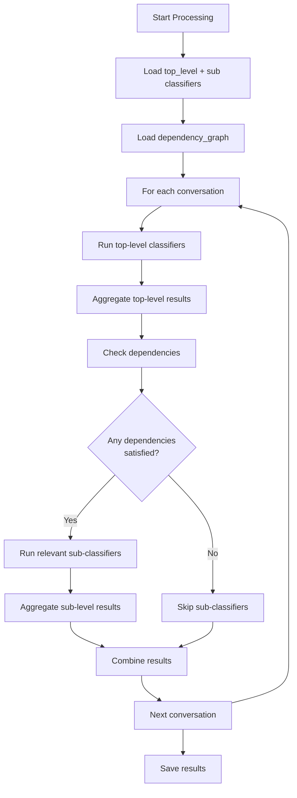

<!-- source: DeepWiki mcp.deepwiki.com · repo openai/emoclassifiers · page 6 Command Line Tools · fetched 2026-10-26 -->

# Command Line Tools

<details>
<summary>Relevant source files</summary>

The following files were used as context for generating this wiki page:

- [README.md](README.md)
- [examples/run_hierarchical_emoclassifiers_v1.py](examples/run_hierarchical_emoclassifiers_v1.py)
- [examples/run_simple_classification.py](examples/run_simple_classification.py)

</details>


This document covers the command-line interface tools provided for batch processing conversations through the EmoClassifiers system. These tools enable efficient classification of large datasets without requiring custom Python code integration.

The EmoClassifiers repository provides two primary command-line tools for different classification workflows. For information about the underlying classification system components, see [Core Classification System](#3). For details about configuring classifiers, see [Configuration System](#5).

## Overview

The command-line tools serve as entry points for batch processing conversations through the emotion classification pipeline. Both tools accept JSONL input files containing conversations and output classification results in JSONL format.

### Tool Comparison

| Tool | Purpose | Classifier Support | Processing Strategy |
|------|---------|-------------------|-------------------|
| `run_simple_classification.py` | Flat classification processing | V1, V2 | All classifiers run in parallel |
| `run_hierarchical_emoclassifiers_v1.py` | Dependency-aware processing | V1 only | Two-stage hierarchical execution |

The tools share common infrastructure but implement different execution strategies optimized for their respective classifier versions.

**Sources:** [examples/run_simple_classification.py:1-62](), [examples/run_hierarchical_emoclassifiers_v1.py:1-113](), [README.md:74-111]()

## Command Line Tool Architecture



**Sources:** [examples/run_simple_classification.py:41-50](), [examples/run_hierarchical_emoclassifiers_v1.py:83-99]()

## Simple Classification Tool

The `run_simple_classification.py` script provides straightforward batch processing for both V1 and V2 classifiers. It executes all selected classifiers against all conversations in parallel, making it suitable for comprehensive analysis workflows.

### Command Syntax

```bash
python examples/run_simple_classification.py \
    --input_path <path-to-input-conversations> \
    --output_path <path-to-output-results> \
    --classifier_set <v1|v2> \
    --aggregation_mode <any|all|adjusted>
```

### Parameters

| Parameter | Required | Default | Description |
|-----------|----------|---------|-------------|
| `--input_path` | Yes | - | Path to JSONL file containing conversations |
| `--output_path` | Yes | - | Path for output JSONL results file |
| `--classifier_set` | No | `v1` | Classifier version to use (`v1`, `v2`) |
| `--aggregation_mode` | No | `any` | Result aggregation strategy |

### Processing Workflow



The `run_classification()` function at [examples/run_simple_classification.py:10-31]() implements a fully parallel execution strategy, creating futures for every conversation-classifier combination simultaneously.

**Sources:** [examples/run_simple_classification.py:33-62](), [README.md:78-97]()

## Hierarchical Classification Tool

The `run_hierarchical_emoclassifiers_v1.py` script implements the dependency-aware processing strategy described in the research paper. It executes top-level classifiers first, then conditionally runs sub-classifiers based on dependency relationships.

### Command Syntax

```bash
python examples/run_hierarchical_emoclassifiers_v1.py \
    --input_path <path-to-input-conversations> \
    --output_path <path-to-output-results> \
    --aggregation_mode <any|all|adjusted>
```

### Parameters

| Parameter | Required | Default | Description |
|-----------|----------|---------|-------------|
| `--input_path` | Yes | - | Path to JSONL file containing conversations |
| `--output_path` | Yes | - | Path for output JSONL results file |
| `--aggregation_mode` | No | `any` | Result aggregation strategy |

### Dependency-Based Processing



The core logic in `run_classification_on_single_conversation()` at [examples/run_hierarchical_emoclassifiers_v1.py:10-49]() implements this two-stage approach:

1. **Top-level Classification**: All top-level classifiers run in parallel
2. **Dependency Check**: Results are aggregated using `AnyAggregator` 
3. **Conditional Sub-classification**: Sub-classifiers execute only if their dependencies are satisfied

### Dependency Graph Structure

The dependency relationships are loaded from `emoclassifiers_v1_dependency.json` and checked at [examples/run_hierarchical_emoclassifiers_v1.py:33-35]():

```python
depends_on = dependency_graph[sub_classifier_name]
if not any(top_level_results[dep] for dep in depends_on):
    continue
```

**Sources:** [examples/run_hierarchical_emoclassifiers_v1.py:76-113](), [README.md:99-111]()

## Shared Infrastructure

Both command-line tools utilize common infrastructure components for consistent behavior and performance optimization.

### ModelWrapper Configuration

Both tools instantiate `ModelWrapper` with identical settings at [examples/run_simple_classification.py:41-45]() and [examples/run_hierarchical_emoclassifiers_v1.py:83-87]():

```python
model_wrapper = classification.ModelWrapper(
    openai_client=openai.AsyncOpenAI(),
    model="gpt-4o-mini-2024-07-18",
    max_concurrent=20,
)
```

### Aggregation Strategy

The `aggregation_mode` parameter maps to aggregation classes through `AGGREGATOR_DICT` at [examples/run_simple_classification.py:50]() and [examples/run_hierarchical_emoclassifiers_v1.py:99]().

### I/O Operations

Both tools use `io_utils` functions for consistent file handling:
- `load_jsonl()` for input conversations
- `save_jsonl()` for output results  
- `load_json()` for configuration files (hierarchical tool only)

**Sources:** [examples/run_simple_classification.py:40-57](), [examples/run_hierarchical_emoclassifiers_v1.py:82-108]()

## Usage Examples

### Basic V2 Classification

```bash
python examples/run_simple_classification.py \
    --input_path ./assets/example_conversations.jsonl \
    --output_path ./v2_results.jsonl \
    --classifier_set v2
```

### V1 Sub-classifiers Only

```bash
python examples/run_simple_classification.py \
    --input_path ./data/conversations.jsonl \
    --output_path ./v1_sub_results.jsonl \
    --classifier_set v1 \
    --aggregation_mode all
```

### Hierarchical V1 Processing

```bash
python examples/run_hierarchical_emoclassifiers_v1.py \
    --input_path ./data/conversations.jsonl \
    --output_path ./hierarchical_results.jsonl \
    --aggregation_mode adjusted
```

**Sources:** [README.md:90-110]()

---

