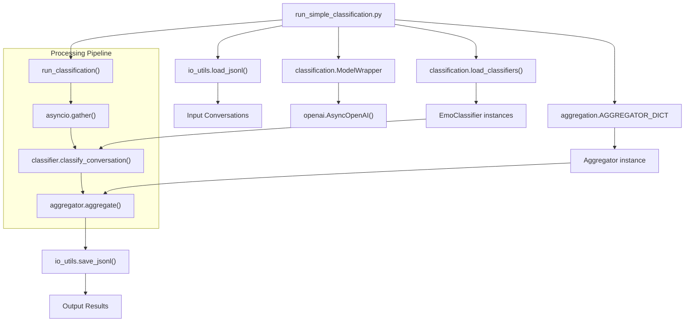
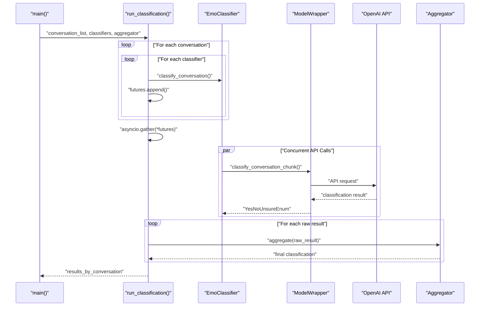
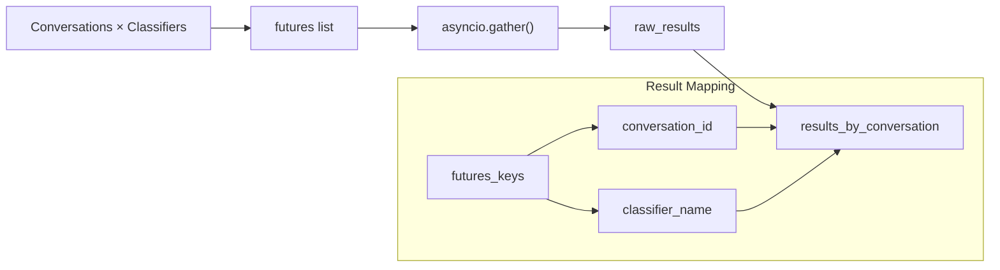

<!-- source: DeepWiki mcp.deepwiki.com · repo openai/emoclassifiers · page 6.1 Simple Classification Tool · fetched 2026-10-26 -->

# Simple Classification Tool

<details>
<summary>Relevant source files</summary>

The following files were used as context for generating this wiki page:

- [examples/run_simple_classification.py](examples/run_simple_classification.py)

</details>


## Purpose and Scope

The Simple Classification Tool provides a command-line interface for running batch emotion classification on conversation datasets using either V1 or V2 classifier systems. This tool handles straightforward parallel processing of multiple conversations against multiple classifiers, with configurable aggregation strategies.

For information about the hierarchical V1-specific classification workflow, see [Hierarchical Classification Tool](#6.2). For details about the underlying classification system components, see [Core Classification System](#3).

## Overview

The Simple Classification Tool (`run_simple_classification.py`) orchestrates the entire classification pipeline from input to output. It loads conversation data, initializes classifiers with an OpenAI model wrapper, processes all conversations asynchronously, and saves aggregated results.

### Key Features

| Feature | Description |
|---------|-------------|
| **Batch Processing** | Processes multiple conversations simultaneously using async/await |
| **Classifier Flexibility** | Supports both V1 and V2 classifier sets |
| **Configurable Aggregation** | Multiple aggregation strategies for combining chunk-level results |
| **Rate Limiting** | Built-in concurrency control for OpenAI API calls |
| **JSONL I/O** | Standard JSONL format for input and output data |

**Sources**: [examples/run_simple_classification.py:1-62]()

## Command Line Interface

### Basic Usage

```bash
python examples/run_simple_classification.py \
    --input_path conversations.jsonl \
    --output_path results.jsonl \
    --classifier_set v2 \
    --aggregation_mode any
```

### Arguments

| Argument | Type | Required | Default | Description |
|----------|------|----------|---------|-------------|
| `--input_path` | string | Yes | - | Path to input JSONL file containing conversations |
| `--output_path` | string | Yes | - | Path where results will be saved as JSONL |
| `--classifier_set` | string | No | `"v1"` | Classifier version: `"v1"` or `"v2"` |
| `--aggregation_mode` | string | No | `"any"` | Aggregation strategy from `aggregation.AGGREGATOR_DICT` |

**Sources**: [examples/run_simple_classification.py:34-39]()

## System Architecture

### Tool Integration



**Sources**: [examples/run_simple_classification.py:5-7](), [examples/run_simple_classification.py:40-56]()

### Async Processing Workflow



**Sources**: [examples/run_simple_classification.py:10-30]()

## Core Processing Logic

### Main Execution Flow

The `main()` function orchestrates the entire classification process:

1. **Argument parsing**: Extracts command-line parameters using `argparse.ArgumentParser`
2. **Data loading**: Loads conversations from JSONL using `io_utils.load_jsonl()`
3. **Model initialization**: Creates `ModelWrapper` with OpenAI client and rate limiting
4. **Classifier loading**: Loads appropriate classifier set using `classification.load_classifiers()`
5. **Processing**: Runs async classification pipeline
6. **Output**: Saves results using `io_utils.save_jsonl()`

**Sources**: [examples/run_simple_classification.py:33-57]()

### ModelWrapper Configuration

The tool initializes the `ModelWrapper` with specific parameters optimized for batch processing:

```python
model_wrapper = classification.ModelWrapper(
    openai_client=openai.AsyncOpenAI(),
    model="gpt-4o-mini-2024-07-18",
    max_concurrent=20,
)
```

- Uses `gpt-4o-mini-2024-07-18` as the default model
- Sets concurrency limit to 20 for rate limiting
- Employs `AsyncOpenAI` client for async operations

**Sources**: [examples/run_simple_classification.py:41-45]()

### Async Result Collection

The `run_classification()` function implements a scatter-gather pattern:



Each future is tagged with metadata (`conversation_id`, `classifier_name`) to enable proper result mapping after async completion.

**Sources**: [examples/run_simple_classification.py:15-30]()

## Data Flow

### Input Format

The tool expects JSONL input where each line contains a conversation object. The exact format depends on the conversation structure expected by the chunking system (see [Conversation Chunking](#3.1)).

### Output Format

Results are saved as JSONL where each line represents one conversation's classification results:

```json
{
  "classifier_name_1": "YES",
  "classifier_name_2": "NO", 
  "classifier_name_3": "UNSURE"
}
```

The output structure contains one key per classifier, with values being the aggregated classification results.

**Sources**: [examples/run_simple_classification.py:26-29]()

## Integration Points

### Classification System Integration

The tool integrates with core classification components:

- **`classification.load_classifiers()`**: Loads classifier definitions based on version
- **`classification.EmoClassifier`**: Individual classifier instances for processing
- **`classification.ModelWrapper`**: Handles OpenAI API interactions with rate limiting

### Aggregation System Integration

Results are processed through the aggregation system:

- **`aggregation.AGGREGATOR_DICT`**: Maps aggregation mode strings to `Aggregator` instances
- **`aggregator.aggregate()`**: Converts chunk-level results to conversation-level classifications

### I/O System Integration

File operations use the shared I/O utilities:

- **`io_utils.load_jsonl()`**: Loads input conversation data
- **`io_utils.save_jsonl()`**: Saves final classification results

**Sources**: [examples/run_simple_classification.py:40](), [examples/run_simple_classification.py:46-50](), [examples/run_simple_classification.py:56]()

---

