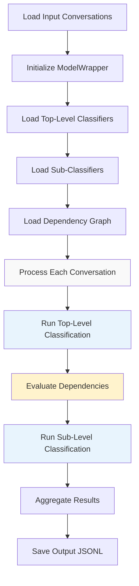
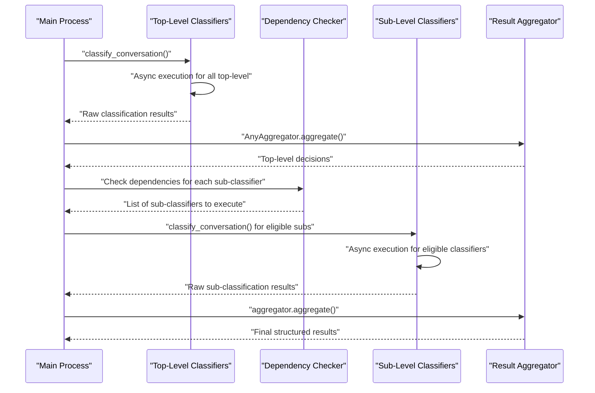
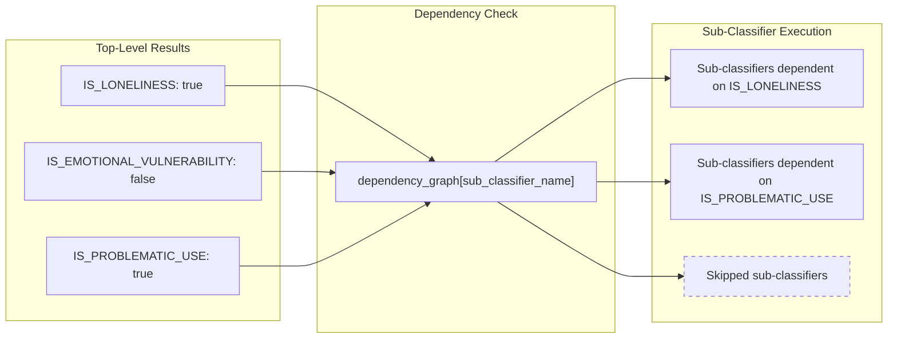

<!-- source: DeepWiki mcp.deepwiki.com · repo openai/emoclassifiers · page 6.2 Hierarchical Classification Tool · fetched 2026-10-26 -->

# Hierarchical Classification Tool

<details>
<summary>Relevant source files</summary>

The following files were used as context for generating this wiki page:

- [examples/run_hierarchical_emoclassifiers_v1.py](examples/run_hierarchical_emoclassifiers_v1.py)

</details>


## Purpose and Scope

The Hierarchical Classification Tool (`run_hierarchical_emoclassifiers_v1.py`) implements the EmoClassifiers V1 dependency-based classification system for batch processing conversations. This tool leverages the hierarchical structure where top-level classifiers determine which sub-classifiers should be executed, providing efficient processing of the V1 classifier set.

For straightforward batch processing without dependency logic, see [Simple Classification Tool](#6.1). For details about the V1 hierarchical classifier definitions, see [EmoClassifiers V1 - Hierarchical System](#4.1).

## Tool Overview

The hierarchical classification tool implements a two-stage processing pipeline where top-level classifiers act as gates for more specific sub-classifiers. This approach reduces computational costs by only running detailed classifications when broader emotional indicators are detected.

**Key Features:**
- Dependency-based classifier execution
- Asynchronous processing for improved performance
- Configurable aggregation strategies
- Structured output with both top-level and sub-level results

## Command Usage

### Basic Invocation

```bash
python examples/run_hierarchical_emoclassifiers_v1.py \
    --input_path path/to/conversations.jsonl \
    --output_path path/to/results.jsonl \
    --aggregation_mode any
```

### Command Line Parameters

| Parameter | Required | Default | Description |
|-----------|----------|---------|-------------|
| `--input_path` | Yes | - | Path to input conversations in JSONL format |
| `--output_path` | Yes | - | Path where classification results will be saved |
| `--aggregation_mode` | No | `any` | Aggregation strategy for sub-classifier results |

Sources: [examples/run_hierarchical_emoclassifiers_v1.py:76-81]()

## Processing Workflow

### High-Level Processing Flow



Sources: [examples/run_hierarchical_emoclassifiers_v1.py:76-108]()

### Single Conversation Processing

The `run_classification_on_single_conversation` function implements the core hierarchical logic:



Sources: [examples/run_hierarchical_emoclassifiers_v1.py:10-48]()

## Dependency-Based Execution

### Dependency Logic Implementation

The tool uses a dependency graph to determine which sub-classifiers should run based on top-level results:



The dependency evaluation logic at [examples/run_hierarchical_emoclassifiers_v1.py:33-35]() ensures that sub-classifiers only execute when at least one of their dependency conditions is met:

```python
if not any(top_level_results[dep] for dep in depends_on):
    continue  # Skip this sub-classifier
```

Sources: [examples/run_hierarchical_emoclassifiers_v1.py:32-39]()

## Configuration Components

### Classifier Loading

The tool loads two distinct classifier sets:

| Classifier Set | Variable | Purpose |
|----------------|----------|---------|
| `v1_top_level` | `top_level_classifiers` | Initial screening classifiers |
| `v1` | `sub_classifiers` | Detailed analysis classifiers |

### Dependency Graph

The dependency relationships are loaded from `emoclassifiers_v1_dependency.json` and define which top-level classifier results trigger specific sub-classifiers.

Sources: [examples/run_hierarchical_emoclassifiers_v1.py:88-98]()

## Output Format

### Result Structure

The tool produces structured output with separate top-level and sub-level classification results:

```json
{
  "top_level": {
    "IS_LONELINESS": true,
    "IS_EMOTIONAL_VULNERABILITY": false,
    "IS_POTENTIALLY_EMOTIONAL_DEPENDENCE": true,
    "IS_PROBLEMATIC_USE": false,
    "IS_SELF_ESTEEM": true
  },
  "sub_level": {
    "classifier_name_1": true,
    "classifier_name_2": false
  }
}
```

### Aggregation Strategies

- **Top-level classifiers**: Always use `AnyAggregator` for consistent gating behavior
- **Sub-level classifiers**: Use configurable aggregation strategy specified by `--aggregation_mode`

Sources: [examples/run_hierarchical_emoclassifiers_v1.py:25-27, 42-43]()

## Performance Characteristics

### Asynchronous Processing

The tool implements concurrent processing at multiple levels:

1. **Conversation-level parallelism**: Multiple conversations processed concurrently
2. **Classifier-level parallelism**: Top-level and eligible sub-classifiers run concurrently within each conversation
3. **Rate limiting**: Controlled by `ModelWrapper` with `max_concurrent=20`

### Efficiency Benefits

The hierarchical approach provides computational efficiency by:
- Reducing unnecessary API calls through dependency gating
- Processing only relevant sub-classifiers based on top-level results
- Maintaining async execution for maximum throughput

Sources: [examples/run_hierarchical_emoclassifiers_v1.py:51-73, 83-87]()

## Model Configuration

The tool uses a fixed model configuration optimized for the V1 classifier set:

- **Model**: `gpt-4o-mini-2024-07-18`
- **Concurrency**: 20 concurrent requests maximum
- **Client**: OpenAI AsyncClient for async operations

Sources: [examples/run_hierarchical_emoclassifiers_v1.py:83-87]()

---

