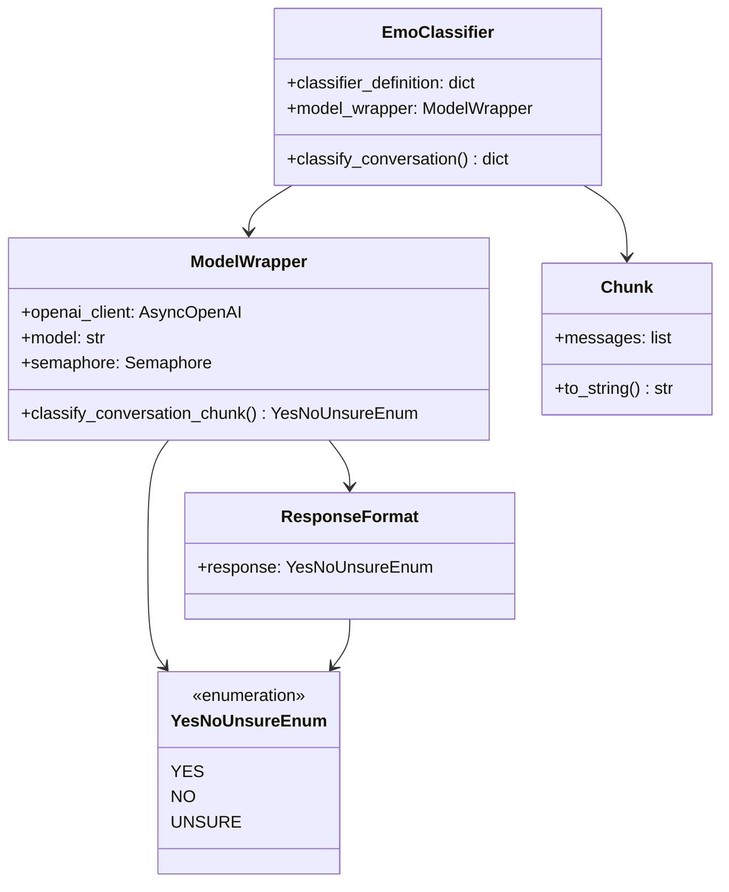
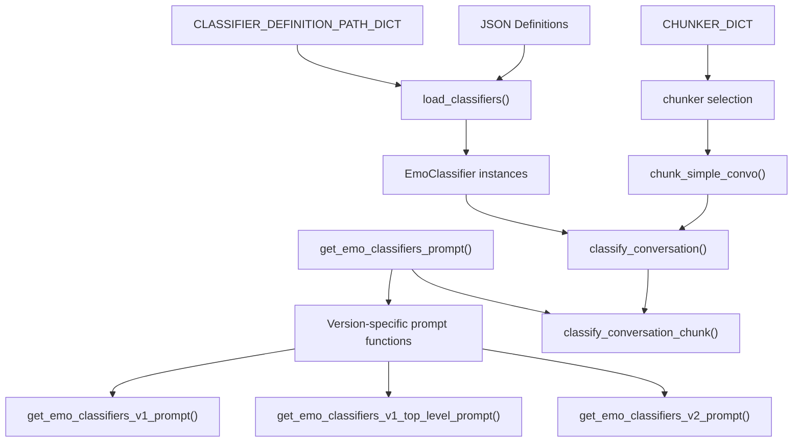
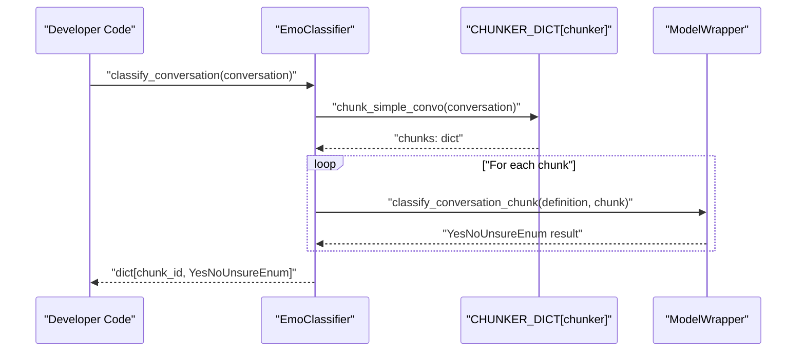

<!-- source: DeepWiki mcp.deepwiki.com · repo openai/emoclassifiers · page 7 Development Guide · fetched 2026-10-26 -->

# Development Guide

<details>
<summary>Relevant source files</summary>

The following files were used as context for generating this wiki page:

- [.gitignore](.gitignore)
- [LICENSE](LICENSE)
- [emoclassifiers/classification.py](emoclassifiers/classification.py)
- [requirements.txt](requirements.txt)

</details>


This document provides technical guidance for developers who want to contribute to, extend, or customize the EmoClassifiers system. It covers the codebase architecture, extension points, development workflows, and best practices for adding new classifiers or modifying existing functionality.

For basic usage instructions, see [Getting Started](#2). For detailed information about classifier configuration, see [Configuration System](#5).

## System Architecture for Developers

The EmoClassifiers system follows a modular, async-first architecture designed for extensibility and scalability. Understanding the core components and their relationships is essential for effective development.

### Core Class Hierarchy



Sources: [emoclassifiers/classification.py:106-201]()

### Extension Points and Factory Pattern

The system uses several factory patterns and configuration-driven approaches that serve as primary extension points:



Sources: [emoclassifiers/classification.py:10-14](), [emoclassifiers/classification.py:89-104](), [emoclassifiers/classification.py:179-200]()

## Core Components and Development Interfaces

### ModelWrapper: API Integration Layer

The `ModelWrapper` class provides the primary interface to OpenAI's API with built-in concurrency control:

| Component | Purpose | Configuration |
|-----------|---------|---------------|
| `openai_client` | Async OpenAI client instance | Defaults to `AsyncOpenAI()` |
| `semaphore` | Rate limiting mechanism | Default: 5 concurrent requests |
| `model` | OpenAI model specification | Default: `"gpt-4o-mini-2024-07-18"` |

**Development Interface**: [emoclassifiers/classification.py:106-121]()

**Key Method**: `classify_conversation_chunk()` returns `YesNoUnsureEnum` values and handles structured completion parsing.

### EmoClassifier: Classification Orchestration

The `EmoClassifier` class coordinates conversation processing through chunking, classification, and result aggregation:



Sources: [emoclassifiers/classification.py:145-177]()

### Prompt Generation System

The prompt generation system uses a dispatch pattern based on classifier version:

| Version | Function | Template Source |
|---------|----------|-----------------|
| `v1` | `get_emo_classifiers_v1_prompt()` | `EMO_CLASSIFIER_V1_PROMPT_TEMPLATE` |
| `v1_top_level` | `get_emo_classifiers_v1_top_level_prompt()` | `EMO_CLASSIFIER_V1_TOP_LEVEL_PROMPT_TEMPLATE` |
| `v2` | `get_emo_classifiers_v2_prompt()` | `EMO_CLASSIFIER_V2_PROMPT_TEMPLATE` |

**Extension Point**: Add new versions by implementing corresponding prompt functions and updating the dispatch logic in `get_emo_classifiers_prompt()`.

Sources: [emoclassifiers/classification.py:42-86](), [emoclassifiers/classification.py:89-104]()

## Development Workflows

### Adding New Classifier Versions

To add a new classifier version (e.g., `v3`):

1. **Define Prompt Template**: Add new template to `prompt_templates.py`
2. **Implement Prompt Function**: Create `get_emo_classifiers_v3_prompt()` following the existing pattern
3. **Update Dispatch Logic**: Modify `get_emo_classifiers_prompt()` to handle `v3`
4. **Add Configuration Path**: Update `CLASSIFIER_DEFINITION_PATH_DICT`
5. **Create Definition Files**: Add JSON configuration files in `assets/definitions/`

### Extending Chunking Strategies

The chunking system uses the `CHUNKER_DICT` registry pattern. To add new chunking strategies:

1. Implement chunker class following the `Chunker` interface
2. Register in `CHUNKER_DICT` 
3. Reference chunker name in classifier definitions

Sources: [emoclassifiers/chunking.py:6]()

### Custom Aggregation Methods

The aggregation system processes raw chunk-level classifications into conversation-level results. Extension points exist in the aggregation module for implementing new aggregation strategies.

## Configuration-Driven Development

### Classifier Definition Structure

The system supports runtime configuration through JSON definition files. Each classifier definition must include:

```json
{
  "classifier_name": {
    "version": "v1|v1_top_level|v2",
    "name": "Display Name",
    "prompt": "Classification prompt text",
    "chunker": "chunker_strategy_name",
    // Version-specific fields
  }
}
```

### Factory Function Usage

The `load_classifiers()` function provides the primary factory interface:

| Parameter | Type | Default | Purpose |
|-----------|------|---------|---------|
| `classifier_set` | `str` | `"v2"` | Key from `CLASSIFIER_DEFINITION_PATH_DICT` |
| `model_wrapper` | `ModelWrapper \| None` | `None` | Custom ModelWrapper instance |
| `custom_path` | `str \| None` | `None` | Custom definition file path |

Sources: [emoclassifiers/classification.py:179-200]()

## Testing and Validation Approaches

### Unit Testing Strategy

Focus testing on these key interfaces:

1. **Prompt Generation**: Test all prompt functions with sample chunk data
2. **ModelWrapper**: Mock OpenAI API calls to test error handling and rate limiting
3. **EmoClassifier**: Test conversation processing pipeline with known inputs
4. **Configuration Loading**: Validate JSON schema and factory function behavior

### Integration Testing

Test complete classification workflows using the example conversations provided in [assets/example_conversations.jsonl]().

### Validation Framework

The system uses Pydantic's `ResponseFormat` for structured completion validation, ensuring type safety in API responses.

Sources: [emoclassifiers/classification.py:26-31]()

## Contributing Guidelines

### Code Style and Patterns

1. **Async/Await**: All I/O operations use async patterns
2. **Type Hints**: Include type annotations for all public interfaces  
3. **Error Handling**: Use assertion statements for development-time validation
4. **Configuration**: Prefer JSON-driven configuration over hard-coded values

### License and Contributions

The project is licensed under MIT License. All contributions must be compatible with this license.

Sources: [LICENSE:1-22]()

### Development Environment

Install dependencies using:
```bash
pip install -r requirements.txt
```

The minimal dependency set includes only `openai>=1.51.0`, keeping the system lightweight and focused.

Sources: [requirements.txt:1]()