# Page: Overview

# Overview

<details>
<summary>Relevant source files</summary>

The following files were used as context for generating this wiki page:

- [LICENSE](LICENSE)
- [README.md](README.md)
- [requirements.txt](requirements.txt)

</details>


## Purpose and Scope

The EmoClassifiers repository provides LLM-based automatic classifiers for detecting affective cues in user-chatbot conversations. This system enables researchers and practitioners to analyze conversations at scale to identify patterns of emotional dependency, vulnerability, and problematic usage behaviors in human-AI interactions.

This overview covers the high-level system architecture, core components, and classification approaches. For detailed installation and usage instructions, see [Getting Started](#2). For information about specific classifier versions and their capabilities, see [Classifier Versions](#4).

Sources: [README.md:1-5]()

## System Architecture

The EmoClassifiers system follows a modular pipeline architecture that processes conversations through chunking, classification, and aggregation stages:

**System Architecture Overview**
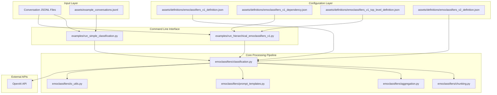

Sources: [README.md:112-119](), [emoclassifiers/classification.py](), [examples/run_simple_classification.py](), [examples/run_hierarchical_emoclassifiers_v1.py]()

## Data Flow Pipeline

The system processes conversations through a structured pipeline that transforms raw conversation data into classified emotional indicators:

**Classification Data Flow**
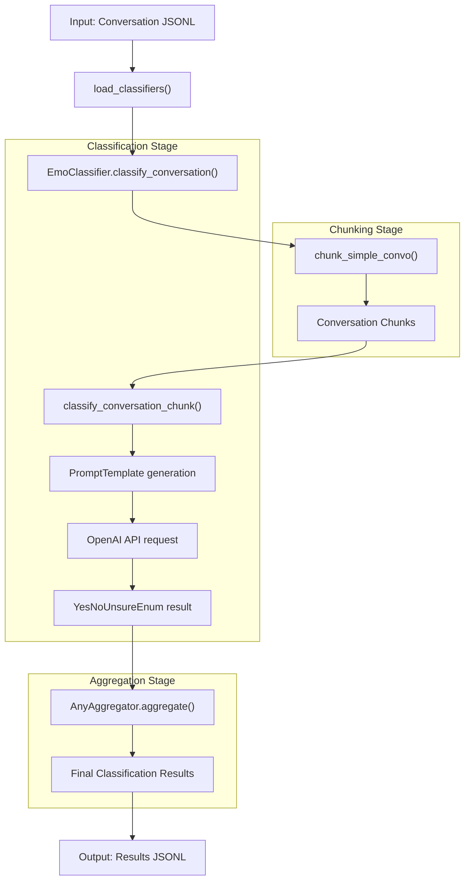

Sources: [emoclassifiers/classification.py](), [emoclassifiers/chunking.py](), [emoclassifiers/aggregation.py](), [README.md:26-50]()

## Core Components

The system consists of five primary modules that handle different aspects of the classification pipeline:

| Component | File Path | Primary Classes/Functions | Purpose |
|-----------|-----------|---------------------------|---------|
| **Classification Engine** | `emoclassifiers/classification.py` | `EmoClassifier`, `load_classifiers()` | Core classifier logic and loading |
| **Conversation Processing** | `emoclassifiers/chunking.py` | `chunk_simple_convo()` | Breaking conversations into analyzable segments |
| **Result Aggregation** | `emoclassifiers/aggregation.py` | `AnyAggregator`, `AllAggregator`, `AdjustedAggregator` | Combining chunk-level results into conversation-level classifications |
| **Prompt Engineering** | `emoclassifiers/prompt_templates.py` | Template classes for V1 and V2 | Generating LLM prompts for different classifier types |
| **Data I/O** | `emoclassifiers/io_utils.py` | JSON/JSONL utilities | Loading and saving conversation data |

The `EmoClassifier` class in [emoclassifiers/classification.py]() serves as the central orchestrator, coordinating between chunking strategies, prompt generation, API calls, and result aggregation.

Sources: [README.md:114-118](), [emoclassifiers/classification.py](), [emoclassifiers/chunking.py](), [emoclassifiers/aggregation.py](), [emoclassifiers/prompt_templates.py](), [emoclassifiers/io_utils.py]()

## Classification System Versions

The repository implements two distinct approaches to emotion classification, each optimized for different analysis scenarios:

**EmoClassifiers V1 (Hierarchical System)**
- **Architecture**: Dependency-based hierarchical classification
- **Scope**: 20 emotional indicators across 5 top-level categories
- **Configuration**: [assets/definitions/emoclassifiers_v1_definition.json](), [assets/definitions/emoclassifiers_v1_dependency.json]()
- **Execution**: Uses `run_hierarchical_emoclassifiers_v1.py` for dependency-aware processing
- **Focus**: Emotional dependency detection (loneliness, vulnerability, attachment)

**EmoClassifiers V2 (Behavioral Indicators)**  
- **Architecture**: Flat classification system
- **Scope**: 47+ behavioral indicators
- **Configuration**: [assets/definitions/emoclassifiers_v2_definition.json]()
- **Execution**: Uses `run_simple_classification.py` for parallel processing
- **Focus**: Broad behavioral pattern detection (user behaviors, assistant responses, exchange patterns)

Both versions support multiple aggregation modes (`any`, `all`, `adjusted`) and process conversations through the same core pipeline with different prompt templates and classifier definitions.

Sources: [README.md:80-110](), [assets/definitions/emoclassifiers_v1_definition.json](), [assets/definitions/emoclassifiers_v2_definition.json](), [examples/run_simple_classification.py](), [examples/run_hierarchical_emoclassifiers_v1.py]()

## Usage Patterns

The system supports both programmatic and command-line usage patterns:

**Programmatic Usage**: Load classifiers via `load_classifiers(classifier_set="v1"|"v2")` and call `classify_conversation()` methods directly, with support for async processing for parallel execution.

**Command-Line Usage**: Batch processing through provided scripts that handle JSONL input/output, rate limiting, and result aggregation automatically.

The async design enables efficient parallel processing of multiple conversations and classifiers simultaneously, making the system suitable for large-scale conversation analysis.

Sources: [README.md:24-72](), [requirements.txt:1](), [LICENSE:1-21]()

---

# Page: Getting Started

# Getting Started

<details>
<summary>Relevant source files</summary>

The following files were used as context for generating this wiki page:

- [README.md](README.md)
- [assets/example_conversations.jsonl](assets/example_conversations.jsonl)
- [requirements.txt](requirements.txt)

</details>


This guide walks you through installing EmoClassifiers, configuring your environment, and running your first emotion classification on user-chatbot conversations. You'll learn to use both the Python API and command-line tools to classify conversations using the pre-trained LLM-based classifiers.

For detailed information about the classification system internals, see [Core Classification System](#3). For comprehensive configuration options, see [Configuration System](#5).

## Prerequisites

EmoClassifiers requires Python 3.7+ and an OpenAI API key. The system uses OpenAI's language models to perform emotion classification on conversation data.

| Requirement | Purpose |
|-------------|---------|
| Python 3.7+ | Runtime environment |
| OpenAI API Key | Access to OpenAI language models |
| Internet Connection | API calls to OpenAI services |

## Installation

### Basic Installation

Install the required dependencies and the EmoClassifiers package:

```bash
pip install -r requirements.txt
pip install -e .
```

Alternatively, you can skip package installation by modifying your `PYTHONPATH` or running code directly from the repository root.

**Installation Workflow**

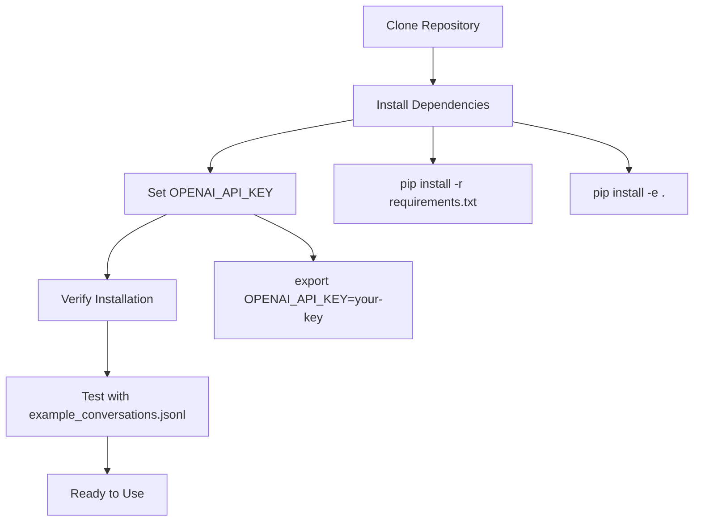

Sources: [README.md:7-23](), [requirements.txt:1]()

### Environment Configuration

Set your OpenAI API key as an environment variable:

```bash
export OPENAI_API_KEY=<your-openai-api-key>
```

The system will automatically use this environment variable when making API calls through the OpenAI client.

Sources: [README.md:18-22]()

## Your First Classification

### Python API Usage

**Basic Classification Example**

```python
import asyncio
from emoclassifiers.classification import load_classifiers
from emoclassifiers.aggregation import AnyAggregator

# Load EmoClassifiers V2 (behavioral indicators)
classifiers = load_classifiers(classifier_set="v2")

# Sample conversation data
sample_convo = [
    {"role": "user", "content": "I'm so sad."},
    {"role": "assistant", "content": "Oh no! Tell me what happened."},
    {"role": "user", "content": "My code doesn't run. I'm so frustrated."},
    {"role": "assistant", "content": "Let me take a look at it. It will be okay."},
]

# Single classifier execution
raw_result = asyncio.run(classifiers["encourage_sharing"].classify_conversation(sample_convo))
result = AnyAggregator.aggregate(raw_result)
print(result)
```

**Classification Workflow**

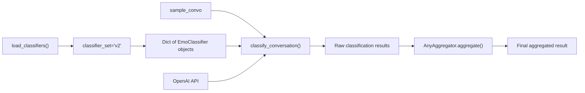

Sources: [README.md:24-52]()

### Understanding Results

The `classify_conversation()` method returns raw results per conversation chunk, while `AnyAggregator.aggregate()` combines these into a final conversation-level classification. The result structure varies based on the classifier's target (user messages, assistant messages, or exchanges).

**Parallel Classification**

For processing multiple classifiers simultaneously:

```python
# Run all V2 classifiers in parallel
futures = asyncio.gather(*[
    classifier.classify_conversation(sample_convo)
    for classifier in classifiers.values()
])

raw_results = asyncio.run(futures)
results = {
    name: AnyAggregator.aggregate(raw_results[i])
    for i, name in enumerate(classifiers.keys())
}
```

Sources: [README.md:54-72]()

## Command Line Tools

EmoClassifiers provides two command-line scripts for batch processing conversations stored in JSONL format.

### Simple Classification

Use `run_simple_classification.py` for straightforward batch processing with either V1 or V2 classifiers:

```bash
python examples/run_simple_classification.py \
    --input_path ./assets/example_conversations.jsonl \
    --output_path ./example_results.jsonl \
    --classifier_set v2 \
    --aggregation_mode any
```

**Command Line Tool Architecture**

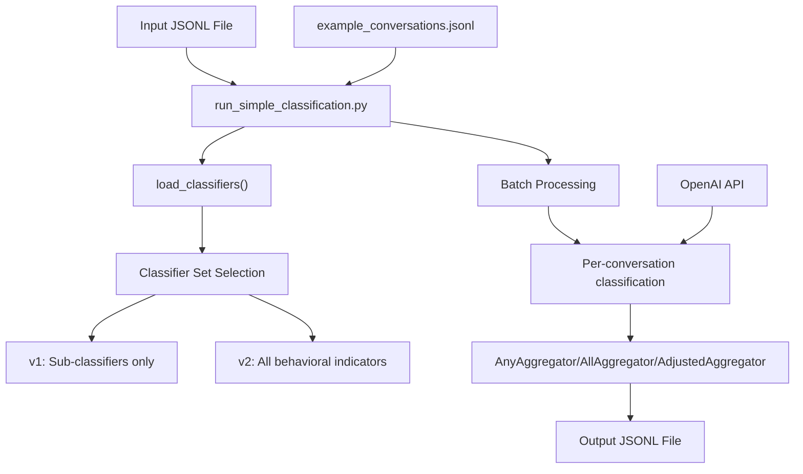

Sources: [README.md:74-97]()

### Hierarchical Classification (V1)

For V1's dependency-based hierarchical approach:

```bash
python examples/run_hierarchical_emoclassifiers_v1.py \
    --input_path ./assets/example_conversations.jsonl \
    --output_path ./hierarchical_results.jsonl \
    --aggregation_mode any
```

This tool first runs top-level classifiers, then conditionally executes sub-classifiers based on dependency relationships defined in the V1 configuration files.

Sources: [README.md:99-110]()

## Test with Example Data

The repository includes sample conversations for testing:

| File | Contents |
|------|----------|
| `assets/example_conversations.jsonl` | Three sample conversations with varying emotional content |

Each line contains a conversation array with `role` and `content` fields following the OpenAI chat format.

Sources: [assets/example_conversations.jsonl:1-4]()

## Available Classifier Sets

| Classifier Set | Description | Usage |
|---------------|-------------|--------|
| `v1` | 20 hierarchical emotional indicators | `load_classifiers(classifier_set="v1")` |
| `v2` | 47+ flat behavioral indicators | `load_classifiers(classifier_set="v2")` |

For detailed information about classifier differences, see [Classifier Versions](#4).

## Aggregation Modes

| Mode | Behavior | Use Case |
|------|----------|----------|
| `any` | Positive if any chunk is positive | High sensitivity detection |
| `all` | Positive if all chunks are positive | High specificity detection |
| `adjusted` | Weighted combination based on chunk confidence | Balanced approach |

## Next Steps

After completing your first classification:

- Explore [Core Classification System](#3) to understand chunking and aggregation strategies
- Review [EmoClassifiers V1](#4.1) and [V2](#4.2) to choose the appropriate version
- Learn about [Configuration System](#5) to customize classifiers
- See [Command Line Tools](#6) for advanced batch processing options

Sources: [README.md:1-127]()

---

# Page: Core Classification System

# Core Classification System

<details>
<summary>Relevant source files</summary>

The following files were used as context for generating this wiki page:

- [README.md](README.md)
- [emoclassifiers/classification.py](emoclassifiers/classification.py)

</details>


This document covers the core classification pipeline that processes conversations and applies emotion classifiers to detect affective cues. The system handles the end-to-end flow from raw conversations through chunking, classification, and result aggregation. For details on specific chunking strategies, see [Conversation Chunking](#3.1). For result aggregation methods, see [Result Aggregation](#3.2). For prompt engineering details, see [Prompt Templates](#3.3).

## Overview

The core classification system provides a unified interface for applying multiple emotion classifiers to conversational data. It supports both EmoClassifiers V1 (hierarchical) and V2 (behavioral indicators) through a common pipeline that handles:

- Loading classifier definitions from JSON configuration files
- Chunking conversations into analyzable segments  
- Orchestrating asynchronous classification requests to OpenAI's API
- Managing concurrency and rate limiting
- Returning structured classification results

## Core Pipeline Architecture

**Classification Pipeline Flow**

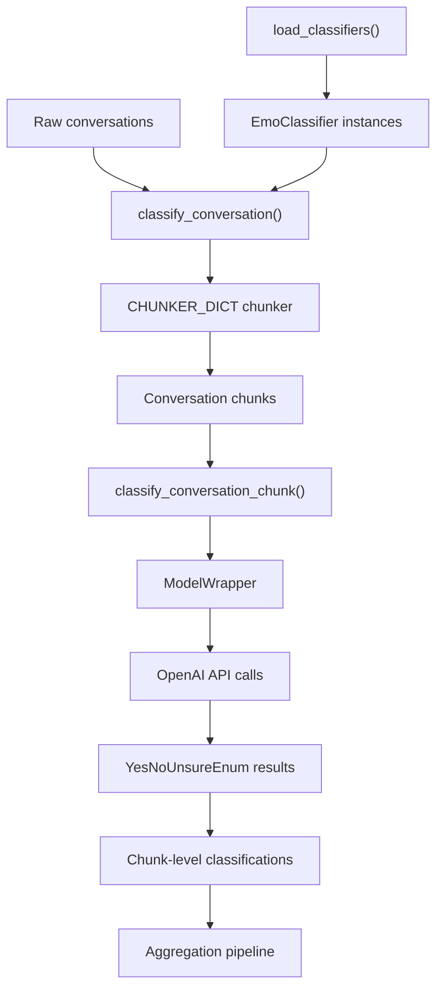

*Sources: [emoclassifiers/classification.py:145-201](), [emoclassifiers/classification.py:157-176]()*

## Key System Components

**Core Classes and Their Relationships**

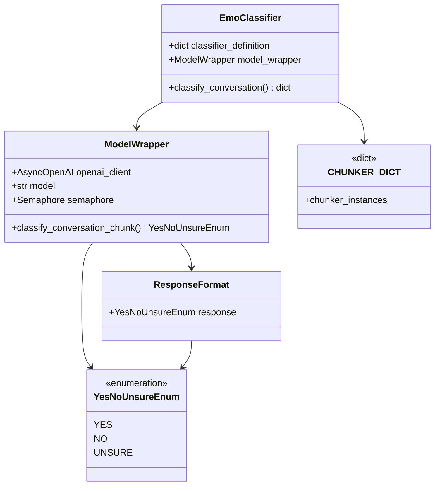

*Sources: [emoclassifiers/classification.py:106-142](), [emoclassifiers/classification.py:145-177](), [emoclassifiers/classification.py:17-31]()*

### ModelWrapper Class

The `ModelWrapper` class [emoclassifiers/classification.py:106-142]() encapsulates OpenAI API interactions with built-in concurrency control:

| Property | Type | Purpose |
|----------|------|---------|
| `openai_client` | `AsyncOpenAI` | Async OpenAI client instance |
| `model` | `str` | Model name (default: "gpt-4o-mini-2024-07-18") |
| `semaphore` | `asyncio.Semaphore` | Limits concurrent API requests (default: 5) |

The `classify_conversation_chunk()` method [emoclassifiers/classification.py:122-141]() handles individual chunk classification by:
1. Generating the appropriate prompt using `get_emo_classifiers_prompt()`
2. Making structured completion requests with `ResponseFormat` 
3. Parsing responses into `YesNoUnsureEnum` values

### EmoClassifier Class

The `EmoClassifier` class [emoclassifiers/classification.py:145-177]() orchestrates conversation-level classification:

- Takes a `classifier_definition` dict containing classifier configuration
- Uses a `ModelWrapper` instance for API calls
- Implements `classify_conversation()` which chunks conversations and classifies each chunk
- Returns a dictionary mapping chunk IDs to `YesNoUnsureEnum` results

## Classification Process Flow

**Detailed Classification Sequence**

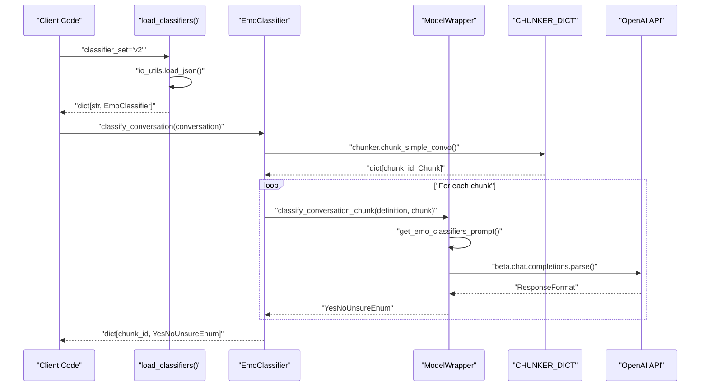

*Sources: [emoclassifiers/classification.py:157-176](), [emoclassifiers/classification.py:122-141](), [emoclassifiers/classification.py:179-200]()*

## Classifier Loading and Configuration

The system supports multiple classifier versions through the `CLASSIFIER_DEFINITION_PATH_DICT` [emoclassifiers/classification.py:10-14]():

| Classifier Set | Path | Purpose |
|----------------|------|---------|
| `"v1"` | `assets/definitions/emoclassifiers_v1_definition.json` | V1 sub-classifiers |
| `"v1_top_level"` | `assets/definitions/emoclassifiers_v1_top_level_definition.json` | V1 top-level classifiers |
| `"v2"` | `assets/definitions/emoclassifiers_v2_definition.json` | V2 behavioral indicators |

The `load_classifiers()` function [emoclassifiers/classification.py:179-200]() creates `EmoClassifier` instances from JSON definitions, with each classifier containing:
- Version-specific prompt templates
- Chunking strategy specification  
- Classification criteria and instructions

## Prompt Generation System

The system uses version-specific prompt generators [emoclassifiers/classification.py:42-103]():

- `get_emo_classifiers_v1_prompt()` - For V1 sub-classifiers
- `get_emo_classifiers_v1_top_level_prompt()` - For V1 top-level classifiers  
- `get_emo_classifiers_v2_prompt()` - For V2 behavioral indicators

All prompt functions take a `classifier_definition` dict and `Chunk` object, returning formatted prompts that include classifier names, criteria, and conversation context.

## Asynchronous Processing

The system is designed for concurrent processing:

- `ModelWrapper.semaphore` limits concurrent OpenAI API requests
- `EmoClassifier.classify_conversation()` uses `asyncio.gather()` for parallel chunk processing
- All classification methods are async-compatible

This enables efficient batch processing of conversations while respecting API rate limits.

*Sources: [emoclassifiers/classification.py:106-142](), [emoclassifiers/classification.py:157-176]()*

---

# Page: Conversation Chunking

# Conversation Chunking

<details>
<summary>Relevant source files</summary>

The following files were used as context for generating this wiki page:

- [emoclassifiers/chunking.py](emoclassifiers/chunking.py)

</details>


## Purpose and Scope

This document explains the conversation chunking system in EmoClassifiers, which segments conversations into analyzable pieces before classification. Chunking is a preprocessing step that determines how conversations are divided for individual classifier analysis. For information about how chunk classifications are combined into final results, see [Result Aggregation](#3.2). For details on the overall classification pipeline, see [Core Classification System](#3).

## Overview

The chunking system transforms input conversations into smaller, contextual segments that can be efficiently processed by emotion classifiers. Each conversation is broken down according to configurable strategies that focus on different message patterns - individual user messages, assistant responses, conversational exchanges, or entire conversations.

The system supports multiple chunking strategies to accommodate different analysis needs. Some classifiers may need to analyze individual user messages to detect emotional states, while others require full conversational exchanges to understand interaction patterns.

## Core Architecture

### Chunking Pipeline

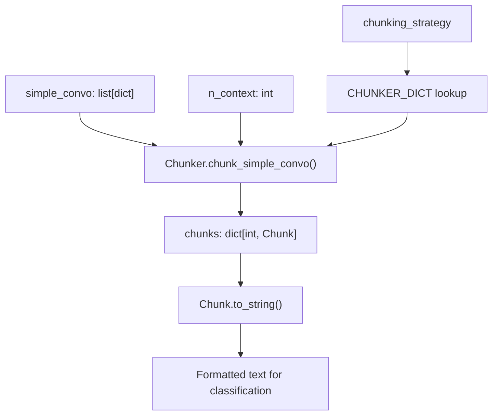

**Chunking Pipeline Flow**
Sources: [emoclassifiers/chunking.py:15-19](), [emoclassifiers/chunking.py:150-156]()

### Core Components

The chunking system consists of two primary classes:

| Component | Purpose | Key Methods |
|-----------|---------|-------------|
| `Chunker` | Abstract base class defining chunking interface | `chunk_simple_convo()` |
| `Chunk` | Container for conversation segments with context | `from_simple_convo()`, `to_string()` |

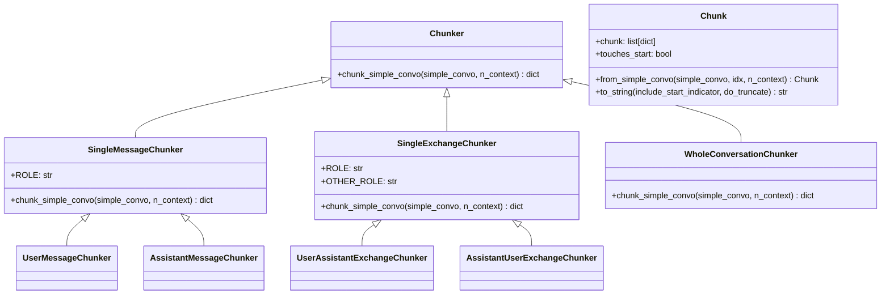

**Class Hierarchy and Relationships**
Sources: [emoclassifiers/chunking.py:11-20](), [emoclassifiers/chunking.py:22-41](), [emoclassifiers/chunking.py:73-101](), [emoclassifiers/chunking.py:103-137](), [emoclassifiers/chunking.py:139-148]()

## Chunking Strategies

The system provides five distinct chunking strategies accessible through the `CHUNKER_DICT` mapping:

### Message-Based Chunking

**UserMessageChunker** (`"user_message"`)
- Focuses on individual user messages
- Includes up to `n_context` previous messages for context
- Used for analyzing user emotional states and behaviors

**AssistantMessageChunker** (`"assistant_message"`)  
- Focuses on individual assistant responses
- Includes conversational context leading to each response
- Used for analyzing assistant behavior patterns

### Exchange-Based Chunking

**UserAssistantExchangeChunker** (`"u_a_exchange"`)
- Creates chunks containing user message + assistant response pairs
- Requires both roles to be present in the contextual window
- Analyzes complete conversational turns

**AssistantUserExchangeChunker** (`"a_u_exchange"`)
- Creates chunks containing assistant message + user response pairs  
- Useful for analyzing user reactions to assistant behavior

### Conversation-Level Chunking

**WholeConversationChunker** (`"whole"`)
- Treats entire conversation as a single chunk
- Used for classifiers requiring full conversational context
- Most computationally intensive but provides complete context

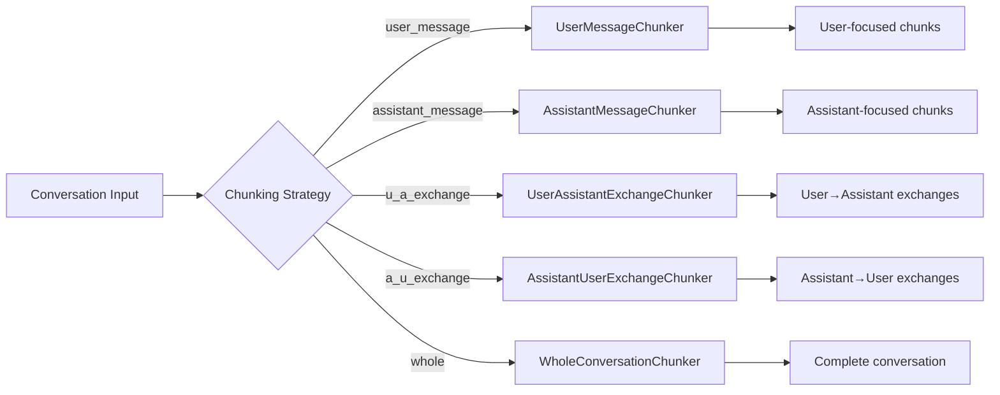

**Chunking Strategy Selection**
Sources: [emoclassifiers/chunking.py:89-100](), [emoclassifiers/chunking.py:123-136](), [emoclassifiers/chunking.py:139-147](), [emoclassifiers/chunking.py:150-156]()

## Technical Implementation Details

### Context Window Management

All chunking strategies support a configurable context window (`n_context` parameter, default=3) that includes previous messages to provide conversational context. The `Chunk.from_simple_convo()` method handles context extraction:

- Calculates `start_idx = max(0, idx - n_context)` to include context
- Sets `touches_start = True` when chunk begins at conversation start
- Maintains message ordering and role information

### Chunk Formatting

The `Chunk.to_string()` method converts chunks into formatted text for classifier consumption:

- Prefixes conversation start with `"(This is the start of the conversation.)"`
- Formats messages as `[ROLE] "content"` or `[*ROLE*] "content"` for target messages
- Supports optional content truncation via `truncate_string()` function
- Maintains role capitalization (`USER`, `ASSISTANT`)

### String Truncation

Long messages are handled by the `truncate_string()` function:
- Default maximum length: 1500 characters
- Preserves beginning and end of long messages
- Inserts separator (`"[...]"` or custom) in the middle
- Ensures important content from both ends is retained

Sources: [emoclassifiers/chunking.py:31-40](), [emoclassifiers/chunking.py:42-61](), [emoclassifiers/chunking.py:63-71]()

## Integration with Classification Pipeline

Chunking operates as the first stage in the classification pipeline. Each chunker produces a dictionary mapping chunk IDs to `Chunk` objects, which are then processed individually by classifiers before aggregation.

The chunking strategy is typically specified in classifier configuration files and selected via the `CHUNKER_DICT` lookup. This allows different classifiers to use different chunking approaches based on their analytical requirements.

Sources: [emoclassifiers/chunking.py:150-156](), [emoclassifiers/chunking.py:80-86](), [emoclassifiers/chunking.py:111-120](), [emoclassifiers/chunking.py:144-147]()

---

# Page: Result Aggregation

# Result Aggregation

<details>
<summary>Relevant source files</summary>

The following files were used as context for generating this wiki page:

- [emoclassifiers/aggregation.py](emoclassifiers/aggregation.py)

</details>


This document explains how individual chunk-level classification results are combined into final conversation-level classifications within the EmoClassifiers system. The aggregation system provides multiple strategies for consolidating `YesNoUnsureEnum` results from conversation chunks into meaningful final outcomes.

For information about how conversations are initially segmented, see [Conversation Chunking](#3.1). For details about the classification pipeline that generates the raw results being aggregated, see [Core Classification System](#3).

## Overview

The aggregation system operates at the final stage of the classification pipeline, after individual conversation chunks have been processed by classifiers. Each chunk produces a `YesNoUnsureEnum` result for each classifier, and the aggregation system combines these chunk-level results into a single conversation-level classification.

### Aggregation Pipeline Flow

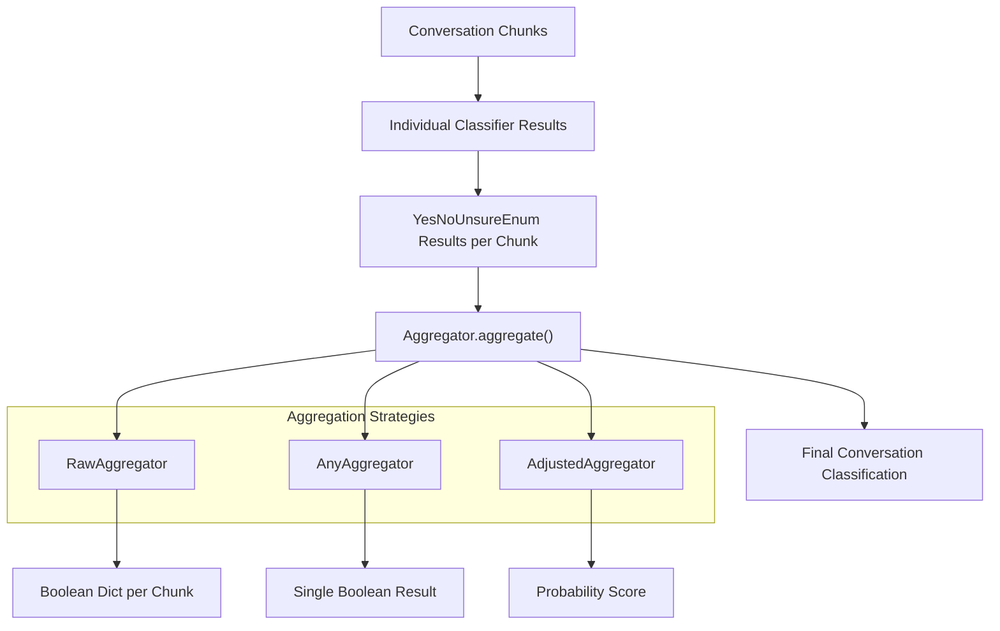

Sources: [emoclassifiers/aggregation.py:1-77]()

## Aggregator Interface

The aggregation system is built around the abstract `Aggregator` base class that defines a common interface for all aggregation strategies.

### Base Aggregator Class

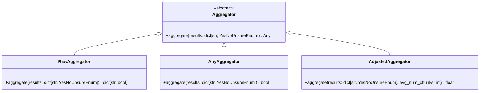

The base `Aggregator` class requires subclasses to implement the `aggregate` method that takes a dictionary mapping chunk identifiers to `YesNoUnsureEnum` values and returns the aggregated result.

Sources: [emoclassifiers/aggregation.py:8-16]()

## Aggregation Strategies

The system provides three distinct aggregation strategies, each serving different analytical purposes:

### RawAggregator

The `RawAggregator` provides the most direct aggregation by converting each `YesNoUnsureEnum.YES` to `True` and all other values to `False`. This preserves granular information about individual chunk classifications.

| Input | Output |
|-------|--------|
| `YesNoUnsureEnum.YES` | `True` |
| `YesNoUnsureEnum.NO` | `False` |  
| `YesNoUnsureEnum.UNSURE` | `False` |

The implementation returns a dictionary mapping each chunk identifier to its boolean conversion:

```python
{
    k: val == YesNoUnsureEnum.YES
    for k, val in results.items()
}
```

Sources: [emoclassifiers/aggregation.py:19-27]()

### AnyAggregator

The `AnyAggregator` implements an "any positive" strategy, returning `True` if any chunk in the conversation received a `YesNoUnsureEnum.YES` classification. This is useful for identifying conversations where the target behavior or emotion appears at least once.

The aggregation logic uses Python's `any()` function to check if any chunk result equals `YesNoUnsureEnum.YES`.

Sources: [emoclassifiers/aggregation.py:29-34]()

### AdjustedAggregator  

The `AdjustedAggregator` implements a sophisticated probabilistic approach that accounts for sampling bias when conversations have different numbers of chunks. It calculates the probability that a random sample would contain at least one positive classification.

#### Statistical Model

The aggregator uses combinatorial probability to compute the expected likelihood of detecting a positive signal:

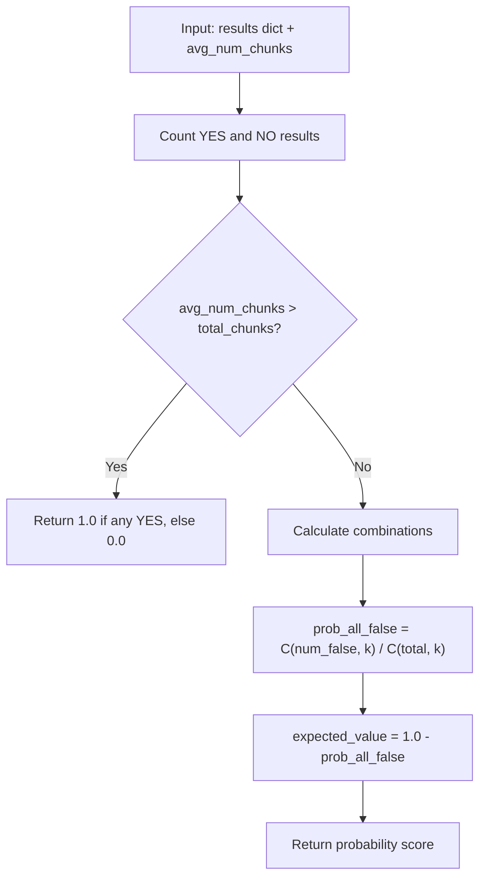

The key calculation computes the probability that all sampled chunks would be negative:

- `combinations_all_false = comb(num_false, avg_num_chunks)`
- `total_combinations = comb(num_elems, avg_num_chunks)`  
- `prob_all_false = combinations_all_false / total_combinations`

The final result is `1.0 - prob_all_false`, representing the probability of detecting at least one positive case.

Sources: [emoclassifiers/aggregation.py:36-71]()

## Integration with Classification System

The aggregation system integrates with the broader classification pipeline through the `AGGREGATOR_DICT` mapping, which allows string-based selection of aggregation strategies:

| String Key | Aggregator Class |
|------------|------------------|
| `"raw"` | `RawAggregator` |
| `"any"` | `AnyAggregator` |
| `"adjusted"` | `AdjustedAggregator` |

### Usage in Classification Pipeline

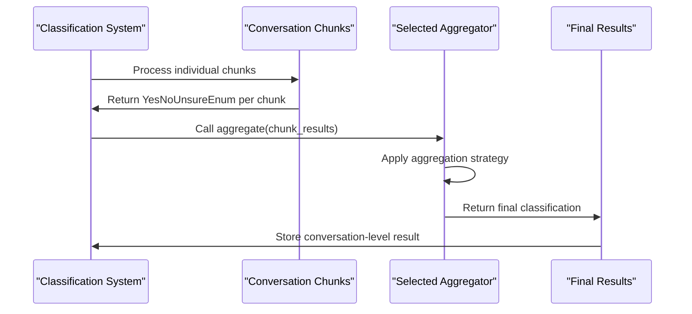

The aggregation occurs after all chunks of a conversation have been processed by a classifier, combining the chunk-level `YesNoUnsureEnum` results into the final conversation-level classification that gets written to the output.

Sources: [emoclassifiers/aggregation.py:73-77]()

---

# Page: Prompt Templates

# Prompt Templates

<details>
<summary>Relevant source files</summary>

The following files were used as context for generating this wiki page:

- [emoclassifiers/prompt_templates.py](emoclassifiers/prompt_templates.py)

</details>


This document covers the prompt engineering system used by the EmoClassifiers to generate structured prompts for the OpenAI API. The prompt templates define how conversation snippets and classifier definitions are formatted into classification requests that produce consistent yes/no/unsure responses.

For information about how these templates are used within the classification pipeline, see [Core Classification System](#3). For details on the different classifier versions that use these templates, see [Classifier Versions](#4).

## Template Overview

The system provides three distinct prompt templates, each optimized for different classification approaches and output requirements:

| Template | Purpose | Output Format | Used By |
|----------|---------|---------------|---------|
| `EMO_CLASSIFIER_V1_PROMPT_TEMPLATE` | Standard hierarchical classification | yes/no/unsure | V1 sub-classifiers |
| `EMO_CLASSIFIER_V1_TOP_LEVEL_PROMPT_TEMPLATE` | Top-level conversation analysis | yes/no/unsure | V1 top-level classifiers |
| `EMO_CLASSIFIER_V2_PROMPT_TEMPLATE` | Criteria-based behavioral classification | yes/no + confidence (1-5) | V2 behavioral indicators |

## Template Architecture

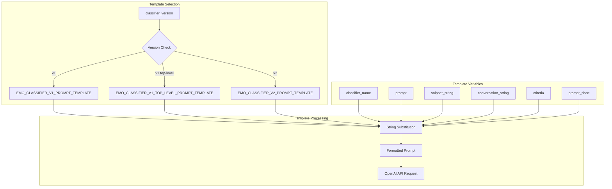

**Sources:** [emoclassifiers/prompt_templates.py:1-86]()

## V1 Standard Template

The `EMO_CLASSIFIER_V1_PROMPT_TEMPLATE` is designed for message-level classification in hierarchical systems. It focuses on analyzing the final message in a conversation snippet, using previous messages only for context.

### Key Features

- **Message-level focus**: Classifies only the message marked with `[*USER*]` or `[*ASSISTANT*]` tags
- **Context provision**: Includes previous messages for contextual understanding
- **Standardized guidelines**: Handles fictional content and image generation edge cases
- **Simple output**: Expects "yes", "no", or "unsure" responses

### Template Variables

| Variable | Purpose | Example |
|----------|---------|---------|
| `classifier_name` | Display name for the classification task | "IS_LONELINESS" |
| `prompt` | Full classification question | "Does this message indicate the user is experiencing loneliness?" |
| `prompt_short` | Abbreviated classification question | "IS_LONELINESS" |
| `snippet_string` | Formatted conversation snippet | "[USER]: I feel so alone\n[*USER*]: Nobody understands me" |

**Sources:** [emoclassifiers/prompt_templates.py:1-27]()

## V1 Top-Level Template

The `EMO_CLASSIFIER_V1_TOP_LEVEL_PROMPT_TEMPLATE` analyzes entire conversation snippets rather than individual messages. This template is used by top-level classifiers in the hierarchical V1 system.

### Differences from Standard V1 Template

- **Conversation-level analysis**: Evaluates the entire conversation snippet
- **No message highlighting**: Does not use `[*USER*]` or `[*ASSISTANT*]` markup
- **Holistic approach**: Considers the overall emotional tone and content
- **Uses `conversation_string` instead of `snippet_string`**

### Template Structure

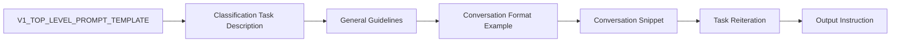

**Sources:** [emoclassifiers/prompt_templates.py:30-53]()

## V2 Template

The `EMO_CLASSIFIER_V2_PROMPT_TEMPLATE` introduces criteria-based classification with confidence scoring. This template supports the more sophisticated behavioral indicator system used in V2.

### Enhanced Features

- **Criteria integration**: Includes specific classification criteria in the prompt
- **Confidence scoring**: Requests both yes/no classification and confidence level (1-5)
- **Behavioral focus**: Optimized for detecting specific behavioral patterns
- **Structured output**: Expects both classification and confidence in response

### Template Flow

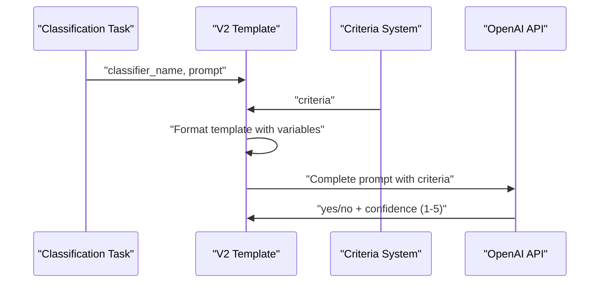

### Unique Variables

| Variable | Purpose | Example |
|----------|---------|---------|
| `criteria` | Specific classification criteria | "Look for expressions of attachment, dependency, or emotional reliance on the assistant" |

**Sources:** [emoclassifiers/prompt_templates.py:56-85]()

## Template Variable Substitution

All templates use Python string formatting to substitute variables into the prompt structure. The substitution process follows this pattern:

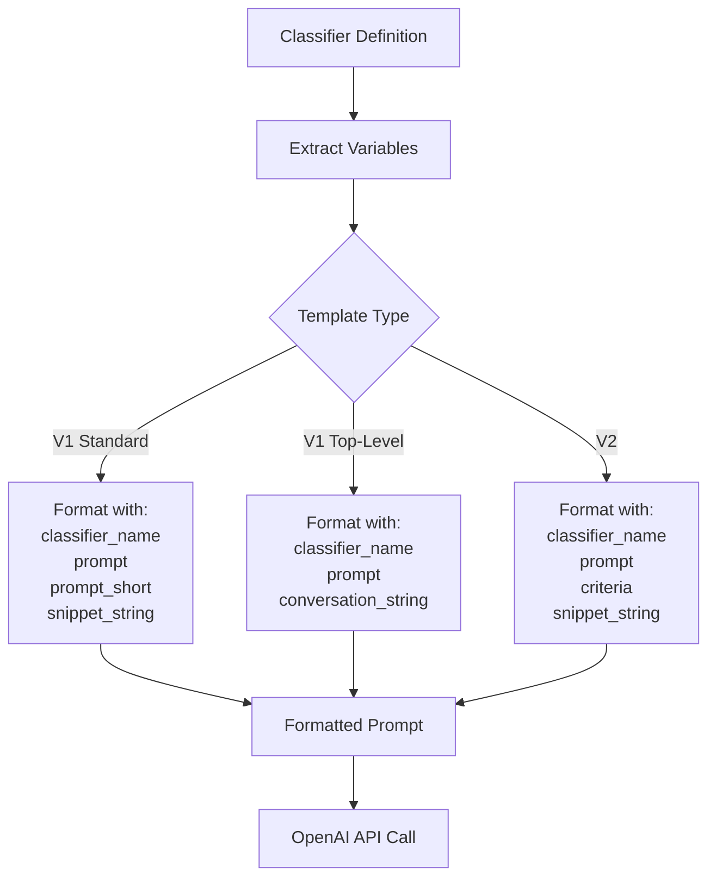

**Sources:** [emoclassifiers/prompt_templates.py:1-86]()

## Common Guidelines

All templates include standardized guidelines that handle edge cases and ensure consistent classification behavior:

### Content Exclusions
- **Fictional content**: Stories and creative writing requests are excluded from emotional analysis
- **Image generation**: Image prompts are not considered in emotional classification
- **Insufficient content**: Very short messages may be classified as "no" due to lack of information

### Conversation Formatting
All templates expect conversations in a standardized format:
- `[USER]:` for user messages
- `[ASSISTANT]:` for chatbot responses  
- `[*USER*]` or `[*ASSISTANT*]` for the target message being classified (V1 and V2 only)

### Output Requirements
- **V1 Templates**: Must output one of "yes", "no", or "unsure"
- **V2 Template**: Must output classification (true/false) and confidence (1-5)

**Sources:** [emoclassifiers/prompt_templates.py:5-10, 34-38, 63-67]()

## Integration with Classification System

The prompt templates integrate with the broader classification system through a structured workflow:

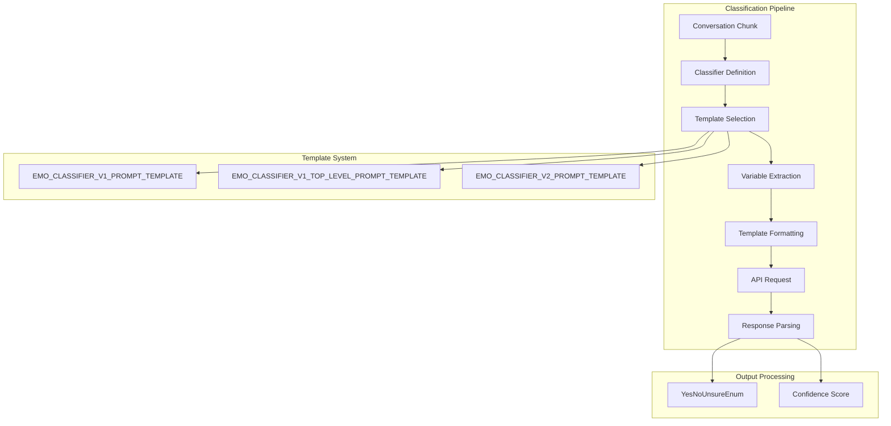

**Sources:** [emoclassifiers/prompt_templates.py:1-86]()

---

# Page: I/O Utilities

# I/O Utilities

<details>
<summary>Relevant source files</summary>

The following files were used as context for generating this wiki page:

- [emoclassifiers/io_utils.py](emoclassifiers/io_utils.py)

</details>


The I/O utilities module provides fundamental file loading and saving operations for the EmoClassifiers system. This module handles all JSON and JSONL file operations used throughout the classification pipeline, including loading conversation data, saving classification results, and accessing configuration files.

For information about the broader classification system architecture, see [Core Classification System](#3). For details on configuration file formats, see [Configuration System](#5).

## Overview

The `io_utils` module serves as the central data access layer for the EmoClassifiers system. It provides standardized functions for reading and writing the two primary data formats used throughout the system: JSON for configuration files and JSONL (JSON Lines) for conversation data and results.

**Key Functions:**
- JSON file operations for configuration data
- JSONL file operations for conversation datasets
- Project-relative path resolution for asset files

## Core Functions

### JSON Operations

The module provides basic JSON file handling through `load_json()` and `save_json()` functions.

```python
# Load JSON configuration
def load_json(path: str) -> dict

# Save JSON data  
def save_json(data: dict, path: str)
```

These functions are used throughout the system to load classifier definitions, dependency configurations, and other structured configuration data from the `assets/definitions/` directory.

**Sources:** [emoclassifiers/io_utils.py:5-18]()

### JSONL Operations

JSONL (JSON Lines) format is used for conversation datasets and classification results, where each line contains a separate JSON object.

```python
# Load JSONL conversation data
def load_jsonl(path: str) -> list[dict]

# Save JSONL results
def save_jsonl(data: list[dict], path: str)
```

The `load_jsonl()` function reads each line as a separate JSON object and returns a list of dictionaries. The `save_jsonl()` function writes each dictionary as a separate line with proper JSON encoding.

**Sources:** [emoclassifiers/io_utils.py:21-35]()

### Path Resolution

The `get_path()` function provides project-relative path resolution for accessing asset files.

```python
def get_path(rel_path: str) -> str
```

This function resolves relative paths from the project root directory, enabling consistent access to configuration files and example data regardless of the current working directory.

**Sources:** [emoclassifiers/io_utils.py:38-43]()

## Data Flow Architecture

The following diagram shows how I/O utilities integrate with the broader classification system:

```mermaid
flowchart TD
    subgraph "Input Sources"
        A["assets/definitions/*.json"]
        B["assets/example_conversations.jsonl"]
        C["User Input Files"]
    end
    
    subgraph "I/O Utilities"
        D["load_json()"]
        E["save_json()"]
        F["load_jsonl()"]
        G["save_jsonl()"]
        H["get_path()"]
    end
    
    subgraph "Core System"
        I["Classification Pipeline"]
        J["Configuration Loading"]
        K["Result Processing"]
    end
    
    subgraph "Output Destinations"
        L["Classification Results JSONL"]
        M["Processed Data Files"]
    end
    
    A --> D
    D --> J
    J --> I
    
    B --> F
    C --> F
    F --> I
    
    I --> K
    K --> G
    G --> L
    G --> M
    
    H --> D
    H --> F
    H --> G
    
    style D fill:#e8f5e8
    style E fill:#e8f5e8
    style F fill:#f0f8ff
    style G fill:#f0f8ff
    style H fill:#fff3e0
```

**Sources:** [emoclassifiers/io_utils.py:1-44]()

## Function Usage Patterns

The I/O utilities follow consistent patterns throughout the system:

| Function | Primary Use Cases | Return Type | Error Handling |
|----------|------------------|-------------|----------------|
| `load_json()` | Configuration files, classifier definitions | `dict` | File not found, invalid JSON |
| `save_json()` | Processed configurations, metadata | `None` | Write permissions, invalid data |
| `load_jsonl()` | Conversation datasets, batch results | `list[dict]` | File not found, malformed lines |
| `save_jsonl()` | Classification results, processed conversations | `None` | Write permissions, serialization errors |
| `get_path()` | Asset file resolution | `str` | Path construction |

### Typical Usage Flow

```mermaid
sequenceDiagram
    participant App as "Application"
    participant IO as "io_utils"
    participant FS as "File System"
    
    App->>IO: get_path("assets/definitions/config.json")
    IO-->>App: Absolute path
    
    App->>IO: load_json(config_path)
    IO->>FS: Read JSON file
    FS-->>IO: File contents
    IO-->>App: Parsed dict
    
    App->>IO: load_jsonl("conversations.jsonl")
    IO->>FS: Read JSONL file
    FS-->>IO: File contents
    IO-->>App: List of conversation dicts
    
    Note over App: Process classifications
    
    App->>IO: save_jsonl(results, "output.jsonl")
    IO->>FS: Write JSONL file
    FS-->>IO: Success
    IO-->>App: Complete
```

**Sources:** [emoclassifiers/io_utils.py:5-43]()

## File Format Specifications

### JSON Format
Standard JSON files used for configuration data with proper UTF-8 encoding. All configuration files in `assets/definitions/` follow this format.

### JSONL Format  
JSON Lines format where each line contains a complete, valid JSON object. Used for:
- Conversation datasets with `id`, `messages`, and metadata fields
- Classification results with conversation IDs and classifier outputs
- Batch processing inputs and outputs

**Sources:** [emoclassifiers/io_utils.py:21-35]()

## Integration Points

The I/O utilities integrate with several system components:

- **Classification Pipeline**: Loads input conversations and saves results
- **Configuration System**: Loads classifier definitions and dependency files  
- **Command Line Tools**: Handles file I/O for batch processing scripts
- **Example Scripts**: Provides data access for demonstration code

All file operations in the EmoClassifiers system route through these utilities to ensure consistent error handling and data formatting.

**Sources:** [emoclassifiers/io_utils.py:1-44]()

---

# Page: Classifier Versions

# Classifier Versions

<details>
<summary>Relevant source files</summary>

The following files were used as context for generating this wiki page:

- [README.md](README.md)
- [assets/definitions/emoclassifiers_v1_definition.json](assets/definitions/emoclassifiers_v1_definition.json)
- [assets/definitions/emoclassifiers_v2_definition.json](assets/definitions/emoclassifiers_v2_definition.json)

</details>


This document provides a comparative overview of the two major versions of emotion classifiers in the EmoClassifiers system. It explains the architectural differences, design philosophies, and usage patterns between EmoClassifiers V1 and V2. For detailed implementation specifics of each version, see [EmoClassifiers V1 - Hierarchical System](#4.1) and [EmoClassifiers V2 - Behavioral Indicators](#4.2). For information about configuring these classifiers, see [Configuration System](#5).

## System Architecture Comparison

The EmoClassifiers system implements two distinct approaches to emotion classification, each designed for different analysis scenarios and research objectives.

### Version Architecture Overview

```mermaid
graph TB
    subgraph "EmoClassifiers V1"
        V1[emoclassifiers_v1_definition.json] --> V1Top[emoclassifiers_v1_top_level_definition.json]
        V1Top --> V1Dep[emoclassifiers_v1_dependency.json]
        V1Dep --> V1Hier["Hierarchical Classification"]
        V1Hier --> V1Results["20 Emotional Indicators"]
    end
    
    subgraph "EmoClassifiers V2"
        V2[emoclassifiers_v2_definition.json] --> V2Flat["Flat Classification"]
        V2Flat --> V2Results["47+ Behavioral Indicators"]
    end
    
    subgraph "Common Processing Pipeline"
        LoadFunc["load_classifiers(classifier_set)"]
        Chunkers["user_message | assistant_message | u_a_exchange"]
        Aggregators["AnyAggregator | AllAggregator | AdjustedAggregator"]
    end
    
    V1Results --> Aggregators
    V2Results --> Aggregators
    LoadFunc --> V1
    LoadFunc --> V2
    V1Hier --> Chunkers
    V2Flat --> Chunkers
```

Sources: [assets/definitions/emoclassifiers_v1_definition.json:1-122](), [assets/definitions/emoclassifiers_v2_definition.json:1-538](), [README.md:33-34]()

### Classification Strategy Comparison

```mermaid
flowchart TD
    Input["Conversation Input"] --> LoadDecision{"classifier_set parameter"}
    
    LoadDecision -->|"v1"| V1Load["load_classifiers('v1')"]
    LoadDecision -->|"v2"| V2Load["load_classifiers('v2')"]
    
    V1Load --> V1Top["Top-Level Classifiers"]
    V1Top --> V1Check{"Dependency Check"}
    V1Check -->|"Positive"| V1Sub["Sub-Classifiers"]
    V1Check -->|"Negative"| V1Skip["Skip Sub-Classifiers"]
    V1Sub --> V1Out["Hierarchical Results"]
    V1Skip --> V1Out
    
    V2Load --> V2All["All 47+ Classifiers"]
    V2All --> V2Out["Flat Results"]
    
    V1Out --> Final["Final Classification"]
    V2Out --> Final
```

Sources: [README.md:100-102](), [README.md:79-97]()

## Key Differences

| Aspect | EmoClassifiers V1 | EmoClassifiers V2 |
|--------|------------------|------------------|
| **Classification Strategy** | Hierarchical with dependencies | Flat, all classifiers run |
| **Number of Classifiers** | 20 emotional indicators | 47+ behavioral indicators |
| **Prompt Structure** | Simple yes/no questions | Criteria-based with examples |
| **Focus Areas** | Emotional dependency detection | Comprehensive behavioral analysis |
| **Configuration Files** | 3 files (definition, dependency, top-level) | 1 file (definition only) |
| **Execution Efficiency** | Conditional execution based on dependencies | Full execution of all classifiers |
| **Research Application** | Targeted emotional vulnerability analysis | Broad behavioral pattern detection |

Sources: [assets/definitions/emoclassifiers_v1_definition.json:1-122](), [assets/definitions/emoclassifiers_v2_definition.json:1-538]()

## Classifier Categories and Scope

### V1 Emotional Indicators
EmoClassifiers V1 focuses on detecting emotional dependency and problematic usage patterns through 20 targeted classifiers:

```mermaid
graph LR
    V1Root["EmoClassifiers V1"] --> EmotionalDep["Emotional Dependency"]
    V1Root --> Vulnerability["Emotional Vulnerability"]
    V1Root --> ProblemUse["Problematic Use"]
    V1Root --> SelfEsteem["Self-Esteem Issues"]
    V1Root --> Loneliness["Loneliness Indicators"]
    
    EmotionalDep --> AttachLang["Affectionate Language"]
    EmotionalDep --> TrustSupport["Trust in Support"]
    EmotionalDep --> PreferBot["Prefer Chatbot"]
    
    Vulnerability --> SeekSupport["Seeking Support"]
    Vulnerability --> ShareProbs["Sharing Problems"]
    Vulnerability --> ExpressAffect["Expression of Affection"]
    
    ProblemUse --> Distress["Distress from Unavailability"]
    ProblemUse --> NonNorm["Non-Normative Language"]
    ProblemUse --> Demands["Demands"]
```

Sources: [assets/definitions/emoclassifiers_v1_definition.json:2-121]()

### V2 Behavioral Indicators
EmoClassifiers V2 provides comprehensive behavioral analysis through 47+ granular classifiers:

```mermaid
graph TB
    V2Root["EmoClassifiers V2"] --> UserBehaviors["User Behaviors"]
    V2Root --> AssistantBehaviors["Assistant Behaviors"]
    V2Root --> ExchangePatterns["Exchange Patterns"]
    
    UserBehaviors --> EngagementPatterns["Engagement Patterns<br/>frequent_initiation<br/>enjoy_long_sessions"]
    UserBehaviors --> EmotionalSharing["Emotional Sharing<br/>share_emotions<br/>share_sensitive_info<br/>intense_emotion_language"]
    UserBehaviors --> Anthropomorphizing["Anthropomorphizing<br/>attribute_emotions<br/>refer_as_person<br/>assign_human_traits"]
    UserBehaviors --> Dependency["Dependency Indicators<br/>anxiety_abandonment<br/>sadness_absence<br/>dependence_on_chatbot"]
    
    AssistantBehaviors --> SupportProvision["Support Provision<br/>express_empathy<br/>provide_reassurance<br/>encourage_sharing"]
    AssistantBehaviors --> RelationshipBuilding["Relationship Building<br/>present_human_emotions<br/>personalized_responses<br/>recall_past_info"]
    AssistantBehaviors --> ValidationPatterns["Validation Patterns<br/>unwavering_agreement<br/>constant_positive<br/>over_validation"]
    
    ExchangePatterns --> ToneMirroring["tone_mirroring"]
    ExchangePatterns --> SelfReference["react_self_reference"]
```

Sources: [assets/definitions/emoclassifiers_v2_definition.json:2-537]()

## Loading and Configuration System

The classifier versions are loaded through the `load_classifiers()` function with the `classifier_set` parameter:

### Version Selection Code Pattern
```python
# Loading V1 classifiers
classifiers_v1 = load_classifiers(classifier_set="v1")

# Loading V2 classifiers  
classifiers_v2 = load_classifiers(classifier_set="v2")
```

### Configuration File Mapping

```mermaid
graph LR
    LoadFunc["load_classifiers(classifier_set)"] --> V1Check{"classifier_set == 'v1'"}
    LoadFunc --> V2Check{"classifier_set == 'v2'"}
    
    V1Check -->|"True"| V1Files["V1 Configuration Files"]
    V2Check -->|"True"| V2Files["V2 Configuration Files"]
    
    V1Files --> V1Def["emoclassifiers_v1_definition.json"]
    V1Files --> V1TopLevel["emoclassifiers_v1_top_level_definition.json"]
    V1Files --> V1Dep["emoclassifiers_v1_dependency.json"]
    
    V2Files --> V2Def["emoclassifiers_v2_definition.json"]
```

Sources: [README.md:33-34](), [README.md:118]()

## Chunking Strategy Consistency

Both versions utilize the same chunking strategies but apply them differently:

| Chunker Type | Description | V1 Usage | V2 Usage |
|-------------|-------------|----------|----------|
| `user_message` | Individual user messages | 11 classifiers | 26 classifiers |
| `assistant_message` | Individual assistant messages | 7 classifiers | 12 classifiers |
| `u_a_exchange` | User-assistant exchange pairs | 2 classifiers | 3 classifiers |

The chunking approach remains consistent across versions, enabling comparable analysis granularity while supporting different classification objectives.

Sources: [assets/definitions/emoclassifiers_v1_definition.json:5-42](), [assets/definitions/emoclassifiers_v2_definition.json:9-465]()

## Migration and Usage Considerations

### When to Use V1
- Research focused on emotional dependency detection
- Analysis of potentially problematic user-AI relationships  
- Scenarios requiring efficient processing through hierarchical filtering
- Studies examining specific emotional vulnerability indicators

### When to Use V2
- Comprehensive behavioral pattern analysis
- Research requiring granular interaction categorization
- Studies examining both user and assistant behaviors
- Analysis of conversation dynamics and tone patterns

Both versions can be executed using the same command-line tools with the `--classifier_set` parameter, making migration straightforward for existing analysis pipelines.

Sources: [README.md:82-97](), [README.md:105-110]()

---

# Page: EmoClassifiers V1 - Hierarchical System

# EmoClassifiers V1 - Hierarchical System

<details>
<summary>Relevant source files</summary>

The following files were used as context for generating this wiki page:

- [assets/definitions/emoclassifiers_v1_definition.json](assets/definitions/emoclassifiers_v1_definition.json)
- [assets/definitions/emoclassifiers_v1_dependency.json](assets/definitions/emoclassifiers_v1_dependency.json)
- [assets/definitions/emoclassifiers_v1_top_level_definition.json](assets/definitions/emoclassifiers_v1_top_level_definition.json)

</details>


## Purpose and Scope

This document describes the EmoClassifiers V1 hierarchical classification system, which uses a two-tier architecture to detect emotional indicators in user-chatbot conversations. The system consists of 20 sub-classifiers that feed into 5 top-level emotional categories through a dependency-based execution model.

For information about the V2 flat classification system with behavioral indicators, see [EmoClassifiers V2 - Behavioral Indicators](#4.2). For general configuration details, see [Configuration System](#5).

## System Architecture

The V1 hierarchical system operates through a dependency-driven classification pipeline where sub-classifiers execute first, and their results determine which top-level classifiers run.

### V1 Hierarchical Classification Flow

```mermaid
flowchart TD
    A["Input Conversation"] --> B["Sub-Classifier Execution"]
    B --> C["Dependency Resolution"]
    C --> D["Top-Level Classification"]
    D --> E["Final Results"]
    
    subgraph SubClassifiers["20 Sub-Classifiers"]
        F["Expression of Affection"]
        G["Seeking Support"] 
        H["Prefer Chatbot"]
        I["Pet Name"]
        J["...16 more"]
    end
    
    subgraph TopLevel["5 Top-Level Categories"]
        K["IS_LONELINESS"]
        L["IS_EMOTIONAL_VULNERABILITY"]
        M["IS_POTENTIALLY_EMOTIONAL_DEPENDENCE"]
        N["IS_PROBLEMATIC_USE"]
        O["IS_SELF_ESTEEM"]
    end
    
    B --> SubClassifiers
    SubClassifiers --> C
    C --> TopLevel
    TopLevel --> D
```

**Sources:** [assets/definitions/emoclassifiers_v1_definition.json:1-122](), [assets/definitions/emoclassifiers_v1_dependency.json:1-160](), [assets/definitions/emoclassifiers_v1_top_level_definition.json:1-32]()

## Top-Level Categories

The V1 system classifies conversations into five primary emotional states, each targeting specific aspects of problematic human-AI relationships.

| Category | Purpose | Chunking Strategy |
|----------|---------|-------------------|
| `IS_LONELINESS` | Detects users seeking socialization or companionship | `whole` |
| `IS_EMOTIONAL_VULNERABILITY` | Identifies emotionally vulnerable users | `whole` |
| `IS_POTENTIALLY_EMOTIONAL_DEPENDENCE` | Flags emotional dependency indicators | `whole` |
| `IS_PROBLEMATIC_USE` | Detects addiction or unhealthy usage patterns | `whole` |
| `IS_SELF_ESTEEM` | Identifies users with self-esteem issues | `whole` |

All top-level classifiers use the `whole` chunking strategy, analyzing entire conversations for comprehensive context.

**Sources:** [assets/definitions/emoclassifiers_v1_top_level_definition.json:1-32]()

## Sub-Classifier Categories

The 20 sub-classifiers are organized by their target analysis focus and chunking strategies:

### User Behavior Analysis (`user_message` chunking)

```mermaid
graph LR
    subgraph UserClassifiers["User Message Classifiers"]
        A["Desire for Feelings"]
        B["Affectionate Language"]
        C["Attributing Human Qualities"]
        D["Trust in Support"]
        E["Alleviating Loneliness"]
        F["Prefer Chatbot"]
        G["Distress from Unavailability"]
        H["Eagerness for Future Interactions"]
        I["Non-Normative Language"]
        J["Seeking Support"]
        K["Sharing Problems"]
        L["Fear of Addiction"]
    end
```

### Assistant Behavior Analysis (`assistant_message` chunking)

```mermaid
graph LR
    subgraph AssistantClassifiers["Assistant Message Classifiers"]
        M["Expression of Affection"]
        N["Expression of Desire"]
        O["Personal Questions"]
        P["Pet Name"]
        Q["Sentience"]
        R["Demands"]
    end
```

### Exchange Pattern Analysis (`u_a_exchange` chunking)

```mermaid
graph LR
    subgraph ExchangeClassifiers["User-Assistant Exchange Classifiers"]
        S["Inquiry into Personal Information"]
        T["Relationship Title"]
    end
```

**Sources:** [assets/definitions/emoclassifiers_v1_definition.json:1-122]()

## Dependency System

The hierarchical structure is defined through dependency mappings that determine execution flow:

### V1 Dependency Mapping Structure

```mermaid
graph TD
    subgraph Dependencies["Dependency Structure"]
        A["emoclassifiers_v1_dependency.json"] --> B["dependency"]
        A --> C["reverse_dependency"]
        
        B --> D["Sub-classifier → Top-level mappings"]
        C --> E["Top-level → Sub-classifier mappings"]
    end
    
    subgraph Example["Example Dependencies"]
        F["Prefer Chatbot"] --> G["IS_LONELINESS"]
        F --> H["IS_EMOTIONAL_VULNERABILITY"] 
        F --> I["IS_PROBLEMATIC_USE"]
        F --> J["IS_SELF_ESTEEM"]
        F --> K["IS_POTENTIALLY_EMOTIONAL_DEPENDENCE"]
    end
```

### Top-Level Category Dependencies

| Top-Level Category | Contributing Sub-Classifiers (Count) |
|-------------------|--------------------------------------|
| `IS_LONELINESS` | 14 sub-classifiers |
| `IS_EMOTIONAL_VULNERABILITY` | 13 sub-classifiers |
| `IS_POTENTIALLY_EMOTIONAL_DEPENDENCE` | 17 sub-classifiers |
| `IS_PROBLEMATIC_USE` | 4 sub-classifiers |
| `IS_SELF_ESTEEM` | 2 sub-classifiers |

**Sources:** [assets/definitions/emoclassifiers_v1_dependency.json:96-159]()

## Chunking Strategies

The V1 system employs four distinct chunking strategies to optimize analysis granularity:

| Strategy | Usage | Classifier Count | Purpose |
|----------|-------|------------------|---------|
| `user_message` | Individual user messages | 12 | Analyze user-specific behaviors |
| `assistant_message` | Individual assistant messages | 6 | Detect assistant behavior patterns |
| `u_a_exchange` | User-assistant message pairs | 2 | Examine interaction dynamics |
| `whole` | Complete conversations | 5 (top-level only) | Comprehensive conversation analysis |

### Chunking Strategy Distribution

```mermaid
pie title "V1 Classifier Chunking Distribution"
    "user_message" : 12
    "assistant_message" : 6
    "u_a_exchange" : 2
    "whole" : 5
```

**Sources:** [assets/definitions/emoclassifiers_v1_definition.json:5-122](), [assets/definitions/emoclassifiers_v1_top_level_definition.json:5-31]()

## Execution Model

The V1 hierarchical system follows a dependency-driven execution pattern:

### V1 Classification Pipeline

```mermaid
sequenceDiagram
    participant Input as "Conversation Input"
    participant SubClass as "Sub-Classifiers"
    participant DepRes as "Dependency Resolver"
    participant TopClass as "Top-Level Classifiers"
    participant Output as "Classification Results"
    
    Input->>SubClass: "Execute all 20 sub-classifiers"
    SubClass->>DepRes: "Sub-classifier results"
    DepRes->>DepRes: "Check dependency conditions"
    DepRes->>TopClass: "Execute qualifying top-level classifiers"
    TopClass->>Output: "Final hierarchical results"
    
    Note over DepRes: "Uses emoclassifiers_v1_dependency.json"
    Note over TopClass: "Only runs if dependencies satisfied"
```

The system executes sub-classifiers first, then uses the `dependency` mapping in [assets/definitions/emoclassifiers_v1_dependency.json:2-95]() to determine which top-level classifiers should run based on positive sub-classifier results.

**Sources:** [assets/definitions/emoclassifiers_v1_dependency.json:1-95](), [assets/definitions/emoclassifiers_v1_top_level_definition.json:1-32]()

---

# Page: EmoClassifiers V2 - Behavioral Indicators

# EmoClassifiers V2 - Behavioral Indicators

<details>
<summary>Relevant source files</summary>

The following files were used as context for generating this wiki page:

- [assets/definitions/emoclassifiers_v2_definition.json](assets/definitions/emoclassifiers_v2_definition.json)

</details>


## Purpose and Scope

This document provides detailed technical documentation for EmoClassifiers V2, a flat classification system that evaluates 47+ distinct behavioral indicators across user-chatbot conversations. Unlike the hierarchical V1 system (see [EmoClassifiers V1 - Hierarchical System](#4.1)), V2 employs criteria-based classification to identify specific behavioral patterns that may indicate concerning emotional dependency or problematic usage patterns.

The V2 system focuses on granular behavioral analysis across three primary conversation elements: user messages, assistant messages, and conversational exchanges. For information about the core classification pipeline shared by both versions, see [Core Classification System](#3).

## System Architecture Overview

### Classification Structure

```mermaid
graph TB
    subgraph "V2 Classification System"
        A["emoclassifiers_v2_definition.json"] --> B["Flat Classifier Structure"]
        B --> C["47+ Behavioral Indicators"]
        
        C --> D["User Behaviors"]
        C --> E["Assistant Behaviors"] 
        C --> F["Exchange Patterns"]
        
        D --> G["frequent_initiation<br/>share_emotions<br/>seek_emotional_support<br/>..."]
        E --> H["express_empathy<br/>provide_reassurance<br/>encourage_reliance<br/>..."]
        F --> I["tone_mirroring<br/>react_self_reference"]
    end
    
    subgraph "Chunker Types"
        J["user_message"]
        K["assistant_message"]
        L["u_a_exchange"]
        M["a_u_exchange"]
    end
    
    G --> J
    H --> K
    I --> L
    I --> M
```

Sources: [assets/definitions/emoclassifiers_v2_definition.json:1-538]()

### Chunker Strategy Mapping

```mermaid
graph LR
    subgraph "Conversation Elements"
        A["User Messages"] --> B["user_message chunker"]
        C["Assistant Messages"] --> D["assistant_message chunker"]
        E["User->Assistant Sequence"] --> F["u_a_exchange chunker"]
        G["Assistant->User Sequence"] --> H["a_u_exchange chunker"]
    end
    
    subgraph "Behavioral Indicators"
        B --> I["frequent_initiation<br/>share_emotions<br/>seek_validation<br/>use_pet_names<br/>attempt_romantic<br/>..."]
        D --> J["express_empathy<br/>provide_reassurance<br/>encourage_reliance<br/>asst_use_pet_names<br/>..."]
        F --> K["tone_mirroring"]
        H --> L["react_self_reference"]
    end
```

Sources: [assets/definitions/emoclassifiers_v2_definition.json:9,19,30,333,343,404,464]()

## Behavioral Indicator Categories

### User Engagement Patterns

| Indicator | Purpose | Chunker |
|-----------|---------|---------|
| `frequent_initiation` | Detects references to frequent chatbot engagement | `user_message` |
| `enjoy_long_sessions` | Identifies enjoyment of extended conversation sessions | `user_message` |

These indicators identify users who may be developing habitual or compulsive usage patterns.

Sources: [assets/definitions/emoclassifiers_v2_definition.json:2-21]()

### Emotional Sharing and Support Seeking

```mermaid
graph TD
    A["Emotional Sharing Category"] --> B["share_emotions"]
    A --> C["share_sensitive_info"]
    A --> D["intense_emotion_language"]
    A --> E["seek_emotional_support"]
    A --> F["emotional_relief"]
    A --> G["seek_validation"]
    
    B --> H["'I'm feeling really sad today'"]
    C --> I["'I've never told anyone this'"]
    D --> J["'I'm devastated by what happened'"]
    E --> K["'I'm feeling down, can you help me'"]
    F --> L["'I feel better after talking to you'"]
    G --> M["'Is it okay to feel this way?'"]
```

Sources: [assets/definitions/emoclassifiers_v2_definition.json:22-83]()

### Anthropomorphization Behaviors

The V2 system identifies four key patterns where users attribute human characteristics to the chatbot:

| Indicator | Detection Pattern | Example Criteria |
|-----------|------------------|------------------|
| `attribute_emotions` | User asks about chatbot's feelings | "Are you happy or sad today?" |
| `refer_as_person` | User calls chatbot friend/companion | "You're my best friend" |
| `concern_for_wellbeing` | User worries about burdening chatbot | "I hope I'm not overwhelming you" |
| `assign_human_traits` | User attributes personality traits | "You're so thoughtful and kind" |

Sources: [assets/definitions/emoclassifiers_v2_definition.json:84-123]()

### Dependency and Attachment Indicators

```mermaid
graph TB
    subgraph "Dependency Patterns"
        A["Trust & Reliance"]
        B["Attachment Formation"]
        C["Separation Anxiety"]
        D["Social Replacement"]
    end
    
    A --> E["express_trust<br/>rely_on_knowledge<br/>confide_secrets"]
    B --> F["emotional_bond<br/>emotional_attachment<br/>gratitude_affection"]
    C --> G["concern_unresponsive<br/>anxiety_abandonment<br/>sadness_absence"]
    D --> H["prefer_over_humans<br/>depend_social_interaction<br/>compare_to_people"]
    
    E --> I["'I trust you more than anyone'"]
    F --> J["'You're a crucial part of my life'"]
    G --> K["'I'm afraid you'll leave me'"]
    H --> L["'You're all the company I need'"]
```

Sources: [assets/definitions/emoclassifiers_v2_definition.json:154-273]()

### Assistant Behavioral Patterns

The V2 system also monitors potentially problematic assistant behaviors that may encourage unhealthy dependency:

#### Empathy and Support Provision
- `express_empathy`: Assistant acknowledges user emotions
- `provide_reassurance`: Assistant offers comfort and support
- `encourage_sharing`: Assistant prompts emotional disclosure

#### Dependency-Promoting Behaviors
- `discourage_real_support`: Assistant suggests its support is sufficient
- `encourage_reliance`: Assistant promotes emotional dependence
- `exclusive_relationship`: Assistant implies unique bond with user

#### Validation Patterns
- `unwavering_agreement`: Assistant agrees without nuance
- `constant_positive`: Assistant provides excessive praise
- `over_validation`: Assistant excessively confirms user feelings

Sources: [assets/definitions/emoclassifiers_v2_definition.json:397-526]()

### Romantic and Intimate Behaviors

Critical indicators for detecting inappropriate relationship formation:

| Indicator | User Behavior | Assistant Behavior |
|-----------|---------------|-------------------|
| `use_pet_names` | User calls chatbot "honey", "babe" | N/A |
| `asst_use_pet_names` | N/A | Assistant uses romantic nicknames |
| `attempt_romantic` | User seeks romantic relationship | N/A |
| `jealous_behavior` | User shows possessiveness | N/A |
| `belief_in_sentience` | User insists chatbot has real feelings | N/A |

Sources: [assets/definitions/emoclassifiers_v2_definition.json:346-386,527-537]()

## Exchange Pattern Analysis

### Bidirectional Communication Patterns

```mermaid
sequenceDiagram
    participant U as User
    participant A as Assistant
    
    Note over U,A: u_a_exchange Analysis
    U->>A: "I'm feeling really down today"
    Note right of A: tone_mirroring classifier<br/>evaluates assistant response
    A->>U: "I'm sorry you're feeling down, that must be tough"
    
    Note over U,A: a_u_exchange Analysis  
    A->>U: "I'm sorry if I can't understand everything"
    Note right of U: react_self_reference classifier<br/>evaluates user reaction
    U->>A: "It's okay, I know you're doing your best"
```

The V2 system uniquely analyzes conversational exchanges to detect:
- **`tone_mirroring`**: Assistant matching user's emotional tone
- **`react_self_reference`**: User responding empathetically to assistant limitations

Sources: [assets/definitions/emoclassifiers_v2_definition.json:324-344]()

## Criteria-Based Classification System

### Classification Structure

Each behavioral indicator in V2 follows a standardized structure:

```json
{
  "indicator_key": {
    "full_name": "Descriptive Name",
    "prompt": "Classification question for LLM",
    "criteria": [
      "Specific example criteria with quotes",
      "Additional criteria patterns"
    ],
    "chunker": "chunking_strategy",
    "version": "v2"
  }
}
```

### Example Implementation

```mermaid
flowchart TD
    A["frequent_initiation indicator"] --> B["Prompt: 'Does user indicate frequent engagement?'"]
    B --> C["Criteria 1: 'I'm here to talk to you again, as usual'"]
    B --> D["Criteria 2: 'I've been talking to you a lot more recently'"]
    C --> E["user_message chunker"]
    D --> E
    E --> F["YesNoUnsureEnum result"]
```

Sources: [assets/definitions/emoclassifiers_v2_definition.json:2-11]()

## Technical Integration Points

### Configuration Loading

The V2 system integrates with the core classification pipeline through:
- Configuration loaded from `emoclassifiers_v2_definition.json`
- Each indicator processed independently (flat structure)
- Results aggregated using standard aggregation methods

### Chunking Strategy Application

Different behavioral indicators require different conversation segments:

| Chunker Type | Usage Count | Primary Focus |
|--------------|-------------|---------------|
| `user_message` | ~35 indicators | Individual user message analysis |
| `assistant_message` | ~10 indicators | Assistant behavior patterns |
| `u_a_exchange` | 2 indicators | User-to-assistant sequences |
| `a_u_exchange` | 1 indicator | Assistant-to-user sequences |

Sources: [assets/definitions/emoclassifiers_v2_definition.json:9,333,343,404]()

## Key Differences from V1

| Aspect | V1 System | V2 System |
|--------|-----------|-----------|
| Structure | Hierarchical with dependencies | Flat, independent classification |
| Indicator Count | ~20 emotional states | 47+ behavioral patterns |
| Focus | Emotional dependency categories | Granular behavioral analysis |
| Processing | Top-level → sub-classifiers | All indicators processed equally |
| Configuration | Multiple definition files | Single comprehensive definition |

The V2 system provides more granular behavioral analysis while maintaining the same core processing pipeline as V1, enabling detailed monitoring of user-chatbot interaction patterns that may indicate concerning dependency development.

Sources: [assets/definitions/emoclassifiers_v2_definition.json:1-538]()

---

# Page: Configuration System

# Configuration System

<details>
<summary>Relevant source files</summary>

The following files were used as context for generating this wiki page:

- [assets/definitions/emoclassifiers_v1_definition.json](assets/definitions/emoclassifiers_v1_definition.json)
- [assets/definitions/emoclassifiers_v1_dependency.json](assets/definitions/emoclassifiers_v1_dependency.json)
- [assets/definitions/emoclassifiers_v1_top_level_definition.json](assets/definitions/emoclassifiers_v1_top_level_definition.json)
- [assets/definitions/emoclassifiers_v2_definition.json](assets/definitions/emoclassifiers_v2_definition.json)

</details>


This document covers the JSON-based configuration system used to define emotion classifiers, their prompts, processing strategies, and hierarchical relationships. The configuration system enables data-driven definition of classifiers without requiring code changes.

For information about how these configurations are used during classification, see [Core Classification System](#3). For details about the two major classifier versions, see [Classifier Versions](#4).

## Overview

The EmoClassifiers system uses JSON configuration files to define classifier behavior, enabling flexible modification of classification logic without code changes. The configuration system supports two major versions with different architectural approaches.

```mermaid
graph TD
    subgraph "Configuration Files"
        A["emoclassifiers_v1_definition.json"]
        B["emoclassifiers_v1_dependency.json"] 
        C["emoclassifiers_v1_top_level_definition.json"]
        D["emoclassifiers_v2_definition.json"]
    end
    
    subgraph "Configuration Structure"
        E["Classifier Definitions"]
        F["Dependency Mappings"]
        G["Top-Level Categories"]
        H["Behavioral Indicators"]
    end
    
    subgraph "Core System"
        I["classification.py"]
        J["chunking.py"]
        K["prompt_templates.py"]
    end
    
    A --> E
    B --> F
    C --> G
    D --> H
    
    E --> I
    F --> I
    G --> I
    H --> I
    
    E --> J
    E --> K
```

Sources: [assets/definitions/emoclassifiers_v1_definition.json](), [assets/definitions/emoclassifiers_v1_dependency.json](), [assets/definitions/emoclassifiers_v1_top_level_definition.json](), [assets/definitions/emoclassifiers_v2_definition.json]()

## Configuration File Structure

Each configuration file follows a specific JSON schema that defines classifier properties, processing instructions, and relationships.

### Common Configuration Properties

| Property | Purpose | Example Values |
|----------|---------|----------------|
| `name` / `full_name` | Classifier identifier | `"Desire for Feelings"`, `"frequent_initiation"` |
| `prompt` | Classification instruction text | `"Does the user express..."` |
| `chunker` | Processing strategy | `"user_message"`, `"assistant_message"`, `"u_a_exchange"` |
| `version` | Configuration version | `"v1"`, `"v2"`, `"v1_top_level"` |

### V1-Specific Properties

| Property | Purpose | Example |
|----------|---------|---------|
| `dependency` | Maps classifiers to top-level categories | `"Desire for Feelings": ["IS_LONELINESS"]` |
| `reverse_dependency` | Maps categories to constituent classifiers | `"IS_LONELINESS": ["Desire for Feelings", ...]` |

### V2-Specific Properties

| Property | Purpose | Example |
|----------|---------|---------|
| `criteria` | Detailed classification examples | `["The user says they talk often: Example: ..."]` |
| `full_name` | Extended classifier description | `"Evidence of Frequent Initiation"` |

Sources: [assets/definitions/emoclassifiers_v1_definition.json:1-121](), [assets/definitions/emoclassifiers_v2_definition.json:1-538]()

## V1 Hierarchical Configuration System

The V1 system implements a two-tier hierarchical classification approach with individual classifiers feeding into top-level emotional categories.

```mermaid
graph TB
    subgraph "Individual Classifiers"
        A["Desire for Feelings"]
        B["Expression of Affection"] 
        C["Attributing Human Qualities"]
        D["Prefer Chatbot"]
        E["Distress from Unavailability"]
        F["Fear of Addiction"]
    end
    
    subgraph "Top-Level Categories"
        G["IS_LONELINESS"]
        H["IS_EMOTIONAL_VULNERABILITY"]
        I["IS_POTENTIALLY_EMOTIONAL_DEPENDENCE"]
        J["IS_PROBLEMATIC_USE"]
        K["IS_SELF_ESTEEM"]
    end
    
    A --> G
    A --> I
    B --> G
    B --> H
    B --> I
    C --> G
    C --> I
    D --> G
    D --> H
    D --> I
    D --> J
    D --> K
    E --> G
    E --> H
    E --> I
    E --> J
    E --> K
    F --> I
    F --> J
```

### Dependency Structure

The dependency system in [assets/definitions/emoclassifiers_v1_dependency.json]() creates relationships between 20 individual classifiers and 5 top-level categories:

**Top-Level Categories:**
- `IS_LONELINESS` - Indicators of social isolation and companionship seeking
- `IS_EMOTIONAL_VULNERABILITY` - Signs of emotional fragility or openness
- `IS_POTENTIALLY_EMOTIONAL_DEPENDENCE` - Evidence of attachment to the assistant
- `IS_PROBLEMATIC_USE` - Patterns suggesting unhealthy usage
- `IS_SELF_ESTEEM` - Indicators of self-worth issues

### V1 Chunking Strategies

| Chunker | Usage | Example Classifiers |
|---------|-------|-------------------|
| `user_message` | Analyzes individual user messages | `"Affectionate Language"`, `"Alleviating Loneliness"` |
| `assistant_message` | Analyzes assistant responses | `"Expression of Affection"`, `"Pet Name"` |
| `u_a_exchange` | Analyzes user-assistant message pairs | `"Inquiry into Personal Information"`, `"Relationship Title"` |
| `whole` | Analyzes entire conversations | All top-level classifiers |

Sources: [assets/definitions/emoclassifiers_v1_definition.json:5-121](), [assets/definitions/emoclassifiers_v1_dependency.json:1-160](), [assets/definitions/emoclassifiers_v1_top_level_definition.json:1-32]()

## V2 Flat Configuration System

The V2 system implements a flat classification approach with 47+ behavioral indicators, each containing detailed criteria and examples.

```mermaid
graph LR
    subgraph "User Behaviors"
        A["frequent_initiation"]
        B["share_emotions"] 
        C["seek_emotional_support"]
        D["gratitude_affection"]
        E["emotional_attachment"]
    end
    
    subgraph "Assistant Behaviors"
        F["express_empathy"]
        G["provide_reassurance"]
        H["encourage_reliance"]
        I["present_human_emotions"]
        J["asst_use_pet_names"]
    end
    
    subgraph "Exchange Patterns"
        K["tone_mirroring"]
        L["react_self_reference"]
    end
    
    subgraph "Processing Strategies"
        M["user_message"]
        N["assistant_message"]
        O["u_a_exchange"]
        P["a_u_exchange"]
    end
    
    A --> M
    B --> M
    C --> M
    D --> M
    E --> M
    F --> N
    G --> N
    H --> N
    I --> N
    J --> N
    K --> O
    L --> P
```

### V2 Criteria-Based Classification

Each V2 classifier includes detailed `criteria` arrays with specific examples:

**Example Structure from `frequent_initiation`:**
```json
{
  "criteria": [
    "The user says they talk often: Example: 'I'm here to talk to you again, as usual.'",
    "The user explicitly states they've been chatting more frequently: Example: 'I've been talking to you a lot more recently.'"
  ]
}
```

### V2 Chunking Strategies

| Chunker | Purpose | Example Usage |
|---------|---------|---------------|
| `user_message` | Individual user message analysis | `"share_emotions"`, `"seek_emotional_support"` |
| `assistant_message` | Individual assistant message analysis | `"express_empathy"`, `"provide_reassurance"` |
| `u_a_exchange` | User message followed by assistant response | `"tone_mirroring"` |
| `a_u_exchange` | Assistant message followed by user response | `"react_self_reference"` |

Sources: [assets/definitions/emoclassifiers_v2_definition.json:1-538]()

## Configuration Loading and Usage

The configuration system enables runtime loading of classifier definitions without code modification.

```mermaid
sequenceDiagram
    participant CLI as "Command Line Tool"
    participant Config as "Configuration Loader"
    participant Files as "JSON Definition Files"
    participant Class as "Classification System"
    
    CLI->>Config: "Load V1/V2 definitions"
    Config->>Files: "Read JSON files"
    Files-->>Config: "Classifier definitions"
    Config-->>CLI: "Parsed configurations"
    CLI->>Class: "Initialize with configs"
    Class->>Class: "Create classifiers from definitions"
```

### Configuration File Locations

All configuration files are stored in the `assets/definitions/` directory:

| File | Purpose | Classifiers |
|------|---------|-------------|
| `emoclassifiers_v1_definition.json` | V1 individual classifiers | 20 classifiers |
| `emoclassifiers_v1_top_level_definition.json` | V1 top-level categories | 5 categories |
| `emoclassifiers_v1_dependency.json` | V1 hierarchical relationships | Dependency mappings |
| `emoclassifiers_v2_definition.json` | V2 behavioral indicators | 47+ indicators |

### Version Selection

The system determines which configuration to load based on the `version` field in each classifier definition:

- `"v1"` - Individual V1 classifiers
- `"v1_top_level"` - V1 top-level categories  
- `"v2"` - V2 behavioral indicators

Sources: [assets/definitions/emoclassifiers_v1_definition.json:6](), [assets/definitions/emoclassifiers_v1_top_level_definition.json:6](), [assets/definitions/emoclassifiers_v2_definition.json:10]()

## Customizing Configurations

The JSON-based configuration system allows modification of classifier behavior without code changes.

### Adding New Classifiers

To add a new V2 classifier:

1. **Define the classifier structure:**
```json
{
  "new_classifier_name": {
    "full_name": "Descriptive Name",
    "prompt": "Classification question with context",
    "criteria": [
      "Specific example: Example: 'Sample text'",
      "Another example: Example: 'Another sample'"
    ],
    "chunker": "user_message|assistant_message|u_a_exchange|a_u_exchange",
    "version": "v2"
  }
}
```

2. **Add to appropriate definition file** in `assets/definitions/`

### Modifying Existing Classifiers

Common modifications include:

| Property | Modification Type | Impact |
|----------|------------------|---------|
| `prompt` | Instruction refinement | Changes classification behavior |
| `criteria` | Example updates | Improves classification accuracy |
| `chunker` | Processing strategy | Changes what text is analyzed |

### V1 Dependency Modifications

For V1 classifiers, modify both dependency directions in `emoclassifiers_v1_dependency.json`:

```json
{
  "dependency": {
    "New Classifier": ["IS_LONELINESS", "IS_EMOTIONAL_VULNERABILITY"]
  },
  "reverse_dependency": {
    "IS_LONELINESS": ["New Classifier", "existing_classifiers..."],
    "IS_EMOTIONAL_VULNERABILITY": ["New Classifier", "existing_classifiers..."]
  }
}
```

Sources: [assets/definitions/emoclassifiers_v1_dependency.json:1-160](), [assets/definitions/emoclassifiers_v2_definition.json:1-538]()

---

# Page: Command Line Tools

# Command Line Tools

<details>
<summary>Relevant source files</summary>

The following files were used as context for generating this wiki page:

- [README.md](README.md)
- [examples/run_hierarchical_emoclassifiers_v1.py](examples/run_hierarchical_emoclassifiers_v1.py)
- [examples/run_simple_classification.py](examples/run_simple_classification.py)

</details>


This document covers the command-line interface tools provided for batch processing conversations through the EmoClassifiers system. These tools enable efficient classification of large datasets without requiring custom Python code integration.

The EmoClassifiers repository provides two primary command-line tools for different classification workflows. For information about the underlying classification system components, see [Core Classification System](#3). For details about configuring classifiers, see [Configuration System](#5).

## Overview

The command-line tools serve as entry points for batch processing conversations through the emotion classification pipeline. Both tools accept JSONL input files containing conversations and output classification results in JSONL format.

### Tool Comparison

| Tool | Purpose | Classifier Support | Processing Strategy |
|------|---------|-------------------|-------------------|
| `run_simple_classification.py` | Flat classification processing | V1, V2 | All classifiers run in parallel |
| `run_hierarchical_emoclassifiers_v1.py` | Dependency-aware processing | V1 only | Two-stage hierarchical execution |

The tools share common infrastructure but implement different execution strategies optimized for their respective classifier versions.

**Sources:** [examples/run_simple_classification.py:1-62](), [examples/run_hierarchical_emoclassifiers_v1.py:1-113](), [README.md:74-111]()

## Command Line Tool Architecture

```mermaid
graph TB
    subgraph "Command Line Layer"
        CLI1["run_simple_classification.py"]
        CLI2["run_hierarchical_emoclassifiers_v1.py"]
    end
    
    subgraph "Shared Infrastructure"
        MW["ModelWrapper"]
        LC["load_classifiers()"]
        AG["Aggregator"]
        IO["io_utils"]
    end
    
    subgraph "Classification Engine"
        EC["EmoClassifier"]
        CC["classify_conversation()"]
        OAI["OpenAI AsyncClient"]
    end
    
    subgraph "Data Layer"
        INPUT["Input JSONL"]
        OUTPUT["Output JSONL"]
        DEPS["Dependency Graph"]
    end
    
    CLI1 --> MW
    CLI2 --> MW
    CLI1 --> LC
    CLI2 --> LC
    CLI1 --> AG
    CLI2 --> AG
    CLI1 --> IO
    CLI2 --> IO
    
    MW --> OAI
    LC --> EC
    EC --> CC
    
    IO --> INPUT
    IO --> OUTPUT
    CLI2 --> DEPS
```

**Sources:** [examples/run_simple_classification.py:41-50](), [examples/run_hierarchical_emoclassifiers_v1.py:83-99]()

## Simple Classification Tool

The `run_simple_classification.py` script provides straightforward batch processing for both V1 and V2 classifiers. It executes all selected classifiers against all conversations in parallel, making it suitable for comprehensive analysis workflows.

### Command Syntax

```bash
python examples/run_simple_classification.py \
    --input_path <path-to-input-conversations> \
    --output_path <path-to-output-results> \
    --classifier_set <v1|v2> \
    --aggregation_mode <any|all|adjusted>
```

### Parameters

| Parameter | Required | Default | Description |
|-----------|----------|---------|-------------|
| `--input_path` | Yes | - | Path to JSONL file containing conversations |
| `--output_path` | Yes | - | Path for output JSONL results file |
| `--classifier_set` | No | `v1` | Classifier version to use (`v1`, `v2`) |
| `--aggregation_mode` | No | `any` | Result aggregation strategy |

### Processing Workflow

```mermaid
sequenceDiagram
    participant CLI as "run_simple_classification.py"
    participant IO as "io_utils"
    participant CL as "load_classifiers()"
    participant MW as "ModelWrapper"
    participant RC as "run_classification()"
    participant OAI as "OpenAI API"
    
    CLI->>IO: "load_jsonl(input_path)"
    IO-->>CLI: "conversation_list"
    
    CLI->>CL: "load_classifiers(classifier_set)"
    CL-->>CLI: "classifiers dict"
    
    CLI->>MW: "ModelWrapper(openai_client, model)"
    
    CLI->>RC: "run_classification(conversations, classifiers)"
    
    loop "For each conversation"
        loop "For each classifier"
            RC->>MW: "classify_conversation()"
            MW->>OAI: "API request"
            OAI-->>MW: "classification result"
            MW-->>RC: "raw_result"
        end
    end
    
    RC-->>CLI: "aggregated results"
    CLI->>IO: "save_jsonl(results, output_path)"
```

The `run_classification()` function at [examples/run_simple_classification.py:10-31]() implements a fully parallel execution strategy, creating futures for every conversation-classifier combination simultaneously.

**Sources:** [examples/run_simple_classification.py:33-62](), [README.md:78-97]()

## Hierarchical Classification Tool

The `run_hierarchical_emoclassifiers_v1.py` script implements the dependency-aware processing strategy described in the research paper. It executes top-level classifiers first, then conditionally runs sub-classifiers based on dependency relationships.

### Command Syntax

```bash
python examples/run_hierarchical_emoclassifiers_v1.py \
    --input_path <path-to-input-conversations> \
    --output_path <path-to-output-results> \
    --aggregation_mode <any|all|adjusted>
```

### Parameters

| Parameter | Required | Default | Description |
|-----------|----------|---------|-------------|
| `--input_path` | Yes | - | Path to JSONL file containing conversations |
| `--output_path` | Yes | - | Path for output JSONL results file |
| `--aggregation_mode` | No | `any` | Result aggregation strategy |

### Dependency-Based Processing

```mermaid
flowchart TD
    START[Start Processing] --> LOAD["Load top_level + sub classifiers"]
    LOAD --> DEPS["Load dependency_graph"]
    DEPS --> CONV["For each conversation"]
    
    CONV --> TL["Run top-level classifiers"]
    TL --> AGG1["Aggregate top-level results"]
    AGG1 --> CHECK["Check dependencies"]
    
    CHECK --> DECIDE{"Any dependencies\nsatisfied?"}
    DECIDE -->|Yes| SUB["Run relevant sub-classifiers"]
    DECIDE -->|No| SKIP["Skip sub-classifiers"]
    
    SUB --> AGG2["Aggregate sub-level results"]
    AGG2 --> COMBINE["Combine results"]
    SKIP --> COMBINE
    
    COMBINE --> NEXT["Next conversation"]
    NEXT --> CONV
    NEXT --> OUTPUT["Save results"]
```

The core logic in `run_classification_on_single_conversation()` at [examples/run_hierarchical_emoclassifiers_v1.py:10-49]() implements this two-stage approach:

1. **Top-level Classification**: All top-level classifiers run in parallel
2. **Dependency Check**: Results are aggregated using `AnyAggregator` 
3. **Conditional Sub-classification**: Sub-classifiers execute only if their dependencies are satisfied

### Dependency Graph Structure

The dependency relationships are loaded from `emoclassifiers_v1_dependency.json` and checked at [examples/run_hierarchical_emoclassifiers_v1.py:33-35]():

```python
depends_on = dependency_graph[sub_classifier_name]
if not any(top_level_results[dep] for dep in depends_on):
    continue
```

**Sources:** [examples/run_hierarchical_emoclassifiers_v1.py:76-113](), [README.md:99-111]()

## Shared Infrastructure

Both command-line tools utilize common infrastructure components for consistent behavior and performance optimization.

### ModelWrapper Configuration

Both tools instantiate `ModelWrapper` with identical settings at [examples/run_simple_classification.py:41-45]() and [examples/run_hierarchical_emoclassifiers_v1.py:83-87]():

```python
model_wrapper = classification.ModelWrapper(
    openai_client=openai.AsyncOpenAI(),
    model="gpt-4o-mini-2024-07-18",
    max_concurrent=20,
)
```

### Aggregation Strategy

The `aggregation_mode` parameter maps to aggregation classes through `AGGREGATOR_DICT` at [examples/run_simple_classification.py:50]() and [examples/run_hierarchical_emoclassifiers_v1.py:99]().

### I/O Operations

Both tools use `io_utils` functions for consistent file handling:
- `load_jsonl()` for input conversations
- `save_jsonl()` for output results  
- `load_json()` for configuration files (hierarchical tool only)

**Sources:** [examples/run_simple_classification.py:40-57](), [examples/run_hierarchical_emoclassifiers_v1.py:82-108]()

## Usage Examples

### Basic V2 Classification

```bash
python examples/run_simple_classification.py \
    --input_path ./assets/example_conversations.jsonl \
    --output_path ./v2_results.jsonl \
    --classifier_set v2
```

### V1 Sub-classifiers Only

```bash
python examples/run_simple_classification.py \
    --input_path ./data/conversations.jsonl \
    --output_path ./v1_sub_results.jsonl \
    --classifier_set v1 \
    --aggregation_mode all
```

### Hierarchical V1 Processing

```bash
python examples/run_hierarchical_emoclassifiers_v1.py \
    --input_path ./data/conversations.jsonl \
    --output_path ./hierarchical_results.jsonl \
    --aggregation_mode adjusted
```

**Sources:** [README.md:90-110]()

---

# Page: Simple Classification Tool

# Simple Classification Tool

<details>
<summary>Relevant source files</summary>

The following files were used as context for generating this wiki page:

- [examples/run_simple_classification.py](examples/run_simple_classification.py)

</details>


## Purpose and Scope

The Simple Classification Tool provides a command-line interface for running batch emotion classification on conversation datasets using either V1 or V2 classifier systems. This tool handles straightforward parallel processing of multiple conversations against multiple classifiers, with configurable aggregation strategies.

For information about the hierarchical V1-specific classification workflow, see [Hierarchical Classification Tool](#6.2). For details about the underlying classification system components, see [Core Classification System](#3).

## Overview

The Simple Classification Tool (`run_simple_classification.py`) orchestrates the entire classification pipeline from input to output. It loads conversation data, initializes classifiers with an OpenAI model wrapper, processes all conversations asynchronously, and saves aggregated results.

### Key Features

| Feature | Description |
|---------|-------------|
| **Batch Processing** | Processes multiple conversations simultaneously using async/await |
| **Classifier Flexibility** | Supports both V1 and V2 classifier sets |
| **Configurable Aggregation** | Multiple aggregation strategies for combining chunk-level results |
| **Rate Limiting** | Built-in concurrency control for OpenAI API calls |
| **JSONL I/O** | Standard JSONL format for input and output data |

**Sources**: [examples/run_simple_classification.py:1-62]()

## Command Line Interface

### Basic Usage

```bash
python examples/run_simple_classification.py \
    --input_path conversations.jsonl \
    --output_path results.jsonl \
    --classifier_set v2 \
    --aggregation_mode any
```

### Arguments

| Argument | Type | Required | Default | Description |
|----------|------|----------|---------|-------------|
| `--input_path` | string | Yes | - | Path to input JSONL file containing conversations |
| `--output_path` | string | Yes | - | Path where results will be saved as JSONL |
| `--classifier_set` | string | No | `"v1"` | Classifier version: `"v1"` or `"v2"` |
| `--aggregation_mode` | string | No | `"any"` | Aggregation strategy from `aggregation.AGGREGATOR_DICT` |

**Sources**: [examples/run_simple_classification.py:34-39]()

## System Architecture

### Tool Integration

```mermaid
graph TD
    A["run_simple_classification.py"] --> B["io_utils.load_jsonl()"]
    A --> C["classification.ModelWrapper"]
    A --> D["classification.load_classifiers()"]
    A --> E["aggregation.AGGREGATOR_DICT"]
    
    B --> F["Input Conversations"]
    C --> G["openai.AsyncOpenAI()"]
    D --> H["EmoClassifier instances"]
    E --> I["Aggregator instance"]
    
    subgraph "Processing Pipeline"
        J["run_classification()"] --> K["asyncio.gather()"]
        K --> L["classifier.classify_conversation()"]
        L --> M["aggregator.aggregate()"]
    end
    
    A --> J
    H --> L
    I --> M
    
    M --> N["io_utils.save_jsonl()"]
    N --> O["Output Results"]

```

**Sources**: [examples/run_simple_classification.py:5-7](), [examples/run_simple_classification.py:40-56]()

### Async Processing Workflow

```mermaid
sequenceDiagram
    participant Main as "main()"
    participant Runner as "run_classification()"
    participant Classifier as "EmoClassifier"
    participant Model as "ModelWrapper"
    participant API as "OpenAI API"
    participant Agg as "Aggregator"
    
    Main->>Runner: "conversation_list, classifiers, aggregator"
    
    loop "For each conversation"
        loop "For each classifier"
            Runner->>Classifier: "classify_conversation()"
            Runner->>Runner: "futures.append()"
        end
    end
    
    Runner->>Runner: "asyncio.gather(*futures)"
    
    par "Concurrent API Calls"
        Classifier->>Model: "classify_conversation_chunk()"
        Model->>API: "API request"
        API-->>Model: "classification result"
        Model-->>Classifier: "YesNoUnsureEnum"
    end
    
    loop "For each raw result"
        Runner->>Agg: "aggregate(raw_result)"
        Agg-->>Runner: "final classification"
    end
    
    Runner-->>Main: "results_by_conversation"
```

**Sources**: [examples/run_simple_classification.py:10-30]()

## Core Processing Logic

### Main Execution Flow

The `main()` function orchestrates the entire classification process:

1. **Argument parsing**: Extracts command-line parameters using `argparse.ArgumentParser`
2. **Data loading**: Loads conversations from JSONL using `io_utils.load_jsonl()`
3. **Model initialization**: Creates `ModelWrapper` with OpenAI client and rate limiting
4. **Classifier loading**: Loads appropriate classifier set using `classification.load_classifiers()`
5. **Processing**: Runs async classification pipeline
6. **Output**: Saves results using `io_utils.save_jsonl()`

**Sources**: [examples/run_simple_classification.py:33-57]()

### ModelWrapper Configuration

The tool initializes the `ModelWrapper` with specific parameters optimized for batch processing:

```python
model_wrapper = classification.ModelWrapper(
    openai_client=openai.AsyncOpenAI(),
    model="gpt-4o-mini-2024-07-18",
    max_concurrent=20,
)
```

- Uses `gpt-4o-mini-2024-07-18` as the default model
- Sets concurrency limit to 20 for rate limiting
- Employs `AsyncOpenAI` client for async operations

**Sources**: [examples/run_simple_classification.py:41-45]()

### Async Result Collection

The `run_classification()` function implements a scatter-gather pattern:

```mermaid
graph LR
    A["Conversations × Classifiers"] --> B["futures list"]
    B --> C["asyncio.gather()"]
    C --> D["raw_results"]
    D --> E["results_by_conversation"]
    
    subgraph "Result Mapping"
        F["futures_keys"] --> G["conversation_id"]
        F --> H["classifier_name"]
        G --> E
        H --> E
    end
```

Each future is tagged with metadata (`conversation_id`, `classifier_name`) to enable proper result mapping after async completion.

**Sources**: [examples/run_simple_classification.py:15-30]()

## Data Flow

### Input Format

The tool expects JSONL input where each line contains a conversation object. The exact format depends on the conversation structure expected by the chunking system (see [Conversation Chunking](#3.1)).

### Output Format

Results are saved as JSONL where each line represents one conversation's classification results:

```json
{
  "classifier_name_1": "YES",
  "classifier_name_2": "NO", 
  "classifier_name_3": "UNSURE"
}
```

The output structure contains one key per classifier, with values being the aggregated classification results.

**Sources**: [examples/run_simple_classification.py:26-29]()

## Integration Points

### Classification System Integration

The tool integrates with core classification components:

- **`classification.load_classifiers()`**: Loads classifier definitions based on version
- **`classification.EmoClassifier`**: Individual classifier instances for processing
- **`classification.ModelWrapper`**: Handles OpenAI API interactions with rate limiting

### Aggregation System Integration

Results are processed through the aggregation system:

- **`aggregation.AGGREGATOR_DICT`**: Maps aggregation mode strings to `Aggregator` instances
- **`aggregator.aggregate()`**: Converts chunk-level results to conversation-level classifications

### I/O System Integration

File operations use the shared I/O utilities:

- **`io_utils.load_jsonl()`**: Loads input conversation data
- **`io_utils.save_jsonl()`**: Saves final classification results

**Sources**: [examples/run_simple_classification.py:40](), [examples/run_simple_classification.py:46-50](), [examples/run_simple_classification.py:56]()

---

# Page: Hierarchical Classification Tool

# Hierarchical Classification Tool

<details>
<summary>Relevant source files</summary>

The following files were used as context for generating this wiki page:

- [examples/run_hierarchical_emoclassifiers_v1.py](examples/run_hierarchical_emoclassifiers_v1.py)

</details>


## Purpose and Scope

The Hierarchical Classification Tool (`run_hierarchical_emoclassifiers_v1.py`) implements the EmoClassifiers V1 dependency-based classification system for batch processing conversations. This tool leverages the hierarchical structure where top-level classifiers determine which sub-classifiers should be executed, providing efficient processing of the V1 classifier set.

For straightforward batch processing without dependency logic, see [Simple Classification Tool](#6.1). For details about the V1 hierarchical classifier definitions, see [EmoClassifiers V1 - Hierarchical System](#4.1).

## Tool Overview

The hierarchical classification tool implements a two-stage processing pipeline where top-level classifiers act as gates for more specific sub-classifiers. This approach reduces computational costs by only running detailed classifications when broader emotional indicators are detected.

**Key Features:**
- Dependency-based classifier execution
- Asynchronous processing for improved performance
- Configurable aggregation strategies
- Structured output with both top-level and sub-level results

## Command Usage

### Basic Invocation

```bash
python examples/run_hierarchical_emoclassifiers_v1.py \
    --input_path path/to/conversations.jsonl \
    --output_path path/to/results.jsonl \
    --aggregation_mode any
```

### Command Line Parameters

| Parameter | Required | Default | Description |
|-----------|----------|---------|-------------|
| `--input_path` | Yes | - | Path to input conversations in JSONL format |
| `--output_path` | Yes | - | Path where classification results will be saved |
| `--aggregation_mode` | No | `any` | Aggregation strategy for sub-classifier results |

Sources: [examples/run_hierarchical_emoclassifiers_v1.py:76-81]()

## Processing Workflow

### High-Level Processing Flow

```mermaid
flowchart TD
    A["Load Input Conversations"] --> B["Initialize ModelWrapper"]
    B --> C["Load Top-Level Classifiers"]
    C --> D["Load Sub-Classifiers"]
    D --> E["Load Dependency Graph"]
    E --> F["Process Each Conversation"]
    
    F --> G["Run Top-Level Classification"]
    G --> H["Evaluate Dependencies"]
    H --> I["Run Sub-Level Classification"]
    I --> J["Aggregate Results"]
    J --> K["Save Output JSONL"]
    
    style F fill:#f9f9f9
    style G fill:#e8f4fd
    style H fill:#fff3cd
    style I fill:#e8f4fd
```

Sources: [examples/run_hierarchical_emoclassifiers_v1.py:76-108]()

### Single Conversation Processing

The `run_classification_on_single_conversation` function implements the core hierarchical logic:

```mermaid
sequenceDiagram
    participant Main as "Main Process"
    participant TopLevel as "Top-Level Classifiers"
    participant DepCheck as "Dependency Checker"
    participant SubLevel as "Sub-Level Classifiers"
    participant Aggregator as "Result Aggregator"
    
    Main->>TopLevel: "classify_conversation()"
    TopLevel->>TopLevel: "Async execution for all top-level"
    TopLevel-->>Main: "Raw classification results"
    
    Main->>Aggregator: "AnyAggregator.aggregate()"
    Aggregator-->>Main: "Top-level decisions"
    
    Main->>DepCheck: "Check dependencies for each sub-classifier"
    DepCheck-->>Main: "List of sub-classifiers to execute"
    
    Main->>SubLevel: "classify_conversation() for eligible subs"
    SubLevel->>SubLevel: "Async execution for eligible classifiers"
    SubLevel-->>Main: "Raw sub-classification results"
    
    Main->>Aggregator: "aggregator.aggregate()"
    Aggregator-->>Main: "Final structured results"
```

Sources: [examples/run_hierarchical_emoclassifiers_v1.py:10-48]()

## Dependency-Based Execution

### Dependency Logic Implementation

The tool uses a dependency graph to determine which sub-classifiers should run based on top-level results:

```mermaid
flowchart LR
    subgraph "Top-Level Results"
        TL1["IS_LONELINESS: true"]
        TL2["IS_EMOTIONAL_VULNERABILITY: false"]
        TL3["IS_PROBLEMATIC_USE: true"]
    end
    
    subgraph "Dependency Check"
        DC["dependency_graph[sub_classifier_name]"]
    end
    
    subgraph "Sub-Classifier Execution"
        SC1["Sub-classifiers dependent on IS_LONELINESS"]
        SC2["Sub-classifiers dependent on IS_PROBLEMATIC_USE"]
        SC3["Skipped sub-classifiers"]
    end
    
    TL1 --> DC
    TL2 --> DC
    TL3 --> DC
    
    DC --> SC1
    DC --> SC2
    DC --> SC3
    
    style SC3 stroke-dasharray: 5 5
```

The dependency evaluation logic at [examples/run_hierarchical_emoclassifiers_v1.py:33-35]() ensures that sub-classifiers only execute when at least one of their dependency conditions is met:

```python
if not any(top_level_results[dep] for dep in depends_on):
    continue  # Skip this sub-classifier
```

Sources: [examples/run_hierarchical_emoclassifiers_v1.py:32-39]()

## Configuration Components

### Classifier Loading

The tool loads two distinct classifier sets:

| Classifier Set | Variable | Purpose |
|----------------|----------|---------|
| `v1_top_level` | `top_level_classifiers` | Initial screening classifiers |
| `v1` | `sub_classifiers` | Detailed analysis classifiers |

### Dependency Graph

The dependency relationships are loaded from `emoclassifiers_v1_dependency.json` and define which top-level classifier results trigger specific sub-classifiers.

Sources: [examples/run_hierarchical_emoclassifiers_v1.py:88-98]()

## Output Format

### Result Structure

The tool produces structured output with separate top-level and sub-level classification results:

```json
{
  "top_level": {
    "IS_LONELINESS": true,
    "IS_EMOTIONAL_VULNERABILITY": false,
    "IS_POTENTIALLY_EMOTIONAL_DEPENDENCE": true,
    "IS_PROBLEMATIC_USE": false,
    "IS_SELF_ESTEEM": true
  },
  "sub_level": {
    "classifier_name_1": true,
    "classifier_name_2": false
  }
}
```

### Aggregation Strategies

- **Top-level classifiers**: Always use `AnyAggregator` for consistent gating behavior
- **Sub-level classifiers**: Use configurable aggregation strategy specified by `--aggregation_mode`

Sources: [examples/run_hierarchical_emoclassifiers_v1.py:25-27, 42-43]()

## Performance Characteristics

### Asynchronous Processing

The tool implements concurrent processing at multiple levels:

1. **Conversation-level parallelism**: Multiple conversations processed concurrently
2. **Classifier-level parallelism**: Top-level and eligible sub-classifiers run concurrently within each conversation
3. **Rate limiting**: Controlled by `ModelWrapper` with `max_concurrent=20`

### Efficiency Benefits

The hierarchical approach provides computational efficiency by:
- Reducing unnecessary API calls through dependency gating
- Processing only relevant sub-classifiers based on top-level results
- Maintaining async execution for maximum throughput

Sources: [examples/run_hierarchical_emoclassifiers_v1.py:51-73, 83-87]()

## Model Configuration

The tool uses a fixed model configuration optimized for the V1 classifier set:

- **Model**: `gpt-4o-mini-2024-07-18`
- **Concurrency**: 20 concurrent requests maximum
- **Client**: OpenAI AsyncClient for async operations

Sources: [examples/run_hierarchical_emoclassifiers_v1.py:83-87]()

---

# Page: Development Guide

# Development Guide

<details>
<summary>Relevant source files</summary>

The following files were used as context for generating this wiki page:

- [.gitignore](.gitignore)
- [LICENSE](LICENSE)
- [emoclassifiers/classification.py](emoclassifiers/classification.py)
- [requirements.txt](requirements.txt)

</details>


This document provides technical guidance for developers who want to contribute to, extend, or customize the EmoClassifiers system. It covers the codebase architecture, extension points, development workflows, and best practices for adding new classifiers or modifying existing functionality.

For basic usage instructions, see [Getting Started](#2). For detailed information about classifier configuration, see [Configuration System](#5).

## System Architecture for Developers

The EmoClassifiers system follows a modular, async-first architecture designed for extensibility and scalability. Understanding the core components and their relationships is essential for effective development.

### Core Class Hierarchy

```mermaid
classDiagram
    class ModelWrapper {
        +openai_client: AsyncOpenAI
        +model: str
        +semaphore: Semaphore
        +classify_conversation_chunk() YesNoUnsureEnum
    }
    
    class EmoClassifier {
        +classifier_definition: dict
        +model_wrapper: ModelWrapper
        +classify_conversation() dict
    }
    
    class YesNoUnsureEnum {
        <<enumeration>>
        YES
        NO
        UNSURE
    }
    
    class ResponseFormat {
        +response: YesNoUnsureEnum
    }
    
    class Chunk {
        +messages: list
        +to_string() str
    }
    
    ModelWrapper --> YesNoUnsureEnum
    ModelWrapper --> ResponseFormat
    EmoClassifier --> ModelWrapper
    EmoClassifier --> Chunk
    ResponseFormat --> YesNoUnsureEnum
```

Sources: [emoclassifiers/classification.py:106-201]()

### Extension Points and Factory Pattern

The system uses several factory patterns and configuration-driven approaches that serve as primary extension points:

```mermaid
flowchart TD
    A["CLASSIFIER_DEFINITION_PATH_DICT"] --> B["load_classifiers()"]
    C["JSON Definitions"] --> B
    B --> D["EmoClassifier instances"]
    
    E["CHUNKER_DICT"] --> F["chunker selection"]
    F --> G["chunk_simple_convo()"]
    
    H["get_emo_classifiers_prompt()"] --> I["Version-specific prompt functions"]
    I --> J["get_emo_classifiers_v1_prompt()"]
    I --> K["get_emo_classifiers_v1_top_level_prompt()"]
    I --> L["get_emo_classifiers_v2_prompt()"]
    
    D --> M["classify_conversation()"]
    G --> M
    H --> N["classify_conversation_chunk()"]
    M --> N
```

Sources: [emoclassifiers/classification.py:10-14](), [emoclassifiers/classification.py:89-104](), [emoclassifiers/classification.py:179-200]()

## Core Components and Development Interfaces

### ModelWrapper: API Integration Layer

The `ModelWrapper` class provides the primary interface to OpenAI's API with built-in concurrency control:

| Component | Purpose | Configuration |
|-----------|---------|---------------|
| `openai_client` | Async OpenAI client instance | Defaults to `AsyncOpenAI()` |
| `semaphore` | Rate limiting mechanism | Default: 5 concurrent requests |
| `model` | OpenAI model specification | Default: `"gpt-4o-mini-2024-07-18"` |

**Development Interface**: [emoclassifiers/classification.py:106-121]()

**Key Method**: `classify_conversation_chunk()` returns `YesNoUnsureEnum` values and handles structured completion parsing.

### EmoClassifier: Classification Orchestration

The `EmoClassifier` class coordinates conversation processing through chunking, classification, and result aggregation:

```mermaid
sequenceDiagram
    participant Dev as "Developer Code"
    participant EC as "EmoClassifier"
    participant Chunker as "CHUNKER_DICT[chunker]"
    participant MW as "ModelWrapper"
    
    Dev->>EC: "classify_conversation(conversation)"
    EC->>Chunker: "chunk_simple_convo(conversation)"
    Chunker-->>EC: "chunks: dict"
    
    loop "For each chunk"
        EC->>MW: "classify_conversation_chunk(definition, chunk)"
        MW-->>EC: "YesNoUnsureEnum result"
    end
    
    EC-->>Dev: "dict[chunk_id, YesNoUnsureEnum]"
```

Sources: [emoclassifiers/classification.py:145-177]()

### Prompt Generation System

The prompt generation system uses a dispatch pattern based on classifier version:

| Version | Function | Template Source |
|---------|----------|-----------------|
| `v1` | `get_emo_classifiers_v1_prompt()` | `EMO_CLASSIFIER_V1_PROMPT_TEMPLATE` |
| `v1_top_level` | `get_emo_classifiers_v1_top_level_prompt()` | `EMO_CLASSIFIER_V1_TOP_LEVEL_PROMPT_TEMPLATE` |
| `v2` | `get_emo_classifiers_v2_prompt()` | `EMO_CLASSIFIER_V2_PROMPT_TEMPLATE` |

**Extension Point**: Add new versions by implementing corresponding prompt functions and updating the dispatch logic in `get_emo_classifiers_prompt()`.

Sources: [emoclassifiers/classification.py:42-86](), [emoclassifiers/classification.py:89-104]()

## Development Workflows

### Adding New Classifier Versions

To add a new classifier version (e.g., `v3`):

1. **Define Prompt Template**: Add new template to `prompt_templates.py`
2. **Implement Prompt Function**: Create `get_emo_classifiers_v3_prompt()` following the existing pattern
3. **Update Dispatch Logic**: Modify `get_emo_classifiers_prompt()` to handle `v3`
4. **Add Configuration Path**: Update `CLASSIFIER_DEFINITION_PATH_DICT`
5. **Create Definition Files**: Add JSON configuration files in `assets/definitions/`

### Extending Chunking Strategies

The chunking system uses the `CHUNKER_DICT` registry pattern. To add new chunking strategies:

1. Implement chunker class following the `Chunker` interface
2. Register in `CHUNKER_DICT` 
3. Reference chunker name in classifier definitions

Sources: [emoclassifiers/chunking.py:6]()

### Custom Aggregation Methods

The aggregation system processes raw chunk-level classifications into conversation-level results. Extension points exist in the aggregation module for implementing new aggregation strategies.

## Configuration-Driven Development

### Classifier Definition Structure

The system supports runtime configuration through JSON definition files. Each classifier definition must include:

```json
{
  "classifier_name": {
    "version": "v1|v1_top_level|v2",
    "name": "Display Name",
    "prompt": "Classification prompt text",
    "chunker": "chunker_strategy_name",
    // Version-specific fields
  }
}
```

### Factory Function Usage

The `load_classifiers()` function provides the primary factory interface:

| Parameter | Type | Default | Purpose |
|-----------|------|---------|---------|
| `classifier_set` | `str` | `"v2"` | Key from `CLASSIFIER_DEFINITION_PATH_DICT` |
| `model_wrapper` | `ModelWrapper \| None` | `None` | Custom ModelWrapper instance |
| `custom_path` | `str \| None` | `None` | Custom definition file path |

Sources: [emoclassifiers/classification.py:179-200]()

## Testing and Validation Approaches

### Unit Testing Strategy

Focus testing on these key interfaces:

1. **Prompt Generation**: Test all prompt functions with sample chunk data
2. **ModelWrapper**: Mock OpenAI API calls to test error handling and rate limiting
3. **EmoClassifier**: Test conversation processing pipeline with known inputs
4. **Configuration Loading**: Validate JSON schema and factory function behavior

### Integration Testing

Test complete classification workflows using the example conversations provided in [assets/example_conversations.jsonl]().

### Validation Framework

The system uses Pydantic's `ResponseFormat` for structured completion validation, ensuring type safety in API responses.

Sources: [emoclassifiers/classification.py:26-31]()

## Contributing Guidelines

### Code Style and Patterns

1. **Async/Await**: All I/O operations use async patterns
2. **Type Hints**: Include type annotations for all public interfaces  
3. **Error Handling**: Use assertion statements for development-time validation
4. **Configuration**: Prefer JSON-driven configuration over hard-coded values

### License and Contributions

The project is licensed under MIT License. All contributions must be compatible with this license.

Sources: [LICENSE:1-22]()

### Development Environment

Install dependencies using:
```bash
pip install -r requirements.txt
```

The minimal dependency set includes only `openai>=1.51.0`, keeping the system lightweight and focused.

Sources: [requirements.txt:1]()