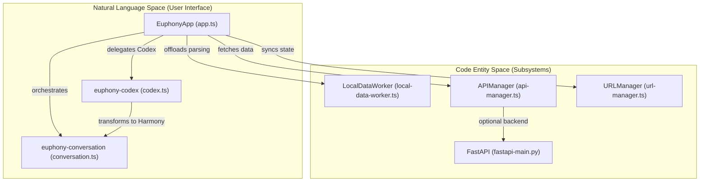
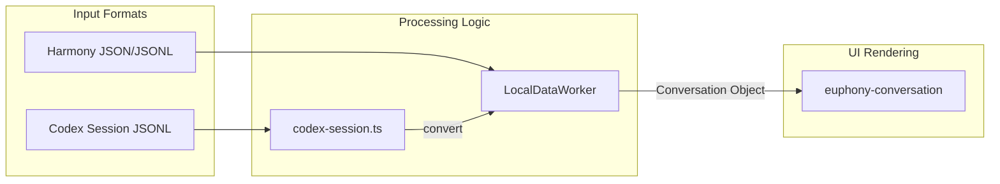

<!-- source: DeepWiki mcp.deepwiki.com · repo openai/euphony · page 1 Euphony Overview · fetched 2026-10-26 -->

# Euphony Overview

Relevant source files

The following files were used as context for generating this wiki page:

- [.gitignore](.gitignore)
- [LICENSE](LICENSE)
- [NOTICE](NOTICE)
- [README.md](README.md)
- [SECURITY.md](SECURITY.md)

Euphony is a visualization platform designed for inspecting [Harmony](https://github.com/openai/harmony) chat conversations and [Codex session logs](https://developers.openai.com/codex/cli/features). It provides a modular suite of LitElement-based Web Components that can be used as a standalone web application or embedded into existing React, Svelte, or Vue projects to render structured AI interaction data.

The system is designed to be portable and customizable, supporting features such as markdown rendering, LaTeX formulas, JMESPath filtering, and Harmony token inspection.

## Operational Modes

Euphony operates in two distinct modes depending on the environment and requirements for data fetching and translation. This is controlled via the `VITE_EUPHONY_FRONTEND_ONLY` environment variable.

| Mode | Description | Key Characteristics |
| :--- | :--- | :--- |
| **Frontend-only** | Recommended for static hosting (e.g., GitHub Pages). All processing occurs in the browser. | Browser-side URL fetching; User-provided OpenAI API key for translation. |
| **Backend-assisted** | Intended for local development or trusted environments. Uses a FastAPI server. | Server-side URL fetching (SSRF risk if public); backend translation; Harmony rendering support. |

For setup instructions, see [Getting Started](#1.1).

## Key Features

*   **Harmony Conversation Viewer**: Renders complex conversation schemas including nested metadata and various message types [README.md:31]().
*   **Codex Session Viewer**: Automatically detects Codex session JSONL and converts it into a viewable conversation timeline [README.md:32]().
*   **Flexible Data Ingestion**: Supports loading via clipboard paste, local file upload, or public HTTP(S) URLs [README.md:33]().
*   **Advanced Rendering**: Native support for Markdown, LaTeX, and unified diff previews [README.md:34]().
*   **Analysis Tools**: Includes JMESPath filtering, "Focus Mode" for specific roles/recipients, and a Harmony token inspector [README.md:37-39]().

## System Architecture

The following diagram illustrates the relationship between the core UI components and the data processing pipeline.

### High-Level Component Relationship

**Sources**: [README.md:44-60](), [src/app.ts:1-50](), [src/utils/api-manager.ts:1-20]()

## Data Pipeline and Formats

Euphony is built around the **Harmony** data format. Even when loading **Codex** sessions, the system transforms the session logs into a Harmony-compatible structure for rendering.

### Data Flow Mapping

**Sources**: [README.md:55-59](), [src/utils/codex-session.ts:1-30]()

For details on the schemas and example files, see [Data Formats: Harmony and Codex](#1.2).

## Integration as a Library

Euphony is distributed as a set of Web Components. Developers can import the library and use the `<euphony-conversation>` tag directly in their HTML or framework components.

*   **Entry Point**: `src/euphony.ts` exports the custom elements.
*   **Build Output**: `pnpm run build:library` generates files in the `lib/` directory [README.md:69-72]().
*   **Customization**: The look and feel can be modified using CSS variables defined in `src/css/component-global.css` [README.md:89-99]().

## Child Pages

*   **[Getting Started](#1.1)**: Installation, build commands, and environment configuration.
*   **[Data Formats: Harmony and Codex](#1.2)**: Deep dive into the supported JSON/JSONL schemas and auto-detection logic.

**Sources**: [README.md:1-120](), [LICENSE:1-135](), [NOTICE:1-14]()

---

