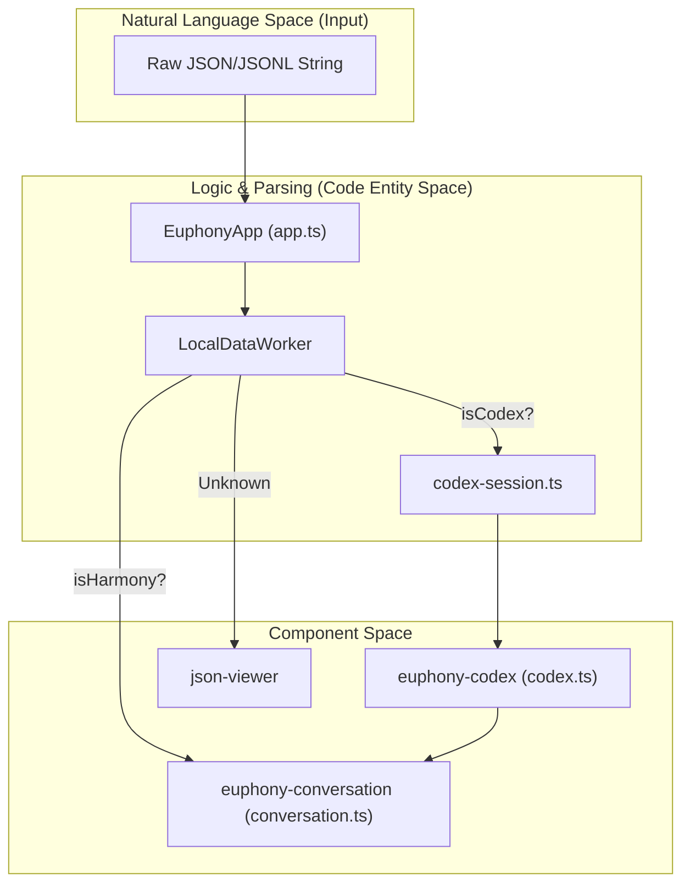
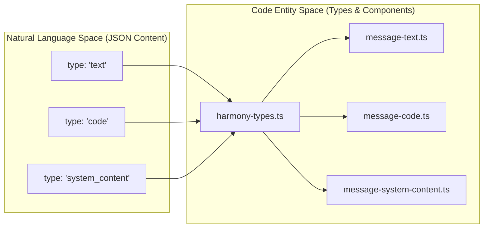

<!-- source: DeepWiki mcp.deepwiki.com · repo openai/euphony · page 1.2 Data Formats: Harmony and Codex · fetched 2026-10-26 -->

# Data Formats: Harmony and Codex

Relevant source files

The following files were used as context for generating this wiki page:

- [README.md](README.md)
- [public/examples/euphony-convo-100.jsonl](public/examples/euphony-convo-100.jsonl)
- [public/examples/simple-harmony-convos.jsonl](public/examples/simple-harmony-convos.jsonl)

Euphony is designed to ingest and visualize two primary structured data formats: **Harmony** (a rich, multi-modal conversation format) and **Codex Sessions** (a log format for developer tool interactions). The system employs an automatic detection pipeline to distinguish between these formats and normalize them for the internal rendering engine.

### Data Format Overview

Euphony supports loading data from the clipboard, local files, or remote URLs [README.md:51-54](). Depending on the structure of the input, it routes the data through different parsing logic.

| Format | File Extension | Structure | Detection Logic |
| :--- | :--- | :--- | :--- |
| **Harmony** | `.json` / `.jsonl` | Array of messages with `role` and `content`. | Presence of `messages` array containing Harmony-compliant objects [README.md:56-58](). |
| **Codex** | `.jsonl` | Stream of session events (request, response, etc). | Presence of specific Codex event keys like `session_id` or `event_type` [README.md:57](). |

**Sources:** [README.md:51-59](), [public/examples/simple-harmony-convos.jsonl:1-5]()

---

### Harmony Conversation Format

Harmony is the native format for Euphony. It represents a conversation as a sequence of messages, where each message contains multi-modal content blocks.

#### Schema Implementation
The core TypeScript interface for a Harmony conversation is defined in `src/types/harmony-types.ts`.

- **`Conversation`**: The top-level object containing an `id`, a list of `messages`, and optional `metadata` [public/examples/simple-harmony-convos.jsonl:1]().
- **`Message`**: Contains a `role` (e.g., `user`, `assistant`, `system`, `developer`, `tool`), `content` (an array of content blocks), and optional metadata like `create_time` [public/examples/simple-harmony-convos.jsonl:2]().
- **`Content Blocks`**: Support various types including `text`, `code`, `system_content`, and `developer_content` [public/examples/simple-harmony-convos.jsonl:3]().

#### Supported Content Types
Euphony provides specialized renderers for the following Harmony content:
1.  **Text**: Standard markdown strings, including support for LaTeX formulas and HTML blocks [public/examples/euphony-convo-100.jsonl:2,4]().
2.  **Code**: Syntax-highlighted blocks and unified diffs for code patches [public/examples/euphony-convo-100.jsonl:3]().
3.  **System/Developer Content**: Rendered as structured configuration tables to inspect the prompt stack [public/examples/euphony-convo-100.jsonl:3]().

**Sources:** [public/examples/euphony-convo-100.jsonl:1-5](), [public/examples/simple-harmony-convos.jsonl:1-5]()

---

### Codex Session Format

Codex sessions are typically stored as JSONL files where each line represents an event in a session timeline. Euphony automatically detects these and transforms them into a conversation-like view.

#### Detection and Transformation
The detection logic looks for session-specific markers. If the input is identified as a Codex session, the `EuphonyApp` delegates rendering to the `euphony-codex` component, which utilizes the `codex-session.ts` utility to map session events to the internal `Conversation` model [README.md:57]().

**Sources:** [README.md:20-25](), [README.md:57]()

---

### Data Detection and Processing Flow

When a user provides data, Euphony runs it through a processing pipeline. For large datasets, this occurs off-thread in the `LocalDataWorker`.

#### Detection Logic Sequence
1.  **Raw Input**: Data is received as a string (from clipboard) or a file handle.
2.  **Format Check**:
    - If the JSON contains a `messages` field at the top level or within a list, it is treated as **Harmony**.
    - If the JSON contains a `session_id` or matches Codex event signatures, it is treated as **Codex**.
    - If neither, it is rendered as a raw JSON object viewer [README.md:55-59]().

#### Data Pipeline Diagram
This diagram shows how the system moves from raw input to the specific component space.

"Data Processing and Component Mapping"

**Sources:** [README.md:51-59](), [public/examples/simple-harmony-convos.jsonl:1]()

---

### Examples and Reference Files

Euphony ships with example files in `public/examples/` to serve as a reference for developers and a test suite for the parser.

1.  **`simple-harmony-convos.jsonl`**: A basic set of Harmony conversations demonstrating the standard `role` and `content` structure [public/examples/simple-harmony-convos.jsonl:1-5]().
2.  **`euphony-convo-100.jsonl`**: A comprehensive example demonstrating:
    -   **Markdown & LaTeX**: Inline formulas and rich text [public/examples/euphony-convo-100.jsonl:2]().
    -   **Multi-modal Content**: Code blocks and diff patches [public/examples/euphony-convo-100.jsonl:3]().
    -   **System/Developer Messages**: Complex configuration objects rendered as tables [public/examples/euphony-convo-100.jsonl:3]().
    -   **HTML Blocks**: Interactive elements embedded in markdown [public/examples/euphony-convo-100.jsonl:4]().

#### Harmony Content Mapping
This diagram bridges the JSON content types to the specific TypeScript interfaces and Renderers.

"Harmony Schema to Code Entity Mapping"

**Sources:** [public/examples/euphony-convo-100.jsonl:1-4](), [public/examples/simple-harmony-convos.jsonl:1-4]()

---

