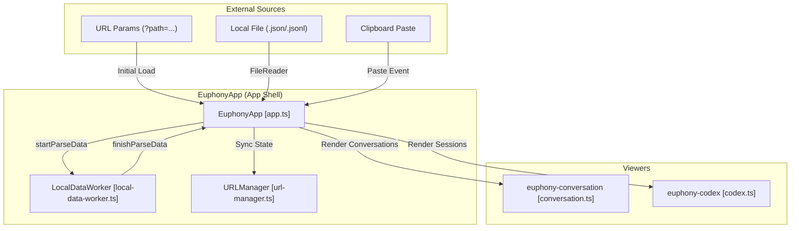
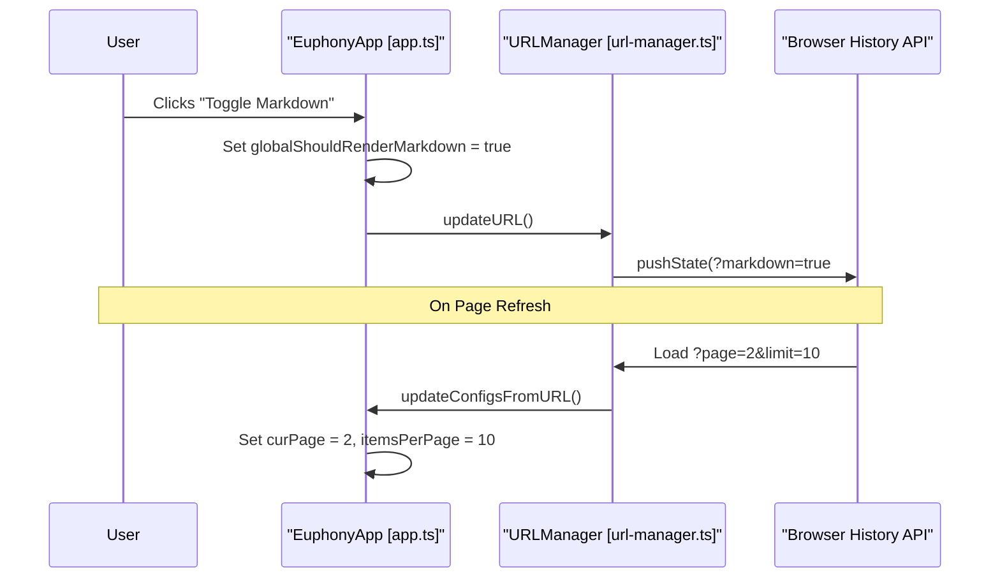

<!-- source: DeepWiki mcp.deepwiki.com · repo openai/euphony · page 2.1 App Shell and Data Pipeline · fetched 2026-10-26 -->

# App Shell and Data Pipeline

Relevant source files

The following files were used as context for generating this wiki page:

- [src/components/app/app.css](src/components/app/app.css)
- [src/components/app/app.ts](src/components/app/app.ts)
- [src/components/app/local-data-worker.ts](src/components/app/local-data-worker.ts)
- [src/components/app/request-worker.ts](src/components/app/request-worker.ts)
- [src/components/app/url-manager.ts](src/components/app/url-manager.ts)

The **Euphony App Shell** is the foundational orchestration layer of the application, implemented primarily in the `EuphonyApp` root component. It manages the global state, coordinates data ingestion from various sources (URLs, local files, and clipboard), and provides a synchronized interface between the UI state and the browser's URL.

### The EuphonyApp Root Component

The `EuphonyApp` class (defined in `src/components/app/app.ts`) is a `LitElement` that serves as the entry point for the standalone application. It manages the high-level layout, including the sticky header, search/filter controls, and the main content area where conversations are rendered [src/components/app/app.ts:127-128]().

#### Key Responsibilities
- **State Management**: Tracks the current dataset (`allConversationData`, `codexSessionData`, `JSONData`), pagination state, and global viewing preferences [src/components/app/app.ts:132-161]().
- **Worker Orchestration**: Initializes and communicates with the `LocalDataWorker` for off-thread parsing and the `RequestWorker` for API interactions [src/components/app/app.ts:201-202]().
- **UI Coordination**: Manages global UI components like toasts, confirm dialogs, and search windows [src/components/app/app.ts:173-192]().

#### Data Pipeline Overview
The diagram below illustrates how data flows from external sources through the App Shell and into the specialized viewer components.

**Data Flow: Source to Viewer**

Sources: [src/components/app/app.ts:127-202](), [src/components/app/local-data-worker.ts:245-255](), [src/components/app/url-manager.ts:13-52]()

---

### LocalDataWorker: Off-Thread Parsing

To maintain UI responsiveness, Euphony offloads heavy JSON/JSONL parsing and data transformation to a Web Worker named `LocalDataWorker` [src/components/app/local-data-worker.ts]().

#### Implementation Details
- **Command Pattern**: The worker listens for a `startParseData` command containing either a raw string or a `File` object [src/components/app/local-data-worker.ts:7-15]().
- **Format Detection**: It automatically detects if the data is a **Codex Session** (using `isCodexSessionJSONL`), a **Harmony Conversation**, or generic **JSON** [src/components/app/local-data-worker.ts:209-228]().
- **Heuristic Transformation**: If the data is JSONL but doesn't match the Harmony schema exactly, `extractConversationFromJSONL` attempts to find a conversation-like object within the lines and promotes it, preserving other fields in `metadata` [src/components/app/local-data-worker.ts:54-134]().

**Worker Communication Logic**
| Message Command | Direction | Payload |
| :--- | :--- | :--- |
| `startParseData` | App -> Worker | `sourceText` or `sourceFile`, `requestID` |
| `finishParseData`| Worker -> App | `dataType` (codex/conversation/json) and the parsed array |
| `error` | Worker -> App | Error message and `requestID` |

Sources: [src/components/app/local-data-worker.ts:6-45](), [src/components/app/local-data-worker.ts:197-243]()

---

### RequestWorker: API and Backend Integration

The `RequestWorker` (defined in `src/components/app/request-worker.ts`) encapsulates the logic for asynchronous network requests, providing a bridge between the viewer components and either the FastAPI backend or direct browser-side API calls [src/components/app/request-worker.ts:35-44]().

#### Key Features
- **Concurrency Control**: Uses an `async-mutex` Semaphore to limit translation requests to 128 concurrent calls, preventing browser-side network exhaustion [src/components/app/request-worker.ts:12-47]().
- **Dual Mode Support**:
    - **Backend Mode**: Calls the FastAPI server endpoints (e.g., `/translate/`, `/harmony-render/`) [src/components/app/request-worker.ts:81-84]().
    - **Frontend-Only Mode**: Uses `BrowserAPIManager` to perform operations like OpenAI translations directly using a client-side API key [src/components/app/request-worker.ts:131-145]().
- **Retry Logic**: Implements a 3-attempt retry strategy with jitter (300ms-700ms) for translation failures [src/components/app/request-worker.ts:73-79]().

Sources: [src/components/app/request-worker.ts:46-125](), [src/components/app/request-worker.ts:218-232]()

---

### URLManager: State Synchronization

The `URLManager` class (defined in `src/components/app/url-manager.ts`) ensures that the application state is reflected in the browser's URL parameters. This enables deep-linking to specific conversations, pages, or filtered views.

#### State Mapping
The `URLManager` synchronizes the following `EuphonyApp` properties:
- **Pagination**: `page`, `limit` [src/components/app/url-manager.ts:19-20]().
- **View Settings**: `markdown` (boolean), `metadata` (boolean), `grid` (column width) [src/components/app/url-manager.ts:23-34]().
- **Filtering**: `jmespath` (the current query string) [src/components/app/url-manager.ts:37-41]().
- **Navigation**: `index` (conversation ID) and `subindex` (message ID) [src/components/app/url-manager.ts:180-181]().

**URL Synchronization Flow**

Sources: [src/components/app/url-manager.ts:13-52](), [src/components/app/url-manager.ts:57-112]()

---

### Layout and Styling

The root layout is defined in `app.css` and utilizes a three-column grid for the main content [src/components/app/app.css:93-94]().

- **`.content-left` / `.content-right`**: Side margins that use CSS Container Queries (`@container`) to hide utility buttons (like "Scroll to Top") when the screen width is too narrow [src/components/app/app.css:109-135](), [src/components/app/app.css:220-232]().
- **`.content-center`**: The primary container for the `conversation-list`.
- **Grid View**: When `is-grid-view` is active, the conversation list switches from a vertical stack to a `repeat(auto-fill, ...)` grid layout [src/components/app/app.css:323-335]().
- **Sticky Header**: The header uses a linear gradient mask to provide a smooth transition as content scrolls beneath it [src/components/app/app.css:57-75]().

Sources: [src/components/app/app.css:3-107](), [src/components/app/app.css:320-338]()

---

