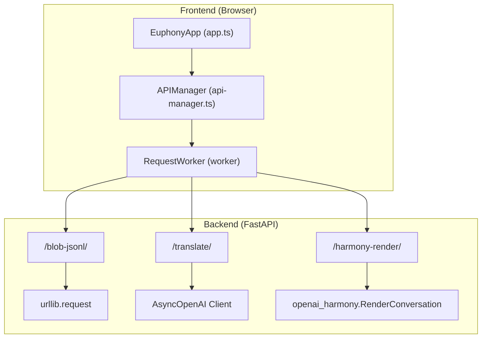
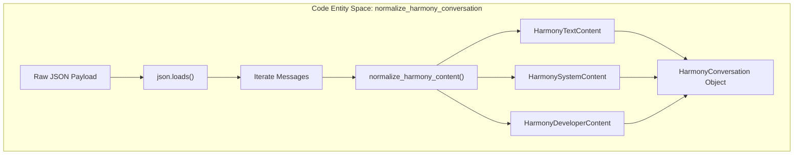

<!-- source: DeepWiki mcp.deepwiki.com · repo openai/euphony · page 2.2 FastAPI Backend Server · fetched 2026-10-26 -->

# FastAPI Backend Server

Relevant source files

The following files were used as context for generating this wiki page:

- [pyproject.toml](pyproject.toml)
- [server/fastapi-main.py](server/fastapi-main.py)

The Euphony backend is an optional Python-based FastAPI server that provides advanced features not available in the standalone frontend mode, such as server-side translation, remote JSONL fetching with JMESPath filtering, and server-side Harmony token rendering.

## Overview and Purpose

While Euphony can run as a static web application, the FastAPI server ([server/fastapi-main.py:1-14]()) extends its capabilities by:
1.  **Bypassing CORS**: Fetching remote resources that do not have permissive CORS headers via the `/blob-jsonl/` endpoint.
2.  **Translation**: Providing high-quality LLM-based translation via OpenAI's API.
3.  **Harmony Rendering**: Integrating with the `openai-harmony` library to visualize how conversations are tokenized for model input.

### Data Flow: Frontend to Backend
The following diagram illustrates how the `EuphonyApp` communicates with the FastAPI server.

**Figure 1: Euphony Backend Communication Flow**

Sources: [src/utils/api-manager.ts:1-20](), [server/fastapi-main.py:43-46](), [server/fastapi-main.py:286-310]()

---

## API Endpoints

### 1. Remote Data Fetching (`/blob-jsonl/`)
This endpoint allows the frontend to request data from a remote URL. It includes a security check to ensure the URL is valid and prevents common SSRF (Server-Side Request Forgery) patterns by validating the URL scheme [server/fastapi-main.py:228-232]().

*   **Function**: `get_blob_jsonl` [server/fastapi-main.py:220]()
*   **Filtering**: Supports server-side JMESPath filtering via the `query` parameter [server/fastapi-main.py:255-257]().
*   **Pagination**: Supports `offset` and `limit` to handle large JSONL files [server/fastapi-main.py:265-271]().

### 2. Translation (`/translate/`)
The `/translate/` endpoint uses the OpenAI API to translate message content into English. It implements several optimizations to handle high concurrency and avoid redundant API calls.

*   **Caching**: Uses `async_lru` for result caching [server/fastapi-main.py:214-215]().
*   **Singleflight Pattern**: The server maintains a dictionary of `_inflight_translations` [server/fastapi-main.py:45](). If multiple requests for the same text arrive simultaneously, they all await the same task instead of spawning multiple API calls [server/fastapi-main.py:330-335]().
*   **Concurrency Control**: A semaphore (`_translation_semaphore`) limits the number of active OpenAI requests to `TRANSLATION_MAX_CONCURRENCY` (default 1024) [server/fastapi-main.py:44]().

### 3. Harmony Rendering
These endpoints integrate with the `openai-harmony` package to provide tokenization previews.

| Endpoint | Function | Description |
| :--- | :--- | :--- |
| `/harmony-renderer-list/` | `get_harmony_renderer_list` | Returns available renderers (e.g., `o200k_harmony`) [server/fastapi-main.py:348-350](). |
| `/harmony-render/` | `post_harmony_render` | Takes a conversation JSON, normalizes it, and returns token IDs and decoded strings [server/fastapi-main.py:353-375](). |

Sources: [server/fastapi-main.py:214-275](), [server/fastapi-main.py:325-375]()

---

## Implementation Details

### Harmony Normalization
Before rendering or processing, raw JSON conversation data is normalized into a standard `HarmonyConversation` object. This process handles various legacy formats and author role mappings.

**Figure 2: Normalization Logic in server/fastapi-main.py**

Sources: [server/fastapi-main.py:94-164](), [server/fastapi-main.py:166-198]()

### Security and SSRF Considerations
The server includes safeguards when fetching remote content:
1.  **URL Validation**: It only allows `http` and `https` schemes [server/fastapi-main.py:228-232]().
2.  **Size Limits**: It enforces a `MAX_PUBLIC_JSON_BYTES` (25MB) limit on downloaded content to prevent memory exhaustion [server/fastapi-main.py:39](), [server/fastapi-main.py:246-248]().
3.  **Path Traversal**: The `_resolve_frontend_path` utility ensures that static file requests (like `index.html`) remain within the `dist` directory [server/fastapi-main.py:85-91]().

### Dependency Configuration
The server's environment is defined in `pyproject.toml`. Key dependencies include:
*   `fastapi` & `uvicorn`: Web framework and server [pyproject.toml:6-7]().
*   `openai-harmony`: Core library for Harmony data structures and tokenization [pyproject.toml:12]().
*   `async-lru`: For caching translation results [pyproject.toml:8]().
*   `jmespath`: For server-side JSON filtering [pyproject.toml:11]().

Sources: [pyproject.toml:1-13](), [server/fastapi-main.py:35-42]()

---

