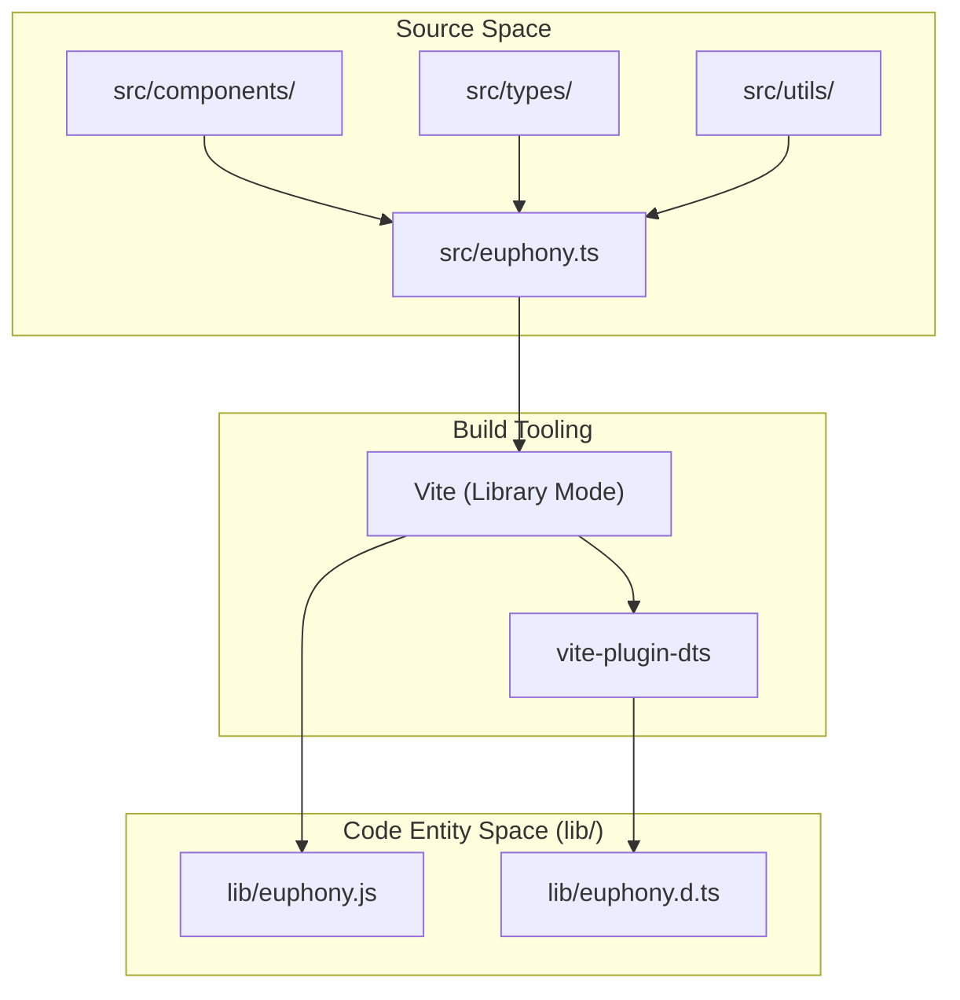
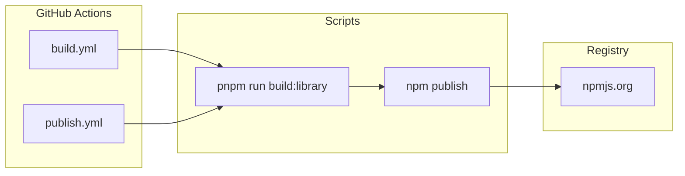

<!-- source: DeepWiki mcp.deepwiki.com · repo openai/euphony · page 2.3 Library Entry Point and Public API · fetched 2026-10-26 -->

# Library Entry Point and Public API

<details>
<summary>Relevant source files</summary>

The following files were used as context for generating this wiki page:

- [.github/workflows/build.yml](.github/workflows/build.yml)
- [.github/workflows/publish.yml](.github/workflows/publish.yml)
- [package.json](package.json)
- [src/euphony.ts](src/euphony.ts)

</details>


The `euphony` library is designed to be consumed either as a standalone web application or as a modular collection of Web Components. The library entry point centralizes the public API, ensuring that consumers have access to the core rendering components, data types, and utility functions required to integrate Euphony into external React, Svelte, or Vue projects.

## Entry Point: src/euphony.ts

The file `src/euphony.ts` serves as the primary barrel file for the library. It does not contain logic itself but rather exports the essential entities that constitute the Euphony public API [src/euphony.ts:1-14]().

By importing from this entry point, consumers gain access to:
- **Web Components**: Custom elements for rendering conversations and specialized message types.
- **Type Definitions**: TypeScript interfaces for Harmony and Codex data formats.
- **Utilities**: Helper functions for parsing session data and general UI logic.

### Exported Modules

| Category | Exports | Source |
| :--- | :--- | :--- |
| **Core Viewers** | `EuphonyCodex`, `EuphonyConversation` | [src/euphony.ts:2-3]() |
| **Message Renderers** | `MessageCode`, `MessageDeveloperContent`, `MessageSystemContent`, `MessageText`, `MessageUnsupported` | [src/euphony.ts:4-8]() |
| **Types** | `Conversation`, `Message`, `BlobJSONLPayload`, `TranslationRequest` | [src/euphony.ts:10-11]() |
| **Utilities** | `parseCodexSession`, `renderMarkdown`, `copyToClipboard` | [src/euphony.ts:12-13]() |

Sources: [src/euphony.ts:1-14]()

## Build Process and Distribution

Euphony uses **Vite** and **vite-plugin-dts** to generate a distribution-ready bundle. The build process is triggered via the `build:library` script defined in `package.json` [package.json:28-28]().

### Build Pipeline

The pipeline performs the following steps:
1.  **Type Checking**: Runs `tsc` to ensure type safety.
2.  **Library Mode**: Executes `vite build --mode library`. This uses the library mode configuration in Vite to bundle `src/euphony.ts`.
3.  **Output Generation**: Produces a `lib/` directory containing:
    -   `euphony.js`: The compiled JavaScript bundle (ES Module).
    -   `euphony.d.ts`: The generated TypeScript declaration file [package.json:6-11]().

### Library Build Workflow

The following diagram illustrates the transformation from source code to the distributed library artifacts.

**Build Artifact Generation**

Sources: [package.json:28-28](), [package.json:6-11](), [src/euphony.ts:1-14]()

## Integration and Usage

Once the library is built or installed via a package manager, it can be integrated into any modern web framework. Since Euphony components are standard Web Components (built with Lit), they are compatible with React, Svelte, and Vue.

### Consuming the Library

The `package.json` defines the entry points for the package, mapping the root import to the compiled library files [package.json:7-14]().

**Example Usage in a Host Application:**

```typescript
import { EuphonyConversation } from 'euphony';

// The component is automatically registered as <euphony-conversation>
// because the component files call customElements.define() internally.
```

### CI/CD Integration

The library is automatically built during the CI process. The `Build` workflow runs `pnpm run build:library` on every push to the `main` branch and on pull requests to verify that the library entry point remains functional [.github/workflows/build.yml:31-32](). 

For releases, the `Publish` workflow triggers on version tags (e.g., `v1.0.0`), builds the library, and publishes the `lib` folder to the npm registry [.github/workflows/publish.yml:31-35]().

**Library Release Pipeline**

Sources: [.github/workflows/build.yml:31-32](), [.github/workflows/publish.yml:31-35](), [package.json:15-23]()

## Public API Surface Area

The following table summarizes the primary classes and interfaces exposed to consumers.

| Symbol | Type | Description |
| :--- | :--- | :--- |
| `EuphonyConversation` | Class | The primary viewer for Harmony conversation data. |
| `EuphonyCodex` | Class | A wrapper that parses Codex session logs and renders them via `EuphonyConversation`. |
| `Conversation` | Interface | The TypeScript definition for the Harmony JSON schema. |
| `Message` | Interface | The TypeScript definition for individual message objects within a conversation. |
| `parseCodexSession` | Function | Utility to transform raw Codex JSONL strings into Harmony format. |

Sources: [src/euphony.ts:1-14](), [package.json:6-14]()

---

