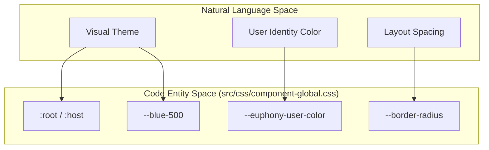
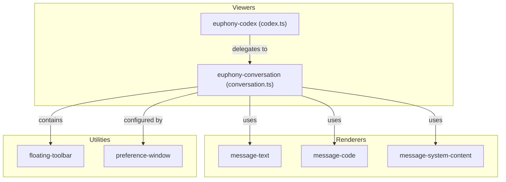

<!-- source: DeepWiki mcp.deepwiki.com · repo openai/euphony · page 3 Web Components · fetched 2026-10-26 -->

# Web Components

Relevant source files

The following files were used as context for generating this wiki page:

- [.fttemplates/default-template/[FTName].css](.fttemplates/default-template/[FTName].css)
- [.fttemplates/default-template/[FTName].ts](.fttemplates/default-template/[FTName].ts)
- [src/css/component-global.css](src/css/component-global.css)

Euphony is built as a library of reusable, encapsulated web components using **LitElement**. All components follow a strict naming convention, use Shadow DOM for style isolation, and leverage CSS variables for consistent theming across the application.

### Naming and Structure
All custom elements in the codebase are prefixed with `euphony-` to prevent collisions with standard HTML elements or other libraries. Each component typically consists of a TypeScript file (`.ts`) for logic and a paired CSS file (`.css`) imported as an inline string to be injected into the component's static styles.

The project uses a standardized template for creating new components, ensuring a consistent internal structure across the codebase.

#### Component Template Pattern
A standard Euphony component follows this structural layout:
1.  **Imports**: Lit core utilities and component-specific styles.
2.  **Class Definition**: Annotated with `@customElement`.
3.  **Properties and State**: Using `@property` for public API and `@state` for internal reactivity.
4.  **Lifecycle Methods**: Implementation of `firstUpdated`, `willUpdate`, etc.
5.  **Render Method**: Returns the HTML template.
6.  **Static Styles**: Combines component-specific CSS with global shared styles.
7.  **Global Declaration**: Registration in `HTMLElementTagNameMap` for TypeScript support.

| Feature | Implementation |
| :--- | :--- |
| **Base Class** | `LitElement` [[.fttemplates/default-template/[FTName].ts:11-11]()] |
| **Naming Convention** | `euphony-<name>` [[.fttemplates/default-template/[FTName].ts:10-10]()] |
| **Style Encapsulation** | Shadow DOM via `static styles` [[.fttemplates/default-template/[FTName].ts:54-58]()] |
| **External Styles** | Inlined via `?inline` query [[.fttemplates/default-template/[FTName].ts:5-5]()] |

**Sources:**
- [.fttemplates/default-template/[FTName].ts:1-66]()
- [.fttemplates/default-template/[FTName].css:1-12]()

---

### Theming and Global Styles
Euphony uses **CSS Custom Properties (Variables)** defined in a global scope to manage theming. These variables allow the host application to override colors, fonts, and spacing without breaking the Shadow DOM encapsulation.

#### Global Variable System
The core design tokens are defined in `src/css/component-global.css`. These include:
*   **Shadows**: Standardized depths for cards and borders (e.g., `--shadow-border-light`).
*   **Typography**: A stepped scale from `--font-d6` to `--font-u6` and a monospace stack.
*   **Color Palette**: Extensive HSL-based color scales (Red, Blue, Green, etc.) and semantic colors like `--added-color` or `--deleted-color` for diffs.

#### Code-to-UI Mapping: Style Tokens
The following diagram illustrates how CSS variables in the code map to visual entities in the rendered components.

**Diagram: Style Token Mapping**

**Sources:**
- [src/css/component-global.css:42-222]()

---

### Component Hierarchy
The Euphony component library is organized into three main categories: high-level viewers, specialized message renderers, and low-level UI utilities.

#### Component Relationship
The following diagram shows how the primary code entities interact to form the UI.

**Diagram: Component Entity Relationships**

#### 1. Conversation and Codex Viewers
These are the entry-point components. `euphony-conversation` handles the rendering of a list of Harmony messages, while `euphony-codex` acts as a wrapper for parsing Codex session files.
*   For details, see [Conversation and Codex Viewer Components](#3.1).

#### 2. Message Renderers
A family of components dedicated to rendering specific message types. The `euphony-conversation` component dynamically selects the appropriate renderer based on the message content type (e.g., Markdown, Code, or System configuration).
*   For details, see [Message Renderer Components](#3.2).

#### 3. UI Utility Components
Supporting elements that provide common UI patterns like toolbars, dialogs, search windows, and pagination. These are used internally by the viewers to provide interactive features.
*   For details, see [UI Utility Components](#3.3).

**Sources:**
- [.fttemplates/default-template/[FTName].ts:10-11]()
- [src/css/component-global.css:1-222]()

---

