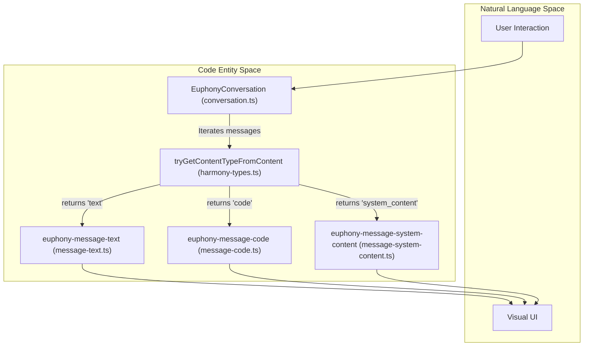
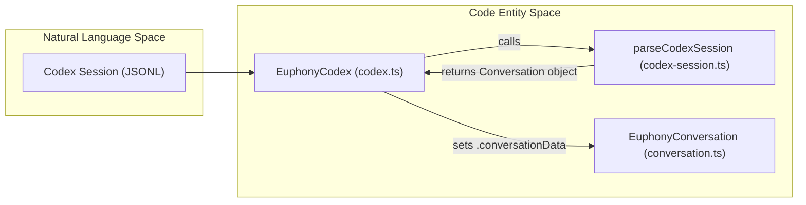

<!-- source: DeepWiki mcp.deepwiki.com · repo openai/euphony · page 3.1 Conversation and Codex Viewer Components · fetched 2026-10-26 -->

# Conversation and Codex Viewer Components

Relevant source files

The following files were used as context for generating this wiki page:

- [src/components/codex/codex.css](src/components/codex/codex.css)
- [src/components/codex/codex.ts](src/components/codex/codex.ts)
- [src/components/conversation/conversation.css](src/components/conversation/conversation.css)
- [src/components/conversation/conversation.ts](src/components/conversation/conversation.ts)

The primary viewer components in Euphony are `euphony-conversation` and `euphony-codex`. These components are responsible for rendering the hierarchical structure of Harmony conversations and Codex sessions, providing interactive features such as metadata inspection, real-time translation, and focus mode filtering.

## Euphony Conversation (`euphony-conversation`)

The `EuphonyConversation` class is the core rendering engine for Harmony data. It transforms a `Conversation` object into a vertical stack of message components, managing global state for the conversation such as theme, markdown rendering, and translation status.

### Implementation Details
`EuphonyConversation` is a `LitElement` that reacts to changes in its `conversationData` property [src/components/conversation/conversation.ts:121-122](). It manages a complex internal state, including:
*   **Message Filtering**: Implements "Focus Mode" which filters messages based on `author`, `recipient`, or `content-type` [src/components/conversation/conversation.ts:187-197]().
*   **Translation**: Orchestrates calls to the backend `/translate/` endpoint and updates messages with their translated counterparts [src/components/conversation/conversation.ts:105-108]().
*   **Metadata Viewer**: Integrates a split-panel view using Shoelace's `sl-split-panel` to show the raw JSON metadata alongside the rendered conversation [src/components/conversation/conversation.ts:55-55]().

### Message Rendering Logic
The component iterates through the `messages` array and dynamically selects a renderer based on the message's content type using `tryGetContentTypeFromContent` [src/components/conversation/conversation.ts:36-37]().

| Content Type | Component Used | Purpose |
| :--- | :--- | :--- |
| `text` | `euphony-message-text` | Renders Markdown and LaTeX. |
| `code` | `euphony-message-code` | Syntax-highlighted code blocks via Prism. |
| `system_content` | `euphony-message-system-content` | Configuration tables for system messages. |
| `developer_content` | `euphony-message-developer-content` | Developer instructions and metadata. |
| `hidden` | `euphony-message-hidden` | Placeholder for collapsed/hidden content. |

### Data Flow: Message Selection and Rendering
The following diagram illustrates how `euphony-conversation` processes a Harmony `Message` object and delegates to specific renderers.

**Message Dispatch Flow**

Sources: [src/components/conversation/conversation.ts:113-114](), [src/types/harmony-types.ts:36-37]()

## Euphony Codex (`euphony-codex`)

`EuphonyCodex` is a wrapper component specifically designed for the Codex session format. Its primary responsibility is to parse Codex JSONL (JSON Lines) data and transform it into a standard Harmony `Conversation` object, which it then passes to an internal `euphony-conversation` instance.

### Implementation Details
*   **Parsing**: It accepts a `session-string` (raw JSONL) or `sessionData` (array of objects) [src/components/codex/codex.ts:17-21]().
*   **Lifecycle**: The `willUpdate` lifecycle method triggers `refreshConversationFromSession` whenever the session data changes [src/components/codex/codex.ts:144-151]().
*   **Delegation**: Once parsed via `parseCodexSession`, the resulting `Conversation` is passed to the child `euphony-conversation` element via the `.conversationData` property [src/components/codex/codex.ts:164-165]().

### Data Flow: Codex to Harmony Transformation
The component acts as a bridge between the raw Codex event stream and the structured Harmony viewer.

**Codex Transformation Pipeline**

Sources: [src/components/codex/codex.ts:121-142](), [src/utils/codex-session.ts:5-5]()

## Key Functions and Properties

### EuphonyConversation Properties
*   `conversationData`: The primary input. Accepts a `TranslatableConversation` object [src/components/conversation/conversation.ts:122-122]().
*   `isEditable`: Enables "Editor Mode," allowing users to modify message content or roles [src/components/conversation/conversation.ts:179-180]().
*   `focusModeAuthor`: An array of author IDs to filter the view [src/components/conversation/conversation.ts:187-188]().

### EuphonyCodex Properties
*   `sessionString`: A string containing JSONL formatted Codex events [src/components/codex/codex.ts:17-18]().
*   `conversationLabel`: Customizes the header label (defaults to "Session") [src/components/codex/codex.ts:26-27]().

### Styling and Theming
Both components utilize the Euphony global CSS variable system defined in `component-global.css`.
*   **Theming**: Controlled via the `theme` property (`light`, `dark`, or `auto`) [src/components/conversation/conversation.ts:210-211]().
*   **CSS Variables**: Layout is managed via variables like `--euphony-conversation-max-width` and `--euphony-user-color` [src/components/conversation/conversation.css:8-16]().

Sources: [src/components/conversation/conversation.ts:113-211](), [src/components/codex/codex.ts:15-96](), [src/components/conversation/conversation.css:1-111]()

---

