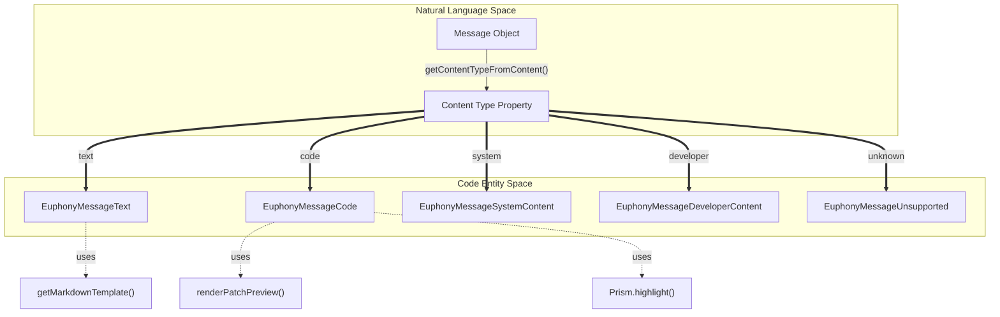
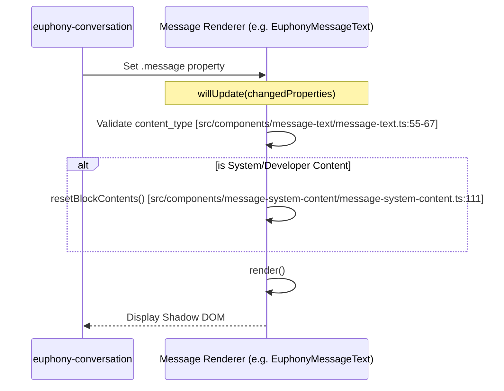

<!-- source: DeepWiki mcp.deepwiki.com · repo openai/euphony · page 3.2 Message Renderer Components · fetched 2026-10-26 -->

# Message Renderer Components

Relevant source files

The following files were used as context for generating this wiki page:

- [src/components/message-code/message-code.css](src/components/message-code/message-code.css)
- [src/components/message-code/message-code.ts](src/components/message-code/message-code.ts)
- [src/components/message-developer-content/message-developer-content.css](src/components/message-developer-content/message-developer-content.css)
- [src/components/message-developer-content/message-developer-content.ts](src/components/message-developer-content/message-developer-content.ts)
- [src/components/message-hidden/message-hidden.css](src/components/message-hidden/message-hidden.css)
- [src/components/message-hidden/message-hidden.ts](src/components/message-hidden/message-hidden.ts)
- [src/components/message-system-content/message-system-content.css](src/components/message-system-content/message-system-content.css)
- [src/components/message-system-content/message-system-content.ts](src/components/message-system-content/message-system-content.ts)
- [src/components/message-text/message-text.css](src/components/message-text/message-text.css)
- [src/components/message-text/message-text.ts](src/components/message-text/message-text.ts)
- [src/components/message-unsupported/message-unsupported.css](src/components/message-unsupported/message-unsupported.css)
- [src/components/message-unsupported/message-unsupported.ts](src/components/message-unsupported/message-unsupported.ts)

Message Renderer Components are specialized LitElement web components responsible for visualizing the diverse content types within a Harmony conversation. Each component is tailored to a specific `content_type` defined in the Harmony schema, handling unique requirements like Markdown parsing, LaTeX rendering, syntax highlighting, or structured data tables.

## Renderer Selection Logic

The parent `euphony-conversation` component orchestrates the display of messages. It inspects the `content_type` of each message and dynamically selects the corresponding renderer.

| Content Type | Component Tag | Class Name |
| :--- | :--- | :--- |
| `text` | `euphony-message-text` | `EuphonyMessageText` |
| `code` | `euphony-message-code` | `EuphonyMessageCode` |
| `system` | `euphony-message-system-content` | `EuphonyMessageSystemContent` |
| `developer` | `euphony-message-developer-content` | `EuphonyMessageDeveloperContent` |
| (Hidden) | `euphony-message-hidden` | `EuphonyMessageHidden` |
| (Unknown) | `euphony-message-unsupported` | `EuphonyMessageUnsupported` |

### Data Flow: Content Type to Component
The following diagram illustrates how the `Message` entity is routed to specific code entities based on its internal state.

**Message Dispatcher Logic**

**Sources:** [src/components/message-text/message-text.ts:59-65](), [src/components/message-code/message-code.ts:34-39](), [src/components/message-system-content/message-system-content.ts:101-108](), [src/components/message-developer-content/message-developer-content.ts:88-95]()

---

## Core Message Renderers

### 1. Message Text (`euphony-message-text`)
The primary renderer for standard conversational turns. It supports two modes: static rendering (Markdown/LaTeX) and an interactive editor mode.

*   **Markdown/LaTeX:** Uses `getMarkdownTemplate` to process the `text` property of `TextMessageContent` [src/components/message-text/message-text.ts:115-131]().
*   **Editor Mode:** When `isEditable` is true, it renders a `contenteditable` div. Changes are propagated via the `message-text-changed` custom event [src/components/message-text/message-text.ts:77-86]().
*   **Translation Support:** Applies specific CSS variables (`--translation-color`) when the `isTranslation` property is set [src/components/message-text/message-text.css:7-12]().

**Sources:** [src/components/message-text/message-text.ts:17-151](), [src/components/message-text/message-text.css:1-40]()

### 2. Message Code (`euphony-message-code`)
Handles technical content including source code and unified diffs (patches).

*   **Syntax Highlighting:** Uses `Prism.js` to highlight code based on the `language` field [src/components/message-code/message-code.ts:44-55](). It specifically imports `prism-json` and `prism-python` by default [src/components/message-code/message-code.ts:5-6]().
*   **Patch Preview:** Before falling back to standard code rendering, it attempts to parse the content via `renderPatchPreview`. If the text follows a diff format, it renders a specialized UI with line-by-line additions and deletions [src/components/message-code/message-code.ts:65-77]().
*   **Styling:** Incorporates `prism-coldark-auto.css` for themed syntax highlighting [src/components/message-code/message-code.ts:80-85]().

**Sources:** [src/components/message-code/message-code.ts:23-92](), [src/components/message-code/message-code.css:1-48]()

### 3. Message System & Developer Content
These components render structured configuration and instruction data, typically seen at the beginning of a conversation or in tool-calling contexts.

*   **System Content (`euphony-message-system-content`):** Renders model identity, knowledge cutoffs, and tool definitions in structured tables [src/components/message-system-content/message-system-content.ts:155-212]().
*   **Developer Content (`euphony-message-developer-content`):** Similar to system content but focused on developer-provided instructions and tool namespaces [src/components/message-developer-content/message-developer-content.ts:140-216]().
*   **Block Decomposition:** Both components use a `resetBlockContents` helper to transform complex Harmony objects into an array of `BlockContent` objects for uniform rendering [src/components/message-system-content/message-system-content.ts:144-152]().

**Sources:** [src/components/message-system-content/message-system-content.ts:45-220](), [src/components/message-developer-content/message-developer-content.ts:44-216]()

---

## Utility and Fallback Renderers

### Message Hidden (`euphony-message-hidden`)
Used when a message is filtered out (e.g., by Focus Mode) but the user should still be aware of its presence. It displays a compact label like "Show text message" [src/components/message-hidden/message-hidden.ts:58-68](). Clicking the component dispatches a `hidden-message-clicked` event, signaling the parent to reveal the content [src/components/message-hidden/message-hidden.ts:73-82]().

**Sources:** [src/components/message-hidden/message-hidden.ts:14-94]()

### Message Unsupported (`euphony-message-unsupported`)
A safety fallback for experimental or future `content_type` values not yet implemented in the UI. It displays an error label and provides a collapsible JSON view of the raw message content [src/components/message-unsupported/message-unsupported.ts:70-107]().

**Sources:** [src/components/message-unsupported/message-unsupported.ts:14-115]()

---

## Implementation Details

### Shared Styling Patterns
Renderers share common CSS modules via `@import` in their shadow DOM styles to ensure visual consistency:
*   `message-content-default.css`: Base layout and padding [src/components/message-text/message-text.css:2]().
*   `message-markdown.css`: Typography for rendered Markdown [src/components/message-text/message-text.css:1]().
*   `message-collapse.css`: Styles for expandable/collapsible blocks used in System/Developer renderers [src/components/message-system-content/message-system-content.css:1]().

### Lifecycle and Data Binding
The components follow a standard Lit lifecycle for data updates:

**Renderer Lifecycle Flow**

**Sources:** [src/components/message-text/message-text.ts:55-67](), [src/components/message-system-content/message-system-content.ts:95-113]()

---

