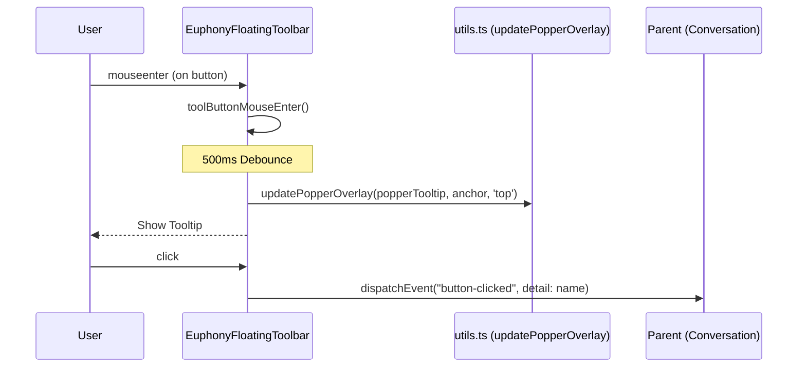

<!-- source: DeepWiki mcp.deepwiki.com · repo openai/euphony · page 3.3 UI Utility Components · fetched 2026-10-26 -->

# UI Utility Components

<details>
<summary>Relevant source files</summary>

The following files were used as context for generating this wiki page:

- [src/components/confirm-dialog/confirm-dialog.css](src/components/confirm-dialog/confirm-dialog.css)
- [src/components/confirm-dialog/confirm-dialog.ts](src/components/confirm-dialog/confirm-dialog.ts)
- [src/components/floating-toolbar/floating-toolbar.css](src/components/floating-toolbar/floating-toolbar.css)
- [src/components/floating-toolbar/floating-toolbar.ts](src/components/floating-toolbar/floating-toolbar.ts)
- [src/components/input-dialog/input-dialog.css](src/components/input-dialog/input-dialog.css)
- [src/components/input-dialog/input-dialog.ts](src/components/input-dialog/input-dialog.ts)
- [src/components/json-viewer/json-viewer.css](src/components/json-viewer/json-viewer.css)
- [src/components/json-viewer/json-viewer.ts](src/components/json-viewer/json-viewer.ts)
- [src/components/menu/menu.css](src/components/menu/menu.css)
- [src/components/menu/menu.ts](src/components/menu/menu.ts)
- [src/components/message-editor-popover/message-editor-popover.css](src/components/message-editor-popover/message-editor-popover.css)
- [src/components/message-editor-popover/message-editor-popover.ts](src/components/message-editor-popover/message-editor-popover.ts)
- [src/components/pagination/pagination.css](src/components/pagination/pagination.css)
- [src/components/pagination/pagination.ts](src/components/pagination/pagination.ts)
- [src/components/preference-window/preference-window.css](src/components/preference-window/preference-window.css)
- [src/components/preference-window/preference-window.ts](src/components/preference-window/preference-window.ts)
- [src/components/search-window/search-window.css](src/components/search-window/search-window.css)
- [src/components/search-window/search-window.ts](src/components/search-window/search-window.ts)
- [src/components/toast/toast.css](src/components/toast/toast.css)
- [src/components/toast/toast.ts](src/components/toast/toast.ts)
- [src/components/token-window/token-window.css](src/components/token-window/token-window.css)
- [src/components/token-window/token-window.ts](src/components/token-window/token-window.ts)

</details>


This page provides a technical reference for the supporting UI components used across Euphony. These components handle auxiliary tasks such as message actions, data filtering, settings management, and interactive dialogs.

## Interaction and Overlay Components

Euphony uses several components to handle user interactions that require overlays or floating UI elements.

### floating-toolbar
The `euphony-floating-toolbar` is a per-message action bar that appears when interacting with a message. It supports dynamic button configurations with tooltips powered by a Popper-based positioning logic [src/components/floating-toolbar/floating-toolbar.ts:4-4]().

- **Data Flow**: It accepts an array of `FloatingToolbarButton` objects [src/components/floating-toolbar/floating-toolbar.ts:8-12](). When a button is clicked, it dispatches a `button-clicked` custom event containing the button name [src/components/floating-toolbar/floating-toolbar.ts:208-213]().
- **Tooltip Logic**: Uses a debounced mouse-enter handler (`toolButtonMouseEnter`) to show tooltips after 500ms [src/components/floating-toolbar/floating-toolbar.ts:107-127]().

### message-editor-popover
Used in conversation editing mode, the `euphony-message-editor-popover` allows for quick modification of message metadata including role, author name, recipient, and channel [src/components/message-editor-popover/message-editor-popover.ts:27-30]().

- **Implementation**: It maintains local state for edits (`selectedRole`, `authorName`, etc.) to allow users to cancel without affecting the original data [src/components/message-editor-popover/message-editor-popover.ts:43-53]().
- **Normalization**: On save, it normalizes blank strings to `null` to maintain a compact Harmony format [src/components/message-editor-popover/message-editor-popover.ts:92-94]().

### menu
A generic dropdown menu component (`nightjar-menu`) used for context actions. It features a fade-out animation implemented via the Web Animations API before hiding the element [src/components/menu/menu.ts:78-87]().

**Sources:**
- [src/components/floating-toolbar/floating-toolbar.ts:1-218]()
- [src/components/message-editor-popover/message-editor-popover.ts:1-208]()
- [src/components/menu/menu.ts:1-136]()

---

## Dialogs and Notifications

Euphony implements custom dialogs and toast notifications for user confirmation and feedback.

### confirm-dialog and input-dialog
These components wrap the native HTML `<dialog>` element [src/components/confirm-dialog/confirm-dialog.ts:126-126]().
- **confirm-dialog**: Includes a "Don't ask me again" feature that persists the user's preference in `localStorage` using an `actionKey` [src/components/confirm-dialog/confirm-dialog.ts:79-82]().
- **input-dialog**: Extends the dialog pattern to include an input field (using `sl-input`) and an asynchronous `inputValidate` hook for checking input before closing [src/components/input-dialog/input-dialog.ts:46-53]().

### toast
The toast notification system provides non-blocking feedback. It supports different severity levels and automatic dismissal.

**Sources:**
- [src/components/confirm-dialog/confirm-dialog.ts:1-177]()
- [src/components/input-dialog/input-dialog.ts:1-199]()

---

## Data Inspection and Search

These components allow users to inspect the underlying Harmony/Codex data structures and filter them.

### json-viewer
The `euphony-json-viewer` provides syntax-highlighted JSON rendering using PrismJS [src/components/json-viewer/json-viewer.ts:4-5](). It imports the `prism-coldark-auto` theme to match the app's styling [src/components/json-viewer/json-viewer.ts:7-7]().

### search-window (JMESPath UI)
This component provides a specialized interface for filtering conversations. It allows users to write and execute JMESPath queries against the loaded data.

### token-window
The `token-window` is a Harmony token inspector. It visualizes how a message is tokenized, often used for debugging model context limits or specific tokenizer behaviors.

**Sources:**
- [src/components/json-viewer/json-viewer.ts:1-93]()
- [src/components/search-window/search-window.ts:1-10]()
- [src/components/token-window/token-window.ts:1-10]()

---

## Component Relationship Diagram

The following diagram illustrates how utility components relate to the core data entities and user actions.

**UI Utility Architecture**
```mermaid
graph TD
    subgraph "Natural Language Space"
        "User Action" --> "Confirm Action"
        "User Action" --> "Edit Metadata"
        "User Action" --> "Filter Messages"
    end

    subgraph "Code Entity Space"
        "Confirm Action" --> CD["NightjarConfirmDialog (confirm-dialog.ts)"]
        "Edit Metadata" --> MEP["EuphonyMessageEditorPopover (message-editor-popover.ts)"]
        "Filter Messages" --> SW["EuphonySearchWindow (search-window.ts)"]
        
        CD -- "checks" --> LS["localStorage (<skip-confirm>)"]
        MEP -- "dispatches" --> SBC["save-button-clicked (CustomEvent)"]
        SW -- "applies" --> JP["JMESPath Filter"]
    end

    style CD stroke-dasharray: 5 5
    style MEP stroke-dasharray: 5 5
    style SW stroke-dasharray: 5 5
```
**Sources:**
- [src/components/confirm-dialog/confirm-dialog.ts:79-82]()
- [src/components/message-editor-popover/message-editor-popover.ts:97-103]()

---

## Component Property Reference

| Component | Tag Name | Key Properties | Events |
| :--- | :--- | :--- | :--- |
| **Floating Toolbar** | `euphony-floating-toolbar` | `buttons: FloatingToolbarButton[]` | `button-clicked` |
| **Confirm Dialog** | `nightjar-confirm-dialog` | `actionKey: string` | N/A (Callback-based) |
| **Input Dialog** | `nightjar-input-dialog` | `inputValidate: Promise<boolean>` | N/A (Callback-based) |
| **JSON Viewer** | `euphony-json-viewer` | `data: JSONValue` | N/A |
| **Editor Popover** | `euphony-message-editor-popover`| `message: Message` | `save-button-clicked`, `cancel-button-clicked` |

### Floating Toolbar Interaction Flow

This diagram maps the code entities involved in displaying and interacting with the per-message toolbar.

**Toolbar Event Flow**

**Sources:**
- [src/components/floating-toolbar/floating-toolbar.ts:91-128]()
- [src/components/floating-toolbar/floating-toolbar.ts:206-214]()
- [src/utils/utils.ts:4-4]()

---

