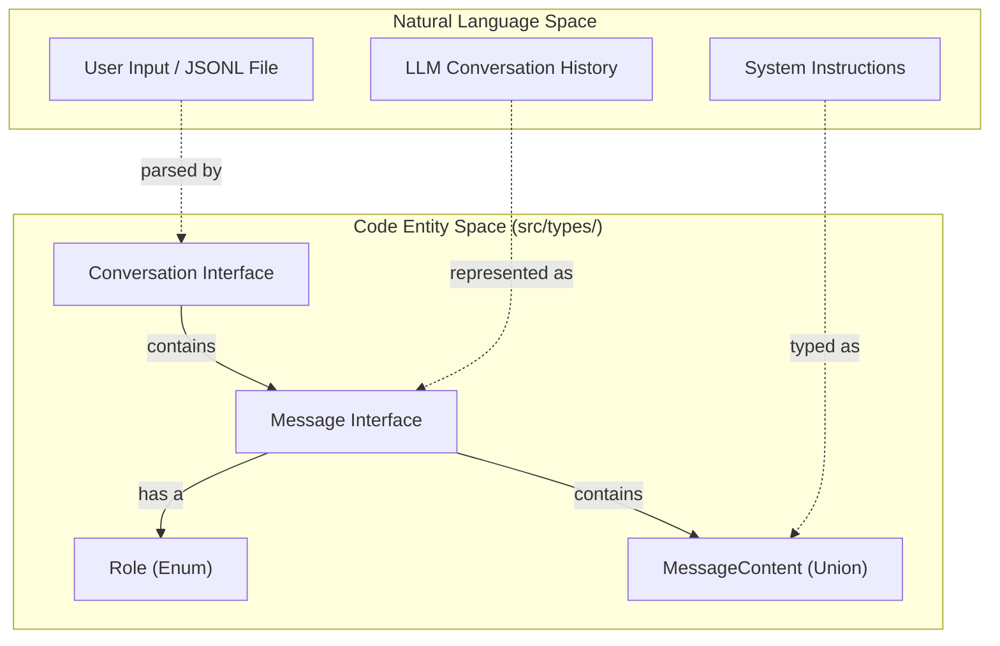
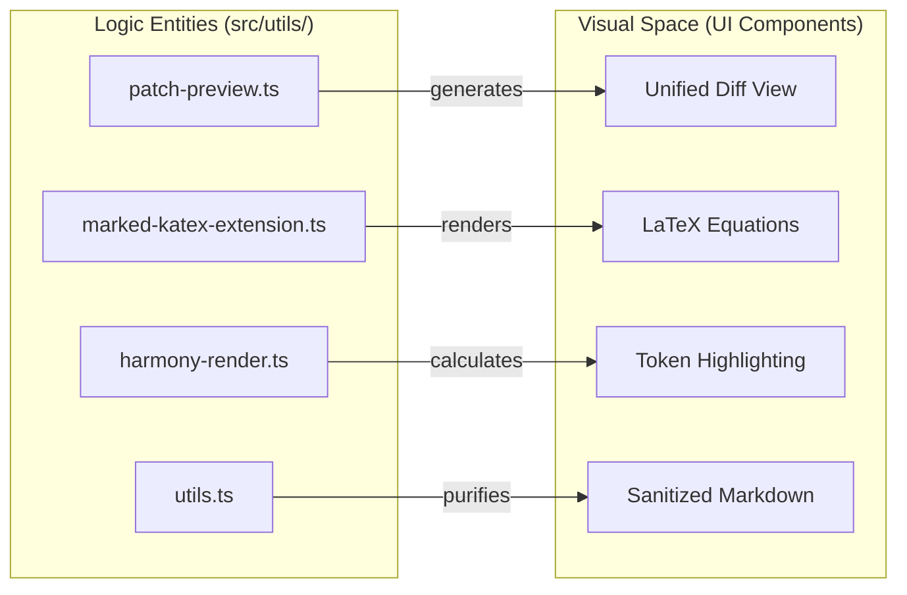

<!-- source: DeepWiki mcp.deepwiki.com · repo openai/euphony · page 4 Core Utilities and Types · fetched 2026-10-26 -->

# Core Utilities and Types

Relevant source files

The following files were used as context for generating this wiki page:

- [src/config/config.ts](src/config/config.ts)

This section provides an overview of the foundational TypeScript modules that underpin Euphony's data structures and logic. These utilities and type definitions are shared across all LitElement components to ensure consistency in message handling, API communication, and document rendering.

Euphony relies on two primary directories for its core logic:
- `src/types/`: Defines the strict interfaces for the **Harmony** conversation format and common API payloads.
- `src/utils/`: Contains logic for markdown parsing, browser-side tokenization, and backend communication.

## Harmony Type System

The Harmony type system is the backbone of Euphony's data model. It provides a structured way to represent multi-modal conversations, including text, code, system configurations, and developer-specific metadata.

The system is centered around the `Conversation` interface, which contains an array of `Message` objects [src/types/harmony-types.ts:252-258](). Each message is associated with a `Role` (e.g., `user`, `assistant`, `system`, `developer`) [src/types/harmony-types.ts:1-7]() and contains a list of `MessageContent` items.

For a deep dive into the interfaces and enums, see **[Harmony Type System](#4.1)**.

### Core Data Flow

The following diagram illustrates how raw input data is mapped to the internal Harmony type system used by the components.

**Natural Language to Code Entity Mapping: Data Pipeline**

Sources: [src/types/harmony-types.ts:1-258]()

---

## Utility Modules

The utility modules provide the functional "engine" for the UI. These include high-performance rendering helpers, API abstractions, and specialized parsers for legacy formats.

Key utility areas include:
- **Rendering**: Euphony uses `marked` for markdown, `KaTeX` for math, and `DOMPurify` to ensure safe HTML output [src/utils/utils.ts:100-140]().
- **API Management**: The `APIManager` class abstracts data fetching, supporting both backend-assisted and frontend-only modes [src/utils/api-manager.ts:10-40]().
- **Tokenization**: Browser-side token counting for Harmony messages is handled via `gpt-tokenizer` integration [src/utils/harmony-render.ts:1-20]().
- **Codex Support**: Specialized logic for detecting and parsing Codex JSONL session files [src/utils/codex-session.ts:5-30]().

For detailed function signatures and implementation logic, see **[Utility Modules](#4.2)**.

### Rendering and Logic Mapping

This diagram shows how specific code entities in the utility layer transform raw data into visual elements.

**Logic to Visual Mapping: Rendering Pipeline**

Sources: [src/utils/utils.ts:1-150](), [src/utils/patch-preview.ts:1-50](), [src/utils/harmony-render.ts:1-30]()

---

## Shared Configuration

Euphony maintains a centralized configuration file for layout constants, timeouts, and a comprehensive HSL color palette used for theming.

| Category | Description | File Reference |
| :--- | :--- | :--- |
| **Layout** | Sidebar offsets and UI spacing constants. | [src/config/config.ts:1-3]() |
| **Timeouts** | Delays for tooltips (300ms) and fetch timeouts (30s). | [src/config/config.ts:5-11]() |
| **Colors** | Semantic colors for diffs (added/deleted) and a full Material-style HSL palette. | [src/config/config.ts:13-183]() |

Sources: [src/config/config.ts:1-183]()

---

