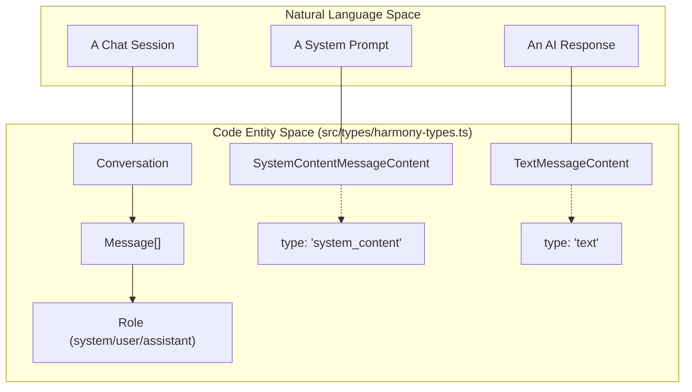
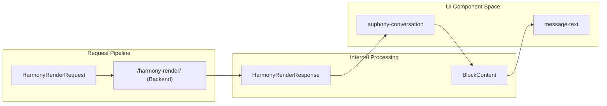

<!-- source: DeepWiki mcp.deepwiki.com · repo openai/euphony · page 4.1 Harmony Type System · fetched 2026-10-26 -->

# Harmony Type System

Relevant source files

The following files were used as context for generating this wiki page:

- [src/config/config.ts](src/config/config.ts)
- [src/euphony.ts](src/euphony.ts)

The Harmony Type System defines the core data structures used by Euphony to represent, process, and render conversational data. It is primarily divided into two modules: `harmony-types.ts`, which describes the "Harmony" schema (a standardized format for multi-turn conversations), and `common-types.ts`, which handles internal application state, API payloads, and rendering requests.

### 1. Harmony Schema Core
The Harmony schema is the primary internal representation for conversations within Euphony. It is designed to support complex message structures, including nested configurations and specialized content types like developer instructions.

#### Conversation Structure
A `Conversation` is the root entity, containing an array of messages and associated metadata.

| Interface | Description | Source |
| :--- | :--- | :--- |
| `Conversation` | Root object containing `messages`, `metadata`, and optional `display_name`. | [src/types/harmony-types.ts:4-9]() |
| `Message` | Represents a single turn, containing a `role`, `content`, and optional `id` or `metadata`. | [src/types/harmony-types.ts:11-18]() |
| `Role` | Enum defining participants: `system`, `developer`, `user`, `assistant`, `tool`. | [src/types/harmony-types.ts:20-26]() |

#### Message Content Variants
Harmony messages use a discriminated union for `content`, allowing for diverse rendering logic based on the `type` field.

*   **`TextMessageContent`**: Standard markdown text. [src/types/harmony-types.ts:33-36]()
*   **`SystemContentMessageContent`**: Specialized for system configurations, often rendered as tables. [src/types/harmony-types.ts:38-41]()
*   **`DeveloperContentMessageContent`**: Used for developer-specific instructions or internal logs. [src/types/harmony-types.ts:43-46]()

**Natural Language to Code Entity Space: Message Hierarchy**

Sources: [src/types/harmony-types.ts:4-46]()

---

### 2. Common Application Types
The `common-types.ts` file defines the interfaces required for the application's operational pipeline, including data fetching, translation, and server-side rendering (SSR) requests.

#### Data Transfer and Payloads
Euphony supports loading data via JSONL blobs, which requires specific payload structures for the backend.

| Interface | Purpose | Source |
| :--- | :--- | :--- |
| `BlobJSONLPayload` | Wraps a JSONL string for transmission to the `/blob-jsonl/` endpoint. | [src/types/common-types.ts:1-4]() |
| `TranslationRequest` | Defines the `text` and `target_lang` for the `/translate/` API. | [src/types/common-types.ts:6-9]() |
| `HarmonyRenderRequest` | Sent to the backend to request a rendered HTML version of a Harmony object. | [src/types/common-types.ts:11-14]() |

#### UI and Rendering State
Internal components use these types to manage the display of message blocks and token information.

*   **`BlockContent`**: Represents a logical section of a message (e.g., a code block or a paragraph) used by `message-text.ts` to handle collapsible sections. [src/types/common-types.ts:21-26]()
*   **`HarmonyRenderResponse`**: The result of a rendering operation, containing the final `html` and optional `css`. [src/types/common-types.ts:16-19]()

**Data Flow: From Request to Rendered View**

Sources: [src/types/common-types.ts:11-26](), [src/euphony.ts:1-14]()

---

### 3. Type Exports and Integration
The Harmony type system is centrally exported via `src/euphony.ts`, making it available for both the internal web components and external library consumers.

*   **Library Entry Point**: `src/euphony.ts` exports all types from `common-types.ts` and `harmony-types.ts` using the `export *` syntax. [src/euphony.ts:10-11]()
*   **Component Usage**: Components like `message-code.ts` and `message-system-content.ts` import these types to ensure strict typing of the `content` property passed down from the parent `euphony-conversation` component. [src/euphony.ts:4-8]()

### 4. Configuration Constants
While not interfaces, the configuration types in `src/config/config.ts` define the visual and timing constraints that the type system must support.

*   **Layout & Timing**: Defines offsets for menus and timeouts for fetching large blobs (e.g., `blobFetchTimeout: 30000`). [src/config/config.ts:1-11]()
*   **Color System**: Provides a massive HSL-based color palette used for theming different message roles and metadata tags. [src/config/config.ts:13-182]()

Sources: [src/config/config.ts:1-182](), [src/euphony.ts:1-14]()

---

