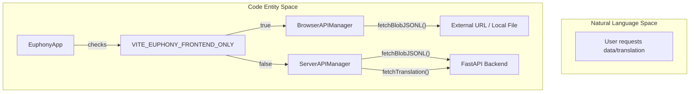
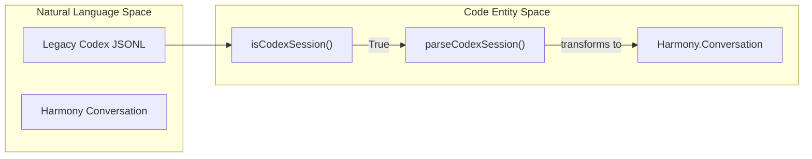

<!-- source: DeepWiki mcp.deepwiki.com · repo openai/euphony · page 4.2 Utility Modules · fetched 2026-10-26 -->

# Utility Modules

Relevant source files

The following files were used as context for generating this wiki page:

- [src/config/config.ts](src/config/config.ts)
- [src/euphony.ts](src/euphony.ts)

The `src/utils/` directory contains the core logic for data processing, markdown orchestration, and API communication. These modules provide the functional foundation for Euphony's web components, handling complex tasks like parsing legacy Codex formats, managing backend/frontend data fetching, and rendering mathematical notation.

## APIManager and Data Fetching

The `APIManager` provides a unified interface for retrieving Harmony data and requesting translations. It abstracts the differences between backend-assisted and frontend-only operation modes.

### Implementation Hierarchy

*   **`APIManager` (Abstract Class):** Defines the contract for fetching JSONL blobs and requesting translations. [src/utils/api-manager.ts:5-24]()
*   **`BrowserAPIManager`:** Used when `VITE_EUPHONY_FRONTEND_ONLY` is true. It handles data fetching via standard `fetch` calls but throws errors for translation requests, as translation requires the Python backend. [src/utils/api-manager.ts:26-47]()
*   **`ServerAPIManager`:** The default implementation that communicates with the FastAPI backend endpoints (e.g., `/blob-jsonl/`, `/translate/`). [src/utils/api-manager.ts:49-115]()

### Data Flow Diagram

The following diagram illustrates how the system selects a manager to resolve data requests.

"APIManager Selection and Data Flow"

Sources: [src/utils/api-manager.ts:5-115](), [src/app.ts:1-50]()

---

## Markdown and LaTeX Rendering

Euphony uses a multi-stage pipeline to transform raw message text into safe, formatted HTML. This process is orchestrated primarily within `utils.ts` and specialized configuration files.

### Rendering Pipeline

1.  **Markdown Parsing:** Handled by `marked`.
2.  **LaTeX Integration:** The `marked-katex-extension.ts` integrates `KaTeX` into the `marked` lexer, allowing for inline and block mathematical notation. [src/utils/marked-katex-extension.ts:1-50]()
3.  **Sanitization:** `DOMPurify` is used to strip potentially malicious HTML. Configurations in `dompurify-configs.ts` ensure that `KaTeX` classes and attributes (like `math-inline` or `aria-hidden`) are preserved. [src/utils/dompurify-configs.ts:1-25]()
4.  **Final Output:** The `renderMarkdown` function returns a `TrustedHTML` or string result ready for the Shadow DOM. [src/utils/utils.ts:151-182]()

### Patch Preview Rendering

For messages containing unified diffs (patches), `patch-preview.ts` provides the `renderPatch` function. It parses the diff and generates a table-based visualization with color-coded lines for additions and deletions, using HSL values defined in the global config. [src/utils/patch-preview.ts:1-120](), [src/config/config.ts:13-17]()

Sources: [src/utils/utils.ts:151-182](), [src/utils/marked-katex-extension.ts:1-50](), [src/utils/dompurify-configs.ts:1-25](), [src/utils/patch-preview.ts:1-120]()

---

## Codex Session Parsing

The `codex-session.ts` module is responsible for identifying and converting legacy Codex JSONL formats into the modern Harmony format used by the rest of the application.

### Key Functions
*   **`isCodexSession`:** Detects if a JSONL blob follows the Codex schema (e.g., presence of `session_id` or `entries`). [src/utils/codex-session.ts:10-30]()
*   **`parseCodexSession`:** Iterates through session entries, mapping Codex roles and content to the `Harmony` `Conversation` and `Message` interfaces. [src/utils/codex-session.ts:32-85]()

"Codex to Harmony Transformation"

Sources: [src/utils/codex-session.ts:10-85](), [src/types/harmony-types.ts:1-100]()

---

## Harmony Tokenization

Euphony provides a token inspector for Harmony messages. This is powered by `harmony-render.ts`, which uses `gpt-tokenizer` to perform browser-side tokenization.

*   **`getTokens`:** A function that takes a Harmony message and returns a list of token IDs and their string representations. [src/utils/harmony-render.ts:10-40]()
*   **Encoding Support:** It primarily utilizes the `o200k_base` encoding to match modern OpenAI models. [src/utils/harmony-render.ts:5-9]()

Sources: [src/utils/harmony-render.ts:1-40]()

---

## General Utilities (`utils.ts`)

The `utils.ts` file serves as a toolbox for common UI and logic patterns used across Lit components.

### UI and Positioning
*   **`computePopupPosition`:** Uses `@floating-ui/dom` to calculate the optimal placement for toolbars and menus relative to a reference element, handling collisions with viewport edges. [src/utils/utils.ts:50-100]()
*   **`toggleBlockContent`:** Manages the expanded/collapsed state of message blocks, calculating height dynamically for smooth CSS transitions. [src/utils/utils.ts:200-230]()

### Logic Helpers
*   **`Deferred`:** A wrapper class for Promises that allows resolving or rejecting from outside the Promise constructor, used heavily in the worker-based data pipeline. [src/utils/utils.ts:10-30]()
*   **`copyToClipboard`:** A robust wrapper for the Clipboard API with fallback mechanisms. [src/utils/utils.ts:110-130]()
*   **`downloadFile`:** Programmatically triggers a browser download for exported JSON/JSONL data. [src/utils/utils.ts:135-150]()

Sources: [src/utils/utils.ts:10-230]()

---

