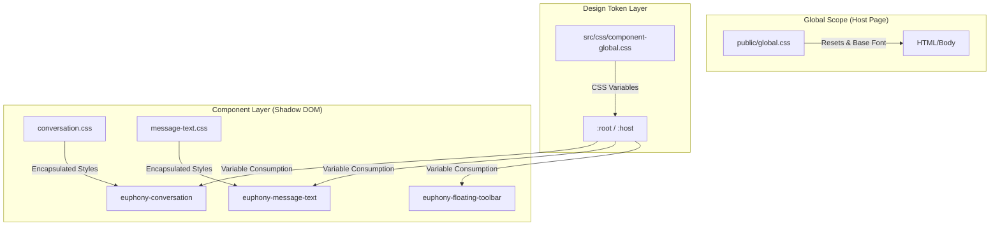
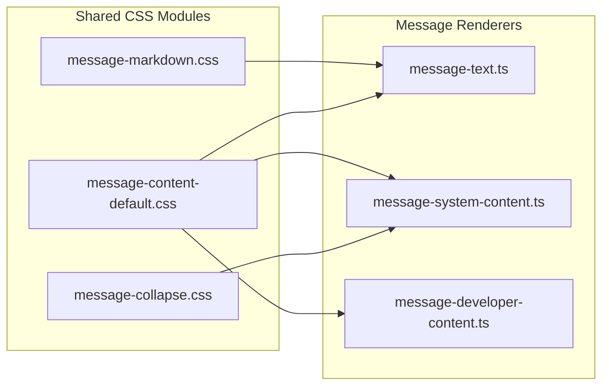

<!-- source: DeepWiki mcp.deepwiki.com · repo openai/euphony · page 5 Styling System · fetched 2026-10-26 -->

# Styling System

Relevant source files

The following files were used as context for generating this wiki page:

- [public/global.css](public/global.css)
- [src/css/component-global.css](src/css/component-global.css)

Euphony utilizes a multi-layered styling approach designed for both standalone application use and library embedding. The system balances **Shadow DOM encapsulation** for component-specific styles with a shared **CSS variable system** for consistent theming and layout.

## Styling Architecture

Euphony's styling is categorized into three primary scopes: host-level resets, shared component tokens, and encapsulated component styles.

### Component Encapsulation
Each LitElement component in Euphony manages its own styles within a Shadow DOM. This ensures that styles defined for a specific component (e.g., `euphony-conversation`) do not leak out to the host page, and host styles do not inadvertently break the component's internal layout. Components typically define their styles in a companion `.css` file which is imported and applied via the `static styles` property in the `.ts` class definition [src/css/component-global.css:43-43]().

### Theming and Design Tokens
Global design tokens such as colors, typography, and spacing are managed via CSS Custom Properties (variables). These are defined in `src/css/component-global.css` and are accessible to all components through the `:host` or `:root` selectors [src/css/component-global.css:42-43]().

| Category | Key Variables | Purpose |
| :--- | :--- | :--- |
| **Colors** | `--blue-500`, `--red-500`, etc. | Material-inspired color palette [src/css/component-global.css:81-222](). |
| **Typography** | `--font-d1` to `--font-u6` | Modular scale for consistent font sizing [src/css/component-global.css:59-71](). |
| **Layout** | `--container-h-padding`, `--border-radius` | Standardized spacing and rounding [src/css/component-global.css:54-56](). |
| **Shadows** | `--shadow-border-light`, `--shadow-border-large` | Consistent elevation levels [src/css/component-global.css:45-48](). |

### Global Resets
When running as a standalone app, `public/global.css` provides high-level resets for `html` and `body` tags, setting default scroll behavior and base font families [public/global.css:1-32]().

## Styling Workflow Diagram

The following diagram illustrates how styles flow from global definitions into the encapsulated components.

**Style Inheritance and Application**

**Sources:** [public/global.css:1-32](), [src/css/component-global.css:42-75]()

## Shared Message Styles

To maintain consistency across different message renderers (text, code, system content), Euphony uses a set of shared stylesheets located in `src/css/`. These are imported by multiple components to ensure that markdown rendering, code blocks, and configuration tables look identical regardless of the parent component.

**Message Styling Relations**

**Sources:** [src/css/component-global.css:1-41]()

## Detailed Styling Documentation

For more specific information on how different parts of the styling system are implemented, see the following child pages:

### [Global and Component-Level CSS](#5.1)
Covers the implementation of `component-global.css`, including the full color palette, typography scales, and the Prism Coldark theme used for syntax highlighting. For details, see [Global and Component-Level CSS](#5.1).

### [Message Content Stylesheets](#5.2)
Explains the shared styles used for rendering message content, including markdown typography, collapsible blocks, and the specialized layouts for system/developer configuration tables. For details, see [Message Content Stylesheets](#5.2).

---
**Sources:**
- [public/global.css:1-39]()
- [src/css/component-global.css:1-222]()

---

