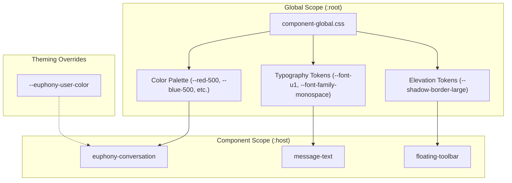
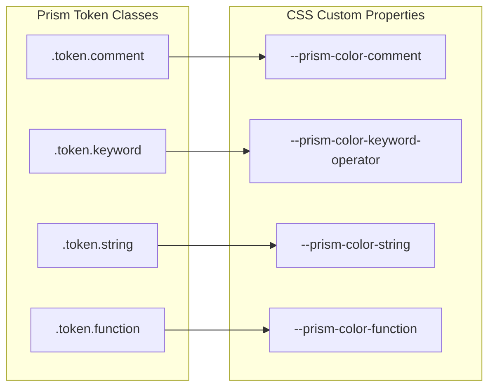

<!-- source: DeepWiki mcp.deepwiki.com · repo openai/euphony · page 5.1 Global and Component-Level CSS · fetched 2026-10-26 -->

# Global and Component-Level CSS

Relevant source files

The following files were used as context for generating this wiki page:

- [public/global.css](public/global.css)
- [src/css/component-global.css](src/css/component-global.css)
- [src/css/prism-coldark-auto.css](src/css/prism-coldark-auto.css)

Euphony utilizes a multi-layered styling system that combines global host-page resets, shared component-level CSS variables (tokens), and a theme-aware syntax highlighting system. This approach ensures visual consistency across the LitElement web components while allowing for flexible theming through CSS custom properties.

## Host-Page Styles

The `public/global.css` file provides the foundational reset and layout for the application shell. It targets the `html` and `body` elements to ensure the application occupies the full viewport and handles scrolling behavior at the top level.

| Target | Purpose | Key Properties |
| :--- | :--- | :--- |
| `html` | Root layout and typography | `font-size: 16px`, `scroll-behavior: smooth`, `overflow-y: hidden` [public/global.css:1-12]() |
| `body` | Base text styles | `margin: 0`, `font-family: -apple-system...`, `line-height: 1.5` [public/global.css:21-32]() |
| `*` | Box model consistency | `box-sizing: border-box` [public/global.css:34-38]() |

**Sources:**
- [public/global.css:1-39]()

## Component-Level Tokens and Variables

The `src/css/component-global.css` file defines the design system for Euphony. It uses `:root` and `:host` selectors to expose CSS custom properties that cascade through the Shadow DOM of all components.

### Layout and Typography Tokens
The system defines a modular scale for font sizes and standardized spacing/border tokens.

- **Font Sizes**: Variables range from `--font-d6` (0.625rem) to `--font-u6` (1.375rem) [src/css/component-global.css:59-71]().
- **Monospace**: Defined via `--font-family-monospace` using a system-standard stack [src/css/component-global.css:73-74]().
- **Layout**: Standardizes `--border-radius` (5px) and container padding [src/css/component-global.css:54-56]().

### Shadows and Transitions
Euphony uses specific shadow levels to create depth:
- `--shadow-border-light`: Subtle elevation [src/css/component-global.css:45-46]().
- `--shadow-border-card`: Specific for message cards [src/css/component-global.css:47]().
- `--shadow-border-large`: Used for floating UI and dialogs [src/css/component-global.css:48]().

### Global Element Styling
Standard HTML elements (links, buttons, inputs) are styled within this file to provide a consistent look for UI utilities that do not use complex Shadow DOM encapsulation.
- **Links**: Blue (`rgb(0, 100, 200)`) with hover underlines [src/css/component-global.css:1-12]().
- **Form Elements**: Shared `font-family` inheritance and light gray borders [src/css/component-global.css:18-26]().

**CSS Token Architecture**

**Sources:**
- [src/css/component-global.css:1-222]()

## Color System

Euphony includes a comprehensive HSL-based color palette. Each color (red, pink, purple, deep-purple, indigo, blue, light-blue, cyan, teal, green, etc.) is defined in increments from 50 to 900, plus accent (A) variants.

| Variable Group | Usage | Example |
| :--- | :--- | :--- |
| `--red-*` | Errors, deletions, and alerts | `--red-500: hsl(4, 89.62%, 58.43%)` [src/css/component-global.css:87]() |
| `--blue-*` | Primary UI actions and links | `--blue-600: hsl(208, 79.28%, 50.78%)` [src/css/component-global.css:163]() |
| `--green-*` | Success states and additions | `--green-500: hsl(122, 39.44%, 49.22%)` [src/css/component-global.css:222]() |
| `Custom Colors` | Semantic diffing and status | `--added-color`, `--replaced-color`, `--deleted--color` [src/css/component-global.css:77-79]() |

**Sources:**
- [src/css/component-global.css:82-222]()

## Syntax Highlighting (Prism Coldark)

The file `src/css/prism-coldark-auto.css` implements a theme-aware version of the Coldark syntax highlighting for Prism.js. Instead of hardcoded hex values, it maps Prism token classes to CSS variables.

**Token Mapping to Code Entity Space**

### Implementation Details
- **General Tokens**: Comments, punctuation, tags, and strings are mapped to specific `--prism-color-*` variables [src/css/prism-coldark-auto.css:8-42]().
- **Logic Tokens**: Keywords, operators, and functions use distinct variables to ensure readability in code blocks [src/css/prism-coldark-auto.css:51-59]().
- **Diff Highlighting**: Special support for `.token.deleted` and `.token.inserted` within code blocks, using background colors defined by `--prism-color-diff-deleted` and `--prism-color-diff-inserted` [src/css/prism-coldark-auto.css:114-121]().
- **UI Elements**: Includes styling for Prism's toolbar and line numbers, ensuring they match the overall Euphony aesthetic [src/css/prism-coldark-auto.css:66-97]().

**Sources:**
- [src/css/prism-coldark-auto.css:1-121]()

---

