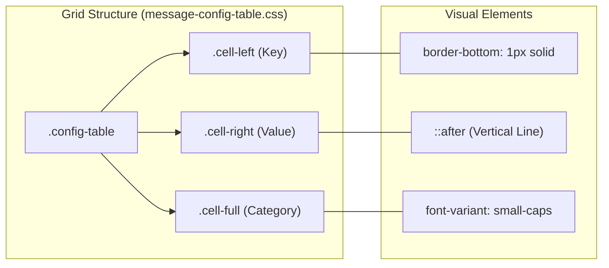

<!-- source: DeepWiki mcp.deepwiki.com · repo openai/euphony · page 5.2 Message Content Stylesheets · fetched 2026-10-26 -->

# Message Content Stylesheets

<details>
<summary>Relevant source files</summary>

The following files were used as context for generating this wiki page:

- [src/css/message-collapse.css](src/css/message-collapse.css)
- [src/css/message-config-table.css](src/css/message-config-table.css)
- [src/css/message-content-default.css](src/css/message-content-default.css)
- [src/css/message-markdown.css](src/css/message-markdown.css)
- [src/css/message-nested-config-table.css](src/css/message-nested-config-table.css)

</details>


This page documents the shared CSS modules located in `src/css/` that provide consistent styling across Euphony's message rendering components. These stylesheets are imported directly into the Shadow DOM of various LitElement components to ensure a unified visual language for markdown, collapsible blocks, and configuration tables.

## Overview of Shared Styles

Euphony utilizes a modular styling approach where specific visual patterns (like tables or markdown typography) are extracted into standalone CSS files. These files leverage CSS Custom Properties defined in `component-global.css` to maintain theme consistency.

### Component to Stylesheet Mapping

| Stylesheet | Primary Purpose | Used By (Examples) |
|:---|:---|:---|
| `message-content-default.css` | Base layout container for all messages. | `message-text`, `message-code`, `message-system-content` |
| `message-markdown.css` | Typography and layout for rendered Markdown/HTML. | `message-text` (when `markdown-rendered` is active) |
| `message-collapse.css` | Styles for expandable/collapsible content blocks. | `message-text` (multi-modal blocks), `patch-preview` |
| `message-config-table.css` | Two-column grid layout for system configurations. | `message-system-content`, `message-developer-content` |
| `message-nested-config-table.css` | Extended grid layout for recursive config objects. | `message-system-content` |

---

## Layout and Typography

### Base Message Layout (`message-content-default.css`)
This stylesheet defines the `.message-content` class, which serves as the standard wrapper for message bodies. It establishes the flexbox context and applies thematic variables for background, padding, and borders [src/css/message-content-default.css:1-13]().

### Markdown Typography (`message-markdown.css`)
This file targets standard HTML elements generated by the markdown parser (e.g., `marked`).
*   **Spacing:** Paragraphs (`p`) use a `0.5em` bottom margin unless they are the last child [src/css/message-markdown.css:1-6]().
*   **Headers:** `h1` through `h3` use scaled font sizes (`1.2em` to `1.1em`) [src/css/message-markdown.css:27-38]().
*   **Code Blocks:** Inline code and `pre` blocks use `white-space: pre-wrap` and `word-break: break-word` to prevent overflow in narrow containers [src/css/message-markdown.css:13-17]().
*   **Tables:** Standard markdown tables are styled with `border-collapse: collapse` and use `--gray-400` for borders [src/css/message-markdown.css:51-65]().
*   **Iframe Containers:** Includes specific styling for sandboxed content, featuring a header and a fixed height of `500px` [src/css/message-markdown.css:78-108]().

**Sources:** [src/css/message-content-default.css:1-14](), [src/css/message-markdown.css:1-109]()

---

## Interaction and Animation

### Collapsible Blocks (`message-collapse.css`)
Used for rendering content that can be toggled by the user, such as large text blocks or translation overlays.

**Styling Flow for Collapsible Content**
```mermaid
graph TD
    subgraph "CSS Entity Space"
        L[".label"] -->|Background| G300["var(--theme-gray-300)"]
        TC[".message-text-container"] -->|Border| G300
        CI[".collapse-icon"] -->|Rotate 90deg| Open["Expanded State"]
        CI -->|Rotate 0deg| Closed["is-collapsed"]
    end

    subgraph "Natural Language Space"
        "User clicks toggle" --> CI
        "Content Visibility" --> TC
    end
```

*   **State Management:** The `.collapse-icon` uses a CSS transition on the `transform` property to rotate the chevron when the `is-collapsed` attribute is toggled [src/css/message-collapse.css:64-80]().
*   **Translation Support:** The `.message-text-container` includes a selector for `&[is-translation]` which switches the text color to `var(--translation-color)` [src/css/message-collapse.css:26-30]().
*   **Container Limits:** It enforces a `max-height: var(--max-message-height)` with `overflow-y: auto` to prevent single messages from dominating the viewport [src/css/message-collapse.css:19-20]().

**Sources:** [src/css/message-collapse.css:1-81]()

---

## Configuration Tables

Euphony uses CSS Grid to render structured system and developer metadata. These styles are split between flat and nested implementations.

### Grid Implementation Details

| Class | Role | Styling Logic |
|:---|:---|:---|
| `.config-table` | Grid Container | `display: grid` with `grid-template-columns: auto 1fr` [src/css/message-config-table.css:1-4](). |
| `.cell-left` | Key Column | Uses `var(--theme-gray-600)` and a right border [src/css/message-config-table.css:9-20](). |
| `.cell-right` | Value Column | Includes a pseudo-element `::after` to create a vertical separator line [src/css/message-config-table.css:34-43](). |
| `.cell-full` | Header/Separator | Spans the entire grid width using `grid-column: 1 / -1` [src/css/message-config-table.css:45-51](). |

### Logical Mapping of Config Styles


### Nested Configurations (`message-nested-config-table.css`)
This variant extends the base table styling to support indentation for recursive data structures.
*   **Indentation:** Uses `.inner-cell .content` to apply `padding-left` calculated from `var(--column-gap)` [src/css/message-nested-config-table.css:20-22]().
*   **Vertical Alignment:** Maintains the vertical separator line across nested levels using the `::after` pseudo-element on `.cell-right` [src/css/message-nested-config-table.css:44-52]().

**Sources:** [src/css/message-config-table.css:1-52](), [src/css/message-nested-config-table.css:1-63]()

---

