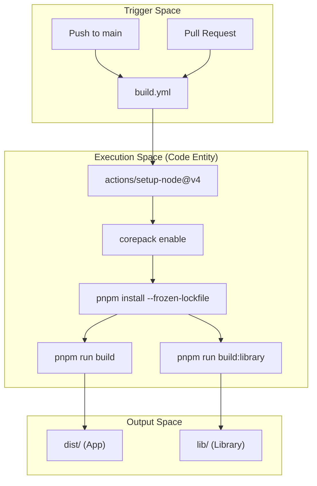
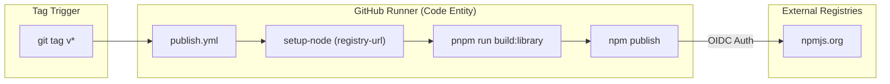

<!-- source: DeepWiki mcp.deepwiki.com · repo openai/euphony · page 6.1 CI/CD Workflows · fetched 2026-10-26 -->

# CI/CD Workflows

Relevant source files

The following files were used as context for generating this wiki page:

- [.github/workflows/build.yml](.github/workflows/build.yml)
- [.github/workflows/publish.yml](.github/workflows/publish.yml)

The Euphony codebase utilizes GitHub Actions to automate the validation of code changes and the distribution of the library. The infrastructure is designed around a modern Node.js stack, leveraging `pnpm` for deterministic dependency management and OpenID Connect (OIDC) for secure publishing to npm.

## Build and Validation Workflow

The `build.yml` workflow serves as the primary continuous integration (CI) gate. It ensures that every change submitted to the repository is compatible with the build system and that both the standalone application and the embeddable library can be successfully compiled.

### Execution Triggers
- **Push to main**: Ensures the main branch remains in a deployable state [.github/workflows/build.yml:4-6]().
- **Pull Requests**: Validates incoming contributions before they are merged [.github/workflows/build.yml:7]().

### Pipeline Implementation
The workflow executes on an `ubuntu-latest` runner and follows a strict sequence of environment initialization and build commands:

1.  **Environment Pinning**: The workflow explicitly pins Node.js to version `22` to ensure consistency across local and CI environments [.github/workflows/build.yml:20]().
2.  **Package Management**: `corepack` is enabled to manage `pnpm` versions [.github/workflows/build.yml:23]().
3.  **Deterministic Installs**: Dependencies are installed using the `--frozen-lockfile` flag, which prevents the CI from succeeding if the `pnpm-lock.yaml` is out of sync with `package.json` [.github/workflows/build.yml:26]().
4.  **Artifact Verification**: The workflow runs both `pnpm run build` (for the Vite-based SPA) and `pnpm run build:library` (for the Lit-based web component bundle) [.github/workflows/build.yml:29-32]().

### Build Workflow Logic
Title: Build Workflow Execution Flow

Sources: [.github/workflows/build.yml:1-33]()

## Publish Workflow

The `publish.yml` workflow automates the release of the Euphony library to the npm registry. It is designed to be secure and only triggers on specific version tags.

### Release Triggers
The workflow is strictly limited to tags matching the `v*` pattern (e.g., `v1.0.0`) [.github/workflows/publish.yml:5-6]().

### Security and OIDC
Euphony uses GitHub's OIDC provider to authenticate with npm, eliminating the need for long-lived secrets in the repository settings.
- **Permissions**: The job requires `id-token: write` to request the OIDC token and `contents: read` to access the source code [.github/workflows/publish.yml:11-13]().
- **Registry Configuration**: The `setup-node` action is configured with the npm registry URL to facilitate the `npm publish` command [.github/workflows/publish.yml:23]().

### Implementation Steps
The publishing process mirrors the build process to ensure the published artifact is fresh:
1.  **Build Library**: Only the library build is required for npm distribution (`pnpm run build:library`) [.github/workflows/publish.yml:32]().
2.  **Publish**: The `npm publish` command is executed, which uses the OIDC token for authorization [.github/workflows/publish.yml:35]().

### Publish Workflow Logic
Title: Publish Workflow and Registry Integration

Sources: [.github/workflows/publish.yml:1-36]()

## Summary of Environment Configuration

Both workflows share a common environment baseline to ensure that the production build is identical to the validation build.

| Feature | Configuration | Rationale |
| :--- | :--- | :--- |
| **Node.js Version** | `22` | Pinning ensures stable build behavior [.github/workflows/build.yml:20]() |
| **Package Manager** | `pnpm` (via Corepack) | Efficient, content-addressable storage [.github/workflows/build.yml:23]() |
| **Lockfile Policy** | `--frozen-lockfile` | Prevents accidental dependency drift [.github/workflows/build.yml:26]() |
| **Build Targets** | App & Library | Validates both operational modes of Euphony [.github/workflows/build.yml:29-32]() |

Sources: [.github/workflows/build.yml:13-33](), [.github/workflows/publish.yml:15-36]()

---

