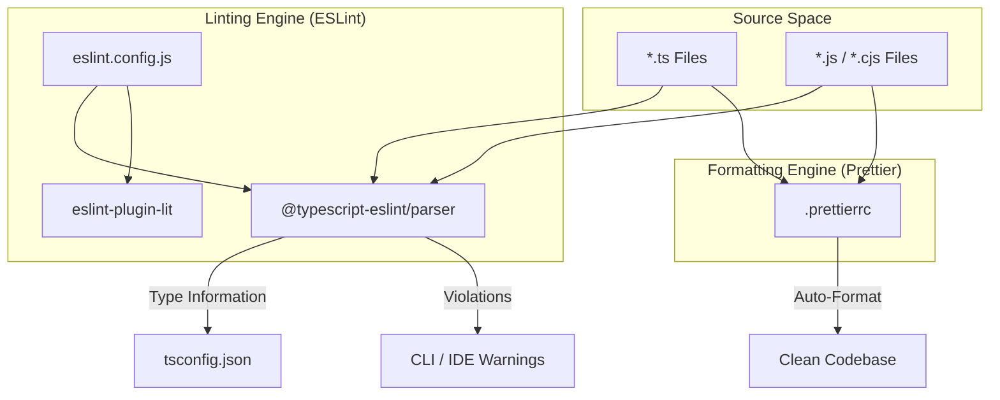
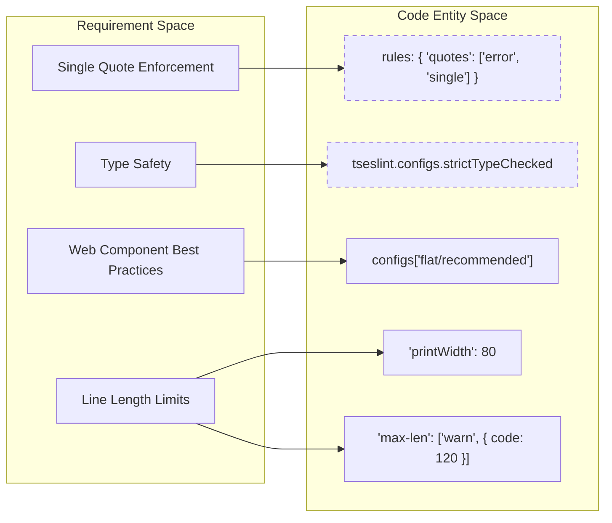

<!-- source: DeepWiki mcp.deepwiki.com · repo openai/euphony · page 6.2 Code Quality: Linting and Formatting · fetched 2026-10-26 -->

# Code Quality: Linting and Formatting

Relevant source files

The following files were used as context for generating this wiki page:

- [.prettierrc](.prettierrc)
- [eslint.config.js](eslint.config.js)

Euphony maintains code consistency and quality through a strict linting and formatting pipeline. The project leverages **ESLint** for static analysis of TypeScript and Web Component patterns, and **Prettier** for automated code styling. These tools ensure that the codebase adheres to a unified style, reducing cognitive load during code reviews and preventing common runtime errors.

## Formatting with Prettier

The project uses Prettier to enforce a consistent visual style across all source files. The configuration is defined in `.prettierrc` and prioritizes readability and standard JavaScript conventions.

### Configuration Rules
The following rules are enforced by the Prettier engine:

| Rule | Value | Description |
| :--- | :--- | :--- |
| `singleQuote` | `true` | Enforces the use of single quotes for strings. |
| `trailingComma` | `"none"` | Disallows trailing commas in objects, arrays, and function arguments. |
| `arrowParens` | `"avoid"` | Omits parentheses around a single parameter in arrow functions. |
| `printWidth` | `80` | Wraps lines that exceed 80 characters to maintain narrow, readable files. |

**Sources:**
- [.prettierrc:1-6]()

---

## Linting with ESLint

Euphony utilizes a "Flat Config" ESLint setup (`eslint.config.js`) that integrates several specialized plugins to handle the project's hybrid nature as a TypeScript-based Web Component library.

### Plugin Integration
The configuration merges several rule sets to provide comprehensive coverage:

1.  **typescript-eslint**: Provides type-aware linting by parsing `tsconfig.json` and `tsconfig.node.json` [eslint.config.js:21-21](). It applies `recommendedTypeChecked`, `stylisticTypeChecked`, and `strictTypeChecked` presets [eslint.config.js:8-11]().
2.  **eslint-plugin-lit**: Enforces best practices for **LitElement** templates, ensuring that `html` tagged templates are syntactically correct and follow Lit performance guidelines [eslint.config.js:4-4](), [eslint.config.js:12-12]().
3.  **Global Environment**: Configured for `globals.browser` to recognize browser-specific APIs (like `window`, `document`, and `HTMLElement`) without explicit imports [eslint.config.js:24-26]().

### Custom Rule Overrides
While inheriting strict defaults, the project defines specific overrides to balance safety with development velocity:

*   **Syntax & Style**:
    *   `quotes`: Enforces single quotes, matching Prettier [eslint.config.js:31-31]().
    *   `semi`: Requires semicolons at the end of statements [eslint.config.js:33-33]().
    *   `max-len`: Issues a warning at 120 characters, providing a buffer beyond Prettier's 80-character wrap [eslint.config.js:34-39]().
*   **TypeScript Specifics**:
    *   `no-floating-promises`: Set to `warn` to ensure asynchronous operations are properly handled [eslint.config.js:41-41]().
    *   `no-unused-vars`: Configured to ignore variables or arguments prefixed with an underscore (e.g., `_unused`) [eslint.config.js:49-56]().
    *   `restrict-template-expressions`: Disabled to allow flexible string interpolation in Lit templates [eslint.config.js:44-44]().

**Sources:**
- [eslint.config.js:1-61]()

---

## Tooling Interaction Diagram

The following diagram illustrates how the linting and formatting tools interact with the source code and the TypeScript compiler during the development workflow.

### Code Quality Pipeline

**Sources:**
- [eslint.config.js:14-23]()
- [.prettierrc:1-6]()

---

## Mapping Rules to Code Entities

This diagram bridges the natural language requirements (e.g., "Use single quotes") to the specific configuration entities in the codebase.

### Rule Mapping: Requirements to Configuration

**Sources:**
- [eslint.config.js:11-12]()
- [eslint.config.js:31-31]()
- [eslint.config.js:34-39]()
- [.prettierrc:5-5]()

---

## Implementation Details

### Parser Configuration
The ESLint configuration explicitly targets `.ts`, `.js`, and `.cjs` files [eslint.config.js:14-14](). It uses the `typescript-eslint` parser to understand modern ECMAScript and TypeScript syntax [eslint.config.js:17-19](). To support type-checked rules, it references the project's TypeScript configurations:
*   `./tsconfig.json`: Main application logic.
*   `./tsconfig.node.json`: Build scripts and configuration files.

### Global Variables
The `languageOptions.globals` property is populated using the `globals` package, specifically `globals.browser` [eslint.config.js:25-25](). This prevents the linter from flagging browser-native objects like `CustomEvent` or `ShadowRoot` as undefined, which is critical for the Lit-based components in `src/`.

**Sources:**
- [eslint.config.js:16-27]()

---

