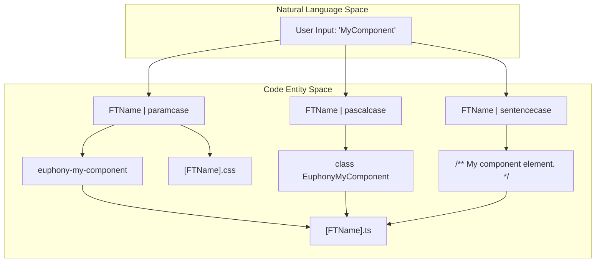
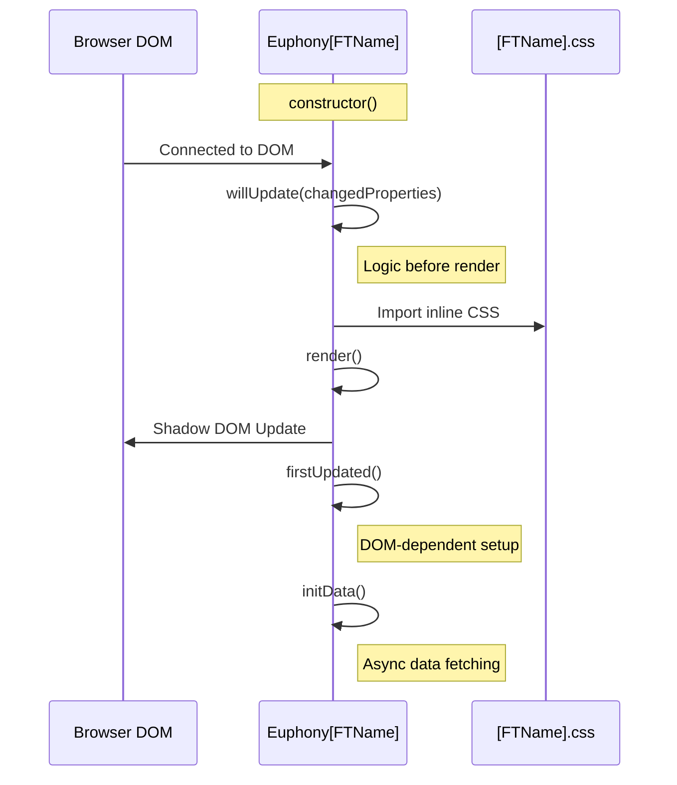

<!-- source: DeepWiki mcp.deepwiki.com · repo openai/euphony · page 6.3 Component Scaffolding Templates · fetched 2026-10-26 -->

# Component Scaffolding Templates

Relevant source files

The following files were used as context for generating this wiki page:

- [.fttemplates/default-template/[FTName].css](.fttemplates/default-template/[FTName].css)
- [.fttemplates/default-template/[FTName].ts](.fttemplates/default-template/[FTName].ts)
- [agents.md](agents.md)

Euphony utilizes a standardized scaffolding system located in the `.fttemplates/` directory to ensure consistency across its LitElement component architecture. This system allows developers to generate new components with a pre-defined structure, including lifecycle hooks, Shadow DOM styling integration, and TypeScript type registrations.

## Template Overview

The scaffolding system is based on the `default-template` directory, which contains two primary files that define the skeleton of every Euphony component:

*   **`[FTName].ts`**: The TypeScript logic file defining the LitElement class, its decorators, and the HTML template.
*   **`[FTName].css`**: The component-specific stylesheet that is automatically imported and injected into the component's Shadow DOM.

### Placeholder Syntax
The system uses the `FTName` placeholder, which supports various casing transformations to match different coding conventions:
*   `FTName | paramcase`: Used for CSS class names and HTML tag names (e.g., `my-component`).
*   `FTName | pascalcase`: Used for TypeScript class names (e.g., `MyComponent`).
*   `FTName | sentencecase`: Used for documentation comments and display text (e.g., `My component`).

**Sources:**
- [.fttemplates/default-template/\[FTName\].ts:1-66]()
- [.fttemplates/default-template/\[FTName\].css:1-11]()

---

## Component Structure ([FTName].ts)

The TypeScript template enforces a strict organizational structure using comment blocks to separate concerns. This ensures that all components in the codebase remain readable and maintainable.

### 1. Class Definition and Decorators
The template automatically prefixes the custom element name with `euphony-` to maintain the project's namespace. It also registers the component in the global `HTMLElementTagNameMap` to enable better IDE support and type safety when using `document.createElement`.

### 2. Standardized Sections
The class is divided into the following sections:
*   **Class Properties**: For `@property` and `@state` decorators.
*   **Lifecycle Methods**: Includes `constructor`, `firstUpdated` (for post-render DOM logic), and `willUpdate` (for pre-render state processing) [[.fttemplates/default-template/\[FTName\].ts:16-32]()].
*   **Custom Methods**: Includes a placeholder `initData()` for asynchronous initialization [[.fttemplates/default-template/\[FTName\].ts:35-37]()].
*   **Templates and Styles**: Contains the `render()` method and the `static styles` array [[.fttemplates/default-template/\[FTName\].ts:48-58]()].

### 3. Style Integration
Styles are imported using Vite's `?inline` suffix. This allows the CSS content to be treated as a string and injected into the `static styles` property using `unsafeCSS`, ensuring the styles are scoped to the component's Shadow DOM [[.fttemplates/default-template/\[FTName\].ts:5-57]()].

**Sources:**
- [.fttemplates/default-template/\[FTName\].ts:1-66]()

---

## Default Styling ([FTName].css)

The CSS template provides a "centered flexbox" default. This helps developers immediately see the component on the screen during development. It includes `box-sizing: border-box` to prevent padding from affecting the defined dimensions [[.fttemplates/default-template/\[FTName\].css:1-11]()].

### Style Template Details
| Property | Value | Purpose |
| :--- | :--- | :--- |
| `display` | `flex` | Enables flexible layout by default. |
| `justify-content` | `center` | Horizontal alignment. |
| `align-items` | `center` | Vertical alignment. |
| `width / height` | `100%` | Ensures the component fills its immediate container. |

**Sources:**
- [.fttemplates/default-template/\[FTName\].css:1-11]()

---

## Data Flow and Implementation

The following diagrams illustrate how the scaffolding system bridges the gap between the file template definitions and the final runtime code entities.

### Template Transformation Map
This diagram shows how the `FTName` variable is mapped to specific code constructs within the generated files.

**Sources:**
- [.fttemplates/default-template/\[FTName\].ts:8-11]()
- [.fttemplates/default-template/\[FTName\].ts:63-63]()
- [.fttemplates/default-template/\[FTName\].css:1-1]()

### Component Lifecycle and Rendering Flow
This diagram details the sequence of methods provided by the template and how they interact with the LitElement lifecycle.

**Sources:**
- [.fttemplates/default-template/\[FTName\].ts:19-58]()
- [.fttemplates/default-template/\[FTName\].ts:5-5]()

---

## Usage Guidelines

1.  **Generation**: Use a file template extension (like "Folder Templates" in VS Code) to apply the `.fttemplates/default-template` to a new folder in `src/components/`.
2.  **Naming**: Use PascalCase for the template name (e.g., `MessageToolbar`).
3.  **Registration**: The template automatically handles `customElement` registration and `HTMLElementTagNameMap` entry [[.fttemplates/default-template/\[FTName\].ts:10-65]()].
4.  **Avoid Manual Edits**: Do not modify the `lib/` directory directly, as those files are auto-generated by the build system from these source components [[agents.md:4-4]()].

**Sources:**
- [.fttemplates/default-template/\[FTName\].ts:1-66]()
- [agents.md:1-5]()

---

