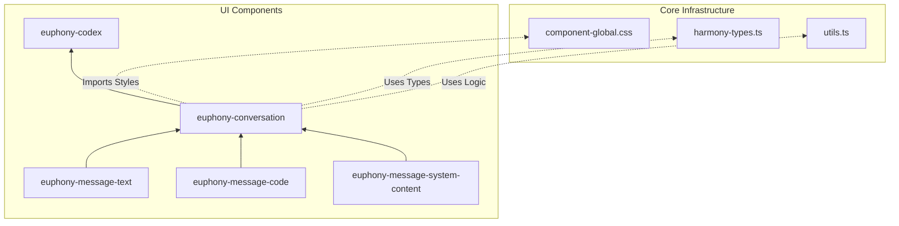

<!-- source: DeepWiki mcp.deepwiki.com · repo openai/euphony · page 7 Glossary · fetched 2026-10-26 -->

# Glossary

<details>
<summary>Relevant source files</summary>

The following files were used as context for generating this wiki page:

- [.fttemplates/default-template/[FTName].ts](.fttemplates/default-template/[FTName].ts)
- [.github/workflows/build.yml](.github/workflows/build.yml)
- [.github/workflows/publish.yml](.github/workflows/publish.yml)
- [README.md](README.md)
- [server/fastapi-main.py](server/fastapi-main.py)
- [src/components/codex/codex.ts](src/components/codex/codex.ts)
- [src/components/conversation/conversation.ts](src/components/conversation/conversation.ts)
- [src/components/token-window/token-window.ts](src/components/token-window/token-window.ts)
- [src/config/config.ts](src/config/config.ts)
- [src/css/component-global.css](src/css/component-global.css)
- [src/euphony.ts](src/euphony.ts)

</details>


This glossary defines technical terms, jargon, and domain-specific concepts used throughout the Euphony codebase. It provides a bridge between the conceptual data models and their concrete implementations in the code.

## Core Domain Concepts

### Harmony
**Harmony** is the primary structured chat data format used by OpenAI for training, evaluation, and agent workflows [README.md:20-25](). In the codebase, Harmony data is represented by the `Conversation` interface, which consists of a sequence of `Message` objects [src/types/harmony-types.ts:28-37]().

### Codex Session
A **Codex Session** is a sequence of events (usually in JSONL format) generated by the Codex CLI or agent environments [README.md:20-25](). Euphony includes a specialized parser to transform these raw session logs into a Harmony-compatible `Conversation` format for visualization [src/utils/codex-session.ts:5]().

### Message Content Types
Euphony categorizes message parts into specific types to determine which renderer to use [src/components/conversation/conversation.ts:58-67]().
*   **Text Content**: Standard markdown or LaTeX strings [src/types/harmony-types.ts:35]().
*   **System Content**: Configuration and model identity metadata, often rendered as tables [src/types/harmony-types.ts:34]().
*   **Developer Content**: Specific instructions or developer-facing metadata [src/types/harmony-types.ts:29]().

## System Components and Utilities

### Token Window
A UI component (`euphony-token-window`) used to inspect how a conversation is tokenized by specific Harmony renderers [src/components/token-window/token-window.ts:29-30](). It allows users to switch between different tokenizers and view token IDs, decoded strings, and raw display strings [src/components/token-window/token-window.ts:63-65]().

### App Shell
The top-level application container that orchestrates data loading from various sources (URL, local file, or clipboard) and passes it down to the viewer components [README.md:51-60]().

### Backend-Assisted Mode
An optional operational mode using a FastAPI server [server/fastapi-main.py:14](). It provides server-side features like fetching remote JSONL blobs, translating content via OpenAI's API, and performing Harmony rendering using the `openai-harmony` Python library [server/fastapi-main.py:18-29]().

## Data Flow Diagram: Natural Language to Code Space

The following diagram maps the conceptual process of loading and rendering data to the specific classes and functions in the codebase.

**Data Ingestion and Parsing Pipeline**
```mermaid
graph TD
    subgraph "Natural Language Space"
        Input["User Input (URL/File/Paste)"]
        RawData["Raw JSON/JSONL"]
    end

    subgraph "Code Entity Space"
        Parser["parseCodexSession()"]
        ConvClass["EuphonyConversation"]
        CodexClass["EuphonyCodex"]
        HarmonyTypes["Conversation Interface"]
    end

    Input -->|"Load via App Shell"| RawData
    RawData -->|"If Codex JSONL"| CodexClass
    CodexClass -->|"Calls"| Parser
    Parser -->|"Returns"| HarmonyTypes
    RawData -->|"If Harmony JSON"| ConvClass
    HarmonyTypes -->|"Property: .conversationData"| ConvClass
    ConvClass -->|"Renders"| UI["Shadow DOM UI"]
end
```
Sources: [src/components/codex/codex.ts:5](), [src/components/codex/codex.ts:130-140](), [src/components/conversation/conversation.ts:122](), [src/types/harmony-types.ts:28]().

## Component Hierarchy Diagram

This diagram shows the relationship between the web components and the underlying style/utility systems.

**Web Component Architecture**

Sources: [src/components/conversation/conversation.ts:58-67](), [src/components/codex/codex.ts:12](), [src/css/component-global.css:42-43](), [src/euphony.ts:1-14]().

## Technical Abbreviations

| Abbreviation | Full Term | Description | Code Pointer |
| :--- | :--- | :--- | :--- |
| **JSONL** | JSON Lines | A format where each line is a valid JSON object, used for Codex sessions. | [src/utils/codex-session.ts:105-118]() |
| **SSR** | Server Side Rendering | Refers to the Harmony rendering performed by the FastAPI backend. | [server/fastapi-main.py:170-182]() |
| **SSRF** | Server-Side Request Forgery | A security risk noted in the backend fetcher for remote URLs. | [README.md:115]() |
| **FT** | File Template | Refers to the component scaffolding system used for generating new elements. | [.fttemplates/default-template/[FTName].ts:1-10]() |

Sources: [README.md:115](), [server/fastapi-main.py:170-182](), [src/components/codex/codex.ts:105-118](), [.fttemplates/default-template/[FTName].ts:1-10]().