# Page: Euphony Overview

# Euphony Overview

<details>
<summary>Relevant source files</summary>

The following files were used as context for generating this wiki page:

- [.gitignore](.gitignore)
- [LICENSE](LICENSE)
- [NOTICE](NOTICE)
- [README.md](README.md)
- [SECURITY.md](SECURITY.md)

</details>


Euphony is a visualization platform designed for inspecting [Harmony](https://github.com/openai/harmony) chat conversations and [Codex session logs](https://developers.openai.com/codex/cli/features). It provides a modular suite of LitElement-based Web Components that can be used as a standalone web application or embedded into existing React, Svelte, or Vue projects to render structured AI interaction data.

The system is designed to be portable and customizable, supporting features such as markdown rendering, LaTeX formulas, JMESPath filtering, and Harmony token inspection.

## Operational Modes

Euphony operates in two distinct modes depending on the environment and requirements for data fetching and translation. This is controlled via the `VITE_EUPHONY_FRONTEND_ONLY` environment variable.

| Mode | Description | Key Characteristics |
| :--- | :--- | :--- |
| **Frontend-only** | Recommended for static hosting (e.g., GitHub Pages). All processing occurs in the browser. | Browser-side URL fetching; User-provided OpenAI API key for translation. |
| **Backend-assisted** | Intended for local development or trusted environments. Uses a FastAPI server. | Server-side URL fetching (SSRF risk if public); backend translation; Harmony rendering support. |

For setup instructions, see [Getting Started](#1.1).

## Key Features

*   **Harmony Conversation Viewer**: Renders complex conversation schemas including nested metadata and various message types [README.md:31]().
*   **Codex Session Viewer**: Automatically detects Codex session JSONL and converts it into a viewable conversation timeline [README.md:32]().
*   **Flexible Data Ingestion**: Supports loading via clipboard paste, local file upload, or public HTTP(S) URLs [README.md:33]().
*   **Advanced Rendering**: Native support for Markdown, LaTeX, and unified diff previews [README.md:34]().
*   **Analysis Tools**: Includes JMESPath filtering, "Focus Mode" for specific roles/recipients, and a Harmony token inspector [README.md:37-39]().

## System Architecture

The following diagram illustrates the relationship between the core UI components and the data processing pipeline.

### High-Level Component Relationship
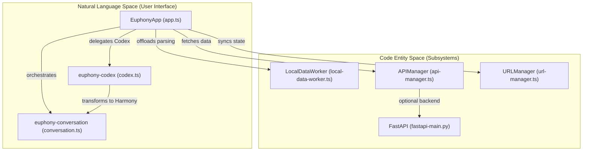
**Sources**: [README.md:44-60](), [src/app.ts:1-50](), [src/utils/api-manager.ts:1-20]()

## Data Pipeline and Formats

Euphony is built around the **Harmony** data format. Even when loading **Codex** sessions, the system transforms the session logs into a Harmony-compatible structure for rendering.

### Data Flow Mapping
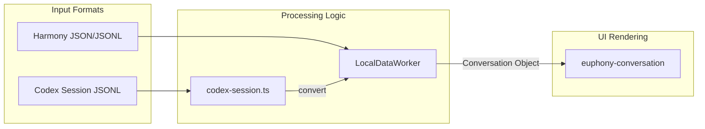
**Sources**: [README.md:55-59](), [src/utils/codex-session.ts:1-30]()

For details on the schemas and example files, see [Data Formats: Harmony and Codex](#1.2).

## Integration as a Library

Euphony is distributed as a set of Web Components. Developers can import the library and use the `<euphony-conversation>` tag directly in their HTML or framework components.

*   **Entry Point**: `src/euphony.ts` exports the custom elements.
*   **Build Output**: `pnpm run build:library` generates files in the `lib/` directory [README.md:69-72]().
*   **Customization**: The look and feel can be modified using CSS variables defined in `src/css/component-global.css` [README.md:89-99]().

## Child Pages

*   **[Getting Started](#1.1)**: Installation, build commands, and environment configuration.
*   **[Data Formats: Harmony and Codex](#1.2)**: Deep dive into the supported JSON/JSONL schemas and auto-detection logic.

**Sources**: [README.md:1-120](), [LICENSE:1-135](), [NOTICE:1-14]()

---

# Page: Getting Started

# Getting Started

<details>
<summary>Relevant source files</summary>

The following files were used as context for generating this wiki page:

- [README.md](README.md)
- [index.html](index.html)
- [package.json](package.json)
- [pnpm-lock.yaml](pnpm-lock.yaml)
- [pyproject.toml](pyproject.toml)

</details>


Euphony is a modular web component-based tool for visualizing Harmony chat conversations and Codex session logs [README.md:1-25](). This page provides a technical guide for setting up the development environment, building the application, and configuring its operational modes.

## Installation and Environment Setup

Euphony uses `pnpm` as its primary package manager and pins the version via the `packageManager` field in `package.json` [package.json:66-66](). It is recommended to use **Corepack** to manage `pnpm` versions.

### 1. Prerequisites
*   **Node.js**: Version 22 is recommended for consistency with CI [README.md:119-120]().
*   **pnpm**: Install via Corepack: `corepack enable && corepack prepare pnpm@latest --activate`.
*   **Python 3.10+**: Required only if using the optional backend-assisted mode [pyproject.toml:1-13]().

### 2. Installing Dependencies
Run the following command in the root directory to install both development and runtime dependencies:
```bash
pnpm install
```
Sources: [README.md:68-68](), [package.json:33-65]()

## Development Workflow

The development environment consists of a Vite-powered frontend and an optional FastAPI backend.

### Running the Frontend Dev Server
To start the Vite development server with Hot Module Replacement (HMR) enabled for web components:
```bash
pnpm run dev
```
The server will be available at `http://localhost:3000` [package.json:25-25]().

### Running the Backend Server (Optional)
The backend provides services like remote URL fetching and server-side Harmony rendering [README.md:103-108](). To start it:
```bash
# Ensure dependencies are installed
pip install .
# Start the server
uvicorn fastapi-main:app --app-dir server --host 127.0.0.1 --port 8020 --reload
```
Sources: [README.md:122-126](), [pyproject.toml:1-13]()

## Build Commands

Euphony supports three distinct build targets depending on the intended use case.

| Command | Target | Description |
| :--- | :--- | :--- |
| `pnpm run build` | **Static App** | Builds the standalone viewer application into the `dist/` folder [package.json:26-26](). |
| `pnpm run build:library` | **Library** | Generates a reusable JS bundle and TypeScript definitions in `lib/` [package.json:28-28](). |
| `pnpm run build:github` | **GitHub Pages** | Builds the app in `VITE_EUPHONY_FRONTEND_ONLY=true` mode for static hosting [package.json:27-27](). |

### Library Output
The library build produces:
*   `./lib/euphony.js`: The main ESM entry point [package.json:11-11]().
*   `./lib/euphony.d.ts`: TypeScript declarations for the public API [package.json:10-10]().

Sources: [package.json:6-32](), [README.md:65-72]()

## Operational Modes

Euphony's behavior is governed by the `VITE_EUPHONY_FRONTEND_ONLY` environment variable. This flag determines how the data pipeline handles requests for external data and translations.

### Data Flow and Mode Configuration

The following diagram illustrates how the `VITE_EUPHONY_FRONTEND_ONLY` flag routes data requests between the browser-based `BrowserAPIManager` and the `FastAPI` backend.

**System Mode Architecture**
```mermaid
graph TD
    subgraph "Client (Browser)"
        [EuphonyApp] --> [APIManager]
        [APIManager] -- "VITE_EUPHONY_FRONTEND_ONLY=true" --> [BrowserAPIManager]
        [APIManager] -- "VITE_EUPHONY_FRONTEND_ONLY=false" --> [BackendAPIManager]
    end

    subgraph "Server (Local)"
        [BackendAPIManager] -- "HTTP/JSON" --> [FastAPI_Server]
        [FastAPI_Server] -- "calls" --> [openai_harmony]
    end

    [BrowserAPIManager] -- "fetch()" --> [External_URLs]
    [BrowserAPIManager] -- "OpenAI API Key" --> [OpenAI_API]
```

### Configuration Details

| Mode | `VITE_EUPHONY_FRONTEND_ONLY` | Features & Limitations |
| :--- | :--- | :--- |
| **Frontend-only** | `true` | **Default for production.** Uses browser `fetch()` for URLs. Translation requires a user-provided API key in the UI [README.md:107-112](). |
| **Backend-assisted** | `false` | **Development only.** Proxies requests through the FastAPI server. Supports large dataset loading and server-side Harmony rendering [README.md:108-115](). |

> [!WARNING]
> Do not host the FastAPI backend on public servers. The `/blob-jsonl/` endpoint can introduce SSRF (Server-Side Request Forgery) risks if exposed to attacker-controlled URLs [README.md:115-116]().

Sources: [README.md:101-116](), [package.json:27-28]()

## Integration Example

Once built, the library can be integrated into any web project.

**Component-to-Code Mapping**
```mermaid
graph LR
    subgraph "Natural Language Space"
        "Conversation String"
        "Harmony Object"
    end

    subgraph "Code Entity Space"
        [euphony-conversation] -- "property: conversation-string" --> "Conversation String"
        [euphony-conversation] -- "property: conversationJSON" --> "Harmony Object"
        [euphony-app] -- "renders" --> [euphony-conversation]
    end
```

### Basic Usage
To use the viewer in a standard HTML page:
1. Import the library: `<script type="module" src="./lib/euphony.js"></script>`.
2. Add the custom element:
```html
<euphony-conversation conversation-string='{"messages": [...]}'>
</euphony-conversation>
```
Alternatively, pass data via JavaScript to the `conversationJSON` property of the `euphony-conversation` element [README.md:81-87]().

Sources: [README.md:74-87](), [index.html:23-27]()

---

# Page: Data Formats: Harmony and Codex

# Data Formats: Harmony and Codex

<details>
<summary>Relevant source files</summary>

The following files were used as context for generating this wiki page:

- [README.md](README.md)
- [public/examples/euphony-convo-100.jsonl](public/examples/euphony-convo-100.jsonl)
- [public/examples/simple-harmony-convos.jsonl](public/examples/simple-harmony-convos.jsonl)

</details>


Euphony is designed to ingest and visualize two primary structured data formats: **Harmony** (a rich, multi-modal conversation format) and **Codex Sessions** (a log format for developer tool interactions). The system employs an automatic detection pipeline to distinguish between these formats and normalize them for the internal rendering engine.

### Data Format Overview

Euphony supports loading data from the clipboard, local files, or remote URLs [README.md:51-54](). Depending on the structure of the input, it routes the data through different parsing logic.

| Format | File Extension | Structure | Detection Logic |
| :--- | :--- | :--- | :--- |
| **Harmony** | `.json` / `.jsonl` | Array of messages with `role` and `content`. | Presence of `messages` array containing Harmony-compliant objects [README.md:56-58](). |
| **Codex** | `.jsonl` | Stream of session events (request, response, etc). | Presence of specific Codex event keys like `session_id` or `event_type` [README.md:57](). |

**Sources:** [README.md:51-59](), [public/examples/simple-harmony-convos.jsonl:1-5]()

---

### Harmony Conversation Format

Harmony is the native format for Euphony. It represents a conversation as a sequence of messages, where each message contains multi-modal content blocks.

#### Schema Implementation
The core TypeScript interface for a Harmony conversation is defined in `src/types/harmony-types.ts`.

- **`Conversation`**: The top-level object containing an `id`, a list of `messages`, and optional `metadata` [public/examples/simple-harmony-convos.jsonl:1]().
- **`Message`**: Contains a `role` (e.g., `user`, `assistant`, `system`, `developer`, `tool`), `content` (an array of content blocks), and optional metadata like `create_time` [public/examples/simple-harmony-convos.jsonl:2]().
- **`Content Blocks`**: Support various types including `text`, `code`, `system_content`, and `developer_content` [public/examples/simple-harmony-convos.jsonl:3]().

#### Supported Content Types
Euphony provides specialized renderers for the following Harmony content:
1.  **Text**: Standard markdown strings, including support for LaTeX formulas and HTML blocks [public/examples/euphony-convo-100.jsonl:2,4]().
2.  **Code**: Syntax-highlighted blocks and unified diffs for code patches [public/examples/euphony-convo-100.jsonl:3]().
3.  **System/Developer Content**: Rendered as structured configuration tables to inspect the prompt stack [public/examples/euphony-convo-100.jsonl:3]().

**Sources:** [public/examples/euphony-convo-100.jsonl:1-5](), [public/examples/simple-harmony-convos.jsonl:1-5]()

---

### Codex Session Format

Codex sessions are typically stored as JSONL files where each line represents an event in a session timeline. Euphony automatically detects these and transforms them into a conversation-like view.

#### Detection and Transformation
The detection logic looks for session-specific markers. If the input is identified as a Codex session, the `EuphonyApp` delegates rendering to the `euphony-codex` component, which utilizes the `codex-session.ts` utility to map session events to the internal `Conversation` model [README.md:57]().

**Sources:** [README.md:20-25](), [README.md:57]()

---

### Data Detection and Processing Flow

When a user provides data, Euphony runs it through a processing pipeline. For large datasets, this occurs off-thread in the `LocalDataWorker`.

#### Detection Logic Sequence
1.  **Raw Input**: Data is received as a string (from clipboard) or a file handle.
2.  **Format Check**:
    - If the JSON contains a `messages` field at the top level or within a list, it is treated as **Harmony**.
    - If the JSON contains a `session_id` or matches Codex event signatures, it is treated as **Codex**.
    - If neither, it is rendered as a raw JSON object viewer [README.md:55-59]().

#### Data Pipeline Diagram
This diagram shows how the system moves from raw input to the specific component space.

"Data Processing and Component Mapping"
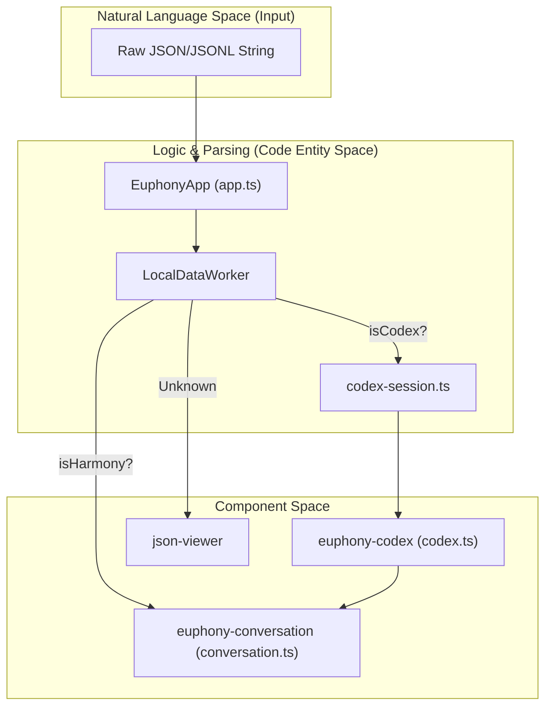
**Sources:** [README.md:51-59](), [public/examples/simple-harmony-convos.jsonl:1]()

---

### Examples and Reference Files

Euphony ships with example files in `public/examples/` to serve as a reference for developers and a test suite for the parser.

1.  **`simple-harmony-convos.jsonl`**: A basic set of Harmony conversations demonstrating the standard `role` and `content` structure [public/examples/simple-harmony-convos.jsonl:1-5]().
2.  **`euphony-convo-100.jsonl`**: A comprehensive example demonstrating:
    -   **Markdown & LaTeX**: Inline formulas and rich text [public/examples/euphony-convo-100.jsonl:2]().
    -   **Multi-modal Content**: Code blocks and diff patches [public/examples/euphony-convo-100.jsonl:3]().
    -   **System/Developer Messages**: Complex configuration objects rendered as tables [public/examples/euphony-convo-100.jsonl:3]().
    -   **HTML Blocks**: Interactive elements embedded in markdown [public/examples/euphony-convo-100.jsonl:4]().

#### Harmony Content Mapping
This diagram bridges the JSON content types to the specific TypeScript interfaces and Renderers.

"Harmony Schema to Code Entity Mapping"
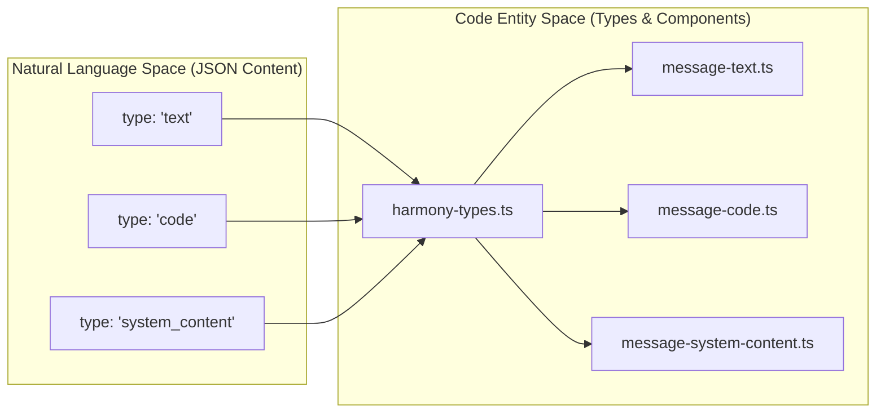
**Sources:** [public/examples/euphony-convo-100.jsonl:1-4](), [public/examples/simple-harmony-convos.jsonl:1-4]()

---

# Page: Architecture

# Architecture

<details>
<summary>Relevant source files</summary>

The following files were used as context for generating this wiki page:

- [src/components/app/app.ts](src/components/app/app.ts)
- [src/config/config.ts](src/config/config.ts)
- [src/euphony.ts](src/euphony.ts)

</details>


Euphony is built as a modular, web-component-based system designed to visualize complex conversation data (Harmony) and session logs (Codex). The architecture follows a layered approach, separating the UI orchestration, data processing, and optional backend services.

## System Overview

The system is composed of three primary layers:
1.  **The App Shell**: A [LitElement](https://lit.dev/) application that manages global state, routing via URL parameters, and high-level data orchestration [src/components/app/app.ts:128-128]().
2.  **The Data Pipeline**: A multi-threaded system using Web Workers to parse large datasets off the main thread, ensuring a responsive UI [src/components/app/app.ts:35-37]().
3.  **The Backend (Optional)**: A FastAPI server that provides advanced features like SSRF-safe data fetching, conversation translation, and server-side rendering (SSR) for Harmony tokens [server/fastapi-main.py:1-25]().

### High-Level Component Relationship

The following diagram illustrates how the core entities interact to transform raw data into a rendered conversation.

**Diagram: Data Flow and Entity Mapping**
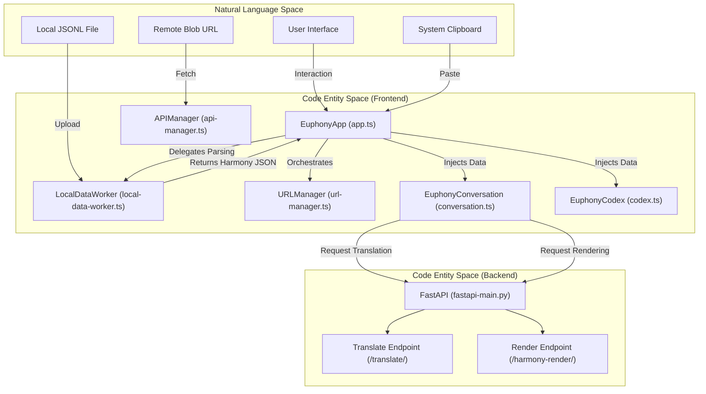
**Sources:** [src/components/app/app.ts:128-202](), [src/utils/api-manager.ts:15-20](), [server/fastapi-main.py:1-30]()

---

## Core Layers

### App Shell and Data Pipeline
The `EuphonyApp` class acts as the central controller. It manages the `DataType` (CONVERSATION, CODEX, or JSON) [src/components/app/app.ts:74-78]() and coordinates between the `URLManager` for state persistence and the `LocalDataWorker` for heavy lifting.

*   **URL Management**: Synchronizes the current conversation index and message sub-index with the browser's URL hash and query parameters [src/components/app/app.ts:106-121]().
*   **Worker Orchestration**: Uses `LocalDataWorker` to parse JSONL files in the background to prevent UI jank [src/components/app/app.ts:35-36]().

For details, see [App Shell and Data Pipeline](#2.1).

### FastAPI Backend Server
While Euphony can run in a "Frontend-Only" mode, the FastAPI backend enables features that require server-side logic or bypass CORS restrictions.

*   **Data Proxying**: The `/blob-jsonl/` endpoint allows fetching data from external URLs safely [server/fastapi-main.py:1-25]().
*   **Translation**: Integrates with LLMs to translate conversation messages via the `/translate/` endpoint [server/fastapi-main.py:1-25]().
*   **Harmony Rendering**: Supports server-side tokenization and rendering of specialized Harmony content types [server/fastapi-main.py:1-25]().

For details, see [FastAPI Backend Server](#2.2).

### Library Entry Point and Public API
Euphony is designed to be consumed either as a standalone application or as a library of web components. The `src/euphony.ts` file serves as the main entry point, exporting all necessary components and types [src/euphony.ts:1-14]().

*   **Exports**: Includes viewers like `EuphonyConversation` and `EuphonyCodex`, as well as individual message renderers [src/euphony.ts:2-8]().
*   **Builds**: The library build produces a bundled JavaScript file and TypeScript definitions in the `lib/` directory.

For details, see [Library Entry Point and Public API](#2.3).

---

## Component Architecture

Euphony uses a tree of custom elements. The `EuphonyApp` contains a grid of viewer components, which in turn contain specific message renderers based on the content type.

**Diagram: Component Hierarchy**
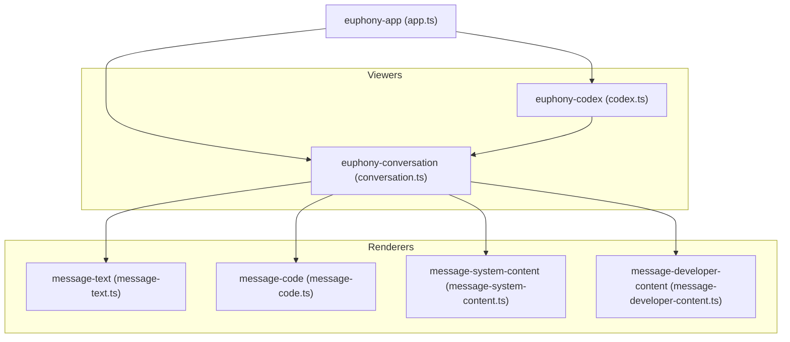
**Sources:** [src/euphony.ts:1-8](), [src/components/app/app.ts:55-65]()

**Sources:**
- [src/components/app/app.ts:1-202]()
- [src/euphony.ts:1-14]()
- [src/utils/api-manager.ts:15-20]()
- [src/config/config.ts:1-11]()

---

# Page: App Shell and Data Pipeline

# App Shell and Data Pipeline

<details>
<summary>Relevant source files</summary>

The following files were used as context for generating this wiki page:

- [src/components/app/app.css](src/components/app/app.css)
- [src/components/app/app.ts](src/components/app/app.ts)
- [src/components/app/local-data-worker.ts](src/components/app/local-data-worker.ts)
- [src/components/app/request-worker.ts](src/components/app/request-worker.ts)
- [src/components/app/url-manager.ts](src/components/app/url-manager.ts)

</details>


The **Euphony App Shell** is the foundational orchestration layer of the application, implemented primarily in the `EuphonyApp` root component. It manages the global state, coordinates data ingestion from various sources (URLs, local files, and clipboard), and provides a synchronized interface between the UI state and the browser's URL.

### The EuphonyApp Root Component

The `EuphonyApp` class (defined in `src/components/app/app.ts`) is a `LitElement` that serves as the entry point for the standalone application. It manages the high-level layout, including the sticky header, search/filter controls, and the main content area where conversations are rendered [src/components/app/app.ts:127-128]().

#### Key Responsibilities
- **State Management**: Tracks the current dataset (`allConversationData`, `codexSessionData`, `JSONData`), pagination state, and global viewing preferences [src/components/app/app.ts:132-161]().
- **Worker Orchestration**: Initializes and communicates with the `LocalDataWorker` for off-thread parsing and the `RequestWorker` for API interactions [src/components/app/app.ts:201-202]().
- **UI Coordination**: Manages global UI components like toasts, confirm dialogs, and search windows [src/components/app/app.ts:173-192]().

#### Data Pipeline Overview
The diagram below illustrates how data flows from external sources through the App Shell and into the specialized viewer components.

**Data Flow: Source to Viewer**
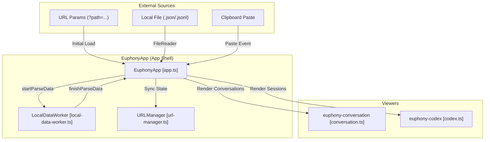
Sources: [src/components/app/app.ts:127-202](), [src/components/app/local-data-worker.ts:245-255](), [src/components/app/url-manager.ts:13-52]()

---

### LocalDataWorker: Off-Thread Parsing

To maintain UI responsiveness, Euphony offloads heavy JSON/JSONL parsing and data transformation to a Web Worker named `LocalDataWorker` [src/components/app/local-data-worker.ts]().

#### Implementation Details
- **Command Pattern**: The worker listens for a `startParseData` command containing either a raw string or a `File` object [src/components/app/local-data-worker.ts:7-15]().
- **Format Detection**: It automatically detects if the data is a **Codex Session** (using `isCodexSessionJSONL`), a **Harmony Conversation**, or generic **JSON** [src/components/app/local-data-worker.ts:209-228]().
- **Heuristic Transformation**: If the data is JSONL but doesn't match the Harmony schema exactly, `extractConversationFromJSONL` attempts to find a conversation-like object within the lines and promotes it, preserving other fields in `metadata` [src/components/app/local-data-worker.ts:54-134]().

**Worker Communication Logic**
| Message Command | Direction | Payload |
| :--- | :--- | :--- |
| `startParseData` | App -> Worker | `sourceText` or `sourceFile`, `requestID` |
| `finishParseData`| Worker -> App | `dataType` (codex/conversation/json) and the parsed array |
| `error` | Worker -> App | Error message and `requestID` |

Sources: [src/components/app/local-data-worker.ts:6-45](), [src/components/app/local-data-worker.ts:197-243]()

---

### RequestWorker: API and Backend Integration

The `RequestWorker` (defined in `src/components/app/request-worker.ts`) encapsulates the logic for asynchronous network requests, providing a bridge between the viewer components and either the FastAPI backend or direct browser-side API calls [src/components/app/request-worker.ts:35-44]().

#### Key Features
- **Concurrency Control**: Uses an `async-mutex` Semaphore to limit translation requests to 128 concurrent calls, preventing browser-side network exhaustion [src/components/app/request-worker.ts:12-47]().
- **Dual Mode Support**:
    - **Backend Mode**: Calls the FastAPI server endpoints (e.g., `/translate/`, `/harmony-render/`) [src/components/app/request-worker.ts:81-84]().
    - **Frontend-Only Mode**: Uses `BrowserAPIManager` to perform operations like OpenAI translations directly using a client-side API key [src/components/app/request-worker.ts:131-145]().
- **Retry Logic**: Implements a 3-attempt retry strategy with jitter (300ms-700ms) for translation failures [src/components/app/request-worker.ts:73-79]().

Sources: [src/components/app/request-worker.ts:46-125](), [src/components/app/request-worker.ts:218-232]()

---

### URLManager: State Synchronization

The `URLManager` class (defined in `src/components/app/url-manager.ts`) ensures that the application state is reflected in the browser's URL parameters. This enables deep-linking to specific conversations, pages, or filtered views.

#### State Mapping
The `URLManager` synchronizes the following `EuphonyApp` properties:
- **Pagination**: `page`, `limit` [src/components/app/url-manager.ts:19-20]().
- **View Settings**: `markdown` (boolean), `metadata` (boolean), `grid` (column width) [src/components/app/url-manager.ts:23-34]().
- **Filtering**: `jmespath` (the current query string) [src/components/app/url-manager.ts:37-41]().
- **Navigation**: `index` (conversation ID) and `subindex` (message ID) [src/components/app/url-manager.ts:180-181]().

**URL Synchronization Flow**
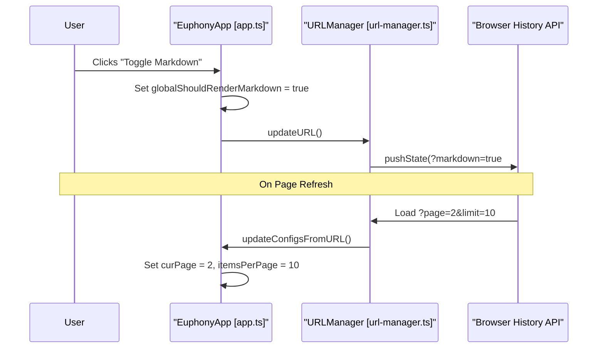
Sources: [src/components/app/url-manager.ts:13-52](), [src/components/app/url-manager.ts:57-112]()

---

### Layout and Styling

The root layout is defined in `app.css` and utilizes a three-column grid for the main content [src/components/app/app.css:93-94]().

- **`.content-left` / `.content-right`**: Side margins that use CSS Container Queries (`@container`) to hide utility buttons (like "Scroll to Top") when the screen width is too narrow [src/components/app/app.css:109-135](), [src/components/app/app.css:220-232]().
- **`.content-center`**: The primary container for the `conversation-list`.
- **Grid View**: When `is-grid-view` is active, the conversation list switches from a vertical stack to a `repeat(auto-fill, ...)` grid layout [src/components/app/app.css:323-335]().
- **Sticky Header**: The header uses a linear gradient mask to provide a smooth transition as content scrolls beneath it [src/components/app/app.css:57-75]().

Sources: [src/components/app/app.css:3-107](), [src/components/app/app.css:320-338]()

---

# Page: FastAPI Backend Server

# FastAPI Backend Server

<details>
<summary>Relevant source files</summary>

The following files were used as context for generating this wiki page:

- [pyproject.toml](pyproject.toml)
- [server/fastapi-main.py](server/fastapi-main.py)

</details>


The Euphony backend is an optional Python-based FastAPI server that provides advanced features not available in the standalone frontend mode, such as server-side translation, remote JSONL fetching with JMESPath filtering, and server-side Harmony token rendering.

## Overview and Purpose

While Euphony can run as a static web application, the FastAPI server ([server/fastapi-main.py:1-14]()) extends its capabilities by:
1.  **Bypassing CORS**: Fetching remote resources that do not have permissive CORS headers via the `/blob-jsonl/` endpoint.
2.  **Translation**: Providing high-quality LLM-based translation via OpenAI's API.
3.  **Harmony Rendering**: Integrating with the `openai-harmony` library to visualize how conversations are tokenized for model input.

### Data Flow: Frontend to Backend
The following diagram illustrates how the `EuphonyApp` communicates with the FastAPI server.

**Figure 1: Euphony Backend Communication Flow**
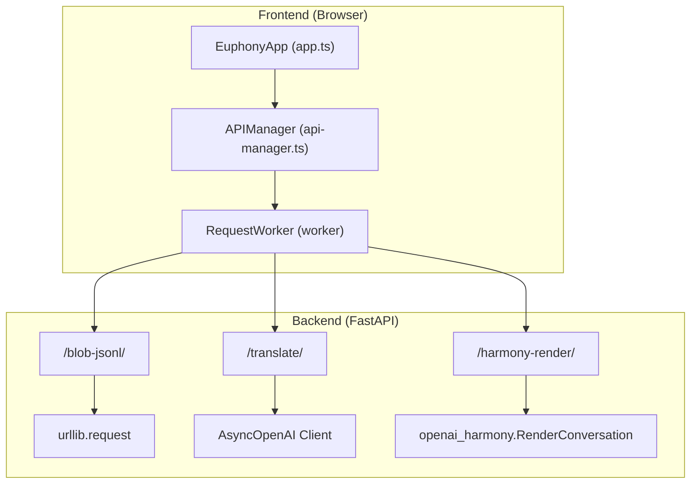
Sources: [src/utils/api-manager.ts:1-20](), [server/fastapi-main.py:43-46](), [server/fastapi-main.py:286-310]()

---

## API Endpoints

### 1. Remote Data Fetching (`/blob-jsonl/`)
This endpoint allows the frontend to request data from a remote URL. It includes a security check to ensure the URL is valid and prevents common SSRF (Server-Side Request Forgery) patterns by validating the URL scheme [server/fastapi-main.py:228-232]().

*   **Function**: `get_blob_jsonl` [server/fastapi-main.py:220]()
*   **Filtering**: Supports server-side JMESPath filtering via the `query` parameter [server/fastapi-main.py:255-257]().
*   **Pagination**: Supports `offset` and `limit` to handle large JSONL files [server/fastapi-main.py:265-271]().

### 2. Translation (`/translate/`)
The `/translate/` endpoint uses the OpenAI API to translate message content into English. It implements several optimizations to handle high concurrency and avoid redundant API calls.

*   **Caching**: Uses `async_lru` for result caching [server/fastapi-main.py:214-215]().
*   **Singleflight Pattern**: The server maintains a dictionary of `_inflight_translations` [server/fastapi-main.py:45](). If multiple requests for the same text arrive simultaneously, they all await the same task instead of spawning multiple API calls [server/fastapi-main.py:330-335]().
*   **Concurrency Control**: A semaphore (`_translation_semaphore`) limits the number of active OpenAI requests to `TRANSLATION_MAX_CONCURRENCY` (default 1024) [server/fastapi-main.py:44]().

### 3. Harmony Rendering
These endpoints integrate with the `openai-harmony` package to provide tokenization previews.

| Endpoint | Function | Description |
| :--- | :--- | :--- |
| `/harmony-renderer-list/` | `get_harmony_renderer_list` | Returns available renderers (e.g., `o200k_harmony`) [server/fastapi-main.py:348-350](). |
| `/harmony-render/` | `post_harmony_render` | Takes a conversation JSON, normalizes it, and returns token IDs and decoded strings [server/fastapi-main.py:353-375](). |

Sources: [server/fastapi-main.py:214-275](), [server/fastapi-main.py:325-375]()

---

## Implementation Details

### Harmony Normalization
Before rendering or processing, raw JSON conversation data is normalized into a standard `HarmonyConversation` object. This process handles various legacy formats and author role mappings.

**Figure 2: Normalization Logic in server/fastapi-main.py**
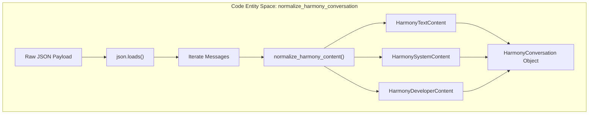
Sources: [server/fastapi-main.py:94-164](), [server/fastapi-main.py:166-198]()

### Security and SSRF Considerations
The server includes safeguards when fetching remote content:
1.  **URL Validation**: It only allows `http` and `https` schemes [server/fastapi-main.py:228-232]().
2.  **Size Limits**: It enforces a `MAX_PUBLIC_JSON_BYTES` (25MB) limit on downloaded content to prevent memory exhaustion [server/fastapi-main.py:39](), [server/fastapi-main.py:246-248]().
3.  **Path Traversal**: The `_resolve_frontend_path` utility ensures that static file requests (like `index.html`) remain within the `dist` directory [server/fastapi-main.py:85-91]().

### Dependency Configuration
The server's environment is defined in `pyproject.toml`. Key dependencies include:
*   `fastapi` & `uvicorn`: Web framework and server [pyproject.toml:6-7]().
*   `openai-harmony`: Core library for Harmony data structures and tokenization [pyproject.toml:12]().
*   `async-lru`: For caching translation results [pyproject.toml:8]().
*   `jmespath`: For server-side JSON filtering [pyproject.toml:11]().

Sources: [pyproject.toml:1-13](), [server/fastapi-main.py:35-42]()

---

# Page: Library Entry Point and Public API

# Library Entry Point and Public API

<details>
<summary>Relevant source files</summary>

The following files were used as context for generating this wiki page:

- [.github/workflows/build.yml](.github/workflows/build.yml)
- [.github/workflows/publish.yml](.github/workflows/publish.yml)
- [package.json](package.json)
- [src/euphony.ts](src/euphony.ts)

</details>


The `euphony` library is designed to be consumed either as a standalone web application or as a modular collection of Web Components. The library entry point centralizes the public API, ensuring that consumers have access to the core rendering components, data types, and utility functions required to integrate Euphony into external React, Svelte, or Vue projects.

## Entry Point: src/euphony.ts

The file `src/euphony.ts` serves as the primary barrel file for the library. It does not contain logic itself but rather exports the essential entities that constitute the Euphony public API [src/euphony.ts:1-14]().

By importing from this entry point, consumers gain access to:
- **Web Components**: Custom elements for rendering conversations and specialized message types.
- **Type Definitions**: TypeScript interfaces for Harmony and Codex data formats.
- **Utilities**: Helper functions for parsing session data and general UI logic.

### Exported Modules

| Category | Exports | Source |
| :--- | :--- | :--- |
| **Core Viewers** | `EuphonyCodex`, `EuphonyConversation` | [src/euphony.ts:2-3]() |
| **Message Renderers** | `MessageCode`, `MessageDeveloperContent`, `MessageSystemContent`, `MessageText`, `MessageUnsupported` | [src/euphony.ts:4-8]() |
| **Types** | `Conversation`, `Message`, `BlobJSONLPayload`, `TranslationRequest` | [src/euphony.ts:10-11]() |
| **Utilities** | `parseCodexSession`, `renderMarkdown`, `copyToClipboard` | [src/euphony.ts:12-13]() |

Sources: [src/euphony.ts:1-14]()

## Build Process and Distribution

Euphony uses **Vite** and **vite-plugin-dts** to generate a distribution-ready bundle. The build process is triggered via the `build:library` script defined in `package.json` [package.json:28-28]().

### Build Pipeline

The pipeline performs the following steps:
1.  **Type Checking**: Runs `tsc` to ensure type safety.
2.  **Library Mode**: Executes `vite build --mode library`. This uses the library mode configuration in Vite to bundle `src/euphony.ts`.
3.  **Output Generation**: Produces a `lib/` directory containing:
    -   `euphony.js`: The compiled JavaScript bundle (ES Module).
    -   `euphony.d.ts`: The generated TypeScript declaration file [package.json:6-11]().

### Library Build Workflow

The following diagram illustrates the transformation from source code to the distributed library artifacts.

**Build Artifact Generation**
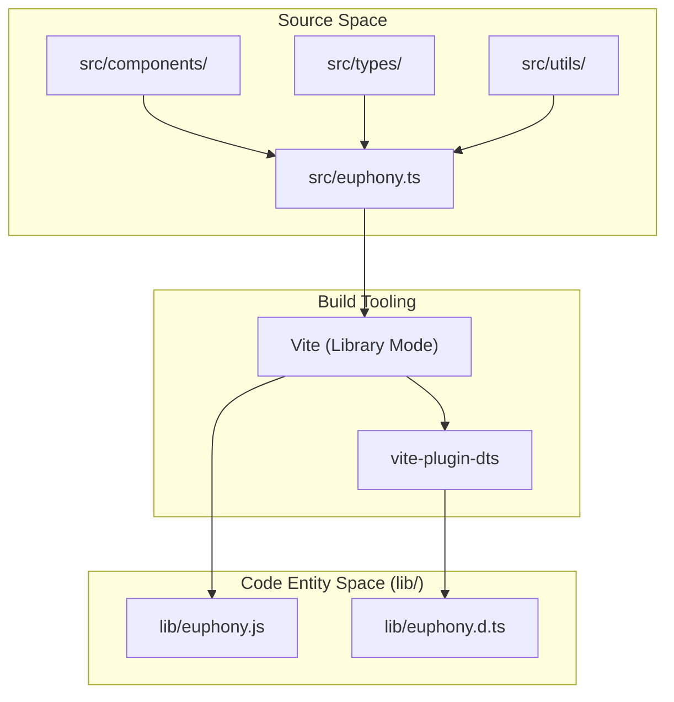
Sources: [package.json:28-28](), [package.json:6-11](), [src/euphony.ts:1-14]()

## Integration and Usage

Once the library is built or installed via a package manager, it can be integrated into any modern web framework. Since Euphony components are standard Web Components (built with Lit), they are compatible with React, Svelte, and Vue.

### Consuming the Library

The `package.json` defines the entry points for the package, mapping the root import to the compiled library files [package.json:7-14]().

**Example Usage in a Host Application:**

```typescript
import { EuphonyConversation } from 'euphony';

// The component is automatically registered as <euphony-conversation>
// because the component files call customElements.define() internally.
```

### CI/CD Integration

The library is automatically built during the CI process. The `Build` workflow runs `pnpm run build:library` on every push to the `main` branch and on pull requests to verify that the library entry point remains functional [.github/workflows/build.yml:31-32](). 

For releases, the `Publish` workflow triggers on version tags (e.g., `v1.0.0`), builds the library, and publishes the `lib` folder to the npm registry [.github/workflows/publish.yml:31-35]().

**Library Release Pipeline**
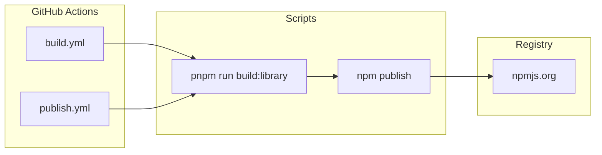
Sources: [.github/workflows/build.yml:31-32](), [.github/workflows/publish.yml:31-35](), [package.json:15-23]()

## Public API Surface Area

The following table summarizes the primary classes and interfaces exposed to consumers.

| Symbol | Type | Description |
| :--- | :--- | :--- |
| `EuphonyConversation` | Class | The primary viewer for Harmony conversation data. |
| `EuphonyCodex` | Class | A wrapper that parses Codex session logs and renders them via `EuphonyConversation`. |
| `Conversation` | Interface | The TypeScript definition for the Harmony JSON schema. |
| `Message` | Interface | The TypeScript definition for individual message objects within a conversation. |
| `parseCodexSession` | Function | Utility to transform raw Codex JSONL strings into Harmony format. |

Sources: [src/euphony.ts:1-14](), [package.json:6-14]()

---

# Page: Web Components

# Web Components

<details>
<summary>Relevant source files</summary>

The following files were used as context for generating this wiki page:

- [.fttemplates/default-template/[FTName].css](.fttemplates/default-template/[FTName].css)
- [.fttemplates/default-template/[FTName].ts](.fttemplates/default-template/[FTName].ts)
- [src/css/component-global.css](src/css/component-global.css)

</details>


Euphony is built as a library of reusable, encapsulated web components using **LitElement**. All components follow a strict naming convention, use Shadow DOM for style isolation, and leverage CSS variables for consistent theming across the application.

### Naming and Structure
All custom elements in the codebase are prefixed with `euphony-` to prevent collisions with standard HTML elements or other libraries. Each component typically consists of a TypeScript file (`.ts`) for logic and a paired CSS file (`.css`) imported as an inline string to be injected into the component's static styles.

The project uses a standardized template for creating new components, ensuring a consistent internal structure across the codebase.

#### Component Template Pattern
A standard Euphony component follows this structural layout:
1.  **Imports**: Lit core utilities and component-specific styles.
2.  **Class Definition**: Annotated with `@customElement`.
3.  **Properties and State**: Using `@property` for public API and `@state` for internal reactivity.
4.  **Lifecycle Methods**: Implementation of `firstUpdated`, `willUpdate`, etc.
5.  **Render Method**: Returns the HTML template.
6.  **Static Styles**: Combines component-specific CSS with global shared styles.
7.  **Global Declaration**: Registration in `HTMLElementTagNameMap` for TypeScript support.

| Feature | Implementation |
| :--- | :--- |
| **Base Class** | `LitElement` [[.fttemplates/default-template/[FTName].ts:11-11]()] |
| **Naming Convention** | `euphony-<name>` [[.fttemplates/default-template/[FTName].ts:10-10]()] |
| **Style Encapsulation** | Shadow DOM via `static styles` [[.fttemplates/default-template/[FTName].ts:54-58]()] |
| **External Styles** | Inlined via `?inline` query [[.fttemplates/default-template/[FTName].ts:5-5]()] |

**Sources:**
- [.fttemplates/default-template/[FTName].ts:1-66]()
- [.fttemplates/default-template/[FTName].css:1-12]()

---

### Theming and Global Styles
Euphony uses **CSS Custom Properties (Variables)** defined in a global scope to manage theming. These variables allow the host application to override colors, fonts, and spacing without breaking the Shadow DOM encapsulation.

#### Global Variable System
The core design tokens are defined in `src/css/component-global.css`. These include:
*   **Shadows**: Standardized depths for cards and borders (e.g., `--shadow-border-light`).
*   **Typography**: A stepped scale from `--font-d6` to `--font-u6` and a monospace stack.
*   **Color Palette**: Extensive HSL-based color scales (Red, Blue, Green, etc.) and semantic colors like `--added-color` or `--deleted-color` for diffs.

#### Code-to-UI Mapping: Style Tokens
The following diagram illustrates how CSS variables in the code map to visual entities in the rendered components.

**Diagram: Style Token Mapping**
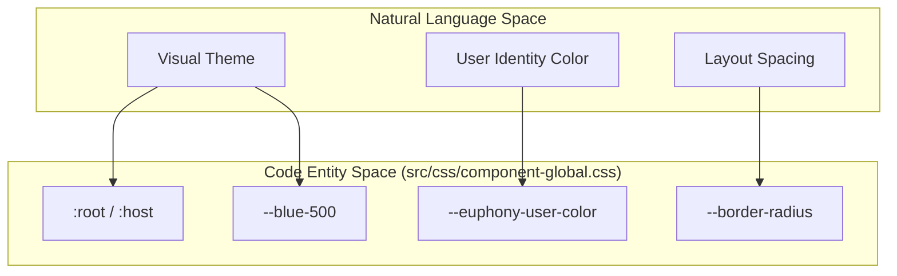

**Sources:**
- [src/css/component-global.css:42-222]()

---

### Component Hierarchy
The Euphony component library is organized into three main categories: high-level viewers, specialized message renderers, and low-level UI utilities.

#### Component Relationship
The following diagram shows how the primary code entities interact to form the UI.

**Diagram: Component Entity Relationships**
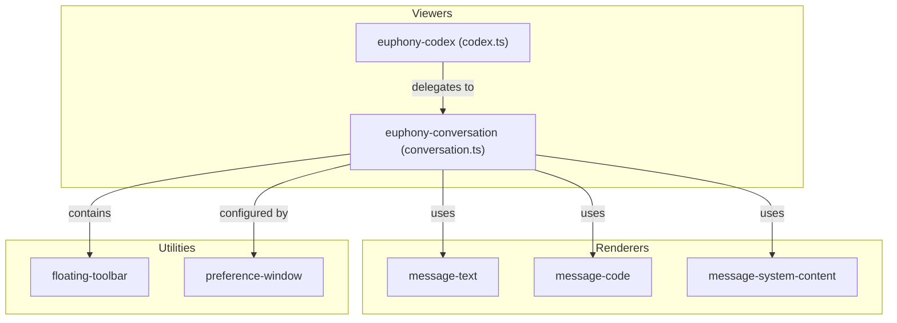

#### 1. Conversation and Codex Viewers
These are the entry-point components. `euphony-conversation` handles the rendering of a list of Harmony messages, while `euphony-codex` acts as a wrapper for parsing Codex session files.
*   For details, see [Conversation and Codex Viewer Components](#3.1).

#### 2. Message Renderers
A family of components dedicated to rendering specific message types. The `euphony-conversation` component dynamically selects the appropriate renderer based on the message content type (e.g., Markdown, Code, or System configuration).
*   For details, see [Message Renderer Components](#3.2).

#### 3. UI Utility Components
Supporting elements that provide common UI patterns like toolbars, dialogs, search windows, and pagination. These are used internally by the viewers to provide interactive features.
*   For details, see [UI Utility Components](#3.3).

**Sources:**
- [.fttemplates/default-template/[FTName].ts:10-11]()
- [src/css/component-global.css:1-222]()

---

# Page: Conversation and Codex Viewer Components

# Conversation and Codex Viewer Components

<details>
<summary>Relevant source files</summary>

The following files were used as context for generating this wiki page:

- [src/components/codex/codex.css](src/components/codex/codex.css)
- [src/components/codex/codex.ts](src/components/codex/codex.ts)
- [src/components/conversation/conversation.css](src/components/conversation/conversation.css)
- [src/components/conversation/conversation.ts](src/components/conversation/conversation.ts)

</details>


The primary viewer components in Euphony are `euphony-conversation` and `euphony-codex`. These components are responsible for rendering the hierarchical structure of Harmony conversations and Codex sessions, providing interactive features such as metadata inspection, real-time translation, and focus mode filtering.

## Euphony Conversation (`euphony-conversation`)

The `EuphonyConversation` class is the core rendering engine for Harmony data. It transforms a `Conversation` object into a vertical stack of message components, managing global state for the conversation such as theme, markdown rendering, and translation status.

### Implementation Details
`EuphonyConversation` is a `LitElement` that reacts to changes in its `conversationData` property [src/components/conversation/conversation.ts:121-122](). It manages a complex internal state, including:
*   **Message Filtering**: Implements "Focus Mode" which filters messages based on `author`, `recipient`, or `content-type` [src/components/conversation/conversation.ts:187-197]().
*   **Translation**: Orchestrates calls to the backend `/translate/` endpoint and updates messages with their translated counterparts [src/components/conversation/conversation.ts:105-108]().
*   **Metadata Viewer**: Integrates a split-panel view using Shoelace's `sl-split-panel` to show the raw JSON metadata alongside the rendered conversation [src/components/conversation/conversation.ts:55-55]().

### Message Rendering Logic
The component iterates through the `messages` array and dynamically selects a renderer based on the message's content type using `tryGetContentTypeFromContent` [src/components/conversation/conversation.ts:36-37]().

| Content Type | Component Used | Purpose |
| :--- | :--- | :--- |
| `text` | `euphony-message-text` | Renders Markdown and LaTeX. |
| `code` | `euphony-message-code` | Syntax-highlighted code blocks via Prism. |
| `system_content` | `euphony-message-system-content` | Configuration tables for system messages. |
| `developer_content` | `euphony-message-developer-content` | Developer instructions and metadata. |
| `hidden` | `euphony-message-hidden` | Placeholder for collapsed/hidden content. |

### Data Flow: Message Selection and Rendering
The following diagram illustrates how `euphony-conversation` processes a Harmony `Message` object and delegates to specific renderers.

**Message Dispatch Flow**
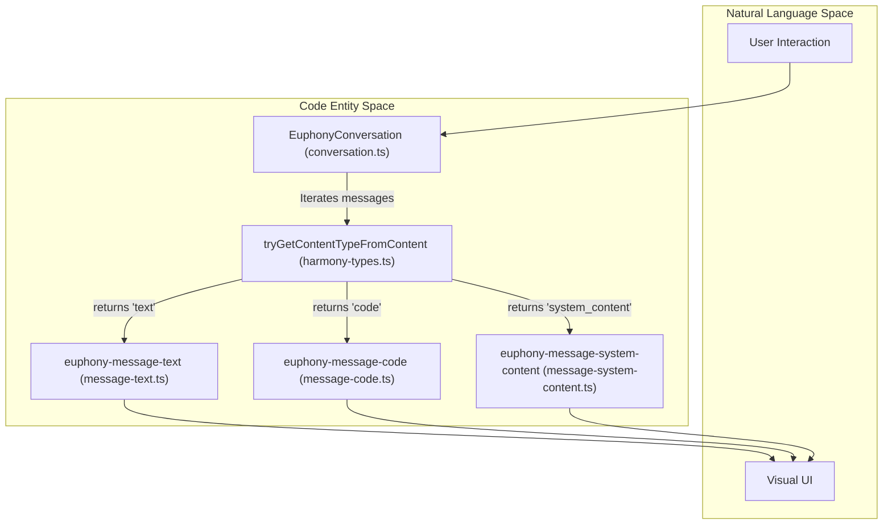
Sources: [src/components/conversation/conversation.ts:113-114](), [src/types/harmony-types.ts:36-37]()

## Euphony Codex (`euphony-codex`)

`EuphonyCodex` is a wrapper component specifically designed for the Codex session format. Its primary responsibility is to parse Codex JSONL (JSON Lines) data and transform it into a standard Harmony `Conversation` object, which it then passes to an internal `euphony-conversation` instance.

### Implementation Details
*   **Parsing**: It accepts a `session-string` (raw JSONL) or `sessionData` (array of objects) [src/components/codex/codex.ts:17-21]().
*   **Lifecycle**: The `willUpdate` lifecycle method triggers `refreshConversationFromSession` whenever the session data changes [src/components/codex/codex.ts:144-151]().
*   **Delegation**: Once parsed via `parseCodexSession`, the resulting `Conversation` is passed to the child `euphony-conversation` element via the `.conversationData` property [src/components/codex/codex.ts:164-165]().

### Data Flow: Codex to Harmony Transformation
The component acts as a bridge between the raw Codex event stream and the structured Harmony viewer.

**Codex Transformation Pipeline**
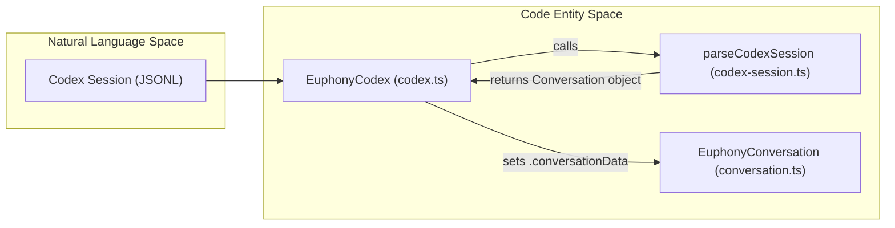
Sources: [src/components/codex/codex.ts:121-142](), [src/utils/codex-session.ts:5-5]()

## Key Functions and Properties

### EuphonyConversation Properties
*   `conversationData`: The primary input. Accepts a `TranslatableConversation` object [src/components/conversation/conversation.ts:122-122]().
*   `isEditable`: Enables "Editor Mode," allowing users to modify message content or roles [src/components/conversation/conversation.ts:179-180]().
*   `focusModeAuthor`: An array of author IDs to filter the view [src/components/conversation/conversation.ts:187-188]().

### EuphonyCodex Properties
*   `sessionString`: A string containing JSONL formatted Codex events [src/components/codex/codex.ts:17-18]().
*   `conversationLabel`: Customizes the header label (defaults to "Session") [src/components/codex/codex.ts:26-27]().

### Styling and Theming
Both components utilize the Euphony global CSS variable system defined in `component-global.css`.
*   **Theming**: Controlled via the `theme` property (`light`, `dark`, or `auto`) [src/components/conversation/conversation.ts:210-211]().
*   **CSS Variables**: Layout is managed via variables like `--euphony-conversation-max-width` and `--euphony-user-color` [src/components/conversation/conversation.css:8-16]().

Sources: [src/components/conversation/conversation.ts:113-211](), [src/components/codex/codex.ts:15-96](), [src/components/conversation/conversation.css:1-111]()

---

# Page: Message Renderer Components

# Message Renderer Components

<details>
<summary>Relevant source files</summary>

The following files were used as context for generating this wiki page:

- [src/components/message-code/message-code.css](src/components/message-code/message-code.css)
- [src/components/message-code/message-code.ts](src/components/message-code/message-code.ts)
- [src/components/message-developer-content/message-developer-content.css](src/components/message-developer-content/message-developer-content.css)
- [src/components/message-developer-content/message-developer-content.ts](src/components/message-developer-content/message-developer-content.ts)
- [src/components/message-hidden/message-hidden.css](src/components/message-hidden/message-hidden.css)
- [src/components/message-hidden/message-hidden.ts](src/components/message-hidden/message-hidden.ts)
- [src/components/message-system-content/message-system-content.css](src/components/message-system-content/message-system-content.css)
- [src/components/message-system-content/message-system-content.ts](src/components/message-system-content/message-system-content.ts)
- [src/components/message-text/message-text.css](src/components/message-text/message-text.css)
- [src/components/message-text/message-text.ts](src/components/message-text/message-text.ts)
- [src/components/message-unsupported/message-unsupported.css](src/components/message-unsupported/message-unsupported.css)
- [src/components/message-unsupported/message-unsupported.ts](src/components/message-unsupported/message-unsupported.ts)

</details>


Message Renderer Components are specialized LitElement web components responsible for visualizing the diverse content types within a Harmony conversation. Each component is tailored to a specific `content_type` defined in the Harmony schema, handling unique requirements like Markdown parsing, LaTeX rendering, syntax highlighting, or structured data tables.

## Renderer Selection Logic

The parent `euphony-conversation` component orchestrates the display of messages. It inspects the `content_type` of each message and dynamically selects the corresponding renderer.

| Content Type | Component Tag | Class Name |
| :--- | :--- | :--- |
| `text` | `euphony-message-text` | `EuphonyMessageText` |
| `code` | `euphony-message-code` | `EuphonyMessageCode` |
| `system` | `euphony-message-system-content` | `EuphonyMessageSystemContent` |
| `developer` | `euphony-message-developer-content` | `EuphonyMessageDeveloperContent` |
| (Hidden) | `euphony-message-hidden` | `EuphonyMessageHidden` |
| (Unknown) | `euphony-message-unsupported` | `EuphonyMessageUnsupported` |

### Data Flow: Content Type to Component
The following diagram illustrates how the `Message` entity is routed to specific code entities based on its internal state.

**Message Dispatcher Logic**
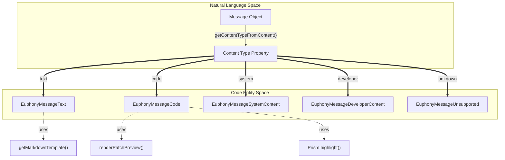
**Sources:** [src/components/message-text/message-text.ts:59-65](), [src/components/message-code/message-code.ts:34-39](), [src/components/message-system-content/message-system-content.ts:101-108](), [src/components/message-developer-content/message-developer-content.ts:88-95]()

---

## Core Message Renderers

### 1. Message Text (`euphony-message-text`)
The primary renderer for standard conversational turns. It supports two modes: static rendering (Markdown/LaTeX) and an interactive editor mode.

*   **Markdown/LaTeX:** Uses `getMarkdownTemplate` to process the `text` property of `TextMessageContent` [src/components/message-text/message-text.ts:115-131]().
*   **Editor Mode:** When `isEditable` is true, it renders a `contenteditable` div. Changes are propagated via the `message-text-changed` custom event [src/components/message-text/message-text.ts:77-86]().
*   **Translation Support:** Applies specific CSS variables (`--translation-color`) when the `isTranslation` property is set [src/components/message-text/message-text.css:7-12]().

**Sources:** [src/components/message-text/message-text.ts:17-151](), [src/components/message-text/message-text.css:1-40]()

### 2. Message Code (`euphony-message-code`)
Handles technical content including source code and unified diffs (patches).

*   **Syntax Highlighting:** Uses `Prism.js` to highlight code based on the `language` field [src/components/message-code/message-code.ts:44-55](). It specifically imports `prism-json` and `prism-python` by default [src/components/message-code/message-code.ts:5-6]().
*   **Patch Preview:** Before falling back to standard code rendering, it attempts to parse the content via `renderPatchPreview`. If the text follows a diff format, it renders a specialized UI with line-by-line additions and deletions [src/components/message-code/message-code.ts:65-77]().
*   **Styling:** Incorporates `prism-coldark-auto.css` for themed syntax highlighting [src/components/message-code/message-code.ts:80-85]().

**Sources:** [src/components/message-code/message-code.ts:23-92](), [src/components/message-code/message-code.css:1-48]()

### 3. Message System & Developer Content
These components render structured configuration and instruction data, typically seen at the beginning of a conversation or in tool-calling contexts.

*   **System Content (`euphony-message-system-content`):** Renders model identity, knowledge cutoffs, and tool definitions in structured tables [src/components/message-system-content/message-system-content.ts:155-212]().
*   **Developer Content (`euphony-message-developer-content`):** Similar to system content but focused on developer-provided instructions and tool namespaces [src/components/message-developer-content/message-developer-content.ts:140-216]().
*   **Block Decomposition:** Both components use a `resetBlockContents` helper to transform complex Harmony objects into an array of `BlockContent` objects for uniform rendering [src/components/message-system-content/message-system-content.ts:144-152]().

**Sources:** [src/components/message-system-content/message-system-content.ts:45-220](), [src/components/message-developer-content/message-developer-content.ts:44-216]()

---

## Utility and Fallback Renderers

### Message Hidden (`euphony-message-hidden`)
Used when a message is filtered out (e.g., by Focus Mode) but the user should still be aware of its presence. It displays a compact label like "Show text message" [src/components/message-hidden/message-hidden.ts:58-68](). Clicking the component dispatches a `hidden-message-clicked` event, signaling the parent to reveal the content [src/components/message-hidden/message-hidden.ts:73-82]().

**Sources:** [src/components/message-hidden/message-hidden.ts:14-94]()

### Message Unsupported (`euphony-message-unsupported`)
A safety fallback for experimental or future `content_type` values not yet implemented in the UI. It displays an error label and provides a collapsible JSON view of the raw message content [src/components/message-unsupported/message-unsupported.ts:70-107]().

**Sources:** [src/components/message-unsupported/message-unsupported.ts:14-115]()

---

## Implementation Details

### Shared Styling Patterns
Renderers share common CSS modules via `@import` in their shadow DOM styles to ensure visual consistency:
*   `message-content-default.css`: Base layout and padding [src/components/message-text/message-text.css:2]().
*   `message-markdown.css`: Typography for rendered Markdown [src/components/message-text/message-text.css:1]().
*   `message-collapse.css`: Styles for expandable/collapsible blocks used in System/Developer renderers [src/components/message-system-content/message-system-content.css:1]().

### Lifecycle and Data Binding
The components follow a standard Lit lifecycle for data updates:

**Renderer Lifecycle Flow**
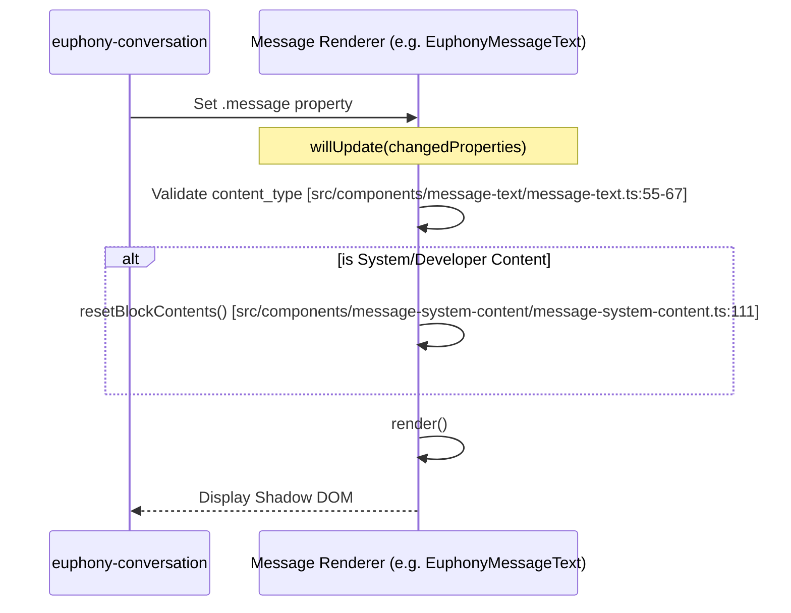
**Sources:** [src/components/message-text/message-text.ts:55-67](), [src/components/message-system-content/message-system-content.ts:95-113]()

---

# Page: UI Utility Components

# UI Utility Components

<details>
<summary>Relevant source files</summary>

The following files were used as context for generating this wiki page:

- [src/components/confirm-dialog/confirm-dialog.css](src/components/confirm-dialog/confirm-dialog.css)
- [src/components/confirm-dialog/confirm-dialog.ts](src/components/confirm-dialog/confirm-dialog.ts)
- [src/components/floating-toolbar/floating-toolbar.css](src/components/floating-toolbar/floating-toolbar.css)
- [src/components/floating-toolbar/floating-toolbar.ts](src/components/floating-toolbar/floating-toolbar.ts)
- [src/components/input-dialog/input-dialog.css](src/components/input-dialog/input-dialog.css)
- [src/components/input-dialog/input-dialog.ts](src/components/input-dialog/input-dialog.ts)
- [src/components/json-viewer/json-viewer.css](src/components/json-viewer/json-viewer.css)
- [src/components/json-viewer/json-viewer.ts](src/components/json-viewer/json-viewer.ts)
- [src/components/menu/menu.css](src/components/menu/menu.css)
- [src/components/menu/menu.ts](src/components/menu/menu.ts)
- [src/components/message-editor-popover/message-editor-popover.css](src/components/message-editor-popover/message-editor-popover.css)
- [src/components/message-editor-popover/message-editor-popover.ts](src/components/message-editor-popover/message-editor-popover.ts)
- [src/components/pagination/pagination.css](src/components/pagination/pagination.css)
- [src/components/pagination/pagination.ts](src/components/pagination/pagination.ts)
- [src/components/preference-window/preference-window.css](src/components/preference-window/preference-window.css)
- [src/components/preference-window/preference-window.ts](src/components/preference-window/preference-window.ts)
- [src/components/search-window/search-window.css](src/components/search-window/search-window.css)
- [src/components/search-window/search-window.ts](src/components/search-window/search-window.ts)
- [src/components/toast/toast.css](src/components/toast/toast.css)
- [src/components/toast/toast.ts](src/components/toast/toast.ts)
- [src/components/token-window/token-window.css](src/components/token-window/token-window.css)
- [src/components/token-window/token-window.ts](src/components/token-window/token-window.ts)

</details>


This page provides a technical reference for the supporting UI components used across Euphony. These components handle auxiliary tasks such as message actions, data filtering, settings management, and interactive dialogs.

## Interaction and Overlay Components

Euphony uses several components to handle user interactions that require overlays or floating UI elements.

### floating-toolbar
The `euphony-floating-toolbar` is a per-message action bar that appears when interacting with a message. It supports dynamic button configurations with tooltips powered by a Popper-based positioning logic [src/components/floating-toolbar/floating-toolbar.ts:4-4]().

- **Data Flow**: It accepts an array of `FloatingToolbarButton` objects [src/components/floating-toolbar/floating-toolbar.ts:8-12](). When a button is clicked, it dispatches a `button-clicked` custom event containing the button name [src/components/floating-toolbar/floating-toolbar.ts:208-213]().
- **Tooltip Logic**: Uses a debounced mouse-enter handler (`toolButtonMouseEnter`) to show tooltips after 500ms [src/components/floating-toolbar/floating-toolbar.ts:107-127]().

### message-editor-popover
Used in conversation editing mode, the `euphony-message-editor-popover` allows for quick modification of message metadata including role, author name, recipient, and channel [src/components/message-editor-popover/message-editor-popover.ts:27-30]().

- **Implementation**: It maintains local state for edits (`selectedRole`, `authorName`, etc.) to allow users to cancel without affecting the original data [src/components/message-editor-popover/message-editor-popover.ts:43-53]().
- **Normalization**: On save, it normalizes blank strings to `null` to maintain a compact Harmony format [src/components/message-editor-popover/message-editor-popover.ts:92-94]().

### menu
A generic dropdown menu component (`nightjar-menu`) used for context actions. It features a fade-out animation implemented via the Web Animations API before hiding the element [src/components/menu/menu.ts:78-87]().

**Sources:**
- [src/components/floating-toolbar/floating-toolbar.ts:1-218]()
- [src/components/message-editor-popover/message-editor-popover.ts:1-208]()
- [src/components/menu/menu.ts:1-136]()

---

## Dialogs and Notifications

Euphony implements custom dialogs and toast notifications for user confirmation and feedback.

### confirm-dialog and input-dialog
These components wrap the native HTML `<dialog>` element [src/components/confirm-dialog/confirm-dialog.ts:126-126]().
- **confirm-dialog**: Includes a "Don't ask me again" feature that persists the user's preference in `localStorage` using an `actionKey` [src/components/confirm-dialog/confirm-dialog.ts:79-82]().
- **input-dialog**: Extends the dialog pattern to include an input field (using `sl-input`) and an asynchronous `inputValidate` hook for checking input before closing [src/components/input-dialog/input-dialog.ts:46-53]().

### toast
The toast notification system provides non-blocking feedback. It supports different severity levels and automatic dismissal.

**Sources:**
- [src/components/confirm-dialog/confirm-dialog.ts:1-177]()
- [src/components/input-dialog/input-dialog.ts:1-199]()

---

## Data Inspection and Search

These components allow users to inspect the underlying Harmony/Codex data structures and filter them.

### json-viewer
The `euphony-json-viewer` provides syntax-highlighted JSON rendering using PrismJS [src/components/json-viewer/json-viewer.ts:4-5](). It imports the `prism-coldark-auto` theme to match the app's styling [src/components/json-viewer/json-viewer.ts:7-7]().

### search-window (JMESPath UI)
This component provides a specialized interface for filtering conversations. It allows users to write and execute JMESPath queries against the loaded data.

### token-window
The `token-window` is a Harmony token inspector. It visualizes how a message is tokenized, often used for debugging model context limits or specific tokenizer behaviors.

**Sources:**
- [src/components/json-viewer/json-viewer.ts:1-93]()
- [src/components/search-window/search-window.ts:1-10]()
- [src/components/token-window/token-window.ts:1-10]()

---

## Component Relationship Diagram

The following diagram illustrates how utility components relate to the core data entities and user actions.

**UI Utility Architecture**
```mermaid
graph TD
    subgraph "Natural Language Space"
        "User Action" --> "Confirm Action"
        "User Action" --> "Edit Metadata"
        "User Action" --> "Filter Messages"
    end

    subgraph "Code Entity Space"
        "Confirm Action" --> CD["NightjarConfirmDialog (confirm-dialog.ts)"]
        "Edit Metadata" --> MEP["EuphonyMessageEditorPopover (message-editor-popover.ts)"]
        "Filter Messages" --> SW["EuphonySearchWindow (search-window.ts)"]
        
        CD -- "checks" --> LS["localStorage (<skip-confirm>)"]
        MEP -- "dispatches" --> SBC["save-button-clicked (CustomEvent)"]
        SW -- "applies" --> JP["JMESPath Filter"]
    end

    style CD stroke-dasharray: 5 5
    style MEP stroke-dasharray: 5 5
    style SW stroke-dasharray: 5 5
```
**Sources:**
- [src/components/confirm-dialog/confirm-dialog.ts:79-82]()
- [src/components/message-editor-popover/message-editor-popover.ts:97-103]()

---

## Component Property Reference

| Component | Tag Name | Key Properties | Events |
| :--- | :--- | :--- | :--- |
| **Floating Toolbar** | `euphony-floating-toolbar` | `buttons: FloatingToolbarButton[]` | `button-clicked` |
| **Confirm Dialog** | `nightjar-confirm-dialog` | `actionKey: string` | N/A (Callback-based) |
| **Input Dialog** | `nightjar-input-dialog` | `inputValidate: Promise<boolean>` | N/A (Callback-based) |
| **JSON Viewer** | `euphony-json-viewer` | `data: JSONValue` | N/A |
| **Editor Popover** | `euphony-message-editor-popover`| `message: Message` | `save-button-clicked`, `cancel-button-clicked` |

### Floating Toolbar Interaction Flow

This diagram maps the code entities involved in displaying and interacting with the per-message toolbar.

**Toolbar Event Flow**
```mermaid
sequenceDiagram
    participant U as User
    participant FT as EuphonyFloatingToolbar
    participant UUT as utils.ts (updatePopperOverlay)
    participant C as Parent (Conversation)

    U->>FT: mouseenter (on button)
    FT->>FT: toolButtonMouseEnter()
    Note over FT: 500ms Debounce
    FT->>UUT: updatePopperOverlay(popperTooltip, anchor, 'top')
    FT-->>U: Show Tooltip
    U->>FT: click
    FT->>C: dispatchEvent("button-clicked", detail: name)
```
**Sources:**
- [src/components/floating-toolbar/floating-toolbar.ts:91-128]()
- [src/components/floating-toolbar/floating-toolbar.ts:206-214]()
- [src/utils/utils.ts:4-4]()

---

# Page: Core Utilities and Types

# Core Utilities and Types

<details>
<summary>Relevant source files</summary>

The following files were used as context for generating this wiki page:

- [src/config/config.ts](src/config/config.ts)

</details>


This section provides an overview of the foundational TypeScript modules that underpin Euphony's data structures and logic. These utilities and type definitions are shared across all LitElement components to ensure consistency in message handling, API communication, and document rendering.

Euphony relies on two primary directories for its core logic:
- `src/types/`: Defines the strict interfaces for the **Harmony** conversation format and common API payloads.
- `src/utils/`: Contains logic for markdown parsing, browser-side tokenization, and backend communication.

## Harmony Type System

The Harmony type system is the backbone of Euphony's data model. It provides a structured way to represent multi-modal conversations, including text, code, system configurations, and developer-specific metadata.

The system is centered around the `Conversation` interface, which contains an array of `Message` objects [src/types/harmony-types.ts:252-258](). Each message is associated with a `Role` (e.g., `user`, `assistant`, `system`, `developer`) [src/types/harmony-types.ts:1-7]() and contains a list of `MessageContent` items.

For a deep dive into the interfaces and enums, see **[Harmony Type System](#4.1)**.

### Core Data Flow

The following diagram illustrates how raw input data is mapped to the internal Harmony type system used by the components.

**Natural Language to Code Entity Mapping: Data Pipeline**
```mermaid
graph TD
    subgraph "Natural Language Space"
        A["User Input / JSONL File"]
        B["LLM Conversation History"]
        C["System Instructions"]
    end

    subgraph "Code Entity Space (src/types/)"
        D["Conversation Interface"]
        E["Message Interface"]
        F["Role (Enum)"]
        G["MessageContent (Union)"]
        
        D -->|contains| E
        E -->|has a| F
        E -->|contains| G
    end

    A -.->|parsed by| D
    B -.->|represented as| E
    C -.->|typed as| G
```
Sources: [src/types/harmony-types.ts:1-258]()

---

## Utility Modules

The utility modules provide the functional "engine" for the UI. These include high-performance rendering helpers, API abstractions, and specialized parsers for legacy formats.

Key utility areas include:
- **Rendering**: Euphony uses `marked` for markdown, `KaTeX` for math, and `DOMPurify` to ensure safe HTML output [src/utils/utils.ts:100-140]().
- **API Management**: The `APIManager` class abstracts data fetching, supporting both backend-assisted and frontend-only modes [src/utils/api-manager.ts:10-40]().
- **Tokenization**: Browser-side token counting for Harmony messages is handled via `gpt-tokenizer` integration [src/utils/harmony-render.ts:1-20]().
- **Codex Support**: Specialized logic for detecting and parsing Codex JSONL session files [src/utils/codex-session.ts:5-30]().

For detailed function signatures and implementation logic, see **[Utility Modules](#4.2)**.

### Rendering and Logic Mapping

This diagram shows how specific code entities in the utility layer transform raw data into visual elements.

**Logic to Visual Mapping: Rendering Pipeline**
```mermaid
graph LR
    subgraph "Logic Entities (src/utils/)"
        P["patch-preview.ts"]
        M["marked-katex-extension.ts"]
        H["harmony-render.ts"]
        U["utils.ts"]
    end

    subgraph "Visual Space (UI Components)"
        V1["Unified Diff View"]
        V2["LaTeX Equations"]
        V3["Token Highlighting"]
        V4["Sanitized Markdown"]
    end

    P -->|generates| V1
    M -->|renders| V2
    H -->|calculates| V3
    U -->|purifies| V4
```
Sources: [src/utils/utils.ts:1-150](), [src/utils/patch-preview.ts:1-50](), [src/utils/harmony-render.ts:1-30]()

---

## Shared Configuration

Euphony maintains a centralized configuration file for layout constants, timeouts, and a comprehensive HSL color palette used for theming.

| Category | Description | File Reference |
| :--- | :--- | :--- |
| **Layout** | Sidebar offsets and UI spacing constants. | [src/config/config.ts:1-3]() |
| **Timeouts** | Delays for tooltips (300ms) and fetch timeouts (30s). | [src/config/config.ts:5-11]() |
| **Colors** | Semantic colors for diffs (added/deleted) and a full Material-style HSL palette. | [src/config/config.ts:13-183]() |

Sources: [src/config/config.ts:1-183]()

---

# Page: Harmony Type System

# Harmony Type System

<details>
<summary>Relevant source files</summary>

The following files were used as context for generating this wiki page:

- [src/config/config.ts](src/config/config.ts)
- [src/euphony.ts](src/euphony.ts)

</details>


The Harmony Type System defines the core data structures used by Euphony to represent, process, and render conversational data. It is primarily divided into two modules: `harmony-types.ts`, which describes the "Harmony" schema (a standardized format for multi-turn conversations), and `common-types.ts`, which handles internal application state, API payloads, and rendering requests.

### 1. Harmony Schema Core
The Harmony schema is the primary internal representation for conversations within Euphony. It is designed to support complex message structures, including nested configurations and specialized content types like developer instructions.

#### Conversation Structure
A `Conversation` is the root entity, containing an array of messages and associated metadata.

| Interface | Description | Source |
| :--- | :--- | :--- |
| `Conversation` | Root object containing `messages`, `metadata`, and optional `display_name`. | [src/types/harmony-types.ts:4-9]() |
| `Message` | Represents a single turn, containing a `role`, `content`, and optional `id` or `metadata`. | [src/types/harmony-types.ts:11-18]() |
| `Role` | Enum defining participants: `system`, `developer`, `user`, `assistant`, `tool`. | [src/types/harmony-types.ts:20-26]() |

#### Message Content Variants
Harmony messages use a discriminated union for `content`, allowing for diverse rendering logic based on the `type` field.

*   **`TextMessageContent`**: Standard markdown text. [src/types/harmony-types.ts:33-36]()
*   **`SystemContentMessageContent`**: Specialized for system configurations, often rendered as tables. [src/types/harmony-types.ts:38-41]()
*   **`DeveloperContentMessageContent`**: Used for developer-specific instructions or internal logs. [src/types/harmony-types.ts:43-46]()

**Natural Language to Code Entity Space: Message Hierarchy**
```mermaid
graph TD
    subgraph "Natural Language Space"
        A["A Chat Session"]
        B["A System Prompt"]
        C["An AI Response"]
    end

    subgraph "Code Entity Space (src/types/harmony-types.ts)"
        A --- D["Conversation"]
        D --> E["Message[]"]
        E --> F["Role (system/user/assistant)"]
        
        B --- G["SystemContentMessageContent"]
        C --- H["TextMessageContent"]
        
        G -.-> I["type: 'system_content'"]
        H -.-> J["type: 'text'"]
    end
```
Sources: [src/types/harmony-types.ts:4-46]()

---

### 2. Common Application Types
The `common-types.ts` file defines the interfaces required for the application's operational pipeline, including data fetching, translation, and server-side rendering (SSR) requests.

#### Data Transfer and Payloads
Euphony supports loading data via JSONL blobs, which requires specific payload structures for the backend.

| Interface | Purpose | Source |
| :--- | :--- | :--- |
| `BlobJSONLPayload` | Wraps a JSONL string for transmission to the `/blob-jsonl/` endpoint. | [src/types/common-types.ts:1-4]() |
| `TranslationRequest` | Defines the `text` and `target_lang` for the `/translate/` API. | [src/types/common-types.ts:6-9]() |
| `HarmonyRenderRequest` | Sent to the backend to request a rendered HTML version of a Harmony object. | [src/types/common-types.ts:11-14]() |

#### UI and Rendering State
Internal components use these types to manage the display of message blocks and token information.

*   **`BlockContent`**: Represents a logical section of a message (e.g., a code block or a paragraph) used by `message-text.ts` to handle collapsible sections. [src/types/common-types.ts:21-26]()
*   **`HarmonyRenderResponse`**: The result of a rendering operation, containing the final `html` and optional `css`. [src/types/common-types.ts:16-19]()

**Data Flow: From Request to Rendered View**
```mermaid
graph LR
    subgraph "Request Pipeline"
        REQ["HarmonyRenderRequest"]
        API["/harmony-render/ (Backend)"]
    end

    subgraph "Internal Processing"
        RES["HarmonyRenderResponse"]
        BC["BlockContent"]
    end

    subgraph "UI Component Space"
        COMP["euphony-conversation"]
        M_TEXT["message-text"]
    end

    REQ --> API
    API --> RES
    RES --> COMP
    COMP --> BC
    BC --> M_TEXT
```
Sources: [src/types/common-types.ts:11-26](), [src/euphony.ts:1-14]()

---

### 3. Type Exports and Integration
The Harmony type system is centrally exported via `src/euphony.ts`, making it available for both the internal web components and external library consumers.

*   **Library Entry Point**: `src/euphony.ts` exports all types from `common-types.ts` and `harmony-types.ts` using the `export *` syntax. [src/euphony.ts:10-11]()
*   **Component Usage**: Components like `message-code.ts` and `message-system-content.ts` import these types to ensure strict typing of the `content` property passed down from the parent `euphony-conversation` component. [src/euphony.ts:4-8]()

### 4. Configuration Constants
While not interfaces, the configuration types in `src/config/config.ts` define the visual and timing constraints that the type system must support.

*   **Layout & Timing**: Defines offsets for menus and timeouts for fetching large blobs (e.g., `blobFetchTimeout: 30000`). [src/config/config.ts:1-11]()
*   **Color System**: Provides a massive HSL-based color palette used for theming different message roles and metadata tags. [src/config/config.ts:13-182]()

Sources: [src/config/config.ts:1-182](), [src/euphony.ts:1-14]()

---

# Page: Utility Modules

# Utility Modules

<details>
<summary>Relevant source files</summary>

The following files were used as context for generating this wiki page:

- [src/config/config.ts](src/config/config.ts)
- [src/euphony.ts](src/euphony.ts)

</details>


The `src/utils/` directory contains the core logic for data processing, markdown orchestration, and API communication. These modules provide the functional foundation for Euphony's web components, handling complex tasks like parsing legacy Codex formats, managing backend/frontend data fetching, and rendering mathematical notation.

## APIManager and Data Fetching

The `APIManager` provides a unified interface for retrieving Harmony data and requesting translations. It abstracts the differences between backend-assisted and frontend-only operation modes.

### Implementation Hierarchy

*   **`APIManager` (Abstract Class):** Defines the contract for fetching JSONL blobs and requesting translations. [src/utils/api-manager.ts:5-24]()
*   **`BrowserAPIManager`:** Used when `VITE_EUPHONY_FRONTEND_ONLY` is true. It handles data fetching via standard `fetch` calls but throws errors for translation requests, as translation requires the Python backend. [src/utils/api-manager.ts:26-47]()
*   **`ServerAPIManager`:** The default implementation that communicates with the FastAPI backend endpoints (e.g., `/blob-jsonl/`, `/translate/`). [src/utils/api-manager.ts:49-115]()

### Data Flow Diagram

The following diagram illustrates how the system selects a manager to resolve data requests.

"APIManager Selection and Data Flow"
```mermaid
graph TD
    subgraph "Natural Language Space"
        User["User requests data/translation"]
    end

    subgraph "Code Entity Space"
        Config["VITE_EUPHONY_FRONTEND_ONLY"]
        App["EuphonyApp"]
        BAM["BrowserAPIManager"]
        SAM["ServerAPIManager"]
        Backend["FastAPI Backend"]
        Network["External URL / Local File"]

        App -- "checks" --> Config
        Config -- "true" --> BAM
        Config -- "false" --> SAM

        BAM -- "fetchBlobJSONL()" --> Network
        SAM -- "fetchBlobJSONL()" --> Backend
        SAM -- "fetchTranslation()" --> Backend
    end
```
Sources: [src/utils/api-manager.ts:5-115](), [src/app.ts:1-50]()

---

## Markdown and LaTeX Rendering

Euphony uses a multi-stage pipeline to transform raw message text into safe, formatted HTML. This process is orchestrated primarily within `utils.ts` and specialized configuration files.

### Rendering Pipeline

1.  **Markdown Parsing:** Handled by `marked`.
2.  **LaTeX Integration:** The `marked-katex-extension.ts` integrates `KaTeX` into the `marked` lexer, allowing for inline and block mathematical notation. [src/utils/marked-katex-extension.ts:1-50]()
3.  **Sanitization:** `DOMPurify` is used to strip potentially malicious HTML. Configurations in `dompurify-configs.ts` ensure that `KaTeX` classes and attributes (like `math-inline` or `aria-hidden`) are preserved. [src/utils/dompurify-configs.ts:1-25]()
4.  **Final Output:** The `renderMarkdown` function returns a `TrustedHTML` or string result ready for the Shadow DOM. [src/utils/utils.ts:151-182]()

### Patch Preview Rendering

For messages containing unified diffs (patches), `patch-preview.ts` provides the `renderPatch` function. It parses the diff and generates a table-based visualization with color-coded lines for additions and deletions, using HSL values defined in the global config. [src/utils/patch-preview.ts:1-120](), [src/config/config.ts:13-17]()

Sources: [src/utils/utils.ts:151-182](), [src/utils/marked-katex-extension.ts:1-50](), [src/utils/dompurify-configs.ts:1-25](), [src/utils/patch-preview.ts:1-120]()

---

## Codex Session Parsing

The `codex-session.ts` module is responsible for identifying and converting legacy Codex JSONL formats into the modern Harmony format used by the rest of the application.

### Key Functions
*   **`isCodexSession`:** Detects if a JSONL blob follows the Codex schema (e.g., presence of `session_id` or `entries`). [src/utils/codex-session.ts:10-30]()
*   **`parseCodexSession`:** Iterates through session entries, mapping Codex roles and content to the `Harmony` `Conversation` and `Message` interfaces. [src/utils/codex-session.ts:32-85]()

"Codex to Harmony Transformation"
```mermaid
graph LR
    subgraph "Natural Language Space"
        Legacy["Legacy Codex JSONL"]
        Standard["Harmony Conversation"]
    end

    subgraph "Code Entity Space"
        Detect["isCodexSession()"]
        Parse["parseCodexSession()"]
        HType["Harmony.Conversation"]
        
        Legacy --> Detect
        Detect -- "True" --> Parse
        Parse -- "transforms to" --> HType
    end
```
Sources: [src/utils/codex-session.ts:10-85](), [src/types/harmony-types.ts:1-100]()

---

## Harmony Tokenization

Euphony provides a token inspector for Harmony messages. This is powered by `harmony-render.ts`, which uses `gpt-tokenizer` to perform browser-side tokenization.

*   **`getTokens`:** A function that takes a Harmony message and returns a list of token IDs and their string representations. [src/utils/harmony-render.ts:10-40]()
*   **Encoding Support:** It primarily utilizes the `o200k_base` encoding to match modern OpenAI models. [src/utils/harmony-render.ts:5-9]()

Sources: [src/utils/harmony-render.ts:1-40]()

---

## General Utilities (`utils.ts`)

The `utils.ts` file serves as a toolbox for common UI and logic patterns used across Lit components.

### UI and Positioning
*   **`computePopupPosition`:** Uses `@floating-ui/dom` to calculate the optimal placement for toolbars and menus relative to a reference element, handling collisions with viewport edges. [src/utils/utils.ts:50-100]()
*   **`toggleBlockContent`:** Manages the expanded/collapsed state of message blocks, calculating height dynamically for smooth CSS transitions. [src/utils/utils.ts:200-230]()

### Logic Helpers
*   **`Deferred`:** A wrapper class for Promises that allows resolving or rejecting from outside the Promise constructor, used heavily in the worker-based data pipeline. [src/utils/utils.ts:10-30]()
*   **`copyToClipboard`:** A robust wrapper for the Clipboard API with fallback mechanisms. [src/utils/utils.ts:110-130]()
*   **`downloadFile`:** Programmatically triggers a browser download for exported JSON/JSONL data. [src/utils/utils.ts:135-150]()

Sources: [src/utils/utils.ts:10-230]()

---

# Page: Styling System

# Styling System

<details>
<summary>Relevant source files</summary>

The following files were used as context for generating this wiki page:

- [public/global.css](public/global.css)
- [src/css/component-global.css](src/css/component-global.css)

</details>


Euphony utilizes a multi-layered styling approach designed for both standalone application use and library embedding. The system balances **Shadow DOM encapsulation** for component-specific styles with a shared **CSS variable system** for consistent theming and layout.

## Styling Architecture

Euphony's styling is categorized into three primary scopes: host-level resets, shared component tokens, and encapsulated component styles.

### Component Encapsulation
Each LitElement component in Euphony manages its own styles within a Shadow DOM. This ensures that styles defined for a specific component (e.g., `euphony-conversation`) do not leak out to the host page, and host styles do not inadvertently break the component's internal layout. Components typically define their styles in a companion `.css` file which is imported and applied via the `static styles` property in the `.ts` class definition [src/css/component-global.css:43-43]().

### Theming and Design Tokens
Global design tokens such as colors, typography, and spacing are managed via CSS Custom Properties (variables). These are defined in `src/css/component-global.css` and are accessible to all components through the `:host` or `:root` selectors [src/css/component-global.css:42-43]().

| Category | Key Variables | Purpose |
| :--- | :--- | :--- |
| **Colors** | `--blue-500`, `--red-500`, etc. | Material-inspired color palette [src/css/component-global.css:81-222](). |
| **Typography** | `--font-d1` to `--font-u6` | Modular scale for consistent font sizing [src/css/component-global.css:59-71](). |
| **Layout** | `--container-h-padding`, `--border-radius` | Standardized spacing and rounding [src/css/component-global.css:54-56](). |
| **Shadows** | `--shadow-border-light`, `--shadow-border-large` | Consistent elevation levels [src/css/component-global.css:45-48](). |

### Global Resets
When running as a standalone app, `public/global.css` provides high-level resets for `html` and `body` tags, setting default scroll behavior and base font families [public/global.css:1-32]().

## Styling Workflow Diagram

The following diagram illustrates how styles flow from global definitions into the encapsulated components.

**Style Inheritance and Application**
```mermaid
graph TD
    subgraph "Global Scope (Host Page)"
        G[public/global.css] -->|"Resets & Base Font"| HTML["HTML/Body"]
    end

    subgraph "Design Token Layer"
        V[src/css/component-global.css] -->|"CSS Variables"| ROOT[":root / :host"]
    end

    subgraph "Component Layer (Shadow DOM)"
        ROOT -->|"Variable Consumption"| C1["euphony-conversation"]
        ROOT -->|"Variable Consumption"| C2["euphony-message-text"]
        ROOT -->|"Variable Consumption"| C3["euphony-floating-toolbar"]
        
        S1["conversation.css"] -->|"Encapsulated Styles"| C1
        S2["message-text.css"] -->|"Encapsulated Styles"| C2
    end
```
**Sources:** [public/global.css:1-32](), [src/css/component-global.css:42-75]()

## Shared Message Styles

To maintain consistency across different message renderers (text, code, system content), Euphony uses a set of shared stylesheets located in `src/css/`. These are imported by multiple components to ensure that markdown rendering, code blocks, and configuration tables look identical regardless of the parent component.

**Message Styling Relations**
```mermaid
graph LR
    subgraph "Shared CSS Modules"
        M_MD["message-markdown.css"]
        M_DEF["message-content-default.css"]
        M_COL["message-collapse.css"]
    end

    subgraph "Message Renderers"
        R_TXT["message-text.ts"]
        R_SYS["message-system-content.ts"]
        R_DEV["message-developer-content.ts"]
    end

    M_MD --> R_TXT
    M_DEF --> R_TXT
    M_DEF --> R_SYS
    M_DEF --> R_DEV
    M_COL --> R_SYS
```
**Sources:** [src/css/component-global.css:1-41]()

## Detailed Styling Documentation

For more specific information on how different parts of the styling system are implemented, see the following child pages:

### [Global and Component-Level CSS](#5.1)
Covers the implementation of `component-global.css`, including the full color palette, typography scales, and the Prism Coldark theme used for syntax highlighting. For details, see [Global and Component-Level CSS](#5.1).

### [Message Content Stylesheets](#5.2)
Explains the shared styles used for rendering message content, including markdown typography, collapsible blocks, and the specialized layouts for system/developer configuration tables. For details, see [Message Content Stylesheets](#5.2).

---
**Sources:**
- [public/global.css:1-39]()
- [src/css/component-global.css:1-222]()

---

# Page: Global and Component-Level CSS

# Global and Component-Level CSS

<details>
<summary>Relevant source files</summary>

The following files were used as context for generating this wiki page:

- [public/global.css](public/global.css)
- [src/css/component-global.css](src/css/component-global.css)
- [src/css/prism-coldark-auto.css](src/css/prism-coldark-auto.css)

</details>


Euphony utilizes a multi-layered styling system that combines global host-page resets, shared component-level CSS variables (tokens), and a theme-aware syntax highlighting system. This approach ensures visual consistency across the LitElement web components while allowing for flexible theming through CSS custom properties.

## Host-Page Styles

The `public/global.css` file provides the foundational reset and layout for the application shell. It targets the `html` and `body` elements to ensure the application occupies the full viewport and handles scrolling behavior at the top level.

| Target | Purpose | Key Properties |
| :--- | :--- | :--- |
| `html` | Root layout and typography | `font-size: 16px`, `scroll-behavior: smooth`, `overflow-y: hidden` [public/global.css:1-12]() |
| `body` | Base text styles | `margin: 0`, `font-family: -apple-system...`, `line-height: 1.5` [public/global.css:21-32]() |
| `*` | Box model consistency | `box-sizing: border-box` [public/global.css:34-38]() |

**Sources:**
- [public/global.css:1-39]()

## Component-Level Tokens and Variables

The `src/css/component-global.css` file defines the design system for Euphony. It uses `:root` and `:host` selectors to expose CSS custom properties that cascade through the Shadow DOM of all components.

### Layout and Typography Tokens
The system defines a modular scale for font sizes and standardized spacing/border tokens.

- **Font Sizes**: Variables range from `--font-d6` (0.625rem) to `--font-u6` (1.375rem) [src/css/component-global.css:59-71]().
- **Monospace**: Defined via `--font-family-monospace` using a system-standard stack [src/css/component-global.css:73-74]().
- **Layout**: Standardizes `--border-radius` (5px) and container padding [src/css/component-global.css:54-56]().

### Shadows and Transitions
Euphony uses specific shadow levels to create depth:
- `--shadow-border-light`: Subtle elevation [src/css/component-global.css:45-46]().
- `--shadow-border-card`: Specific for message cards [src/css/component-global.css:47]().
- `--shadow-border-large`: Used for floating UI and dialogs [src/css/component-global.css:48]().

### Global Element Styling
Standard HTML elements (links, buttons, inputs) are styled within this file to provide a consistent look for UI utilities that do not use complex Shadow DOM encapsulation.
- **Links**: Blue (`rgb(0, 100, 200)`) with hover underlines [src/css/component-global.css:1-12]().
- **Form Elements**: Shared `font-family` inheritance and light gray borders [src/css/component-global.css:18-26]().

**CSS Token Architecture**

```mermaid
graph TD
    subgraph "Global Scope (:root)"
        A["component-global.css"] --> B["Color Palette (--red-500, --blue-500, etc.)"]
        A --> C["Typography Tokens (--font-u1, --font-family-monospace)"]
        A --> D["Elevation Tokens (--shadow-border-large)"]
    end

    subgraph "Component Scope (:host)"
        B --> E["euphony-conversation"]
        C --> F["message-text"]
        D --> G["floating-toolbar"]
    end

    subgraph "Theming Overrides"
        H["--euphony-user-color"] -.-> E
    end
```

**Sources:**
- [src/css/component-global.css:1-222]()

## Color System

Euphony includes a comprehensive HSL-based color palette. Each color (red, pink, purple, deep-purple, indigo, blue, light-blue, cyan, teal, green, etc.) is defined in increments from 50 to 900, plus accent (A) variants.

| Variable Group | Usage | Example |
| :--- | :--- | :--- |
| `--red-*` | Errors, deletions, and alerts | `--red-500: hsl(4, 89.62%, 58.43%)` [src/css/component-global.css:87]() |
| `--blue-*` | Primary UI actions and links | `--blue-600: hsl(208, 79.28%, 50.78%)` [src/css/component-global.css:163]() |
| `--green-*` | Success states and additions | `--green-500: hsl(122, 39.44%, 49.22%)` [src/css/component-global.css:222]() |
| `Custom Colors` | Semantic diffing and status | `--added-color`, `--replaced-color`, `--deleted--color` [src/css/component-global.css:77-79]() |

**Sources:**
- [src/css/component-global.css:82-222]()

## Syntax Highlighting (Prism Coldark)

The file `src/css/prism-coldark-auto.css` implements a theme-aware version of the Coldark syntax highlighting for Prism.js. Instead of hardcoded hex values, it maps Prism token classes to CSS variables.

**Token Mapping to Code Entity Space**

```mermaid
graph LR
    subgraph "Prism Token Classes"
        T1[".token.comment"]
        T2[".token.keyword"]
        T3[".token.string"]
        T4[".token.function"]
    end

    subgraph "CSS Custom Properties"
        V1["--prism-color-comment"]
        V2["--prism-color-keyword-operator"]
        V3["--prism-color-string"]
        V4["--prism-color-function"]
    end

    T1 --> V1
    T2 --> V2
    T3 --> V3
    T4 --> V4
```

### Implementation Details
- **General Tokens**: Comments, punctuation, tags, and strings are mapped to specific `--prism-color-*` variables [src/css/prism-coldark-auto.css:8-42]().
- **Logic Tokens**: Keywords, operators, and functions use distinct variables to ensure readability in code blocks [src/css/prism-coldark-auto.css:51-59]().
- **Diff Highlighting**: Special support for `.token.deleted` and `.token.inserted` within code blocks, using background colors defined by `--prism-color-diff-deleted` and `--prism-color-diff-inserted` [src/css/prism-coldark-auto.css:114-121]().
- **UI Elements**: Includes styling for Prism's toolbar and line numbers, ensuring they match the overall Euphony aesthetic [src/css/prism-coldark-auto.css:66-97]().

**Sources:**
- [src/css/prism-coldark-auto.css:1-121]()

---

# Page: Message Content Stylesheets

# Message Content Stylesheets

<details>
<summary>Relevant source files</summary>

The following files were used as context for generating this wiki page:

- [src/css/message-collapse.css](src/css/message-collapse.css)
- [src/css/message-config-table.css](src/css/message-config-table.css)
- [src/css/message-content-default.css](src/css/message-content-default.css)
- [src/css/message-markdown.css](src/css/message-markdown.css)
- [src/css/message-nested-config-table.css](src/css/message-nested-config-table.css)

</details>


This page documents the shared CSS modules located in `src/css/` that provide consistent styling across Euphony's message rendering components. These stylesheets are imported directly into the Shadow DOM of various LitElement components to ensure a unified visual language for markdown, collapsible blocks, and configuration tables.

## Overview of Shared Styles

Euphony utilizes a modular styling approach where specific visual patterns (like tables or markdown typography) are extracted into standalone CSS files. These files leverage CSS Custom Properties defined in `component-global.css` to maintain theme consistency.

### Component to Stylesheet Mapping

| Stylesheet | Primary Purpose | Used By (Examples) |
|:---|:---|:---|
| `message-content-default.css` | Base layout container for all messages. | `message-text`, `message-code`, `message-system-content` |
| `message-markdown.css` | Typography and layout for rendered Markdown/HTML. | `message-text` (when `markdown-rendered` is active) |
| `message-collapse.css` | Styles for expandable/collapsible content blocks. | `message-text` (multi-modal blocks), `patch-preview` |
| `message-config-table.css` | Two-column grid layout for system configurations. | `message-system-content`, `message-developer-content` |
| `message-nested-config-table.css` | Extended grid layout for recursive config objects. | `message-system-content` |

---

## Layout and Typography

### Base Message Layout (`message-content-default.css`)
This stylesheet defines the `.message-content` class, which serves as the standard wrapper for message bodies. It establishes the flexbox context and applies thematic variables for background, padding, and borders [src/css/message-content-default.css:1-13]().

### Markdown Typography (`message-markdown.css`)
This file targets standard HTML elements generated by the markdown parser (e.g., `marked`).
*   **Spacing:** Paragraphs (`p`) use a `0.5em` bottom margin unless they are the last child [src/css/message-markdown.css:1-6]().
*   **Headers:** `h1` through `h3` use scaled font sizes (`1.2em` to `1.1em`) [src/css/message-markdown.css:27-38]().
*   **Code Blocks:** Inline code and `pre` blocks use `white-space: pre-wrap` and `word-break: break-word` to prevent overflow in narrow containers [src/css/message-markdown.css:13-17]().
*   **Tables:** Standard markdown tables are styled with `border-collapse: collapse` and use `--gray-400` for borders [src/css/message-markdown.css:51-65]().
*   **Iframe Containers:** Includes specific styling for sandboxed content, featuring a header and a fixed height of `500px` [src/css/message-markdown.css:78-108]().

**Sources:** [src/css/message-content-default.css:1-14](), [src/css/message-markdown.css:1-109]()

---

## Interaction and Animation

### Collapsible Blocks (`message-collapse.css`)
Used for rendering content that can be toggled by the user, such as large text blocks or translation overlays.

**Styling Flow for Collapsible Content**
```mermaid
graph TD
    subgraph "CSS Entity Space"
        L[".label"] -->|Background| G300["var(--theme-gray-300)"]
        TC[".message-text-container"] -->|Border| G300
        CI[".collapse-icon"] -->|Rotate 90deg| Open["Expanded State"]
        CI -->|Rotate 0deg| Closed["is-collapsed"]
    end

    subgraph "Natural Language Space"
        "User clicks toggle" --> CI
        "Content Visibility" --> TC
    end
```

*   **State Management:** The `.collapse-icon` uses a CSS transition on the `transform` property to rotate the chevron when the `is-collapsed` attribute is toggled [src/css/message-collapse.css:64-80]().
*   **Translation Support:** The `.message-text-container` includes a selector for `&[is-translation]` which switches the text color to `var(--translation-color)` [src/css/message-collapse.css:26-30]().
*   **Container Limits:** It enforces a `max-height: var(--max-message-height)` with `overflow-y: auto` to prevent single messages from dominating the viewport [src/css/message-collapse.css:19-20]().

**Sources:** [src/css/message-collapse.css:1-81]()

---

## Configuration Tables

Euphony uses CSS Grid to render structured system and developer metadata. These styles are split between flat and nested implementations.

### Grid Implementation Details

| Class | Role | Styling Logic |
|:---|:---|:---|
| `.config-table` | Grid Container | `display: grid` with `grid-template-columns: auto 1fr` [src/css/message-config-table.css:1-4](). |
| `.cell-left` | Key Column | Uses `var(--theme-gray-600)` and a right border [src/css/message-config-table.css:9-20](). |
| `.cell-right` | Value Column | Includes a pseudo-element `::after` to create a vertical separator line [src/css/message-config-table.css:34-43](). |
| `.cell-full` | Header/Separator | Spans the entire grid width using `grid-column: 1 / -1` [src/css/message-config-table.css:45-51](). |

### Logical Mapping of Config Styles
```mermaid
graph LR
    subgraph "Grid Structure (message-config-table.css)"
        Grid[".config-table"] --> Left[".cell-left (Key)"]
        Grid --> Right[".cell-right (Value)"]
        Grid --> Full[".cell-full (Category)"]
    end

    subgraph "Visual Elements"
        Left --- LBorder["border-bottom: 1px solid"]
        Right --- Separator["::after (Vertical Line)"]
        Full --- SmallCaps["font-variant: small-caps"]
    end
```

### Nested Configurations (`message-nested-config-table.css`)
This variant extends the base table styling to support indentation for recursive data structures.
*   **Indentation:** Uses `.inner-cell .content` to apply `padding-left` calculated from `var(--column-gap)` [src/css/message-nested-config-table.css:20-22]().
*   **Vertical Alignment:** Maintains the vertical separator line across nested levels using the `::after` pseudo-element on `.cell-right` [src/css/message-nested-config-table.css:44-52]().

**Sources:** [src/css/message-config-table.css:1-52](), [src/css/message-nested-config-table.css:1-63]()

---

# Page: Infrastructure and Tooling

# Infrastructure and Tooling

<details>
<summary>Relevant source files</summary>

The following files were used as context for generating this wiki page:

- [.github/workflows/build.yml](.github/workflows/build.yml)
- [.github/workflows/publish.yml](.github/workflows/publish.yml)
- [.prettierrc](.prettierrc)
- [agents.md](agents.md)
- [eslint.config.js](eslint.config.js)

</details>


Euphony utilizes a modern web development stack centered around **TypeScript**, **pnpm**, and **GitHub Actions**. The project enforces strict code quality through automated linting and formatting, while a template-driven scaffolding system ensures consistency across its custom LitElement components.

### Automation and Lifecycle

The project's lifecycle is managed through `pnpm` and pinned to **Node.js 22** via Corepack [.github/workflows/build.yml:20-23](). The infrastructure is designed to support two primary outputs: a standalone web application and a distributable library bundle.

**Tooling Integration Map**

```mermaid
graph TD
    subgraph "Local Development"
        [".prettierrc"] -- "Formatting" --> ["Source Code"]
        ["eslint.config.js"] -- "Linting" --> ["Source Code"]
        [".fttemplates"] -- "Scaffolding" --> ["New Components"]
    end

    subgraph "CI/CD Pipeline"
        ["Source Code"] -- "Push/PR" --> ["build.yml"]
        ["build.yml"] -- "pnpm build" --> ["dist/ (App)"]
        ["build.yml"] -- "pnpm build:library" --> ["lib/ (Library)"]
        ["Source Code"] -- "v* Tag" --> ["publish.yml"]
        ["publish.yml"] -- "npm publish" --> ["NPM Registry"]
    end

    style ["dist/ (App)"] stroke-dasharray: 5 5
    style ["lib/ (Library)"] stroke-dasharray: 5 5
```

Sources: [.github/workflows/build.yml:1-33](), [.github/workflows/publish.yml:1-36](), [eslint.config.js:1-61](), [.prettierrc:1-6]()

---

### CI/CD Workflows

Euphony employs two main GitHub Actions workflows to maintain code integrity and automate releases:

1.  **Build and Validation**: Triggered on every push to `main` and all pull requests. It ensures that both the standalone application and the library bundle compile successfully using `pnpm build` and `pnpm build:library` [.github/workflows/build.yml:3-32]().
2.  **Automated Publishing**: Triggered by version tags (e.g., `v1.0.0`). This workflow builds the library and publishes the package to the npm registry using OIDC for secure authentication [.github/workflows/publish.yml:3-35]().

For details, see [CI/CD Workflows](#6.1).

Sources: [.github/workflows/build.yml:3-32](), [.github/workflows/publish.yml:3-35]()

---

### Code Quality: Linting and Formatting

The codebase adheres to a strict style guide enforced by **ESLint** and **Prettier**. The configuration is designed to handle the specific requirements of Web Components and TypeScript.

*   **ESLint**: Uses `typescript-eslint` for type-aware linting and `eslint-plugin-lit` to validate Lit templates [eslint.config.js:3-12](). It enforces rules such as single quotes, mandatory semicolons, and restricted use of `var` [eslint.config.js:31-58]().
*   **Prettier**: Standardizes code formatting with an 80-character print width, single quotes, and no trailing commas to ensure diff readability [.prettierrc:2-5]().

**Linting Architecture**

```mermaid
graph LR
    ["eslint.config.js"] --> ["typescript-eslint"]
    ["eslint.config.js"] --> ["eslint-plugin-lit"]
    ["eslint.config.js"] --> ["eslint-plugin-wc"]
    
    subgraph "Rules Enforcement"
        ["typescript-eslint"] --> ["Type Safety"]
        ["eslint-plugin-lit"] --> ["Template Syntax"]
        ["Prettier"] --> ["Visual Consistency"]
    end
```

For details, see [Code Quality: Linting and Formatting](#6.2).

Sources: [eslint.config.js:1-61](), [.prettierrc:1-6]()

---

### Component Scaffolding Templates

To maintain the architectural pattern of the `euphony-*` components, the project uses a file template system located in `.fttemplates/`. This system allows developers to quickly generate new components with a standardized structure, including:

*   **Logic ([FTName].ts)**: A boilerplate `LitElement` class with lifecycle sections, Shadow DOM styles, and automatic registration in the `HTMLElementTagNameMap`.
*   **Styling ([FTName].css)**: A companion stylesheet with default flexbox centering and layout properties.

The system utilizes placeholders like `[FTName | paramcase]` for file naming and `[FTName | pascalcase]` for class definitions to ensure naming convention consistency.

For details, see [Component Scaffolding Templates](#6.3).

Sources: [agents.md:4-5](), [eslint.config.js:12-14]()

---

# Page: CI/CD Workflows

# CI/CD Workflows

<details>
<summary>Relevant source files</summary>

The following files were used as context for generating this wiki page:

- [.github/workflows/build.yml](.github/workflows/build.yml)
- [.github/workflows/publish.yml](.github/workflows/publish.yml)

</details>


The Euphony codebase utilizes GitHub Actions to automate the validation of code changes and the distribution of the library. The infrastructure is designed around a modern Node.js stack, leveraging `pnpm` for deterministic dependency management and OpenID Connect (OIDC) for secure publishing to npm.

## Build and Validation Workflow

The `build.yml` workflow serves as the primary continuous integration (CI) gate. It ensures that every change submitted to the repository is compatible with the build system and that both the standalone application and the embeddable library can be successfully compiled.

### Execution Triggers
- **Push to main**: Ensures the main branch remains in a deployable state [.github/workflows/build.yml:4-6]().
- **Pull Requests**: Validates incoming contributions before they are merged [.github/workflows/build.yml:7]().

### Pipeline Implementation
The workflow executes on an `ubuntu-latest` runner and follows a strict sequence of environment initialization and build commands:

1.  **Environment Pinning**: The workflow explicitly pins Node.js to version `22` to ensure consistency across local and CI environments [.github/workflows/build.yml:20]().
2.  **Package Management**: `corepack` is enabled to manage `pnpm` versions [.github/workflows/build.yml:23]().
3.  **Deterministic Installs**: Dependencies are installed using the `--frozen-lockfile` flag, which prevents the CI from succeeding if the `pnpm-lock.yaml` is out of sync with `package.json` [.github/workflows/build.yml:26]().
4.  **Artifact Verification**: The workflow runs both `pnpm run build` (for the Vite-based SPA) and `pnpm run build:library` (for the Lit-based web component bundle) [.github/workflows/build.yml:29-32]().

### Build Workflow Logic
Title: Build Workflow Execution Flow
```mermaid
graph TD
    subgraph "Trigger Space"
        A["Push to main"] --> D["build.yml"]
        B["Pull Request"] --> D
    end

    subgraph "Execution Space (Code Entity)"
        D --> E["actions/setup-node@v4"]
        E --> F["corepack enable"]
        F --> G["pnpm install --frozen-lockfile"]
        G --> H["pnpm run build"]
        G --> I["pnpm run build:library"]
    end

    subgraph "Output Space"
        H --> J["dist/ (App)"]
        I --> K["lib/ (Library)"]
    end
```
Sources: [.github/workflows/build.yml:1-33]()

## Publish Workflow

The `publish.yml` workflow automates the release of the Euphony library to the npm registry. It is designed to be secure and only triggers on specific version tags.

### Release Triggers
The workflow is strictly limited to tags matching the `v*` pattern (e.g., `v1.0.0`) [.github/workflows/publish.yml:5-6]().

### Security and OIDC
Euphony uses GitHub's OIDC provider to authenticate with npm, eliminating the need for long-lived secrets in the repository settings.
- **Permissions**: The job requires `id-token: write` to request the OIDC token and `contents: read` to access the source code [.github/workflows/publish.yml:11-13]().
- **Registry Configuration**: The `setup-node` action is configured with the npm registry URL to facilitate the `npm publish` command [.github/workflows/publish.yml:23]().

### Implementation Steps
The publishing process mirrors the build process to ensure the published artifact is fresh:
1.  **Build Library**: Only the library build is required for npm distribution (`pnpm run build:library`) [.github/workflows/publish.yml:32]().
2.  **Publish**: The `npm publish` command is executed, which uses the OIDC token for authorization [.github/workflows/publish.yml:35]().

### Publish Workflow Logic
Title: Publish Workflow and Registry Integration
```mermaid
graph LR
    subgraph "Tag Trigger"
        Tag["git tag v*"]
    end

    subgraph "GitHub Runner (Code Entity)"
        P["publish.yml"]
        Setup["setup-node (registry-url)"]
        BuildLib["pnpm run build:library"]
        PublishCmd["npm publish"]
    end

    subgraph "External Registries"
        NPM["npmjs.org"]
    end

    Tag --> P
    P --> Setup
    Setup --> BuildLib
    BuildLib --> PublishCmd
    PublishCmd -- "OIDC Auth" --> NPM
```
Sources: [.github/workflows/publish.yml:1-36]()

## Summary of Environment Configuration

Both workflows share a common environment baseline to ensure that the production build is identical to the validation build.

| Feature | Configuration | Rationale |
| :--- | :--- | :--- |
| **Node.js Version** | `22` | Pinning ensures stable build behavior [.github/workflows/build.yml:20]() |
| **Package Manager** | `pnpm` (via Corepack) | Efficient, content-addressable storage [.github/workflows/build.yml:23]() |
| **Lockfile Policy** | `--frozen-lockfile` | Prevents accidental dependency drift [.github/workflows/build.yml:26]() |
| **Build Targets** | App & Library | Validates both operational modes of Euphony [.github/workflows/build.yml:29-32]() |

Sources: [.github/workflows/build.yml:13-33](), [.github/workflows/publish.yml:15-36]()

---

# Page: Code Quality: Linting and Formatting

# Code Quality: Linting and Formatting

<details>
<summary>Relevant source files</summary>

The following files were used as context for generating this wiki page:

- [.prettierrc](.prettierrc)
- [eslint.config.js](eslint.config.js)

</details>


Euphony maintains code consistency and quality through a strict linting and formatting pipeline. The project leverages **ESLint** for static analysis of TypeScript and Web Component patterns, and **Prettier** for automated code styling. These tools ensure that the codebase adheres to a unified style, reducing cognitive load during code reviews and preventing common runtime errors.

## Formatting with Prettier

The project uses Prettier to enforce a consistent visual style across all source files. The configuration is defined in `.prettierrc` and prioritizes readability and standard JavaScript conventions.

### Configuration Rules
The following rules are enforced by the Prettier engine:

| Rule | Value | Description |
| :--- | :--- | :--- |
| `singleQuote` | `true` | Enforces the use of single quotes for strings. |
| `trailingComma` | `"none"` | Disallows trailing commas in objects, arrays, and function arguments. |
| `arrowParens` | `"avoid"` | Omits parentheses around a single parameter in arrow functions. |
| `printWidth` | `80` | Wraps lines that exceed 80 characters to maintain narrow, readable files. |

**Sources:**
- [.prettierrc:1-6]()

---

## Linting with ESLint

Euphony utilizes a "Flat Config" ESLint setup (`eslint.config.js`) that integrates several specialized plugins to handle the project's hybrid nature as a TypeScript-based Web Component library.

### Plugin Integration
The configuration merges several rule sets to provide comprehensive coverage:

1.  **typescript-eslint**: Provides type-aware linting by parsing `tsconfig.json` and `tsconfig.node.json` [eslint.config.js:21-21](). It applies `recommendedTypeChecked`, `stylisticTypeChecked`, and `strictTypeChecked` presets [eslint.config.js:8-11]().
2.  **eslint-plugin-lit**: Enforces best practices for **LitElement** templates, ensuring that `html` tagged templates are syntactically correct and follow Lit performance guidelines [eslint.config.js:4-4](), [eslint.config.js:12-12]().
3.  **Global Environment**: Configured for `globals.browser` to recognize browser-specific APIs (like `window`, `document`, and `HTMLElement`) without explicit imports [eslint.config.js:24-26]().

### Custom Rule Overrides
While inheriting strict defaults, the project defines specific overrides to balance safety with development velocity:

*   **Syntax & Style**:
    *   `quotes`: Enforces single quotes, matching Prettier [eslint.config.js:31-31]().
    *   `semi`: Requires semicolons at the end of statements [eslint.config.js:33-33]().
    *   `max-len`: Issues a warning at 120 characters, providing a buffer beyond Prettier's 80-character wrap [eslint.config.js:34-39]().
*   **TypeScript Specifics**:
    *   `no-floating-promises`: Set to `warn` to ensure asynchronous operations are properly handled [eslint.config.js:41-41]().
    *   `no-unused-vars`: Configured to ignore variables or arguments prefixed with an underscore (e.g., `_unused`) [eslint.config.js:49-56]().
    *   `restrict-template-expressions`: Disabled to allow flexible string interpolation in Lit templates [eslint.config.js:44-44]().

**Sources:**
- [eslint.config.js:1-61]()

---

## Tooling Interaction Diagram

The following diagram illustrates how the linting and formatting tools interact with the source code and the TypeScript compiler during the development workflow.

### Code Quality Pipeline
```mermaid
graph TD
    subgraph "Source Space"
        TS_Files["*.ts Files"]
        JS_Files["*.js / *.cjs Files"]
    end

    subgraph "Linting Engine (ESLint)"
        ESLint_Config["eslint.config.js"]
        TS_Parser["@typescript-eslint/parser"]
        Lit_Plugin["eslint-plugin-lit"]
        
        ESLint_Config --> TS_Parser
        ESLint_Config --> Lit_Plugin
    end

    subgraph "Formatting Engine (Prettier)"
        Prettier_Config[".prettierrc"]
    end

    TS_Files & JS_Files --> TS_Parser
    TS_Parser -->|"Type Information"| TSConfig["tsconfig.json"]
    
    TS_Files & JS_Files --> Prettier_Config
    Prettier_Config -->|"Auto-Format"| Formatted_Code["Clean Codebase"]
    
    TS_Parser -->|"Violations"| Developer_Feedback["CLI / IDE Warnings"]
```

**Sources:**
- [eslint.config.js:14-23]()
- [.prettierrc:1-6]()

---

## Mapping Rules to Code Entities

This diagram bridges the natural language requirements (e.g., "Use single quotes") to the specific configuration entities in the codebase.

### Rule Mapping: Requirements to Configuration
```mermaid
graph LR
    subgraph "Requirement Space"
        Req_Quotes["Single Quote Enforcement"]
        Req_Types["Type Safety"]
        Req_Lit["Web Component Best Practices"]
        Req_Width["Line Length Limits"]
    end

    subgraph "Code Entity Space"
        Rule_Quotes["rules: { 'quotes': ['error', 'single'] }"]
        Rule_TS["tseslint.configs.strictTypeChecked"]
        Rule_Lit["configs['flat/recommended']"]
        Rule_Prettier_Width["'printWidth': 80"]
        Rule_ESLint_Width["'max-len': ['warn', { code: 120 }]"]
    end

    Req_Quotes --> Rule_Quotes
    Req_Types --> Rule_TS
    Req_Lit --> Rule_Lit
    Req_Width --> Rule_Prettier_Width
    Req_Width --> Rule_ESLint_Width

    style Rule_Quotes stroke-dasharray: 5 5
    style Rule_TS stroke-dasharray: 5 5
```

**Sources:**
- [eslint.config.js:11-12]()
- [eslint.config.js:31-31]()
- [eslint.config.js:34-39]()
- [.prettierrc:5-5]()

---

## Implementation Details

### Parser Configuration
The ESLint configuration explicitly targets `.ts`, `.js`, and `.cjs` files [eslint.config.js:14-14](). It uses the `typescript-eslint` parser to understand modern ECMAScript and TypeScript syntax [eslint.config.js:17-19](). To support type-checked rules, it references the project's TypeScript configurations:
*   `./tsconfig.json`: Main application logic.
*   `./tsconfig.node.json`: Build scripts and configuration files.

### Global Variables
The `languageOptions.globals` property is populated using the `globals` package, specifically `globals.browser` [eslint.config.js:25-25](). This prevents the linter from flagging browser-native objects like `CustomEvent` or `ShadowRoot` as undefined, which is critical for the Lit-based components in `src/`.

**Sources:**
- [eslint.config.js:16-27]()

---

# Page: Component Scaffolding Templates

# Component Scaffolding Templates

<details>
<summary>Relevant source files</summary>

The following files were used as context for generating this wiki page:

- [.fttemplates/default-template/[FTName].css](.fttemplates/default-template/[FTName].css)
- [.fttemplates/default-template/[FTName].ts](.fttemplates/default-template/[FTName].ts)
- [agents.md](agents.md)

</details>


Euphony utilizes a standardized scaffolding system located in the `.fttemplates/` directory to ensure consistency across its LitElement component architecture. This system allows developers to generate new components with a pre-defined structure, including lifecycle hooks, Shadow DOM styling integration, and TypeScript type registrations.

## Template Overview

The scaffolding system is based on the `default-template` directory, which contains two primary files that define the skeleton of every Euphony component:

*   **`[FTName].ts`**: The TypeScript logic file defining the LitElement class, its decorators, and the HTML template.
*   **`[FTName].css`**: The component-specific stylesheet that is automatically imported and injected into the component's Shadow DOM.

### Placeholder Syntax
The system uses the `FTName` placeholder, which supports various casing transformations to match different coding conventions:
*   `FTName | paramcase`: Used for CSS class names and HTML tag names (e.g., `my-component`).
*   `FTName | pascalcase`: Used for TypeScript class names (e.g., `MyComponent`).
*   `FTName | sentencecase`: Used for documentation comments and display text (e.g., `My component`).

**Sources:**
- [.fttemplates/default-template/\[FTName\].ts:1-66]()
- [.fttemplates/default-template/\[FTName\].css:1-11]()

---

## Component Structure ([FTName].ts)

The TypeScript template enforces a strict organizational structure using comment blocks to separate concerns. This ensures that all components in the codebase remain readable and maintainable.

### 1. Class Definition and Decorators
The template automatically prefixes the custom element name with `euphony-` to maintain the project's namespace. It also registers the component in the global `HTMLElementTagNameMap` to enable better IDE support and type safety when using `document.createElement`.

### 2. Standardized Sections
The class is divided into the following sections:
*   **Class Properties**: For `@property` and `@state` decorators.
*   **Lifecycle Methods**: Includes `constructor`, `firstUpdated` (for post-render DOM logic), and `willUpdate` (for pre-render state processing) [[.fttemplates/default-template/\[FTName\].ts:16-32]()].
*   **Custom Methods**: Includes a placeholder `initData()` for asynchronous initialization [[.fttemplates/default-template/\[FTName\].ts:35-37]()].
*   **Templates and Styles**: Contains the `render()` method and the `static styles` array [[.fttemplates/default-template/\[FTName\].ts:48-58]()].

### 3. Style Integration
Styles are imported using Vite's `?inline` suffix. This allows the CSS content to be treated as a string and injected into the `static styles` property using `unsafeCSS`, ensuring the styles are scoped to the component's Shadow DOM [[.fttemplates/default-template/\[FTName\].ts:5-57]()].

**Sources:**
- [.fttemplates/default-template/\[FTName\].ts:1-66]()

---

## Default Styling ([FTName].css)

The CSS template provides a "centered flexbox" default. This helps developers immediately see the component on the screen during development. It includes `box-sizing: border-box` to prevent padding from affecting the defined dimensions [[.fttemplates/default-template/\[FTName\].css:1-11]()].

### Style Template Details
| Property | Value | Purpose |
| :--- | :--- | :--- |
| `display` | `flex` | Enables flexible layout by default. |
| `justify-content` | `center` | Horizontal alignment. |
| `align-items` | `center` | Vertical alignment. |
| `width / height` | `100%` | Ensures the component fills its immediate container. |

**Sources:**
- [.fttemplates/default-template/\[FTName\].css:1-11]()

---

## Data Flow and Implementation

The following diagrams illustrate how the scaffolding system bridges the gap between the file template definitions and the final runtime code entities.

### Template Transformation Map
This diagram shows how the `FTName` variable is mapped to specific code constructs within the generated files.

```mermaid
graph TD
    subgraph "Natural Language Space"
        Input["User Input: 'MyComponent'"]
    end

    subgraph "Code Entity Space"
        FT_Param["FTName | paramcase"] --> TagName["euphony-my-component"]
        FT_Pascal["FTName | pascalcase"] --> ClassName["class EuphonyMyComponent"]
        FT_Sentence["FTName | sentencecase"] --> DocBlock["/** My component element. */"]
        
        TagName --> TS_File["[FTName].ts"]
        ClassName --> TS_File
        DocBlock --> TS_File
        
        FT_Param --> CSS_File["[FTName].css"]
    end

    Input --> FT_Param
    Input --> FT_Pascal
    Input --> FT_Sentence
```

**Sources:**
- [.fttemplates/default-template/\[FTName\].ts:8-11]()
- [.fttemplates/default-template/\[FTName\].ts:63-63]()
- [.fttemplates/default-template/\[FTName\].css:1-1]()

### Component Lifecycle and Rendering Flow
This diagram details the sequence of methods provided by the template and how they interact with the LitElement lifecycle.

```mermaid
sequenceDiagram
    participant Host as Browser DOM
    participant Comp as Euphony[FTName]
    participant Style as [FTName].css

    Note over Comp: constructor()
    Host->>Comp: Connected to DOM
    Comp->>Comp: willUpdate(changedProperties)
    Note right of Comp: Logic before render
    Comp->>Style: Import inline CSS
    Comp->>Comp: render()
    Comp->>Host: Shadow DOM Update
    Comp->>Comp: firstUpdated()
    Note right of Comp: DOM-dependent setup
    Comp->>Comp: initData()
    Note right of Comp: Async data fetching
```

**Sources:**
- [.fttemplates/default-template/\[FTName\].ts:19-58]()
- [.fttemplates/default-template/\[FTName\].ts:5-5]()

---

## Usage Guidelines

1.  **Generation**: Use a file template extension (like "Folder Templates" in VS Code) to apply the `.fttemplates/default-template` to a new folder in `src/components/`.
2.  **Naming**: Use PascalCase for the template name (e.g., `MessageToolbar`).
3.  **Registration**: The template automatically handles `customElement` registration and `HTMLElementTagNameMap` entry [[.fttemplates/default-template/\[FTName\].ts:10-65]()].
4.  **Avoid Manual Edits**: Do not modify the `lib/` directory directly, as those files are auto-generated by the build system from these source components [[agents.md:4-4]()].

**Sources:**
- [.fttemplates/default-template/\[FTName\].ts:1-66]()
- [agents.md:1-5]()

---

# Page: Glossary

# Glossary

<details>
<summary>Relevant source files</summary>

The following files were used as context for generating this wiki page:

- [.fttemplates/default-template/[FTName].ts](.fttemplates/default-template/[FTName].ts)
- [.github/workflows/build.yml](.github/workflows/build.yml)
- [.github/workflows/publish.yml](.github/workflows/publish.yml)
- [README.md](README.md)
- [server/fastapi-main.py](server/fastapi-main.py)
- [src/components/codex/codex.ts](src/components/codex/codex.ts)
- [src/components/conversation/conversation.ts](src/components/conversation/conversation.ts)
- [src/components/token-window/token-window.ts](src/components/token-window/token-window.ts)
- [src/config/config.ts](src/config/config.ts)
- [src/css/component-global.css](src/css/component-global.css)
- [src/euphony.ts](src/euphony.ts)

</details>


This glossary defines technical terms, jargon, and domain-specific concepts used throughout the Euphony codebase. It provides a bridge between the conceptual data models and their concrete implementations in the code.

## Core Domain Concepts

### Harmony
**Harmony** is the primary structured chat data format used by OpenAI for training, evaluation, and agent workflows [README.md:20-25](). In the codebase, Harmony data is represented by the `Conversation` interface, which consists of a sequence of `Message` objects [src/types/harmony-types.ts:28-37]().

### Codex Session
A **Codex Session** is a sequence of events (usually in JSONL format) generated by the Codex CLI or agent environments [README.md:20-25](). Euphony includes a specialized parser to transform these raw session logs into a Harmony-compatible `Conversation` format for visualization [src/utils/codex-session.ts:5]().

### Message Content Types
Euphony categorizes message parts into specific types to determine which renderer to use [src/components/conversation/conversation.ts:58-67]().
*   **Text Content**: Standard markdown or LaTeX strings [src/types/harmony-types.ts:35]().
*   **System Content**: Configuration and model identity metadata, often rendered as tables [src/types/harmony-types.ts:34]().
*   **Developer Content**: Specific instructions or developer-facing metadata [src/types/harmony-types.ts:29]().

## System Components and Utilities

### Token Window
A UI component (`euphony-token-window`) used to inspect how a conversation is tokenized by specific Harmony renderers [src/components/token-window/token-window.ts:29-30](). It allows users to switch between different tokenizers and view token IDs, decoded strings, and raw display strings [src/components/token-window/token-window.ts:63-65]().

### App Shell
The top-level application container that orchestrates data loading from various sources (URL, local file, or clipboard) and passes it down to the viewer components [README.md:51-60]().

### Backend-Assisted Mode
An optional operational mode using a FastAPI server [server/fastapi-main.py:14](). It provides server-side features like fetching remote JSONL blobs, translating content via OpenAI's API, and performing Harmony rendering using the `openai-harmony` Python library [server/fastapi-main.py:18-29]().

## Data Flow Diagram: Natural Language to Code Space

The following diagram maps the conceptual process of loading and rendering data to the specific classes and functions in the codebase.

**Data Ingestion and Parsing Pipeline**
```mermaid
graph TD
    subgraph "Natural Language Space"
        Input["User Input (URL/File/Paste)"]
        RawData["Raw JSON/JSONL"]
    end

    subgraph "Code Entity Space"
        Parser["parseCodexSession()"]
        ConvClass["EuphonyConversation"]
        CodexClass["EuphonyCodex"]
        HarmonyTypes["Conversation Interface"]
    end

    Input -->|"Load via App Shell"| RawData
    RawData -->|"If Codex JSONL"| CodexClass
    CodexClass -->|"Calls"| Parser
    Parser -->|"Returns"| HarmonyTypes
    RawData -->|"If Harmony JSON"| ConvClass
    HarmonyTypes -->|"Property: .conversationData"| ConvClass
    ConvClass -->|"Renders"| UI["Shadow DOM UI"]
end
```
Sources: [src/components/codex/codex.ts:5](), [src/components/codex/codex.ts:130-140](), [src/components/conversation/conversation.ts:122](), [src/types/harmony-types.ts:28]().

## Component Hierarchy Diagram

This diagram shows the relationship between the web components and the underlying style/utility systems.

**Web Component Architecture**
```mermaid
graph BT
    subgraph "UI Components"
        E_Text["euphony-message-text"]
        E_Code["euphony-message-code"]
        E_Sys["euphony-message-system-content"]
        E_Conv["euphony-conversation"]
        E_Codex["euphony-codex"]
    end

    subgraph "Core Infrastructure"
        GlobalCSS["component-global.css"]
        HarmonyUtils["harmony-types.ts"]
        Utils["utils.ts"]
    end

    E_Text --> E_Conv
    E_Code --> E_Conv
    E_Sys --> E_Conv
    E_Conv --> E_Codex
    
    E_Conv -.->|"Imports Styles"| GlobalCSS
    E_Conv -.->|"Uses Types"| HarmonyUtils
    E_Conv -.->|"Uses Logic"| Utils
```
Sources: [src/components/conversation/conversation.ts:58-67](), [src/components/codex/codex.ts:12](), [src/css/component-global.css:42-43](), [src/euphony.ts:1-14]().

## Technical Abbreviations

| Abbreviation | Full Term | Description | Code Pointer |
| :--- | :--- | :--- | :--- |
| **JSONL** | JSON Lines | A format where each line is a valid JSON object, used for Codex sessions. | [src/utils/codex-session.ts:105-118]() |
| **SSR** | Server Side Rendering | Refers to the Harmony rendering performed by the FastAPI backend. | [server/fastapi-main.py:170-182]() |
| **SSRF** | Server-Side Request Forgery | A security risk noted in the backend fetcher for remote URLs. | [README.md:115]() |
| **FT** | File Template | Refers to the component scaffolding system used for generating new elements. | [.fttemplates/default-template/[FTName].ts:1-10]() |

Sources: [README.md:115](), [server/fastapi-main.py:170-182](), [src/components/codex/codex.ts:105-118](), [.fttemplates/default-template/[FTName].ts:1-10]().