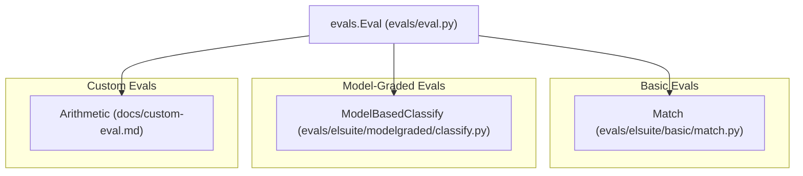
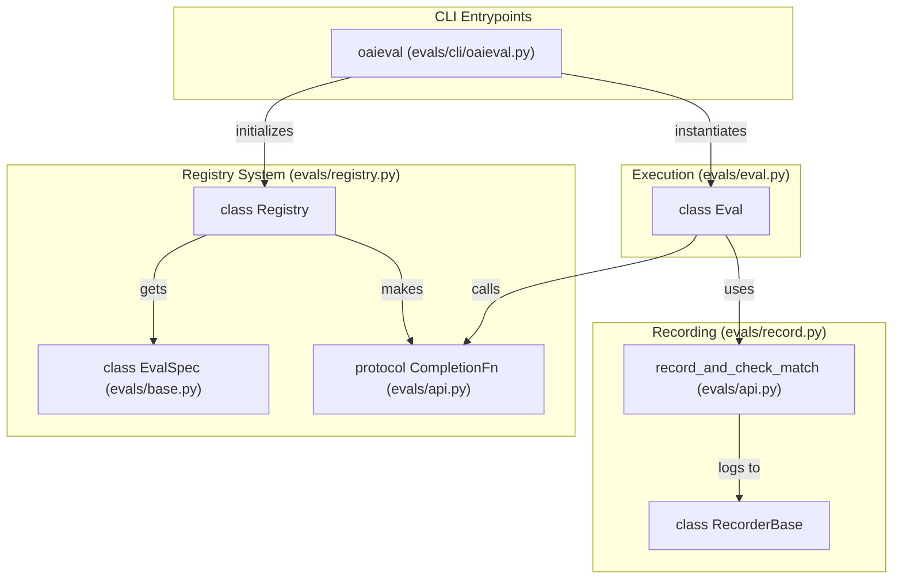
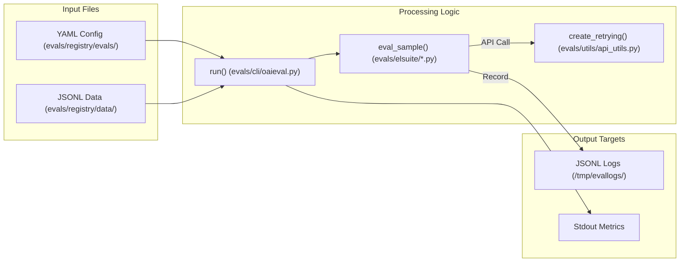

<!-- source: DeepWiki mcp.deepwiki.com · repo openai/evals · page 1 Overview · fetched 2026-10-26 -->

# Overview

Relevant source files

The following files were used as context for generating this wiki page:

- [.gitattributes](.gitattributes)
- [.github/config.yml](.github/config.yml)
- [MANIFEST.in](MANIFEST.in)
- [Makefile](Makefile)
- [README.md](README.md)
- [docs/build-eval.md](docs/build-eval.md)
- [docs/completion-fn-protocol.md](docs/completion-fn-protocol.md)
- [docs/completion-fns.md](docs/completion-fns.md)
- [docs/custom-eval.md](docs/custom-eval.md)
- [docs/run-evals.md](docs/run-evals.md)
- [evals/__init__.py](evals/__init__.py)
- [evals/api.py](evals/api.py)
- [evals/base.py](evals/base.py)
- [evals/cli/oaieval.py](evals/cli/oaieval.py)
- [evals/completion_fns/langchain_math.py](evals/completion_fns/langchain_math.py)
- [evals/completion_fns/openai.py](evals/completion_fns/openai.py)
- [evals/completion_fns/retrieval.py](evals/completion_fns/retrieval.py)
- [evals/elsuite/make_me_say/autoeval.py](evals/elsuite/make_me_say/autoeval.py)
- [evals/elsuite/make_me_say/utils.py](evals/elsuite/make_me_say/utils.py)
- [evals/registry.py](evals/registry.py)
- [evals/registry/completion_fns/cot.yaml](evals/registry/completion_fns/cot.yaml)
- [evals/registry/data/pattern_identification/samples.v0.jsonl](evals/registry/data/pattern_identification/samples.v0.jsonl)
- [evals/registry/data/word_association/corpus_tools/validators.py](evals/registry/data/word_association/corpus_tools/validators.py)
- [evals/registry/evals/pattern_identification.yaml](evals/registry/evals/pattern_identification.yaml)
- [evals/registry_test.py](evals/registry_test.py)
- [evals/utils/api_utils.py](evals/utils/api_utils.py)
- [examples/retrieval-completionfn.ipynb](examples/retrieval-completionfn.ipynb)

This document provides a high-level introduction to the OpenAI Evals framework, covering its purpose, architecture, and core components. It serves as an entry point for understanding how the system is structured and how its parts interact.

## Purpose and Scope

OpenAI Evals is a framework for evaluating large language models (LLMs) and systems built using LLMs. The framework provides:

- **A registry of pre-built evaluations** for testing different dimensions of model capabilities [evals/registry.py:1-5]().
- **Eval templates** for common evaluation patterns such as exact matching, model-graded evaluation, and solver-based evaluation [docs/build-eval.md:42-53]().
- **A plugin architecture** for adding custom evaluations, completion functions, and solvers [docs/custom-eval.md:28-45]().
- **Recording infrastructure** for logging results to local files, HTTP endpoints, or databases [evals/cli/oaieval.py:58-89]().
- **Command-line tools** (`oaieval` and `oaievalset`) for executing evaluations [evals/cli/oaieval.py:1-4]().

The framework is designed to make it easy to understand how different model versions affect specific use cases without requiring extensive manual testing [README.md:5-9]().

Sources: [README.md:1-11](), [evals/cli/oaieval.py:1-4](), [evals/registry.py:1-5](), [docs/build-eval.md:1-20]()

## Core Components

The Evals framework consists of four primary layers that work together to execute evaluations:

### 1. Configuration Layer (Registry System)

The registry system is a YAML-based configuration layer that enables declarative evaluation definition. The `Registry` class dynamically loads these files and instantiates Python objects at runtime [evals/registry.py:103-151]().

| Registry Type | Purpose |
|--------------|---------|
| **Eval Registry** | Defines evaluations with their class, arguments, and metrics [evals/base.py:51-61](). |
| **CompletionFn Registry** | Defines model interfaces and their configurations [evals/base.py:18-27](). |
| **EvalSet Registry** | Groups multiple evaluations into named sets [evals/base.py:64-72](). |
| **ModelGraded Specs** | Defines reusable grading templates for LLM-as-judge evaluations [evals/elsuite/modelgraded/base.py:23-23](). |

Sources: [evals/registry.py:103-151](), [evals/base.py:18-72](), [docs/build-eval.md:40-56]()

### 2. Execution Layer (Eval Framework)

The execution layer implements the evaluation logic. All evaluations inherit from the `evals.Eval` base class [docs/custom-eval.md:28-31]().

**Diagram: Evaluation Class Hierarchy**

Key methods in `evals.Eval`:
- `run(recorder)`: Entry point called by the CLI, returns final metrics [docs/custom-eval.md:46-58]().
- `eval_sample(test_sample, rng)`: Evaluates a single sample [docs/custom-eval.md:63-97]().
- `eval_all_samples(recorder, samples)`: Iterates through samples and manages execution [docs/custom-eval.md:52-52]().

Sources: [docs/custom-eval.md:28-97](), [evals/cli/oaieval.py:184-185]()

### 3. Model Interface Layer

The framework interacts with models through the `CompletionFn` protocol [evals/api.py:23-40]().

- `OpenAIChatCompletionFn`: Handles interaction with OpenAI Chat models (e.g., GPT-4) [evals/completion_fns/openai.py:134-181]().
- `OpenAICompletionFn`: Handles interaction with legacy OpenAI completion models [evals/completion_fns/openai.py:83-131]().
- `DummyCompletionFn`: Returns a static response for testing [evals/api.py:48-52]().

The `Registry.make_completion_fn` method is responsible for instantiating the correct interface based on the model ID or registry name [evals/registry.py:120-151]().

Sources: [evals/api.py:23-52](), [evals/completion_fns/openai.py:83-181](), [evals/registry.py:120-151]()

### 4. Recording and Metrics Layer

The recording layer captures evaluation events through `RecorderBase` [evals/cli/oaieval.py:15-16]().

- **Local Recording**: Enabled by default, stores results in a JSON file [evals/cli/oaieval.py:58-62]().
- **HTTP Recording**: Sends evaluation results to a specified URL [evals/cli/oaieval.py:65-76]().
- **Snowflake Recording**: Optional logging to a Snowflake database [README.md:64-64]().

Sources: [evals/cli/oaieval.py:15-89](), [README.md:64-64]()

## System Architecture

The following diagram bridges the natural language concepts of the evaluation process to the specific code entities in the repository.

**Diagram: Code Entity Architecture**

Sources: [evals/cli/oaieval.py:1-131](), [evals/registry.py:103-151](), [evals/api.py:23-106](), [evals/base.py:51-61]()

## Data Flow

**Diagram: Evaluation Data Flow**

Sources: [evals/cli/oaieval.py:118-185](), [evals/utils/api_utils.py:10-23](), [docs/custom-eval.md:63-97]()

## Setup Requirements

1. **Python Version**: Minimum 3.9 [README.md:15-15]().
2. **API Key**: `OPENAI_API_KEY` environment variable must be set [README.md:13-13]().
3. **Git LFS**: Required to download evaluation datasets stored in the registry [README.md:19-24]().
4. **Installation**: Recommended editable install via `pip install -e .` for developers [README.md:39-39]().

Sources: [README.md:13-48]()

---

