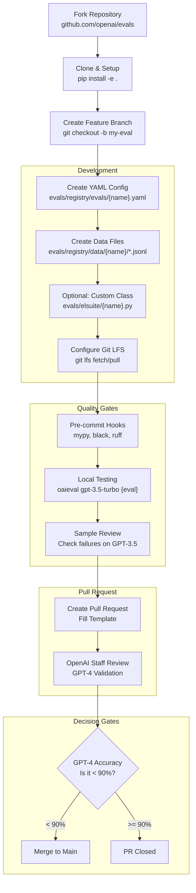
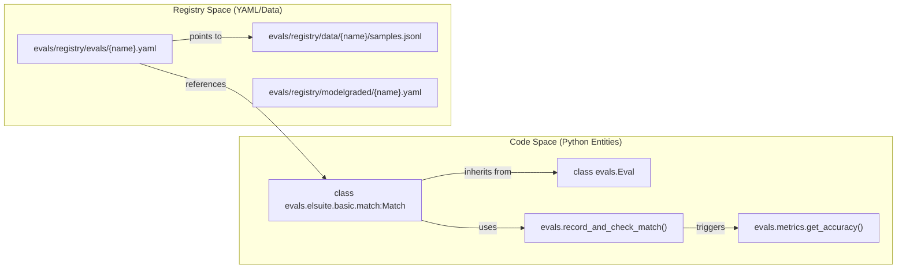

<!-- source: DeepWiki mcp.deepwiki.com · repo openai/evals · page 10 Contributing · fetched 2026-10-26 -->

# Contributing

<details>
<summary>Relevant source files</summary>

The following files were used as context for generating this wiki page:

- [.gitattributes](.gitattributes)
- [.github/PULL_REQUEST_TEMPLATE.md](.github/PULL_REQUEST_TEMPLATE.md)
- [.github/config.yml](.github/config.yml)
- [.pre-commit-config.yaml](.pre-commit-config.yaml)
- [Makefile](Makefile)
- [README.md](README.md)
- [docs/build-eval.md](docs/build-eval.md)
- [docs/completion-fn-protocol.md](docs/completion-fn-protocol.md)
- [docs/completion-fns.md](docs/completion-fns.md)
- [docs/custom-eval.md](docs/custom-eval.md)
- [evals/metrics.py](evals/metrics.py)
- [evals/registry/data/pattern_identification/samples.v0.jsonl](evals/registry/data/pattern_identification/samples.v0.jsonl)
- [evals/registry/evals/pattern_identification.yaml](evals/registry/evals/pattern_identification.yaml)
- [tests/unit/evals/test_metrics.py](tests/unit/evals/test_metrics.py)

</details>


This document provides an overview of the contribution process for the OpenAI Evals framework. It covers the high-level requirements, quality standards, and workflows that contributors must follow when submitting new evaluations, completion functions, or improvements to the codebase.

For detailed step-by-step guidance on the pull request process and acceptance criteria, see [Contribution Workflow](#10.1). For testing infrastructure and how to run tests locally, see [Testing and CI/CD](#10.2). For code style requirements and development environment setup, see [Code Quality Standards](#10.3).

## Contribution Types

The Evals framework accepts several types of contributions, each with specific requirements and file locations:

| Contribution Type | Registry Location | Required Files | Primary Class |
|------------------|-------------------|----------------|---------------|
| **Evaluations** | `evals/registry/evals/*.yaml` | YAML config, data files (JSONL), optional Python class | `evals.Eval` [evals/eval.py]() |
| **Completion Functions** | `evals/registry/completion_fns/*.yaml` | YAML config, Python implementation | `CompletionFn` protocol [docs/completion-fn-protocol.md]() |
| **Solvers** | `evals/registry/solvers/*.yaml` | YAML config, Python implementation | `evals.solvers.Solver` |
| **Model-Graded Specs** | `evals/registry/modelgraded/*.yaml` | YAML config with prompt template | Used by `ModelBasedClassify` |
| **Test Suite** | `tests/` | Python test files | pytest framework |

### Evaluation Contributions

The most common contribution type is a new evaluation. Contributors can submit evaluations that test specific capabilities or failure modes of language models. Evaluations must use existing eval classes (e.g., `Match`, `Includes`, `FuzzyMatch`) unless there is a compelling reason for a custom implementation [docs/build-eval.md:7-19]().

**Example evaluation registration** from [`docs/build-eval.md:42-53`]():
```yaml
<eval_name>:
  id: <eval_name>.dev.v0
  description: <description>
  metrics: [accuracy]

<eval_name>.dev.v0:
  class: evals.elsuite.basic.match:Match
  args:
    samples_jsonl: <eval_name>/samples.jsonl
```

Sources: [`.github/PULL_REQUEST_TEMPLATE.md:1-94`](), [`docs/build-eval.md:1-80`](), [`evals/registry/evals/pattern_identification.yaml:1-8`]()

## Contribution Workflow Overview

Title: Evaluation Contribution Lifecycle


**Key Process Steps**

1. **Git LFS Requirement**: The evals registry uses Git-LFS for data storage [README.md:19-26](). All `.jsonl` files in `evals/registry/data/` are tracked by LFS [`.gitattributes:1-2`](). Ensure you use `git lfs fetch --all` and `git lfs pull` to populate data [README.md:22-23]().

2. **GPT-4 Performance Threshold**: To be merged, an evaluation must fail on GPT-4. If GPT-4 achieves >90% accuracy, the evaluation is likely to be rejected [`.github/PULL_REQUEST_TEMPLATE.md:7-9`]().

3. **Minimum Sample Count**: Contributions must include at least 15 high-quality examples [`.github/PULL_REQUEST_TEMPLATE.md:9,36`]().

4. **Development Mode**: Use `pip install -e .` so that changes to your eval logic or registry are reflected immediately without reinstallation [README.md:39-42]().

Sources: [README.md:11-53](), [`.github/PULL_REQUEST_TEMPLATE.md:1-94`](), [`.gitattributes:1-2`]()

## Evaluation Quality Criteria

Acceptable evaluations should follow the criteria defined in [`.github/PULL_REQUEST_TEMPLATE.md:27-42`]():

### Required Criteria

*   **Thematically Consistent**: Prompts should demonstrate a specific failure mode (e.g., failing to reason about the physical world) [`.github/PULL_REQUEST_TEMPLATE.md:33`]().
*   **Human-Solvable**: Tasks should be performable by a human but difficult for GPT-4 or GPT-3.5-Turbo [`.github/PULL_REQUEST_TEMPLATE.md:34`]().
*   **Good Signal**: Must include correct answers for `Basic` evals or exhaustive rubrics for `Criteria` model-graded evals [`.github/PULL_REQUEST_TEMPLATE.md:35`]().
*   **No Custom Code (Preferred)**: OpenAI is currently not accepting evaluations with custom code; contributors should use existing templates and custom YAML files for model-graded evals [README.md:75-76](), [`docs/build-eval.md:3-4`]().

### Implementation Example (Custom Class)

While currently discouraged for public submission, a custom eval class (e.g., `Arithmetic`) inherits from `evals.Eval` and overrides `eval_sample` and `run` [`docs/custom-eval.md:28-45`]():

```python
class Arithmetic(evals.Eval):
    def run(self, recorder):
        test_samples = evals.get_jsonl(self.test_jsonl)
        self.eval_all_samples(recorder, test_samples)
        return {"accuracy": evals.metrics.get_accuracy(recorder.get_events("match"))}
```

Sources: [`.github/PULL_REQUEST_TEMPLATE.md:27-42`](), [`docs/custom-eval.md:26-58`](), [`README.md:75-78`]()

## File Structure and Registry

Title: Registry and Code Association


**Required File Locations**

When contributing an evaluation, ensure files are placed correctly [`.github/PULL_REQUEST_TEMPLATE.md:48-49`]():
1.  **YAML Registration**: `evals/registry/evals/{name}.yaml`
2.  **Data Samples**: `evals/registry/data/{name}/samples.jsonl` (Tracked via Git LFS)

Sources: [`docs/build-eval.md:38-53`](), [`.github/PULL_REQUEST_TEMPLATE.md:45-52`](), [`.gitattributes:1-2`]()

## Code Quality Standards

Contributors must adhere to the project's linting and formatting standards. Pre-commit hooks are used to enforce these rules [README.md:44-53]().

### Enabled Tools

As defined in [`.pre-commit-config.yaml:1-44`]():
*   **mypy**: Static type checking [`Makefile:3`]().
*   **black**: Code formatting (line length 100).
*   **isort**: Import sorting.
*   **autoflake**: Removes unused imports/variables.
*   **ruff**: Fast linting and autofixing.

### Setup Instructions

```bash
pip install -e .[formatters]
pre-commit install
```
To run manually on all files: `pre-commit run --all-files` [README.md:47-52]().

Sources: [`.pre-commit-config.yaml:1-44`](), [README.md:44-53](), [`Makefile:1-3`]()

## Submission Agreement and Licensing

By contributing, you agree to the following [README.md:99-101](), [`.github/PULL_REQUEST_TEMPLATE.md:56-61`]():
*   **MIT License**: Your logic and data will be licensed under the MIT license.
*   **Usage Rights**: OpenAI reserves the right to use the data for future service improvements.
*   **GPT-4 Access**: Access may be granted to the email address associated with the merged PR commits [`.github/PULL_REQUEST_TEMPLATE.md:63-67`]().

Sources: [README.md:99-102](), [`.github/PULL_REQUEST_TEMPLATE.md:56-73`]()

## External Registry Development

You can develop evaluations outside the main repository by using the `--registry_path` argument with `oaieval` [`docs/completion-fns.md:33-49`]():

```bash
oaieval my_completion_fn test-match --registry_path ~/my_project
```

This allows you to reference custom classes and YAMLs located in external directories without modifying the `evals` source code directly [`docs/completion-fns.md:41-49`]().

Sources: [`docs/completion-fns.md:32-49`]()

---

