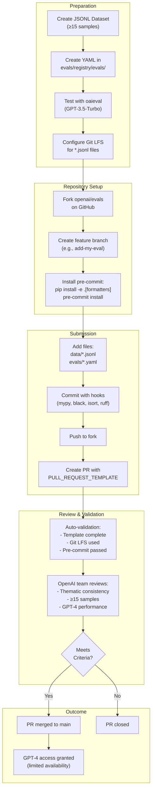
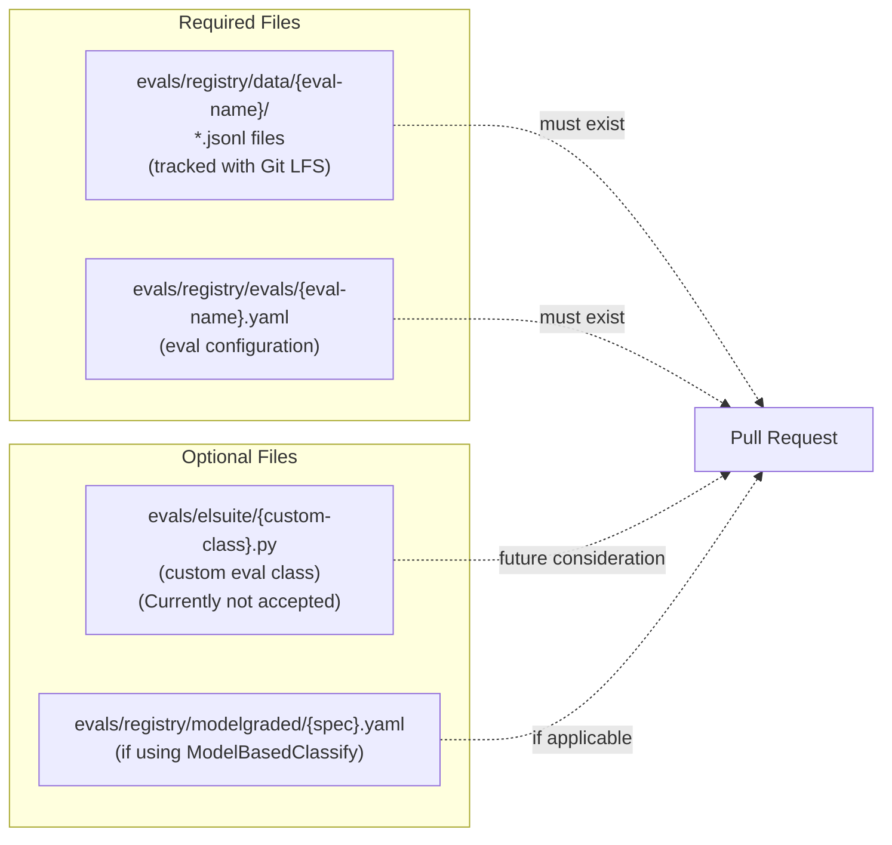
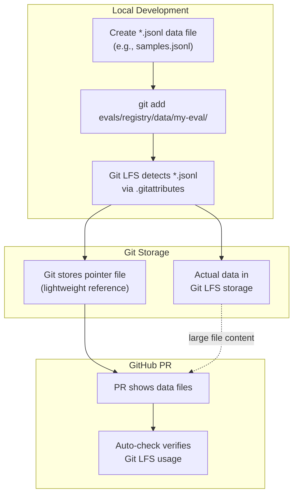

<!-- source: DeepWiki mcp.deepwiki.com · repo openai/evals · page 10.1 Contribution Workflow · fetched 2026-10-26 -->

# Contribution Workflow

<details>
<summary>Relevant source files</summary>

The following files were used as context for generating this wiki page:

- [.gitattributes](.gitattributes)
- [.github/PULL_REQUEST_TEMPLATE.md](.github/PULL_REQUEST_TEMPLATE.md)
- [.github/config.yml](.github/config.yml)
- [.pre-commit-config.yaml](.pre-commit-config.yaml)
- [Makefile](Makefile)
- [README.md](README.md)
- [docs/build-eval.md](docs/build-eval.md)
- [docs/completion-fn-protocol.md](docs/completion-fn-protocol.md)
- [docs/completion-fns.md](docs/completion-fns.md)
- [docs/custom-eval.md](docs/custom-eval.md)
- [evals/metrics.py](evals/metrics.py)
- [evals/registry/data/pattern_identification/samples.v0.jsonl](evals/registry/data/pattern_identification/samples.v0.jsonl)
- [evals/registry/evals/pattern_identification.yaml](evals/registry/evals/pattern_identification.yaml)
- [tests/unit/evals/test_metrics.py](tests/unit/evals/test_metrics.py)

</details>


This document details the pull request process for contributing new evaluations to the OpenAI Evals framework, including evaluation criteria for acceptance, licensing requirements, and GPT-4 access eligibility.

## Overview

The OpenAI Evals framework accepts community contributions of new evaluation tasks. A contribution typically includes:
- JSONL data files in `evals/registry/data/{eval-name}/`
- YAML configuration in `evals/registry/evals/{eval-name}.yaml`
- Optional: Custom evaluation class implementations (Note: currently not accepting custom code for public PRs as per [docs/build-eval.md:3]()).

All contributions must go through a pull request review process with specific quality requirements and automated validation.

### Complete Contribution Flow



Sources: [.github/PULL_REQUEST_TEMPLATE.md:1-80](), [README.md:44-52]()

## Evaluation Acceptance Criteria

Your evaluation submission must meet specific criteria to be accepted. The requirements are enforced through the PR template checklist at [.github/PULL_REQUEST_TEMPLATE.md:27-52]().

### Core Requirements

| Requirement | Description | Validation Method |
|-------------|-------------|-------------------|
| **Thematic consistency** | Focus on a specific capability or failure mode. Multiple prompts demonstrating the same issue. | Manual review |
| **Meaningful failures** | Tasks where humans succeed but GPT-4 or GPT-3.5-Turbo struggle. | Model performance testing |
| **Clear success criteria** | Correct answers for `Match`/`Includes`/`FuzzyMatch` evals, or comprehensive rubrics for `ModelGradedSpec` evals. | Manual review |
| **Minimum sample count** | At least 15 high-quality evaluation samples. | Automated check |
| **GPT-4 failure threshold** | GPT-4 must score below 90% accuracy. If GPT-4 achieves ≥90%, the eval is rejected as the model is already capable. | OpenAI team testing |

### File Structure Requirements



### Data Rights and Licensing

Contributors must confirm:
- You have adequate rights to upload any data used in the eval [README.md:101]()
- You agree to make evaluation logic and data available under MIT license [.github/PULL_REQUEST_TEMPLATE.md:58]()
- The submission complies with OpenAI's usage policies [.github/PULL_REQUEST_TEMPLATE.md:58]()

These are confirmed via checkboxes at [.github/PULL_REQUEST_TEMPLATE.md:56-60]().

Sources: [.github/PULL_REQUEST_TEMPLATE.md:27-52](), [.github/PULL_REQUEST_TEMPLATE.md:56-60](), [README.md:99-102]()

## Technical Setup

Before submitting a contribution, you should set up your development environment properly:

### Git LFS Setup

Evaluation data files are tracked using Git Large File Storage (LFS) as specified at [.github/PULL_REQUEST_TEMPLATE.md:11](). Pointer files for the registry are located under `evals/registry/data` [README.md:26]().

#### Setup Commands

```bash
# Install Git LFS
git lfs install

# Fetch existing data pointers
git lfs fetch --all [README.md:22]()
git lfs pull [README.md:23]()

# Add your data files (tracked via .gitattributes)
git add evals/registry/data/my-eval/samples.jsonl
```

#### Git LFS File Flow



**Important**: PRs that fail to use Git LFS for JSONL data files will be automatically closed as noted at [.github/PULL_REQUEST_TEMPLATE.md:77]().

Sources: [.github/PULL_REQUEST_TEMPLATE.md:11](), [.github/PULL_REQUEST_TEMPLATE.md:77](), [.gitattributes:1](), [README.md:19-32]()

### Pre-Commit Hooks

Pre-commit hooks enforce code quality standards and must be set up before submitting a PR, as required at [.github/PULL_REQUEST_TEMPLATE.md:78]().

#### Installation

```bash
# Install with formatters extra
pip install -e .[formatters] [README.md:47]()

# Install git hooks in the repository
pre-commit install [README.md:50]()
```

#### Configured Hooks

The hooks are defined in [.pre-commit-config.yaml:1-44]() and run automatically on `git commit`:

| Hook | Source | Purpose | Configuration |
|------|---------|---------|---------------|
| **mypy** | mirrors-mypy | Type checking | `--config-file=mypy.ini --no-site-packages` |
| **black** | psf/black | Code formatting | `--line-length=100` |
| **isort** | pycqa/isort | Import sorting | `--line-length=100 --profile=black` |
| **autoflake** | pycqa/autoflake | Remove unused imports/variables | `--in-place --remove-all-unused-imports` |
| **ruff** | astral-sh/ruff | Python linting | `--fix --exit-non-zero-on-fix --line-length=767` |

**Note**: The autoflake hook excludes `evals/__init__.py` as specified at [.pre-commit-config.yaml:35]() since imports there may have necessary side effects.

Sources: [.pre-commit-config.yaml:1-44](), [.github/PULL_REQUEST_TEMPLATE.md:78](), [README.md:44-52]()

## Pull Request Template

The PR template at [.github/PULL_REQUEST_TEMPLATE.md:1-94]() enforces all submission requirements through a structured checklist. Incomplete submissions will be automatically closed.

### Required PR Sections

The template is organized into the following sections:

```mermaid
graph TB
    subgraph "Section 1: Eval Details"
        Name["Eval name<br/>[lines 15-17]"]
        Desc["Eval description<br/>[lines 19-21]"]
        Value["What makes this useful?<br/>[lines 23-25]"]
    end
    
    subgraph "Section 2: Criteria for Good Eval"
        Thematic["✓ Thematically consistent<br/>[line 33]"]
        Failures["✓ Contains failures<br/>[line 34]"]
        Signal["✓ Good signal/rubric<br/>[line 35]"]
        Samples["✓ ≥15 examples<br/>[line 36]"]
    end
    
    subgraph "Section 3: Eval Structure"
        DataPath["✓ Data in evals/registry/data/{name}<br/>[line 48]"]
        YAMLPath["✓ YAML in evals/registry/evals/{name}.yaml<br/>[line 49]"]
        DataRights["✓ Right to use data<br/>[line 50]"]
    end
    
    subgraph "Section 4: Final Checklist"
        Agreement["✓ MIT license agreement<br/>[line 60]"]
        Email["✓ Email address for GPT-4 access<br/>[line 66]"]
        Expectations["✓ Limited availability acknowledgment<br/>[line 72]"]
        GitLFS["✓ Used Git LFS<br/>[line 77]"]
        PreCommitCheck["✓ Pre-commit hooks installed<br/>[line 78]"]
    end
    
    subgraph "Section 5: Sample Data"
        JSONSamples["≥5 samples in JSON format<br/>[lines 84-93]"]
    end
    
    Name --> Desc
    Desc --> Value
    Value --> Thematic
    Thematic --> Failures
    Failures --> Signal
    Signal --> Samples
    Samples --> DataPath
    DataPath --> YAMLPath
    YAMLPath --> DataRights
    DataRights --> Agreement
    Agreement --> Email
    Email --> Expectations
    Expectations --> GitLFS
    GitLFS --> PreCommitCheck
    PreCommitCheck --> JSONSamples
```



### Critical PR Template Requirements

The template includes several critical warnings at [.github/PULL_REQUEST_TEMPLATE.md:3-9]():

| Warning | Implication |
|---------|-------------|
| **Failure to follow guidelines results in automatic closure** | PRs must complete all required fields and meet all criteria |
| **Eval must fail on GPT-4** | Even if GPT-4 access is not available, the eval should challenge GPT-4 (OpenAI team will verify) |
| **GPT-4 scoring ≥90% leads to rejection** | If GPT-4 already performs well, the eval is not useful for identifying failures |
| **Minimum 15 samples** | Required count for a valid contribution (as of April 10) |

Sources: [.github/PULL_REQUEST_TEMPLATE.md:1-94](), [.github/PULL_REQUEST_TEMPLATE.md:3-9](), [.github/PULL_REQUEST_TEMPLATE.md:15-25](), [.github/PULL_REQUEST_TEMPLATE.md:33-36](), [.github/PULL_REQUEST_TEMPLATE.md:48-50](), [.github/PULL_REQUEST_TEMPLATE.md:84-93]()

## Review and Acceptance Process

After PR submission, the OpenAI team conducts a multi-stage review. As stated at [.github/PULL_REQUEST_TEMPLATE.md:69-72](), meeting all criteria does not guarantee acceptance.

### GPT-4 Access Eligibility

If a submission is accepted, OpenAI may grant GPT-4 access to a limited number of contributors. Access is granted to the email address associated with the commits on the merged pull request [.github/PULL_REQUEST_TEMPLATE.md:63-64](). Contributors must acknowledge that opening a PR does not guarantee access [.github/PULL_REQUEST_TEMPLATE.md:72]().

### Automatic Rejection Conditions

PRs are automatically closed if:
- Required template fields are not filled [.github/PULL_REQUEST_TEMPLATE.md:80]()
- Git LFS is not used for JSONL files [.github/PULL_REQUEST_TEMPLATE.md:77]()
- Pre-commit hooks are not installed [.github/PULL_REQUEST_TEMPLATE.md:78]()
- GPT-4 achieves ≥90% accuracy [.github/PULL_REQUEST_TEMPLATE.md:7]()
- Custom code is submitted (currently restricted) [docs/build-eval.md:3]()

Sources: [.github/PULL_REQUEST_TEMPLATE.md:3-8](), [.github/PULL_REQUEST_TEMPLATE.md:63-72](), [.github/PULL_REQUEST_TEMPLATE.md:75-80](), [docs/build-eval.md:3]()

---

