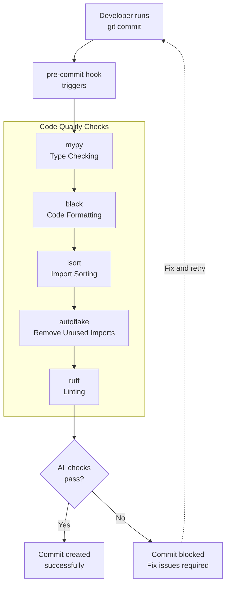
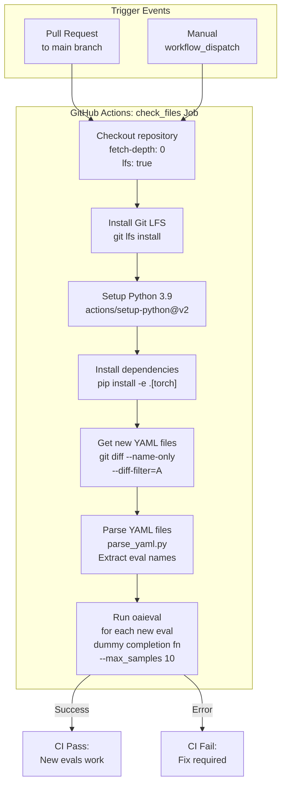
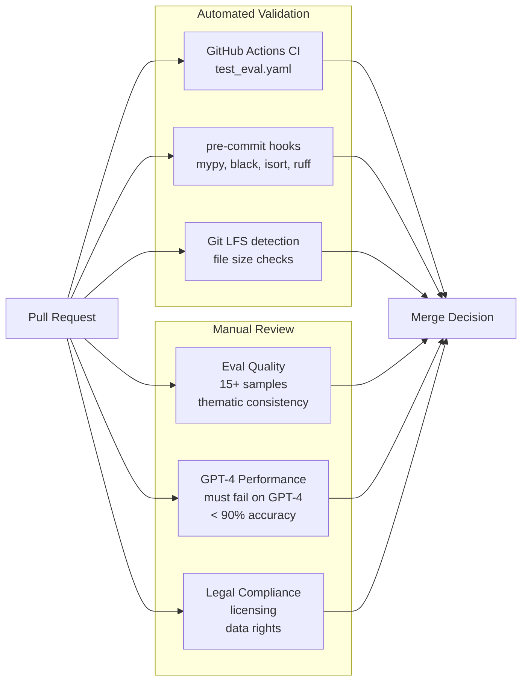

<!-- source: DeepWiki mcp.deepwiki.com · repo openai/evals · page 10.2 Testing and CI/CD · fetched 2026-10-26 -->

# Testing and CI/CD

<details>
<summary>Relevant source files</summary>

The following files were used as context for generating this wiki page:

- [.github/PULL_REQUEST_TEMPLATE.md](.github/PULL_REQUEST_TEMPLATE.md)
- [.github/workflows/run_tests.yaml](.github/workflows/run_tests.yaml)
- [.github/workflows/test_eval.yaml](.github/workflows/test_eval.yaml)
- [.pre-commit-config.yaml](.pre-commit-config.yaml)
- [evals/metrics.py](evals/metrics.py)
- [evals/registry/solvers/gemini.yaml](evals/registry/solvers/gemini.yaml)
- [evals/solvers/providers/google/gemini_solver.py](evals/solvers/providers/google/gemini_solver.py)
- [evals/solvers/providers/google/gemini_solver_test.py](evals/solvers/providers/google/gemini_solver_test.py)
- [evals/solvers/providers/google/requirements.txt](evals/solvers/providers/google/requirements.txt)
- [pyproject.toml](pyproject.toml)
- [tests/unit/evals/test_metrics.py](tests/unit/evals/test_metrics.py)

</details>


## Purpose and Scope

This document describes the testing infrastructure and continuous integration/continuous deployment (CI/CD) systems used in the OpenAI Evals framework. It covers pre-commit hooks for local code quality validation, GitHub Actions workflows for automated testing of contributed evaluations and core logic, and the requirements for submitting pull requests.

For information about contributing evaluations and the overall contribution workflow, see [Contribution Workflow](#10.1). For details on code style standards enforced by these tools, see [Code Quality Standards](#10.3).

---

## Pre-commit Hooks

The framework uses [pre-commit](https://pre-commit.com/) to enforce code quality standards automatically before commits are created. Contributors must install pre-commit hooks to ensure their code meets quality requirements.

### Installation

Contributors must run the following commands after cloning the repository:

```bash
pip install pre-commit
pre-commit install
```

This installs Git hooks that will run automatically on every `git commit` operation.

### Hook Configuration

The pre-commit configuration is defined in [.pre-commit-config.yaml:1-44](). The following tools run on each commit:

| Tool | Purpose | Configuration |
|------|---------|---------------|
| **mypy** | Static type checking | `--config-file=mypy.ini --no-site-packages` |
| **black** | Code formatting | `--line-length=100` |
| **isort** | Import sorting | `--line-length=100 --profile=black` |
| **autoflake** | Remove unused imports/variables | `--in-place --remove-all-unused-imports` |
| **ruff** | Fast Python linter | `--fix --exit-non-zero-on-fix --line-length=767` |

### Execution Flow



**Execution Order and Behavior**

The hooks execute in sequence as defined in [.pre-commit-config.yaml:2-44]():

1. **mypy** [.pre-commit-config.yaml:2-6]() - Validates type annotations using configuration from `mypy.ini`.
2. **black** [.pre-commit-config.yaml:8-12]() - Automatically reformats code to conform to style guide.
3. **isort** [.pre-commit-config.yaml:16-20]() - Sorts and organizes import statements, compatible with black's style.
4. **autoflake** [.pre-commit-config.yaml:25-35]() - Removes unused imports and variables (excluding `evals/__init__.py`).
5. **ruff** [.pre-commit-config.yaml:40-44]() - Performs fast linting and can auto-fix many issues. Note the high line-length (767) to accommodate long eval samples [.pre-commit-config.yaml:44]().

If any tool fails or makes changes, the commit is blocked and the developer must review the changes and commit again.

**Sources:** [.pre-commit-config.yaml:1-44](), [.github/PULL_REQUEST_TEMPLATE.md:78]()

---

## GitHub Actions CI/CD Pipeline

The repository uses GitHub Actions to automatically validate new evaluation contributions and core code changes.

### Workflow Trigger Conditions

There are two primary automated workflows:

1. **Run unit tests (`run_tests.yaml`)**: Triggered on push or pull request to `main` [.github/workflows/run_tests.yaml:3-9]().
2. **Run new evals (`test_eval.yaml`)**: Triggered by pull requests to `main` specifically modifying `evals/registry/**` [.github/workflows/test_eval.yaml:5-9](), or via manual dispatch [.github/workflows/test_eval.yaml:4]().

### CI Pipeline Architecture



### Pipeline Steps Detail

#### 1. Repository Setup [.github/workflows/test_eval.yaml:16-25]()

The `fetch-depth: 0` ensures full git history is available for `git diff` operations. Git LFS is required to access evaluation data files stored in LFS [.github/workflows/test_eval.yaml:20-25]().

#### 2. Python Environment [.github/workflows/test_eval.yaml:27-36]()

The environment is set to Python 3.9 [.github/workflows/test_eval.yaml:30](). Dependencies are installed including optional `torch` support for specific metrics or models [.github/workflows/run_tests.yaml:32]().

#### 3. Detect New Evaluations [.github/workflows/test_eval.yaml:38-43]()

The workflow identifies newly added YAML files in `evals/registry/evals/` using:
```bash
git diff --name-only --diff-filter=A ${{ github.event.pull_request.base.sha }} ${{ github.sha }} | grep '^evals/registry/evals/.*\.yaml$'
```
The `--diff-filter=A` flag ensures only **added** files trigger tests [.github/workflows/test_eval.yaml:42]().

#### 4. Extract and Execute [.github/workflows/test_eval.yaml:45-59]()

For each new YAML file, the workflow parses the eval name and runs:
```bash
oaieval dummy $first_key --max_samples 10
```
This uses the `dummy` completion function to validate that the eval can be instantiated and run for 10 samples without API costs [.github/workflows/test_eval.yaml:55]().

**Sources:** [.github/workflows/test_eval.yaml:1-60](), [.github/workflows/run_tests.yaml:1-39]()

---

## Running Tests Locally

Contributors should run tests locally before submitting pull requests to catch issues early.

### Unit Tests

The repository includes unit tests for core functionality, such as metrics calculation in `evals/metrics.py`.

**Metric Code Entity Mapping:**

| Logic Name | Code Function | Source |
|------------|---------------|--------|
| Accuracy | `get_accuracy` | [evals/metrics.py:12-18]() |
| Bootstrap Std | `get_bootstrap_accuracy_std` | [evals/metrics.py:21-23]() |
| Confusion Matrix | `get_confusion_matrix` | [evals/metrics.py:26-40]() |
| F-Score | `compute_f_score` | [evals/metrics.py:60-64]() |

### Running Tests with pytest

```bash
# Run all unit tests
pytest

# Run tests with API keys (if needed)
export OPENAI_API_KEY="your-key"
pytest
```

Unit tests for metrics are located in `tests/unit/evals/test_metrics.py` and use `pytest.mark.parametrize` to validate accuracy calculations against expected values [tests/unit/evals/test_metrics.py:10-25]().

### Testing Providers and Solvers

Specific components like `GeminiSolver` have dedicated tests in `evals/solvers/providers/google/gemini_solver_test.py`. These tests validate:
- **Message Formatting**: Conversion from Evals `Message` format to `GoogleMessage` [evals/solvers/providers/google/gemini_solver_test.py:51-71]().
- **Solver Logic**: Interaction with the Gemini API (skipped in GitHub Actions to save costs) [evals/solvers/providers/google/gemini_solver_test.py:29-30]().

**Sources:** [evals/metrics.py:1-74](), [tests/unit/evals/test_metrics.py:1-25](), [evals/solvers/providers/google/gemini_solver_test.py:1-72]()

---

## Pull Request Validation Requirements

### Required Checklist Items

The pull request template [.github/PULL_REQUEST_TEMPLATE.md:1-94]() defines strict requirements:

| Requirement | Description | Source |
|-------------|-------------|--------|
| **Minimum 15 samples** | Minimum count for high-quality examples. | [.github/PULL_REQUEST_TEMPLATE.md:9,36]() |
| **Git LFS** | JSON files must be moved to Git LFS. | [.github/PULL_REQUEST_TEMPLATE.md:11,77]() |
| **GPT-4 Performance** | Eval must be difficult enough that GPT-4 scores < 90%. | [.github/PULL_REQUEST_TEMPLATE.md:7-9]() |
| **Registry Path** | Data in `evals/registry/data/{name}`, YAML in `evals/registry/evals/{name}.yaml`. | [.github/PULL_REQUEST_TEMPLATE.md:48-49]() |

### Automated vs Manual Validation



### Failure Modes Leading to PR Closure

The template explicitly states that PRs will be automatically closed if [.github/PULL_REQUEST_TEMPLATE.md:3,80]():
1. Required fields are not filled out.
2. Pre-commit hooks are not installed/passing.
3. Git LFS is not used for data files.
4. Minimum sample count (15) is not met.

**Sources:** [.github/PULL_REQUEST_TEMPLATE.md:1-94]()

---

## Test Infrastructure Organization

### Directory Structure

```
evals/
├── tests/
│   ├── unit/
│   │   ├── evals/
│   │   │   └── test_metrics.py    # Metrics computation tests
│   │   └── ...
├── .github/
│   ├── workflows/
│   │   ├── test_eval.yaml         # CI workflow for new evals
│   │   ├── run_tests.yaml         # CI workflow for unit tests
│   │   └── parse_yaml.py          # YAML parsing helper
├── .pre-commit-config.yaml        # Pre-commit hook config
└── pyproject.toml                 # Project metadata and dependencies
```

### Dependency Management

Project dependencies for testing and formatting are managed in `pyproject.toml`:
- **Core Testing**: `pytest` [.pyproject.toml:37]().
- **Formatters**: `black`, `isort`, `autoflake`, `ruff` [.pyproject.toml:56]().
- **Optional dependencies**: `torch` for specialized evaluations [.pyproject.toml:58]().

**Sources:** [.pyproject.toml:1-71](), [.github/workflows/run_tests.yaml:1-39]()

---

