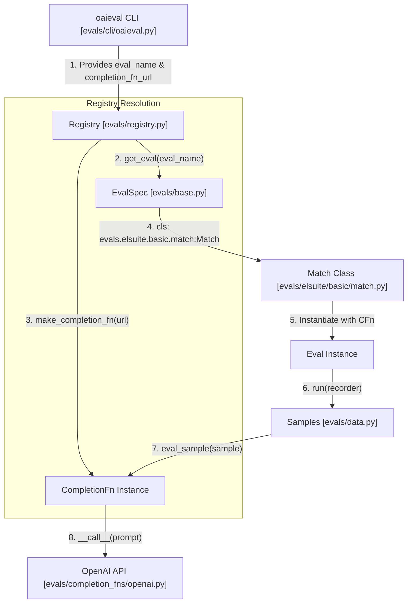
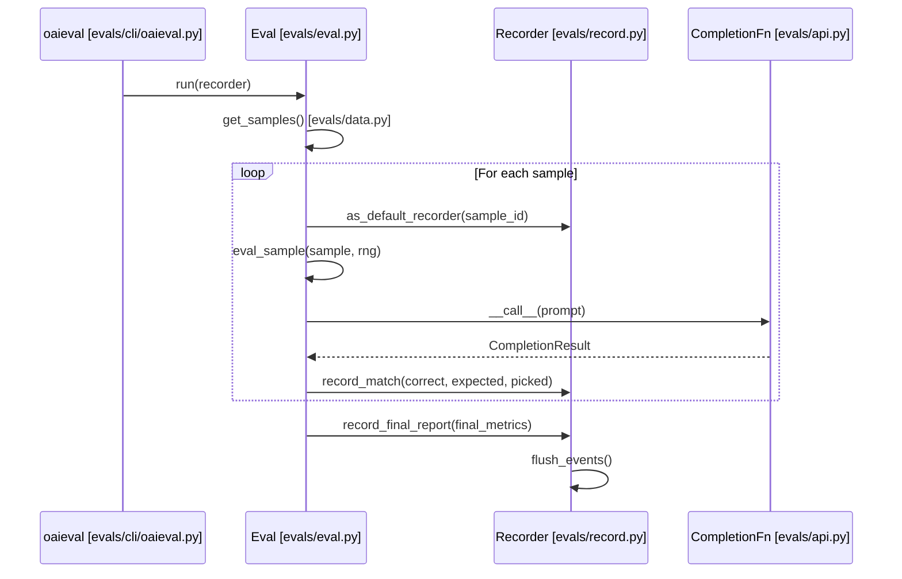

<!-- source: DeepWiki mcp.deepwiki.com · repo openai/evals · page 11 Glossary · fetched 2026-10-26 -->

# Glossary

Relevant source files

The following files were used as context for generating this wiki page:

- [.gitattributes](.gitattributes)
- [.github/config.yml](.github/config.yml)
- [MANIFEST.in](MANIFEST.in)
- [Makefile](Makefile)
- [README.md](README.md)
- [docs/build-eval.md](docs/build-eval.md)
- [docs/completion-fn-protocol.md](docs/completion-fn-protocol.md)
- [docs/completion-fns.md](docs/completion-fns.md)
- [docs/custom-eval.md](docs/custom-eval.md)
- [docs/run-evals.md](docs/run-evals.md)
- [evals/__init__.py](evals/__init__.py)
- [evals/api.py](evals/api.py)
- [evals/base.py](evals/base.py)
- [evals/cli/oaieval.py](evals/cli/oaieval.py)
- [evals/cli/oaievalset.py](evals/cli/oaievalset.py)
- [evals/completion_fns/langchain_math.py](evals/completion_fns/langchain_math.py)
- [evals/completion_fns/openai.py](evals/completion_fns/openai.py)
- [evals/completion_fns/retrieval.py](evals/completion_fns/retrieval.py)
- [evals/data.py](evals/data.py)
- [evals/data_test.py](evals/data_test.py)
- [evals/elsuite/basic/fuzzy_match.py](evals/elsuite/basic/fuzzy_match.py)
- [evals/elsuite/basic/fuzzy_match_test.py](evals/elsuite/basic/fuzzy_match_test.py)
- [evals/elsuite/basic/includes.py](evals/elsuite/basic/includes.py)
- [evals/elsuite/basic/includes_test.py](evals/elsuite/basic/includes_test.py)
- [evals/elsuite/basic/json_validator.py](evals/elsuite/basic/json_validator.py)
- [evals/elsuite/basic/json_validator_test.py](evals/elsuite/basic/json_validator_test.py)
- [evals/elsuite/basic/match.py](evals/elsuite/basic/match.py)
- [evals/elsuite/basic/match_test.py](evals/elsuite/basic/match_test.py)
- [evals/elsuite/basic/match_with_solvers.py](evals/elsuite/basic/match_with_solvers.py)
- [evals/elsuite/make_me_say/autoeval.py](evals/elsuite/make_me_say/autoeval.py)
- [evals/elsuite/make_me_say/utils.py](evals/elsuite/make_me_say/utils.py)
- [evals/elsuite/modelgraded/base.py](evals/elsuite/modelgraded/base.py)
- [evals/elsuite/modelgraded/classify.py](evals/elsuite/modelgraded/classify.py)
- [evals/elsuite/modelgraded/classify_utils.py](evals/elsuite/modelgraded/classify_utils.py)
- [evals/elsuite/test/match.py](evals/elsuite/test/match.py)
- [evals/elsuite/translate.py](evals/elsuite/translate.py)
- [evals/elsuite/utils.py](evals/elsuite/utils.py)
- [evals/elsuite/utils_test.py](evals/elsuite/utils_test.py)
- [evals/eval.py](evals/eval.py)
- [evals/prompt/base.py](evals/prompt/base.py)
- [evals/record.py](evals/record.py)
- [evals/record_test.py](evals/record_test.py)
- [evals/registry.py](evals/registry.py)
- [evals/registry/completion_fns/cot.yaml](evals/registry/completion_fns/cot.yaml)
- [evals/registry/data/pattern_identification/samples.v0.jsonl](evals/registry/data/pattern_identification/samples.v0.jsonl)
- [evals/registry/data/word_association/corpus_tools/validators.py](evals/registry/data/word_association/corpus_tools/validators.py)
- [evals/registry/eval_sets/test-basic.yaml](evals/registry/eval_sets/test-basic.yaml)
- [evals/registry/eval_sets/test-modelgraded.yaml](evals/registry/eval_sets/test-modelgraded.yaml)
- [evals/registry/evals/pattern_identification.yaml](evals/registry/evals/pattern_identification.yaml)
- [evals/registry/evals/test-basic.yaml](evals/registry/evals/test-basic.yaml)
- [evals/registry/evals/test-modelgraded.yaml](evals/registry/evals/test-modelgraded.yaml)
- [evals/registry/modelgraded/battle.yaml](evals/registry/modelgraded/battle.yaml)
- [evals/registry/modelgraded/best.yaml](evals/registry/modelgraded/best.yaml)
- [evals/registry/modelgraded/diversity.yaml](evals/registry/modelgraded/diversity.yaml)
- [evals/registry/modelgraded/fact.yaml](evals/registry/modelgraded/fact.yaml)
- [evals/registry/modelgraded/humor.yaml](evals/registry/modelgraded/humor.yaml)
- [evals/registry/solvers/bluff.yaml](evals/registry/solvers/bluff.yaml)
- [evals/registry/solvers/defaults.yaml](evals/registry/solvers/defaults.yaml)
- [evals/registry/solvers/make-me-pay.yaml](evals/registry/solvers/make-me-pay.yaml)
- [evals/registry/solvers/self_prompting.yaml](evals/registry/solvers/self_prompting.yaml)
- [evals/registry/solvers/theory_of_mind.yaml](evals/registry/solvers/theory_of_mind.yaml)
- [evals/registry_test.py](evals/registry_test.py)
- [evals/solvers/README.md](evals/solvers/README.md)
- [evals/solvers/human_cli_solver.py](evals/solvers/human_cli_solver.py)
- [evals/solvers/nested/cot_solver.py](evals/solvers/nested/cot_solver.py)
- [evals/solvers/nested/self_consistency_solver.py](evals/solvers/nested/self_consistency_solver.py)
- [evals/solvers/postprocessors/README.md](evals/solvers/postprocessors/README.md)
- [evals/solvers/prompts/cot.py](evals/solvers/prompts/cot.py)
- [evals/solvers/prompts/hhh.py](evals/solvers/prompts/hhh.py)
- [evals/solvers/solver.py](evals/solvers/solver.py)
- [evals/solvers/utils.py](evals/solvers/utils.py)
- [evals/utils/api_utils.py](evals/utils/api_utils.py)
- [evals/utils/misc.py](evals/utils/misc.py)
- [examples/retrieval-completionfn.ipynb](examples/retrieval-completionfn.ipynb)
- [mypy.ini](mypy.ini)
- [scripts/battle_generator.py](scripts/battle_generator.py)
- [scripts/modelgraded_generator.py](scripts/modelgraded_generator.py)
- [scripts/pattern_identification_generator.py](scripts/pattern_identification_generator.py)

This glossary defines codebase-specific terms, jargon, and core abstractions used within the OpenAI Evals framework. It is intended to help onboarding engineers navigate the relationships between configuration files (YAML), data (JSONL), and the execution engine.

## Core Abstractions

### Eval
The base class for all evaluations. It defines the lifecycle of an evaluation, including loading data, iterating over samples, and aggregating metrics.
*   **Implementation**: `evals.Eval` [evals/eval.py:46-166]()
*   **Key Methods**:
    *   `run(recorder)`: The entry point for the evaluation logic. It typically calls `get_samples` and `eval_all_samples`. [evals/eval.py:86-88]()
    *   `eval_sample(sample, rng)`: Abstract method that must be implemented to define how a single data point is processed. [evals/eval.py:77-78]()
    *   `eval_all_samples(recorder, samples)`: Handles the parallel execution of `eval_sample` using a `ThreadPool`. [evals/eval.py:112-147]()

### CompletionFn
A protocol (and often a class) that defines how to get a response from a model. It abstracts away the specific API calls, allowing the framework to use OpenAI models, local models, or complex prompt chains interchangeably.
*   **Implementation**: `evals.api.CompletionFn` [evals/api.py:12-25]() (Interface), `evals.completion_fns.openai.OpenAIChatCompletionFn` [evals/completion_fns/openai.py:134-181]()
*   **Usage**: It is called as a function: `completion_fn(prompt=prompt, **kwargs)`. [evals/completion_fns/openai.py:149-181]()

### Solver
A higher-level abstraction than `CompletionFn`. Solvers are stateful and isolated per sample. While a `CompletionFn` is generally a stateless mapping from prompt to completion, a `Solver` can maintain history or perform multi-step reasoning.
*   **Implementation**: `evals.solvers.solver.Solver` [evals/solvers/solver.py:12-28]()
*   **SolverEval**: A specialized `Eval` class that wraps a `Solver` and creates a fresh instance for every sample. [evals/eval.py:168-204]()

### Registry
The central system for discovering and instantiating evaluations, completion functions, and solvers defined in YAML files.
*   **Implementation**: `evals.registry.Registry` [evals/registry.py:103-228]()
*   **Key Function**: `make_completion_fn(name, **kwargs)` resolves a string name (like `gpt-4` or a registry key) into a callable object. [evals/registry.py:120-151]()

---

## Data Flow: Natural Language Space to Code Entities

The following diagram illustrates how a user's CLI command interacts with the registry to instantiate the concrete Python objects required to run an evaluation.

### System Entry Point and Object Resolution

**Sources**: [evals/cli/oaieval.py:118-182](), [evals/registry.py:120-151](), [evals/eval.py:112-147]()

---

## Technical Terms & Jargon

| Term | Definition | Code Pointer |
| :--- | :--- | :--- |
| **JSONL** | The standard data format for samples. Each line is a valid JSON object. | [evals/data.py:120-133]() |
| **Model-Graded** | An evaluation where an LLM acts as the judge to grade another model's output. | [evals/elsuite/modelgraded/classify.py:14-127]() |
| **Recorder** | A subsystem for logging events (sampling, matches, metrics) during a run. | [evals/record.py:54-186]() |
| **Sample ID** | A unique identifier for a specific data point in a run, usually formatted as `base_eval.split.index`. | [evals/eval.py:133-134]() |
| **Registry Path** | A directory containing `evals`, `completion_fns`, or `solvers` YAML subdirectories. | [evals/registry.py:30-33]() |
| **Match** | A binary metric indicating if a model's output satisfies the `ideal` criteria. | [evals/record.py:187-201]() |

---

## Evaluation Lifecycle

The lifecycle of an evaluation involves the `oaieval` runner, the `Eval` implementation, and the `Recorder`.

### Execution and Recording Logic

**Sources**: [evals/eval.py:112-147](), [evals/record.py:90-97](), [evals/record.py:187-201]()

---

## Registry Specifications

The registry uses Pydantic models to validate the structure of YAML files.

*   **EvalSpec**: Defines the class and arguments for an evaluation. [evals/base.py:27-31]()
*   **CompletionFnSpec**: Defines how to instantiate a `CompletionFn`. [evals/base.py:17-20]()
*   **ModelGradedSpec**: Specifically for `ModelBasedClassify` evaluations, defining the prompt templates and choices for the model-judge. [evals/elsuite/modelgraded/base.py:11-27]()

## File Utility Patterns

*   **`open_by_file_pattern`**: A robust wrapper around `blobfile` that handles local paths, GCS, and various compression formats (`.gz`, `.lz4`, `.zst`). [evals/data.py:47-80]()
*   **`jsondumps`**: An enhanced JSON serializer that handles Pydantic models, Dataclasses, and Path objects. [evals/data.py:211-218]()
*   **`create_retrying`**: A decorator/wrapper for handling API transient failures with exponential backoff. [evals/utils/api_utils.py:10-23]()

**Sources**: [evals/data.py:1-218](), [evals/base.py:1-40](), [evals/registry.py:1-228]()