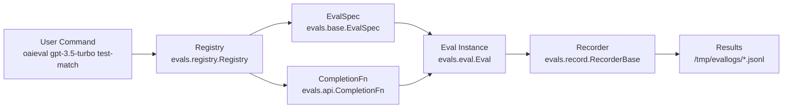
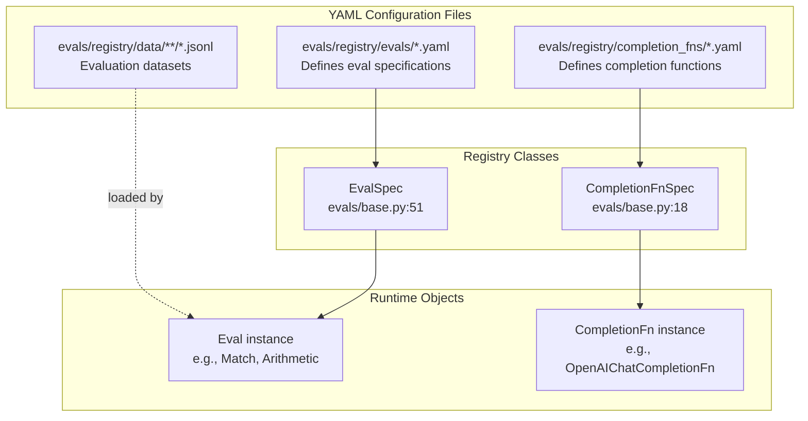
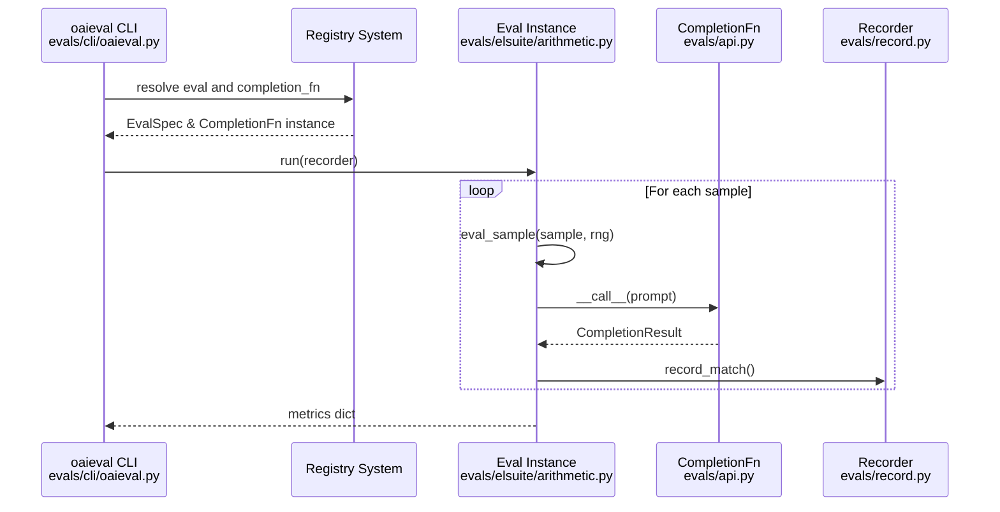

<!-- source: DeepWiki mcp.deepwiki.com · repo openai/evals · page 2 Getting Started · fetched 2026-10-26 -->

# Getting Started

<details>
<summary>Relevant source files</summary>

The following files were used as context for generating this wiki page:

- [.gitattributes](.gitattributes)
- [.github/config.yml](.github/config.yml)
- [.github/workflows/run_tests.yaml](.github/workflows/run_tests.yaml)
- [.github/workflows/test_eval.yaml](.github/workflows/test_eval.yaml)
- [MANIFEST.in](MANIFEST.in)
- [Makefile](Makefile)
- [README.md](README.md)
- [docs/build-eval.md](docs/build-eval.md)
- [docs/completion-fn-protocol.md](docs/completion-fn-protocol.md)
- [docs/completion-fns.md](docs/completion-fns.md)
- [docs/custom-eval.md](docs/custom-eval.md)
- [docs/run-evals.md](docs/run-evals.md)
- [evals/__init__.py](evals/__init__.py)
- [evals/api.py](evals/api.py)
- [evals/base.py](evals/base.py)
- [evals/registry/data/pattern_identification/samples.v0.jsonl](evals/registry/data/pattern_identification/samples.v0.jsonl)
- [evals/registry/evals/pattern_identification.yaml](evals/registry/evals/pattern_identification.yaml)
- [evals/registry/solvers/gemini.yaml](evals/registry/solvers/gemini.yaml)
- [evals/solvers/providers/google/gemini_solver.py](evals/solvers/providers/google/gemini_solver.py)
- [evals/solvers/providers/google/gemini_solver_test.py](evals/solvers/providers/google/gemini_solver_test.py)
- [evals/solvers/providers/google/requirements.txt](evals/solvers/providers/google/requirements.txt)
- [pyproject.toml](pyproject.toml)

</details>


This page provides a practical guide to installing OpenAI Evals and running your first evaluation. It covers the essential prerequisites, installation steps, and a simple walkthrough of executing an eval using the command-line interface.

For detailed information about installation options and environment configuration, see [Installation and Setup](#2.1). For comprehensive coverage of running evaluations with all available options, see [Running Your First Evaluation](#2.2).

---

## Purpose and Scope

This guide helps you:
1. Install the evals framework and configure your environment.
2. Execute your first evaluation using the `oaieval` CLI [evals/cli/oaieval.py:61]().
3. Understand the basic architecture and data flow.
4. Navigate to more detailed documentation for specific use cases.

This page assumes you want to run existing evaluations. For information about creating new evaluations, see [Creating and Configuring Evaluations](#7). For understanding the core architecture in depth, see [Core Architecture](#3).

---

## Prerequisites

### System Requirements

**Minimum Python Version**: Python 3.9 or higher [README.md:15]().

**Required Tools**:
- Git (for cloning the repository).
- Git LFS (for downloading evaluation datasets) [README.md:19]().

**API Access**:
- OpenAI API key (set via `OPENAI_API_KEY` environment variable) [README.md:13]().
- Optional: Snowflake credentials for remote logging [README.md:64]().

Sources: [README.md:11-16](), [pyproject.toml:4]()

### Git LFS Setup

The evaluation datasets in `evals/registry/data/` are tracked using Git LFS [.gitattributes:1](). Before running evaluations, fetch these files:

```bash
cd evals
git lfs fetch --all
git lfs pull
```

To fetch only specific evaluation data:

```bash
git lfs fetch --include=evals/registry/data/${your_eval}
git lfs pull
```

Sources: [README.md:17-32](), [.gitattributes:1]()

---

## Installation

### For Running Evals Only

If you only want to execute existing evaluations:

```bash
pip install evals
```

This installs the package from PyPI [README.md:59]().

### For Contributing or Development

If you plan to create new evaluations or modify existing ones:

```bash
git clone https://github.com/openai/evals.git
cd evals
pip install -e .
```

The `-e` flag installs in editable mode [README.md:39-42]().

**Optional**: Install formatters or torch support:

```bash
pip install -e .[formatters]
pip install -e .[torch]
```

Sources: [README.md:34-52](), [pyproject.toml:55-58]()

---

## Running Your First Evaluation

### Basic Command Structure

The `oaieval` CLI [evals/cli/oaieval.py:61]() requires two primary arguments:
1. **Completion function**: The model or completion function to evaluate.
2. **Eval name**: The evaluation to run (from the registry).

```bash
oaieval gpt-3.5-turbo test-match
```

This command:
- Evaluates the `gpt-3.5-turbo` model [docs/run-evals.md:9]().
- Using the `test-match` evaluation [docs/run-evals.md:9]().
- Records results to `/tmp/evallogs` by default [docs/run-evals.md:19]().

Sources: [docs/run-evals.md:5-13](), [evals/cli/oaieval.py:61]()

### Understanding the Output

A typical run produces output that includes:
- **Run ID**: Unique identifier for this evaluation run generated in `RunSpec` [evals/base.py:82-88]().
- **Progress bar**: Shows sample completion status via `tqdm` [pyproject.toml:46]().
- **Final metrics**: Key performance metrics (e.g., `accuracy`) [docs/build-eval.md:47]().

Sources: [evals/base.py:75-90](), [docs/build-eval.md:42-53]()

---

## System Architecture Overview

### High-Level Data Flow



**Diagram: Basic Evaluation Execution Flow**

1. User invokes `oaieval` CLI with model and eval names [evals/cli/oaieval.py:61]().
2. `Registry` loads specifications from YAML files in `evals/registry/` [docs/run-evals.md:11]().
3. `EvalSpec` [evals/base.py:51]() defines which evaluation class to instantiate.
4. `CompletionFn` [evals/api.py:23]() provides the interface to the language model.
5. `Eval` instance [docs/custom-eval.md:28]() executes the evaluation logic.
6. `Recorder` captures events and metrics [evals/record.py]().

Sources: [evals/base.py:18-62](), [evals/api.py:23-40](), [docs/run-evals.md:7-13]()

### Registry System Mapping



**Diagram: Registry System - Configuration to Runtime Mapping**

The registry system dereferences string names to Python objects:
- **YAML configurations** define what to run (stored in `evals/registry/`) [docs/run-evals.md:11]().
- **`EvalSpec`** [evals/base.py:51]() and **`CompletionFnSpec`** [evals/base.py:18]() are dataclasses describing how to instantiate components.
- **`Eval` instances** (like `Arithmetic` [docs/custom-eval.md:39]()) load data from `jsonl` files in the registry [docs/custom-eval.md:50-51]().

Sources: [evals/base.py:18-62](), [docs/build-eval.md:42-53](), [docs/custom-eval.md:104-108]()

---

## Key Components

### Registry

The registry is the central orchestrator that resolves names to specifications. It looks for YAML files in `evals/registry/evals` [docs/run-evals.md:11]() and `evals/registry/completion_fns` [docs/completion-fns.md:17]().

### CompletionFn

The `CompletionFn` protocol [evals/api.py:23-40]() defines the interface for interacting with language models:

```python
class CompletionFn(Protocol):
    def __call__(
        self,
        prompt: Union[str, OpenAICreateChatPrompt],
        **kwargs,
    ) -> CompletionResult:
        ...
```

Implementations include:
- `OpenAIChatCompletionFn` (dynamically instantiated for models like `gpt-3.5-turbo`) [docs/run-evals.md:13]().
- `LangChainLLMCompletionFn` for LangChain integrations [docs/completion-fns.md:11]().
- `DummyCompletionFn` [evals/api.py:48-52]() for testing.

### Eval

The `Eval` base class [docs/custom-eval.md:28]() defines the evaluation lifecycle:
- `run(recorder)`: Main entry point, typically calls `eval_all_samples` [docs/custom-eval.md:46-52]().
- `eval_sample(sample, rng)`: Processes a single data point [docs/custom-eval.md:63-76]().
- Returns metrics dictionary for the final report [docs/custom-eval.md:55-58]().

Concrete implementations include basic templates like `Match` [docs/build-eval.md:50]() and model-graded evals like `fact` or `closedqa` [docs/build-eval.md:36]().

Sources: [evals/api.py:16-52](), [evals/base.py:18-62](), [docs/custom-eval.md:28-58]()

---

## Execution Flow in Detail



**Diagram: Detailed Execution Sequence**

Key steps:
1. **CLI entry**: `oaieval` is the main entry point [pyproject.toml:61]().
2. **Registry resolution**: YAML files are parsed to find the `class` and `args` [docs/build-eval.md:42-53]().
3. **Evaluation loop**: `eval_all_samples` iterates through the dataset [docs/custom-eval.md:52]().
4. **Recording**: `record_and_check_match` [evals/api.py:55]() logs the results to the recorder.

Sources: [evals/api.py:55-105](), [docs/custom-eval.md:46-58](), [pyproject.toml:60-62]()

---

## Common Options

| Flag | Description | Example |
|------|-------------|---------|
| `--record_path` | Custom output directory for logs [docs/run-evals.md:19](). | `--record_path /tmp/logs` |
| `--no-local-run` | Log to Snowflake instead of local files [docs/run-evals.md:18](). | `--no-local-run` |
| `--registry_path` | Add extra paths to search for YAMLs [docs/completion-fns.md:33](). | `--registry_path ~/my_project` |

Sources: [docs/run-evals.md:17-21](), [docs/completion-fns.md:32-49]()

---

## Next Steps

After running your first evaluation, explore:

- **[Installation and Setup](#2.1)**: Detailed configuration and environment requirements.
- **[Running Your First Evaluation](#2.2)**: Walkthrough of interpreting results and understanding output logs.
- **[Core Architecture](#3)**: Deep dive into the registry and recording subsystems.
- **[Creating and Configuring Evaluations](#7)**: Guide to formatting data and registering new evals.

Sources: [README.md:68-73](), [docs/build-eval.md:1-7]()

---

