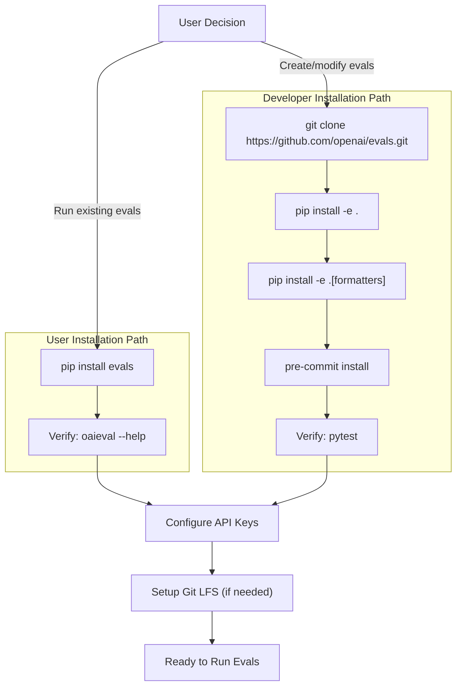
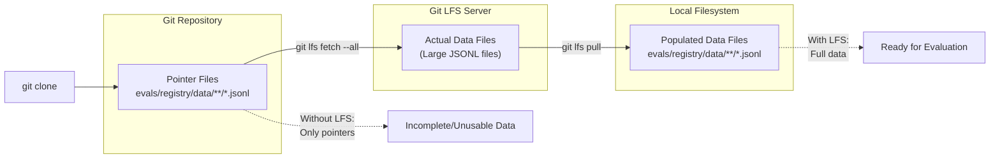
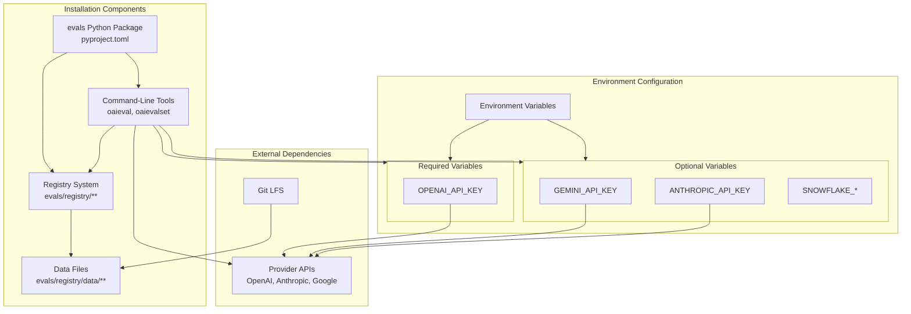

<!-- source: DeepWiki mcp.deepwiki.com · repo openai/evals · page 2.1 Installation and Setup · fetched 2026-10-26 -->

# Installation and Setup

<details>
<summary>Relevant source files</summary>

The following files were used as context for generating this wiki page:

- [.gitattributes](.gitattributes)
- [.github/config.yml](.github/config.yml)
- [.github/workflows/run_tests.yaml](.github/workflows/run_tests.yaml)
- [.github/workflows/test_eval.yaml](.github/workflows/test_eval.yaml)
- [Makefile](Makefile)
- [README.md](README.md)
- [docs/build-eval.md](docs/build-eval.md)
- [docs/completion-fn-protocol.md](docs/completion-fn-protocol.md)
- [docs/completion-fns.md](docs/completion-fns.md)
- [docs/custom-eval.md](docs/custom-eval.md)
- [evals/registry/data/pattern_identification/samples.v0.jsonl](evals/registry/data/pattern_identification/samples.v0.jsonl)
- [evals/registry/evals/pattern_identification.yaml](evals/registry/evals/pattern_identification.yaml)
- [evals/registry/solvers/gemini.yaml](evals/registry/solvers/gemini.yaml)
- [evals/solvers/providers/google/gemini_solver.py](evals/solvers/providers/google/gemini_solver.py)
- [evals/solvers/providers/google/gemini_solver_test.py](evals/solvers/providers/google/gemini_solver_test.py)
- [evals/solvers/providers/google/requirements.txt](evals/solvers/providers/google/requirements.txt)
- [pyproject.toml](pyproject.toml)

</details>


This document covers the installation and configuration steps required to use the OpenAI Evals framework. This includes installing the Python package, configuring API keys for model providers, setting up Git LFS for data files, and verifying the installation. For instructions on running evaluations after setup, see [Running Your First Evaluation](#2.2).

## Overview

The Evals framework can be installed in two modes:
- **User mode**: For running existing evaluations without modifying code.
- **Developer mode**: For creating new evaluations or contributing to the framework.

Both modes require Python 3.9 or higher and appropriate API credentials.

Sources: [README.md:1-102](), [pyproject.toml:1-71]()

## Environment Requirements

### Python Version

The minimum required Python version is **3.9**.

```bash
# Verify Python version
python --version  # Should be >= 3.9
```

Sources: [README.md:15](), [pyproject.toml:4](), [.github/workflows/run_tests.yaml:24-25]()

### Core Dependencies

The framework has extensive dependencies managed through `pyproject.toml`. Key dependencies include:

| Category | Packages | Purpose |
|----------|----------|---------|
| LLM Providers | `openai>=1.0.0`, `anthropic`, `google-generativeai`, `langchain` | API clients for model providers |
| Data Processing | `datasets`, `pandas`, `numpy`, `blobfile` | Dataset loading and manipulation |
| Utilities | `pyyaml`, `dacite`, `beartype`, `tiktoken` | Configuration and type validation |
| Metrics | `evaluate`, `sacrebleu`, `jiwer` | Evaluation metrics computation |
| Recording | `snowflake-connector-python[pandas]`, `flask` | Results storage backends |
| Testing | `pytest`, `mock` | Unit testing infrastructure |

Sources: [pyproject.toml:6-50]()

## Installation Methods

### User Installation (Running Existing Evals)

For users who want to run existing evaluations without modifying the codebase:

```bash
pip install evals
```

This installs the package from PyPI and provides the `oaieval` and `oaievalset` command-line tools.

Sources: [README.md:56-60](), [pyproject.toml:60-62]()

### Developer Installation (Creating or Contributing Evals)

For users who want to create new evaluations or contribute to the framework:

```bash
# Clone the repository
git clone https://github.com/openai/evals.git
cd evals

# Install in editable mode
pip install -e .
```

The `-e` flag installs the package in "editable" mode, meaning changes to the source code are immediately reflected without reinstalling.

Sources: [README.md:36-42](), [docs/build-eval.md:1-6](), [.github/workflows/run_tests.yaml:28-32]()

### Installing Development Tools

For contributors who will be formatting code and running pre-commit hooks:

```bash
# Install formatters
pip install -e .[formatters]

# Install pre-commit hooks
pre-commit install
```

This installs code quality tools including `black`, `isort`, `autoflake`, and `ruff` for automatic code formatting.

Sources: [README.md:44-52](), [pyproject.toml:55-56]()

## Installation Flow Diagram



Sources: [README.md:11-62](), [docs/build-eval.md:1-20]()

## API Key Configuration

### Required: OpenAI API Key

The OpenAI API key is required for all evaluations. Obtain an API key from the [OpenAI Platform](https://platform.openai.com/account/api-keys).

Set the environment variable:

```bash
export OPENAI_API_KEY="sk-..."
```

Sources: [README.md:13]()

### Optional Provider API Keys

The framework supports multiple LLM providers. Configure additional API keys as needed:

| Provider | Environment Variable | Implementation Entity |
|----------|---------------------|----------------------|
| Google Gemini | `GEMINI_API_KEY` | `evals.solvers.providers.google.gemini_solver:GeminiSolver` |
| Anthropic Claude | `ANTHROPIC_API_KEY` | Configured via `anthropic` package |

**Example for Gemini:**

```bash
export GEMINI_API_KEY="your-gemini-api-key"
```

Sources: [evals/solvers/providers/google/gemini_solver.py:16-17](), [evals/registry/solvers/gemini.yaml:1-24]()

### Optional: Snowflake Database Configuration

For logging evaluation results to a Snowflake database (optional):

```bash
export SNOWFLAKE_ACCOUNT="your-account"
export SNOWFLAKE_DATABASE="your-database"
export SNOWFLAKE_USERNAME="your-username"
export SNOWFLAKE_PASSWORD="your-password"
```

Sources: [README.md:64]()

## Git LFS Setup for Data Files

### Understanding Git LFS in Evals

The evaluation datasets in `evals/registry/data/` are stored using [Git Large File Storage (Git LFS)](https://git-lfs.com/). Pointer files in the repository contain metadata (version, oid, size) while the actual JSONL content is fetched from the LFS server.

Sources: [README.md:17-32](), [evals/registry/data/pattern_identification/samples.v0.jsonl:1-4](), [.gitattributes:1]()

### Fetching Eval Data

After cloning the repository and installing Git LFS:

```bash
cd evals
git lfs fetch --all
git lfs pull
```

To download data for only specific evaluations:

```bash
git lfs fetch --include=evals/registry/data/${your eval}
git lfs pull
```

Sources: [README.md:19-32]()

### Git LFS Data Flow Diagram



Sources: [README.md:17-32](), [evals/registry/data/pattern_identification/samples.v0.jsonl:1-4]()

## Verification

### Command-Line Tools Verification

Verify that the command-line tools are installed correctly:

```bash
# Check oaieval is available
oaieval --help

# Check oaievalset is available
oaievalset --help
```

Sources: [pyproject.toml:60-62]()

### Running Tests (Developer Installation)

For developer installations, verify that tests pass:

```bash
# Run all tests
pytest
```

Sources: [.github/workflows/run_tests.yaml:34-38]()

## System Configuration Diagram



Sources: [pyproject.toml:1-71](), [README.md:11-64](), [evals/solvers/providers/google/gemini_solver.py:16-17]()

---

