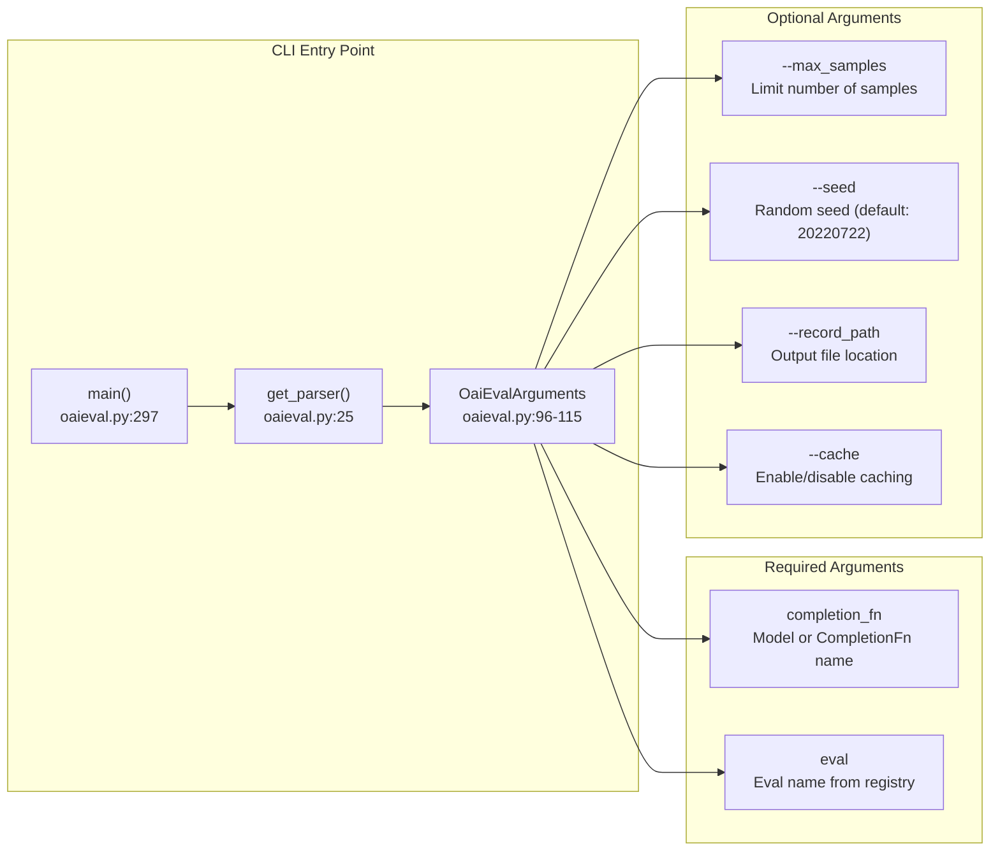
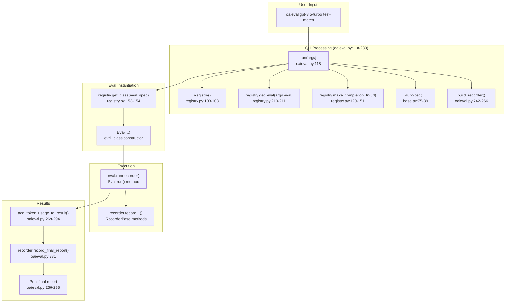
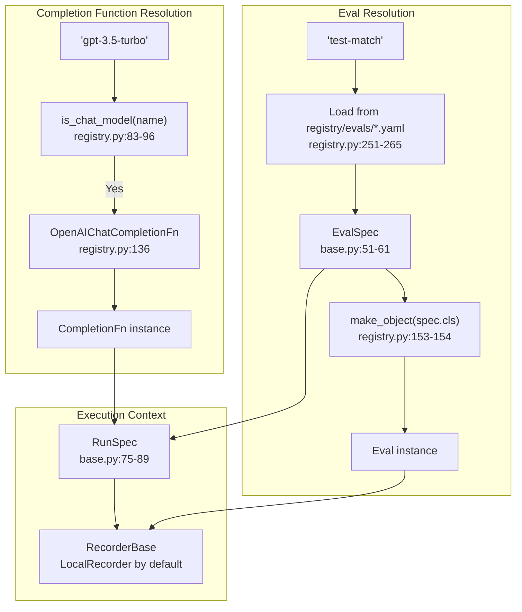
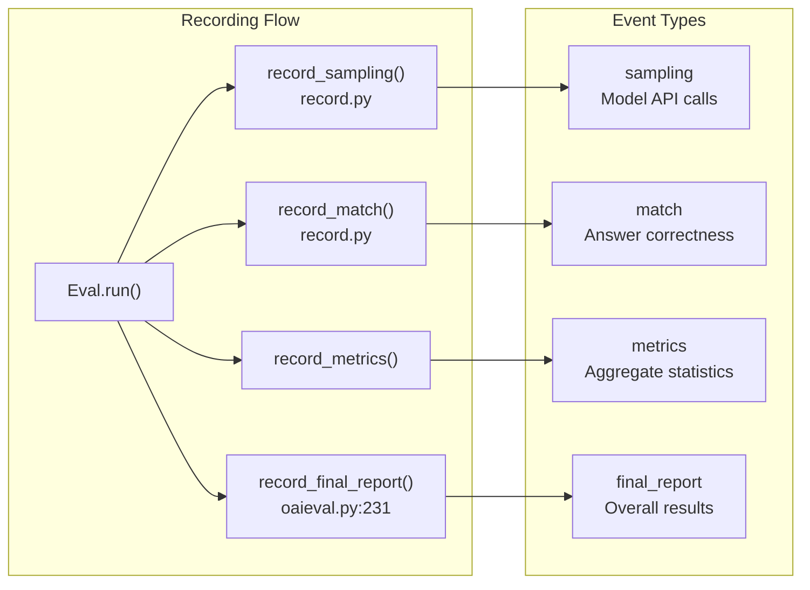
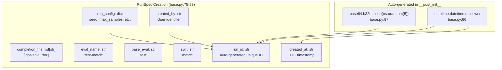
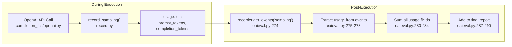
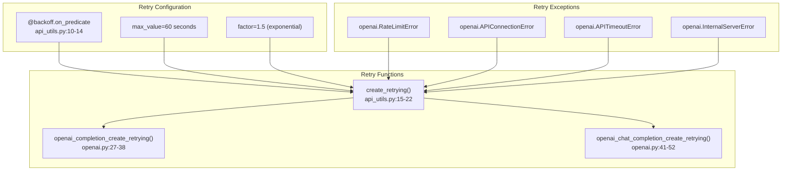

<!-- source: DeepWiki mcp.deepwiki.com · repo openai/evals · page 2.2 Running Your First Evaluation · fetched 2026-10-26 -->

# Running Your First Evaluation

<details>
<summary>Relevant source files</summary>

The following files were used as context for generating this wiki page:

- [.gitattributes](.gitattributes)
- [.github/config.yml](.github/config.yml)
- [MANIFEST.in](MANIFEST.in)
- [Makefile](Makefile)
- [README.md](README.md)
- [docs/build-eval.md](docs/build-eval.md)
- [docs/completion-fn-protocol.md](docs/completion-fn-protocol.md)
- [docs/completion-fns.md](docs/completion-fns.md)
- [docs/custom-eval.md](docs/custom-eval.md)
- [docs/run-evals.md](docs/run-evals.md)
- [evals/__init__.py](evals/__init__.py)
- [evals/api.py](evals/api.py)
- [evals/base.py](evals/base.py)
- [evals/cli/oaieval.py](evals/cli/oaieval.py)
- [evals/completion_fns/langchain_math.py](evals/completion_fns/langchain_math.py)
- [evals/completion_fns/openai.py](evals/completion_fns/openai.py)
- [evals/completion_fns/retrieval.py](evals/completion_fns/retrieval.py)
- [evals/elsuite/make_me_say/autoeval.py](evals/elsuite/make_me_say/autoeval.py)
- [evals/elsuite/make_me_say/utils.py](evals/elsuite/make_me_say/utils.py)
- [evals/registry.py](evals/registry.py)
- [evals/registry/completion_fns/cot.yaml](evals/registry/completion_fns/cot.yaml)
- [evals/registry/data/pattern_identification/samples.v0.jsonl](evals/registry/data/pattern_identification/samples.v0.jsonl)
- [evals/registry/data/word_association/corpus_tools/validators.py](evals/registry/data/word_association/corpus_tools/validators.py)
- [evals/registry/evals/pattern_identification.yaml](evals/registry/evals/pattern_identification.yaml)
- [evals/registry_test.py](evals/registry_test.py)
- [evals/utils/api_utils.py](evals/utils/api_utils.py)
- [examples/retrieval-completionfn.ipynb](examples/retrieval-completionfn.ipynb)

</details>


**Purpose**: This page provides a practical walkthrough for executing your first evaluation using the `oaieval` CLI. It covers the basic command syntax, execution flow, output interpretation, and commonly used options. For comprehensive CLI reference including all flags and advanced configurations, see [Using oaieval CLI](#5.1). For installation and environment setup, see [Installation and Setup](#2.1).

---

## Basic Command Structure

The simplest evaluation command requires two arguments:

```bash
oaieval <completion_fn> <eval>
```

**Example:**
```bash
oaieval gpt-3.5-turbo test-match
```

| Component | Description | Example Value |
|-----------|-------------|---------------|
| `completion_fn` | The model or completion function to evaluate | `gpt-3.5-turbo`, `gpt-4`, `dummy` |
| `eval` | The evaluation to run (registered in YAML) | `test-match`, `logqa`, `lambada` |

Sources: [evals/cli/oaieval.py:26-32](), [docs/run-evals.md:7-13]()

---

## Command Line Arguments Parsing



Sources: [evals/cli/oaieval.py:25-115]()

---

## Your First Evaluation: test-match

The `test-match` eval is a simple exact-match evaluation ideal for testing your setup.

### Step 1: Run the Command

```bash
oaieval gpt-3.5-turbo test-match
```

### Step 2: Observe Initial Output

The CLI will display:
- **Run ID**: A unique identifier in format `YYMMDDHHMMSS<random>`
- **Progress**: Sample-by-sample processing updates
- **Token usage**: Number of prompt/completion tokens used

Example output:
```
[2024-01-15 10:30:45] Run started: 240115103045AB3D2
[2024-01-15 10:30:46] [1/10] Processing sample...
[2024-01-15 10:30:47] [2/10] Processing sample...
...
```

### Step 3: View Final Results

After all samples complete, the final report appears:

```
Final report:
accuracy: 0.85
usage_prompt_tokens: 1247
usage_completion_tokens: 423
usage_total_tokens: 1670
```

Sources: [evals/cli/oaieval.py:214-238](), [docs/run-evals.md:7-13]()

---

## Execution Flow Diagram



Sources: [evals/cli/oaieval.py:118-239]()

---

## Registry Resolution Process

When you run `oaieval gpt-3.5-turbo test-match`, the system resolves both arguments through the `Registry` class:



**Resolution Rules:**

| Input Type | Resolution Logic | Code Reference |
|------------|------------------|----------------|
| OpenAI model name (e.g., `gpt-3.5-turbo`) | Detected as chat model, creates `OpenAIChatCompletionFn` | [evals/registry.py:135-136]() |
| Registry completion_fn ID | Looks up in `evals/registry/completion_fns/*.yaml` | [evals/registry.py:141-151]() |
| `dummy` | Returns `DummyCompletionFn` (for testing) | [evals/registry.py:130-131]() |
| Eval name | Looks up in `evals/registry/evals/*.yaml` | [evals/registry.py:210-211]() |

Sources: [evals/registry.py:83-151](), [evals/registry.py:210-211](), [evals/base.py:51-89]()

---

## Output Files and Recording

By default, evaluation results are written to a local JSONL file:

**Default location:**
```
/tmp/evallogs/{run_id}_{completion_fn}_{eval}.jsonl
```

**Example:**
```
/tmp/evallogs/240115103045AB3D2_gpt-3.5-turbo_test-match.jsonl
```

### Custom Output Location

Use the `--record_path` flag to specify a custom location:

```bash
oaieval gpt-3.5-turbo test-match --record_path ./my_results.jsonl
```

### Recording Modes

| Mode | Flag | Recorder Class | Description |
|------|------|----------------|-------------|
| Local (default) | `--local-run` | `LocalRecorder` | Writes JSONL to local file |
| HTTP | `--http-run` | `HttpRecorder` | POSTs events to URL |
| Dry run | `--dry-run` | `DummyRecorder` | No recording, prints to console |

Sources: [evals/cli/oaieval.py:197-208](), [evals/cli/oaieval.py:242-266]()

---

## Interpreting Results

### Final Report Metrics

After execution completes, the CLI prints a final report. Common metrics include:

| Metric | Description | Example Value |
|--------|-------------|---------------|
| `accuracy` | Fraction of correct matches | `0.85` (85%) |
| `usage_prompt_tokens` | Total tokens in prompts | `1247` |
| `usage_completion_tokens` | Total tokens in completions | `423` |
| `usage_total_tokens` | Sum of prompt + completion tokens | `1670` |

### Event Types in JSONL Output

The JSONL file contains various event types:



Sources: [evals/record.py](), [evals/cli/oaieval.py:231]()

---

## Commonly Used Options

### Limit Sample Count

Test with fewer samples during development:

```bash
oaieval gpt-3.5-turbo test-match --max_samples 5
```

This limits evaluation to the first 5 samples. The `max_samples` value is set globally via `evals.eval.set_max_samples` [evals/cli/oaieval.py:125]() and affects all sample iterators.

### Set Random Seed

Ensure reproducible results:

```bash
oaieval gpt-3.5-turbo test-match --seed 42
```

Default seed is `20220722` [evals/cli/oaieval.py:43]().

### Disable Caching

Force fresh API calls (useful when testing prompt changes):

```bash
oaieval gpt-3.5-turbo test-match --no-cache
```

This sets `cache` to `False` in arguments [evals/cli/oaieval.py:41](), affecting the behavior of completion functions.

### Enable Debug Logging

Get detailed execution information:

```bash
oaieval gpt-3.5-turbo test-match --debug
```

This sets the root logger level to `DEBUG` [evals/cli/oaieval.py:119-120]().

### Combine Multiple Options

```bash
oaieval gpt-3.5-turbo test-match \
  --max_samples 10 \
  --seed 42 \
  --record_path ./results.jsonl \
  --debug
```

Sources: [evals/cli/oaieval.py:40-93]()

---

## Example: Running with Different Models

### OpenAI Chat Models

```bash
# GPT-4
oaieval gpt-4 test-match

# GPT-3.5 Turbo 16k context
oaieval gpt-3.5-turbo-16k test-match
```

### OpenAI Completion Models

```bash
# Text-Davinci-003
oaieval text-davinci-003 test-match
```

The `Registry` automatically detects the model type and instantiates the appropriate `CompletionFn`:
- Chat models → `OpenAIChatCompletionFn` [evals/registry.py:136]()
- Completion models → `OpenAICompletionFn` [evals/registry.py:138]()

### Registered Completion Functions

```bash
# Chain-of-Thought wrapper (from registry)
oaieval cot/gpt-3.5-turbo test-match

# Dummy completion (for testing)
oaieval dummy test-match
```

Sources: [evals/registry.py:120-151](), [evals/completion_fns/openai.py:83-181]()

---

## Execution Context: RunSpec

Every evaluation run creates a `RunSpec` object that captures execution metadata:



**RunSpec Fields:**

| Field | Source | Example |
|-------|--------|---------|
| `run_id` | Auto-generated (timestamp + random) | `240115103045AB3D2` |
| `completion_fns` | From CLI argument | `["gpt-3.5-turbo"]` |
| `eval_name` | From CLI argument | `"test-match"` |
| `base_eval` | Parsed from eval_name (before `.`) | `"test"` |
| `split` | Parsed from eval_name (after `.`) | `"match"` |
| `run_config` | Captures all execution parameters | `{"seed": 42, "max_samples": 10, ...}` |

Sources: [evals/base.py:75-89](), [evals/cli/oaieval.py:173-195]()

---

## Token Usage Tracking

Token usage is automatically tracked and aggregated from sampling events:



**Usage Fields:**

| Field | Description |
|-------|-------------|
| `prompt_tokens` | Tokens in the input prompt |
| `completion_tokens` | Tokens in the model's response |
| `total_tokens` | Sum of prompt and completion tokens |

The `add_token_usage_to_result` function aggregates these across all samples and adds them to the final report with `usage_` prefix [evals/cli/oaieval.py:269-294]().

Sources: [evals/cli/oaieval.py:269-294](), [evals/completion_fns/openai.py:125-130](), [evals/completion_fns/openai.py:175-180]()

---

## Error Handling and Retry Logic

API calls automatically retry on transient errors using exponential backoff:



**Retry Parameters:**

| Parameter | Value | Description |
|-----------|-------|-------------|
| Wait strategy | Exponential | Doubles wait time after each retry |
| Max wait | 60 seconds | Maximum backoff between retries |
| Factor | 1.5 | Multiplier for exponential backoff |

Sources: [evals/utils/api_utils.py:10-22](), [evals/completion_fns/openai.py:19-52]()

---

## Next Steps

After running your first evaluation, explore:

- **[Using oaieval CLI](#5.1)**: Complete reference for all CLI flags and options
- **[Evaluation Types](#6)**: Different evaluation patterns (Basic, Model-Graded, Solver-Based)
- **[Creating and Configuring Evaluations](#7)**: Build custom evaluations
- **[Configuration and Advanced Options](#5.3)**: Environment variables, registry paths, sampling parameters

---

## Quick Reference: Common Commands

| Task | Command |
|------|---------|
| Basic evaluation | `oaieval gpt-3.5-turbo test-match` |
| Limit samples | `oaieval gpt-3.5-turbo test-match --max_samples 10` |
| Custom output | `oaieval gpt-3.5-turbo test-match --record_path ./results.jsonl` |
| Different model | `oaieval gpt-4 test-match` |
| Dry run (no recording) | `oaieval gpt-3.5-turbo test-match --dry-run` |
| Debug mode | `oaieval gpt-3.5-turbo test-match --debug` |
| Disable cache | `oaieval gpt-3.5-turbo test-match --no-cache` |
| Set seed | `oaieval gpt-3.5-turbo test-match --seed 42` |

Sources: [evals/cli/oaieval.py:25-93](), [docs/run-evals.md:7-22]()

---

