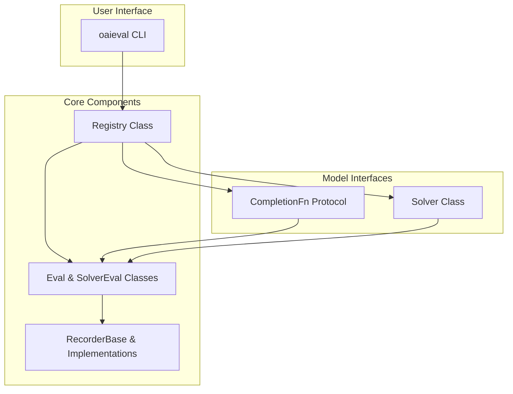
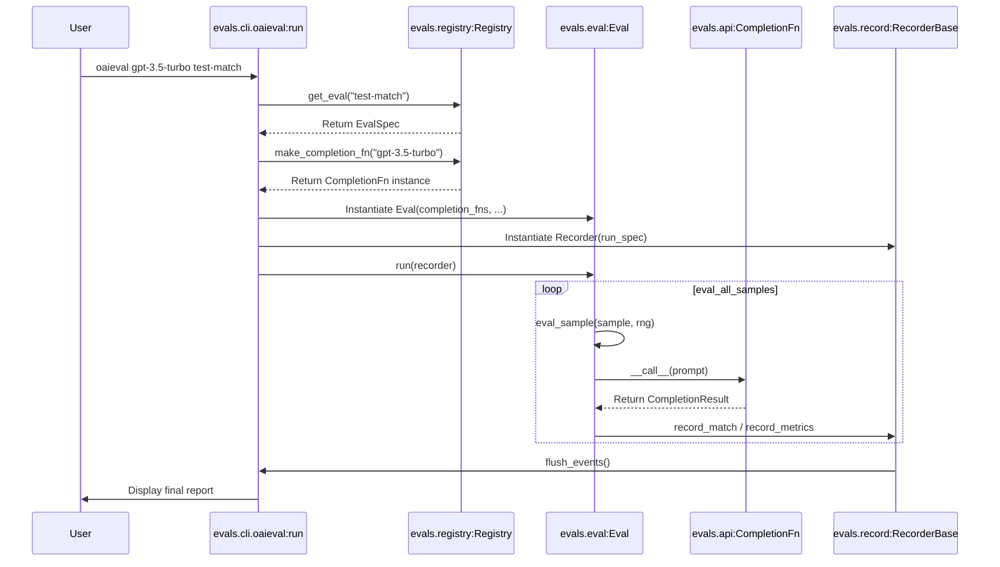
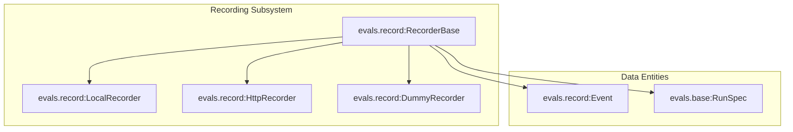

<!-- source: DeepWiki mcp.deepwiki.com · repo openai/evals · page 3 Core Architecture · fetched 2026-10-26 -->

# Core Architecture

Relevant source files

The following files were used as context for generating this wiki page:

- [MANIFEST.in](MANIFEST.in)
- [docs/run-evals.md](docs/run-evals.md)
- [evals/__init__.py](evals/__init__.py)
- [evals/api.py](evals/api.py)
- [evals/base.py](evals/base.py)
- [evals/cli/oaieval.py](evals/cli/oaieval.py)
- [evals/cli/oaievalset.py](evals/cli/oaievalset.py)
- [evals/completion_fns/langchain_math.py](evals/completion_fns/langchain_math.py)
- [evals/completion_fns/openai.py](evals/completion_fns/openai.py)
- [evals/completion_fns/retrieval.py](evals/completion_fns/retrieval.py)
- [evals/data.py](evals/data.py)
- [evals/data_test.py](evals/data_test.py)
- [evals/elsuite/basic/match_with_solvers.py](evals/elsuite/basic/match_with_solvers.py)
- [evals/elsuite/make_me_say/autoeval.py](evals/elsuite/make_me_say/autoeval.py)
- [evals/elsuite/make_me_say/utils.py](evals/elsuite/make_me_say/utils.py)
- [evals/eval.py](evals/eval.py)
- [evals/record.py](evals/record.py)
- [evals/record_test.py](evals/record_test.py)
- [evals/registry.py](evals/registry.py)
- [evals/registry/completion_fns/cot.yaml](evals/registry/completion_fns/cot.yaml)
- [evals/registry/data/word_association/corpus_tools/validators.py](evals/registry/data/word_association/corpus_tools/validators.py)
- [evals/registry_test.py](evals/registry_test.py)
- [evals/solvers/human_cli_solver.py](evals/solvers/human_cli_solver.py)
- [evals/solvers/prompts/cot.py](evals/solvers/prompts/cot.py)
- [evals/solvers/prompts/hhh.py](evals/solvers/prompts/hhh.py)
- [evals/solvers/solver.py](evals/solvers/solver.py)
- [evals/solvers/utils.py](evals/solvers/utils.py)
- [evals/utils/api_utils.py](evals/utils/api_utils.py)
- [evals/utils/misc.py](evals/utils/misc.py)
- [examples/retrieval-completionfn.ipynb](examples/retrieval-completionfn.ipynb)
- [mypy.ini](mypy.ini)
- [scripts/battle_generator.py](scripts/battle_generator.py)
- [scripts/modelgraded_generator.py](scripts/modelgraded_generator.py)
- [scripts/pattern_identification_generator.py](scripts/pattern_identification_generator.py)

The OpenAI Evals framework provides a robust and extensible system for evaluating language models on a variety of tasks. This page explains the high-level architecture of the framework, how its components interact, and the flow of execution when running evaluations.

## Key Components Overview

The Evals framework consists of several key components that work together to provide a complete evaluation pipeline:

Sources: [evals/cli/oaieval.py:25-93](), [evals/registry.py:103-152](), [evals/eval.py:46-200](), [evals/record.py:54-73]()

## Execution Flow

When you run an evaluation using the `oaieval` CLI tool, the following sequence of events occurs:

Sources: [evals/cli/oaieval.py:118-239](), [evals/eval.py:112-147](), [evals/api.py:23-40]()

## Registry System
The Registry system manages all configuration for evaluations, including evaluation definitions, completion functions, solvers, and datasets. It loads these configurations from YAML files.

For details, see [Registry System](#3.1).

| Component | Description | Code Entity |
| :--- | :--- | :--- |
| **Discovery** | Logic to find YAML files in search paths | `evals.registry.Registry` [evals/registry.py:103]() |
| **Instantiation** | Factory for creating model interfaces | `Registry.make_completion_fn` [evals/registry.py:120]() |
| **Resolution** | Logic to map IDs to Specs | `Registry._dereference` [evals/registry.py:156]() |

Sources: [evals/registry.py:103-208]()

## Evaluation Base Framework
Evaluations are implemented through a hierarchy of classes that extend the base `Eval` class. The newer `SolverEval` class is designed specifically for use with the Solver framework.

For details, see [Evaluation Base Framework](#3.2).

- **`evals.eval.Eval`**: The base abstract class requiring implementation of `eval_sample` and `run` [evals/eval.py:46-89]().
- **`evals.eval.SolverEval`**: A specialized base class that wraps model interfaces as `Solvers`, ensuring per-sample isolation [evals/eval.py:168-196]().
- **Parallelism**: The framework supports both `ThreadPool` and `asyncio` execution modes for samples [evals/eval.py:90-147]().

Sources: [evals/eval.py:46-200]()

## Recording and Metrics
The recording system logs evaluation results and calculates metrics. It provides multiple recorder implementations for different storage backends.

For details, see [Recording and Metrics](#3.3).

Sources: [evals/record.py:44-143](), [evals/record.py:316-466]()

## Model Interfaces
The framework provides two primary abstractions for interacting with models:

1.  **`evals.api.CompletionFn`**: A protocol defining a `__call__` method that takes a prompt and returns a `CompletionResult` [evals/api.py:23-40]().
2.  **`evals.solvers.solver.Solver`**: A more complex interface for stateful, multi-turn, or reasoning-based tasks [evals/eval.py:168-196]().

The `Registry.make_completion_fn` method is responsible for resolving model names (like `gpt-4`) into the appropriate `OpenAIChatCompletionFn` or `OpenAICompletionFn` instance [evals/registry.py:120-151]().

Sources: [evals/api.py:16-40](), [evals/registry.py:120-151](), [evals/completion_fns/openai.py:83-181]()

## Data Management
The framework includes utilities for working with different data formats, primarily JSONL for evaluation samples.

- **`evals.data.get_jsonl`**: Extracts JSON lines from a given path or directory [evals/data.py:120-133]().
- **`evals.data.open_by_file_pattern`**: A versatile file opener supporting local/GCS paths and compression (Gzip, LZ4, Zstd) [evals/data.py:47-80]().

Sources: [evals/data.py:47-165]()

---

