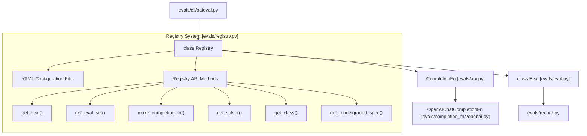
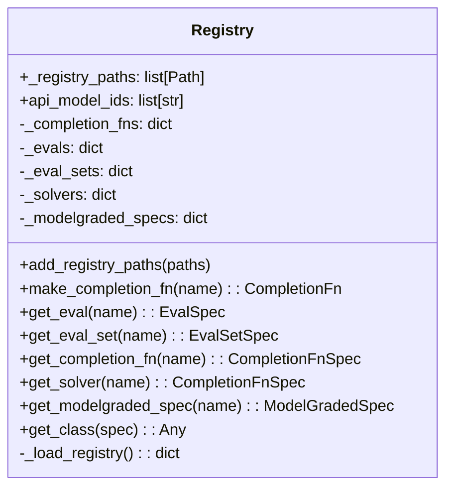
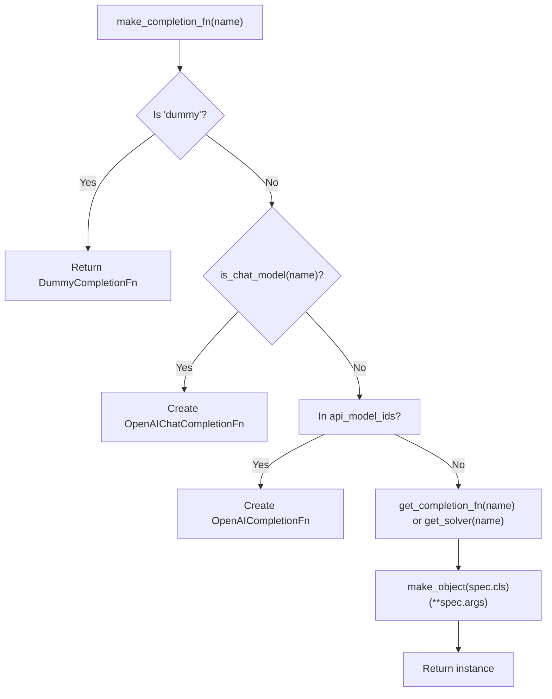

<!-- source: DeepWiki mcp.deepwiki.com · repo openai/evals · page 3.1 Registry System · fetched 2026-10-26 -->

# Registry System

Relevant source files

The following files were used as context for generating this wiki page:

- [.gitattributes](.gitattributes)
- [.github/config.yml](.github/config.yml)
- [MANIFEST.in](MANIFEST.in)
- [Makefile](Makefile)
- [README.md](README.md)
- [docs/build-eval.md](docs/build-eval.md)
- [docs/completion-fn-protocol.md](docs/completion-fn-protocol.md)
- [docs/completion-fns.md](docs/completion-fns.md)
- [docs/custom-eval.md](docs/custom-eval.md)
- [docs/run-evals.md](docs/run-evals.md)
- [evals/__init__.py](evals/__init__.py)
- [evals/api.py](evals/api.py)
- [evals/base.py](evals/base.py)
- [evals/cli/oaieval.py](evals/cli/oaieval.py)
- [evals/completion_fns/langchain_math.py](evals/completion_fns/langchain_math.py)
- [evals/completion_fns/openai.py](evals/completion_fns/openai.py)
- [evals/completion_fns/retrieval.py](evals/completion_fns/retrieval.py)
- [evals/elsuite/make_me_say/autoeval.py](evals/elsuite/make_me_say/autoeval.py)
- [evals/elsuite/make_me_say/utils.py](evals/elsuite/make_me_say/utils.py)
- [evals/registry.py](evals/registry.py)
- [evals/registry/completion_fns/cot.yaml](evals/registry/completion_fns/cot.yaml)
- [evals/registry/data/pattern_identification/samples.v0.jsonl](evals/registry/data/pattern_identification/samples.v0.jsonl)
- [evals/registry/data/word_association/corpus_tools/validators.py](evals/registry/data/word_association/corpus_tools/validators.py)
- [evals/registry/evals/pattern_identification.yaml](evals/registry/evals/pattern_identification.yaml)
- [evals/registry/solvers/bluff.yaml](evals/registry/solvers/bluff.yaml)
- [evals/registry/solvers/defaults.yaml](evals/registry/solvers/defaults.yaml)
- [evals/registry/solvers/make-me-pay.yaml](evals/registry/solvers/make-me-pay.yaml)
- [evals/registry/solvers/self_prompting.yaml](evals/registry/solvers/self_prompting.yaml)
- [evals/registry/solvers/theory_of_mind.yaml](evals/registry/solvers/theory_of_mind.yaml)
- [evals/registry_test.py](evals/registry_test.py)
- [evals/solvers/README.md](evals/solvers/README.md)
- [evals/solvers/nested/cot_solver.py](evals/solvers/nested/cot_solver.py)
- [evals/solvers/nested/self_consistency_solver.py](evals/solvers/nested/self_consistency_solver.py)
- [evals/solvers/postprocessors/README.md](evals/solvers/postprocessors/README.md)
- [evals/utils/api_utils.py](evals/utils/api_utils.py)
- [examples/retrieval-completionfn.ipynb](examples/retrieval-completionfn.ipynb)

The Registry System is a core architectural component of the OpenAI Evals framework that manages the configuration and discovery of evaluations, completion functions, and datasets. It provides a plugin architecture that enables users to reference components by name rather than direct code imports, making the framework extensible without modifying core code.

## Purpose and Structure

The Registry System acts as a centralized configuration manager with several key responsibilities:

1. Loading component definitions from YAML configuration files.
2. Providing an API to access these definitions.
3. Creating instances of completion functions, evaluations, and other components.
4. Resolving dependencies between components.

### Natural Language to Code Entity Mapping

The following diagram illustrates how user-facing registry concepts map to specific classes and functions in the codebase.

**Registry Logic Flow**

Sources: [evals/registry.py:1-10](), [evals/registry.py:103-104](), [evals/registry.py:202-214](), [evals/api.py:23-40](), [evals/cli/oaieval.py:127-131]()

## Registry Architecture

The Registry is implemented as a class that maintains a cache of loaded components and provides methods to access them. The system is primarily defined in the `Registry` class in `evals/registry.py` [evals/registry.py:103-104]().

**Registry Class Structure**

Sources: [evals/registry.py:103-330]()

### Registry Paths

The Registry searches for configuration files in a list of directories. By default, `DEFAULT_PATHS` includes:

1. `evals/registry` - Built-in configurations in the repository [evals/registry.py:31]().
2. `~/.evals` - User-defined configurations in the home directory [evals/registry.py:32]().

Users can append additional paths using the `add_registry_paths` method [evals/registry.py:107-108]() or the `--registry_path` CLI option in `oaieval` [evals/cli/oaieval.py:49-54]().

### Registry Resolution Logic
When resolving a name, the registry uses a dereferencing logic in `_dereference` [evals/registry.py:156-192](). It handles:
- **Aliases**: If a registry entry is a string or a dict with an `id` key, it recursively resolves that name [evals/registry.py:168-182]().
- **Parameter Merging**: Arguments provided at runtime via `kwargs` are merged with the `args` defined in the YAML [evals/registry.py:184-186]().

## Specification Formats

The Registry loads YAML files and parses them into specific dataclasses defined in `evals/base.py`.

| Spec Type | Code Entity | Description |
| :--- | :--- | :--- |
| **Eval Spec** | `EvalSpec` | Defines the evaluation class and its instantiation arguments [evals/base.py:51-60](). |
| **Base Eval Spec** | `BaseEvalSpec` | Metadata for an eval, including metrics and descriptions [evals/base.py:30-49](). |
| **CompletionFn Spec** | `CompletionFnSpec` | Defines the class and args for a completion function or solver [evals/base.py:18-26](). |
| **Eval Set Spec** | `EvalSetSpec` | A collection of evaluation names to be run together [evals/base.py:64-71](). |
| **Model Graded Spec** | `ModelGradedSpec` | Specific configuration for model-based grading [evals/elsuite/modelgraded/base.py:23](). |

Sources: [evals/base.py:18-71](), [evals/registry.py:189-214]()

## Key Registry Operations

### Creating Completion Functions

The `make_completion_fn` method [evals/registry.py:120-151]() is the primary entry point for turning a string identifier into an executable `CompletionFn`.

**Completion Function Resolution**

Sources: [evals/registry.py:120-151](), [evals/registry.py:83-96](), [evals/completion_fns/openai.py:83-181]()

### Model Intelligence
The registry includes metadata for OpenAI models to automate configuration:
- `n_ctx_from_model_name`: Returns the context window size (e.g., 8192 for `gpt-4`) [evals/registry.py:37-80]().
- `is_chat_model`: Determines if the model requires the Chat Completion API [evals/registry.py:83-96]().

## Integration with CLI Tools

The `oaieval` CLI tool uses the registry to bootstrap the evaluation environment.

1. **Initialization**: It creates a `Registry` instance and adds any user-provided paths [evals/cli/oaieval.py:127-129]().
2. **Spec Retrieval**: It fetches the `EvalSpec` using `registry.get_eval(args.eval)` [evals/cli/oaieval.py:131]().
3. **CompletionFn Creation**: It creates `CompletionFn` instances using `registry.make_completion_fn` [evals/cli/oaieval.py:170]().
4. **Instantiation**: It retrieves the evaluation class via `registry.get_class(eval_spec)` and initializes it with the completion functions and merged arguments [evals/cli/oaieval.py:217-225]().

Sources: [evals/cli/oaieval.py:118-226](), [evals/registry.py:153-154]()

## Data Registry

While the YAML files define the logic, the registry also manages access to data files (usually JSONL).
- By convention, data is stored in `evals/registry/data` [README.md:26]().
- Evaluation specifications reference these files via the `samples_jsonl` argument [docs/build-eval.md:52]().
- The framework uses `git-lfs` to manage these large data files [README.md:19-24]().

Sources: [README.md:19-26](), [docs/build-eval.md:42-53]()

---

