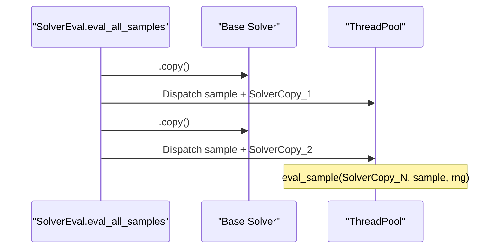
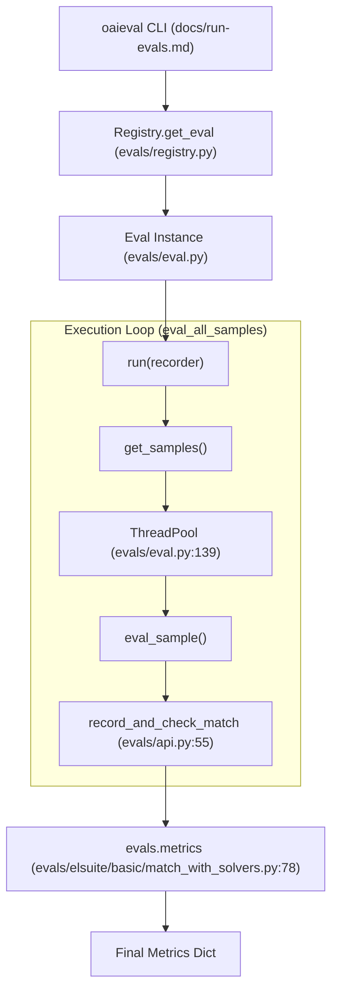

<!-- source: DeepWiki mcp.deepwiki.com · repo openai/evals · page 3.2 Evaluation Base Framework · fetched 2026-10-26 -->

# Evaluation Base Framework

<details>
<summary>Relevant source files</summary>

The following files were used as context for generating this wiki page:

- [MANIFEST.in](MANIFEST.in)
- [docs/run-evals.md](docs/run-evals.md)
- [evals/__init__.py](evals/__init__.py)
- [evals/api.py](evals/api.py)
- [evals/base.py](evals/base.py)
- [evals/elsuite/basic/match_with_solvers.py](evals/elsuite/basic/match_with_solvers.py)
- [evals/eval.py](evals/eval.py)
- [evals/solvers/human_cli_solver.py](evals/solvers/human_cli_solver.py)
- [evals/solvers/prompts/cot.py](evals/solvers/prompts/cot.py)
- [evals/solvers/prompts/hhh.py](evals/solvers/prompts/hhh.py)
- [evals/solvers/solver.py](evals/solvers/solver.py)
- [evals/solvers/utils.py](evals/solvers/utils.py)

</details>


The Evaluation Base Framework provides the foundation for all evaluations in the OpenAI Evals system. This document covers the core abstractions and components that enable the creation and execution of standardized evaluations for language models.

## Core Abstractions

The Evaluation Base Framework is built around two primary abstract classes defined in `evals/eval.py`:

1.  **Eval**: The base class for all evaluations. It manages a list of `CompletionFn` objects and provides the core parallel execution logic [evals/eval.py:46-64]().
2.  **SolverEval**: A specialized version of `Eval` designed to work with the `Solver` framework. It ensures that a fresh, isolated `Solver` instance is provided for each individual sample [evals/eval.py:168-194]().

### Class Hierarchy and Entity Mapping

The following diagram bridges the conceptual evaluation types to their specific implementation classes and the model interfaces they consume.

```mermaid
classDiagram
    class "Eval (Abstract)" {
        <<evals/eval.py>>
        +completion_fns: List[CompletionFn]
        +eval_registry_path: Path
        +run(recorder) Dict
        +eval_sample(sample, rng)
        +eval_all_samples(recorder, samples)
    }
    
    class "SolverEval (Abstract)" {
        <<evals/eval.py>>
        +_solver: Solver
        +eval_sample(solver, sample, rng)
    }
    
    class "MatchWithSolvers" {
        <<evals/elsuite/basic/match_with_solvers.py>>
        +eval_sample(solver, sample, rng)
    }
    
    class "CompletionFn (Protocol)" {
        <<evals/api.py>>
        +__call__(prompt) CompletionResult
    }

    class "Solver (ABC)" {
        <<evals/solvers/solver.py>>
        +__call__(task_state) SolverResult
        +_solve(task_state) SolverResult
    }
    
    "Eval (Abstract)" <|-- "SolverEval (Abstract)"
    "SolverEval (Abstract)" <|-- "MatchWithSolvers"
    "Eval (Abstract)" ..> "CompletionFn (Protocol)" : consumes
    "SolverEval (Abstract)" ..> "Solver (ABC)" : consumes
```

Sources: [evals/eval.py:46-46](), [evals/eval.py:168-168](), [evals/api.py:23-23](), [evals/solvers/solver.py:41-41](), [evals/elsuite/basic/match_with_solvers.py:15-15]()

## The Eval Class

The `Eval` class is the foundational abstract class. It handles registry paths, seeding, and the orchestration of multiple samples.

### Key Methods and Properties

*   **`eval_sample(sample, rng)`**: An abstract method where the core evaluation logic for a single data point resides [evals/eval.py:76-78]().
*   **`run(recorder)`**: The entry point for the evaluation. It typically loads data, calls `eval_all_samples`, and returns a dictionary of aggregated metrics [evals/eval.py:85-88]().
*   **`eval_all_samples(recorder, samples, ...)`**: The standard synchronous execution engine. It uses a `ThreadPool` to process samples in parallel [evals/eval.py:112-147]().
*   **`completion_fn`**: A helper property that returns the first element of `completion_fns`, used for simpler evaluations that only require one model [evals/eval.py:80-83]().

### Parallel Execution Patterns

The framework supports both threaded and asynchronous execution. Threading is the default for standard evaluations.

| Feature | Implementation | Configuration |
| :--- | :--- | :--- |
| **Threaded Execution** | `eval_all_samples` [evals/eval.py:112]() | `EVALS_THREADS` (default: 10) [evals/eval.py:124]() |
| **Async Execution** | `async_eval_all_samples` [evals/eval.py:90]() | `concurrency` argument (default: 32) [evals/eval.py:94]() |
| **Sequential Mode** | `eval_all_samples` [evals/eval.py:140]() | `EVALS_SEQUENTIAL=1` [evals/eval.py:140]() |

Sources: [evals/eval.py:90-147](), [docs/run-evals.md:31-34]()

## The SolverEval Class

`SolverEval` adapts the base `Eval` to the `Solver` interface. Unlike basic `Eval`, which passes raw completion functions, `SolverEval` manages the lifecycle of `Solver` instances.

### Solver Isolation and State

A key feature of `SolverEval` is that it creates a new copy of the `Solver` for every sample [evals/eval.py:218-220](). This is critical for stateful solvers (e.g., those with memory or multi-turn history) to ensure that interactions in one sample do not bleed into another.



Sources: [evals/eval.py:168-184](), [evals/eval.py:218-220](), [evals/solvers/solver.py:122-125]()

## Evaluation Lifecycle and Data Flow

The following diagram illustrates the flow from the `oaieval` CLI through the base framework components to produce a final result.



Sources: [evals/eval.py:112-147](), [docs/run-evals.md:7-13](), [evals/api.py:55-106](), [evals/elsuite/basic/match_with_solvers.py:68-80]()

### Sample Evaluation Logic

When `eval_all_samples` runs, it performs several setup steps for each worker:
1.  **Indexing**: Samples are paired with their original indices to ensure results can be sorted back to the original order [evals/eval.py:30-38]().
2.  **RNG Initialization**: A deterministic `random.Random` instance is created for each sample using a combination of the sample ID and the global eval seed [evals/eval.py:133-136]().
3.  **Recorder Context**: The `recorder.as_default_recorder(sample_id)` context manager is used to ensure all events (sampling, matches, etc.) are associated with the correct sample ID in the logs [evals/eval.py:134]().

## Integration Utilities

The framework includes utilities in `evals/solvers/utils.py` to bridge the gap between legacy `CompletionFn` code and newer `Solver` code.

*   **`maybe_wrap_with_compl_fn`**: Wraps a `Solver` in a `SolverCompletionFn` so it can be used where a `CompletionFn` is expected [evals/solvers/utils.py:10-25]().
*   **`maybe_wrap_with_solver`**: Wraps a standard `CompletionFn` (like `OpenAIChatCompletionFn`) into an `OpenAISolver` so it can be used within the `SolverEval` framework [evals/solvers/utils.py:28-55]().

Sources: [evals/solvers/utils.py:10-55]()

---

