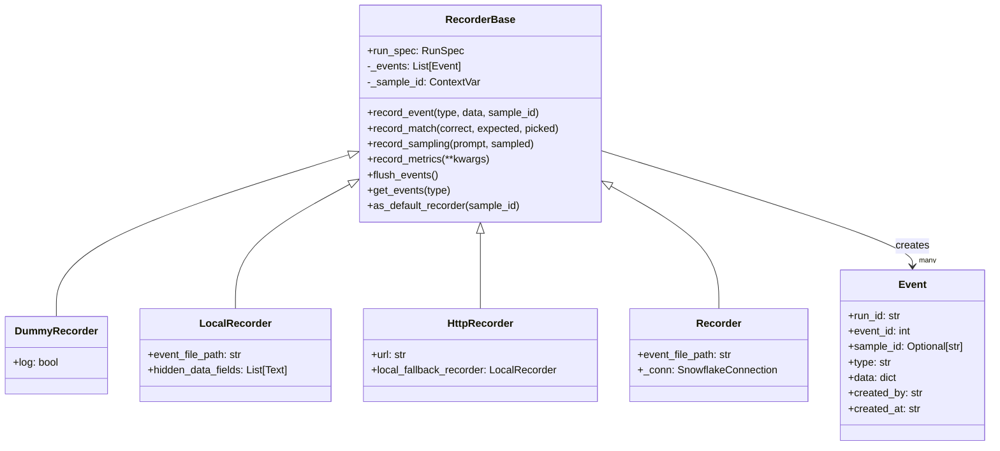
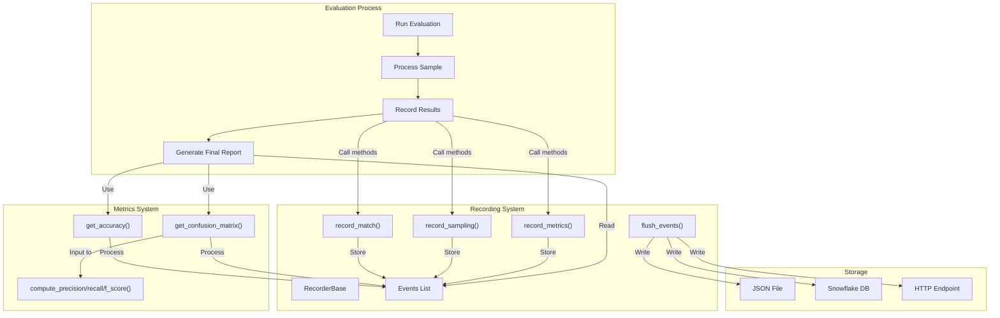
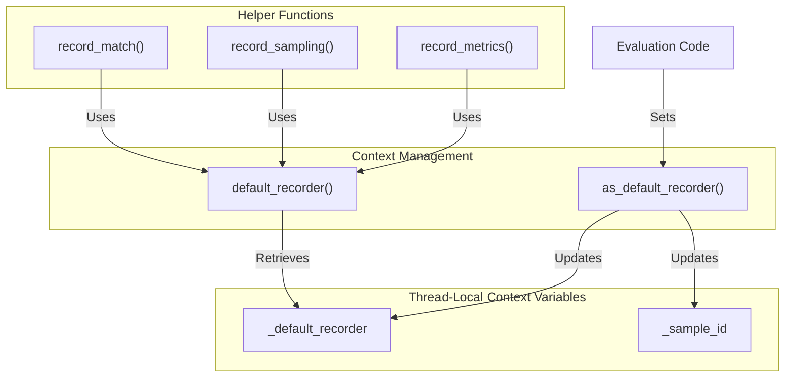
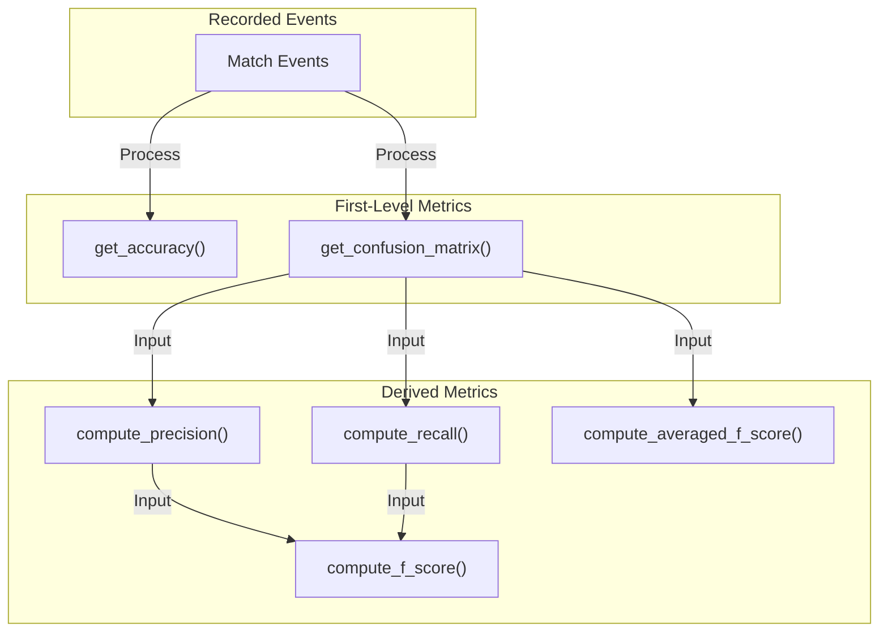

<!-- source: DeepWiki mcp.deepwiki.com · repo openai/evals · page 3.3 Recording and Metrics · fetched 2026-10-26 -->

# Recording and Metrics

<details>
<summary>Relevant source files</summary>

The following files were used as context for generating this wiki page:

- [.github/PULL_REQUEST_TEMPLATE.md](.github/PULL_REQUEST_TEMPLATE.md)
- [.pre-commit-config.yaml](.pre-commit-config.yaml)
- [evals/cli/oaievalset.py](evals/cli/oaievalset.py)
- [evals/data.py](evals/data.py)
- [evals/data_test.py](evals/data_test.py)
- [evals/metrics.py](evals/metrics.py)
- [evals/record.py](evals/record.py)
- [evals/record_test.py](evals/record_test.py)
- [evals/utils/misc.py](evals/utils/misc.py)
- [mypy.ini](mypy.ini)
- [scripts/battle_generator.py](scripts/battle_generator.py)
- [scripts/modelgraded_generator.py](scripts/modelgraded_generator.py)
- [scripts/pattern_identification_generator.py](scripts/pattern_identification_generator.py)
- [tests/unit/evals/test_metrics.py](tests/unit/evals/test_metrics.py)

</details>


The Recording and Metrics system is a core component of the OpenAI Evals framework that enables capturing evaluation results and calculating performance statistics. This page documents how evaluation data is recorded during eval runs and how metrics are computed from this recorded data.

## Overview

The Recording and Metrics subsystem provides:

1.  A standardized way to log evaluation events (model outputs, matches between expected and actual results, etc.).
2.  Multiple backend options for storing these events (local files, HTTP endpoints, Snowflake database).
3.  Functions to calculate common performance metrics from recorded events.

This system is used throughout the evaluation process to track results and compute performance statistics that help quantify model capabilities.

## Recorder Architecture

### Recorder Class Hierarchy


Sources: [evals/record.py:43-582]()

All recorder implementations inherit from the `RecorderBase` class [evals/record.py:54-73](), which defines the core interface for recording events. Each recorder type uses a different approach for storing event data:

| Recorder Type | Purpose | Storage Backend |
|---------------|---------|----------------|
| `DummyRecorder` | For dry runs | Console logging only [evals/record.py:284-314]() |
| `LocalRecorder` | Default recorder | Local JSON file [evals/record.py:316-372]() |
| `HttpRecorder` | Remote recording | HTTP endpoint with local fallback [evals/record.py:374-466]() |
| `Recorder` | Enterprise recording | Snowflake database with local backup [evals/record.py:468-582]() |

### Event Structure

The `Event` dataclass [evals/record.py:43-51]() represents a single occurrence during an evaluation run. Events have these standard fields:

| Field | Description |
|-------|-------------|
| `run_id` | Unique identifier for the evaluation run |
| `event_id` | Sequential ID for the event |
| `sample_id` | Identifier for the sample being evaluated |
| `type` | Event type (e.g., "match", "sampling", "metrics") |
| `data` | Event-specific data payload |
| `created_by` | User or system that created the event |
| `created_at` | Timestamp when the event was created |

## Event Flow

The following diagram shows how events flow through the Recording and Metrics system:


Sources: [evals/record.py:145-186](), [evals/metrics.py:12-73]()

## Standard Event Types

The framework defines several standard event types, each with dedicated recording methods:

| Event Type | Method | Purpose |
|------------|--------|---------|
| `match` | `record_match()` | Records whether a model's output matched the expected result [evals/record.py:187-201]() |
| `sampling` | `record_sampling()` | Records a model's response to a prompt [evals/record.py:214-220]() |
| `function_call` | `record_function_call()` | Records a function call with arguments and return value [evals/record.py:228-235]() |
| `cond_logp` | `record_cond_logp()` | Records conditional log probability of a completion [evals/record.py:207-212]() |
| `pick_option` | `record_pick_option()` | Records which option was selected from available choices [evals/record.py:222-226]() |
| `metrics` | `record_metrics()` | Records computed metrics (accuracy, F1, etc.) [evals/record.py:241-242]() |
| `error` | `record_error()` | Records errors encountered during evaluation [evals/record.py:244-245]() |
| `extra` | `record_extra()` | Records any additional data not covered by other types [evals/record.py:247-248]() |

Sources: [evals/record.py:187-260]()

## Default Recorder Context System

The Recording system uses Python's `ContextVar` [evals/record.py:34-36]() to maintain a thread-local "default recorder" that can be accessed without explicitly passing a recorder instance through the call stack:


Sources: [evals/record.py:34-40](), [evals/record.py:90-96](), [evals/record.py:589-642]()

This context system allows for convenient helper functions that automatically use the current default recorder:

```python
# These use the default recorder set by as_default_recorder()
from evals.record import record_match, record_sampling, record_metrics

record_match(correct=True, expected="Paris", picked="Paris")
record_sampling(prompt="What is the capital of France?", sampled="Paris")
record_metrics(accuracy=0.75)
```
Sources: [evals/record.py:589-642]()

## Metrics Calculation

The metrics module [evals/metrics.py]() provides functions to analyze recorded events and compute standard performance metrics:


Sources: [evals/metrics.py:12-73]()

The primary metrics functions include:

| Function | Purpose |
|----------|---------|
| `get_accuracy()` | Calculates the fraction of correct matches from events [evals/metrics.py:12-18]() |
| `get_confusion_matrix()` | Creates a confusion matrix from match events [evals/metrics.py:26-40]() |
| `compute_precision()` | Calculates precision from a confusion matrix [evals/metrics.py:52-53]() |
| `compute_recall()` | Calculates recall from a confusion matrix [evals/metrics.py:56-57]() |
| `compute_f_score()` | Calculates F-score with configurable beta parameter [evals/metrics.py:60-63]() |

## Recorder Implementation Details

### LocalRecorder

The `LocalRecorder` [evals/record.py:316-372]() writes events to a local JSON file. It supports hiding sensitive data fields through `hidden_data_fields` [evals/record.py:321](), which are filtered out during serialization using `jsondumps` [evals/data.py:211-218]().

### HttpRecorder

The `HttpRecorder` [evals/record.py:374-466]() sends events to an HTTP endpoint. It uses a `local_fallback_recorder` [evals/record.py:381]() if the remote service is unavailable. After a configurable number of consecutive failures (`max_failures`), it permanently switches to local recording [evals/record.py:421-424]().

### Snowflake Recorder

The `Recorder` class [evals/record.py:468-582]() records events to a Snowflake database using `SnowflakeConnection` [evals/utils/snowflake.py](). It maintains a local JSON backup [evals/record.py:476]() and handles large payloads by chunking them to stay under the `MAX_SNOWFLAKE_BYTES` limit [evals/record.py:31]().

## Practical Usage Examples

### Basic Recording Pattern

```python
# Initialize a recorder
from evals.base import RunSpec
from evals.record import LocalRecorder

spec = RunSpec(completion_fns=["model"], eval_name="my-eval", base_eval="accuracy", 
               split="test", run_config={}, created_by="user", run_id="run-123", 
               created_at="2023-01-01")
recorder = LocalRecorder("results.jsonl", spec)

# Record events
with recorder.as_default_recorder(sample_id="sample-1"):
    # Model generates response
    response = "Paris"
    
    # Record the sampling event
    recorder.record_sampling(prompt="What is the capital of France?", sampled=response)
    
    # Record match result
    recorder.record_match(correct=(response == "Paris"), 
                          expected="Paris", 
                          picked=response)

# Flush events to storage
recorder.flush_events()
```
Sources: [evals/record.py:90-96](), [evals/record.py:148-155]()

### Computing and Recording Metrics

```python
# Calculate metrics from recorded events
from evals import metrics

match_events = recorder.get_events("match")
accuracy = metrics.get_accuracy(match_events)

# Record the metrics
recorder.record_metrics(accuracy=accuracy)

# Generate final report
final_report = {"accuracy": accuracy}
recorder.record_final_report(final_report)
```
Sources: [evals/record.py:119-121](), [evals/metrics.py:12-18](), [evals/record.py:250-252]()

---

