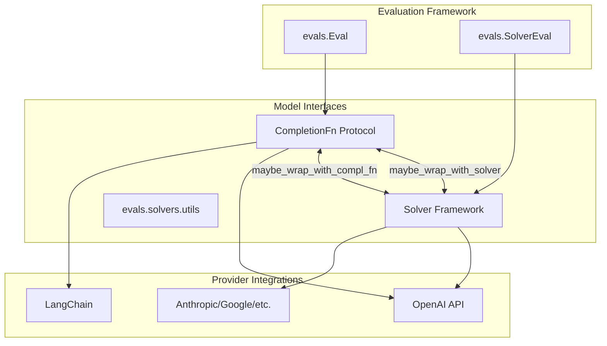
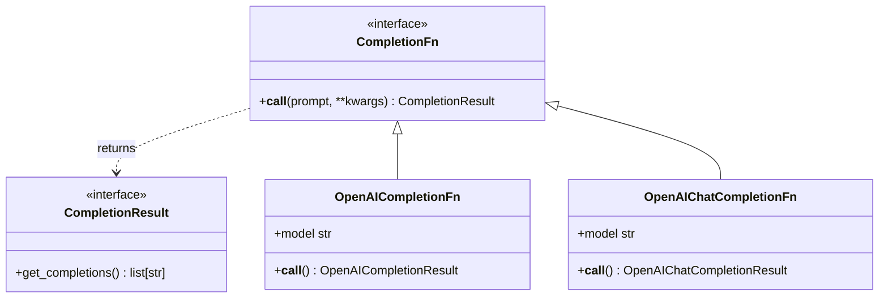
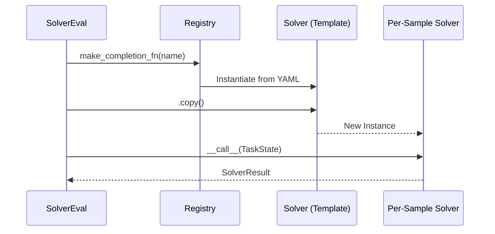

<!-- source: DeepWiki mcp.deepwiki.com · repo openai/evals · page 4 Model Interfaces · fetched 2026-10-26 -->

# Model Interfaces

Relevant source files

The following files were used as context for generating this wiki page:

- [.gitignore](.gitignore)
- [evals/cli/oaieval.py](evals/cli/oaieval.py)
- [evals/completion_fns/cot.py](evals/completion_fns/cot.py)
- [evals/completion_fns/langchain_llm.py](evals/completion_fns/langchain_llm.py)
- [evals/completion_fns/langchain_math.py](evals/completion_fns/langchain_math.py)
- [evals/completion_fns/openai.py](evals/completion_fns/openai.py)
- [evals/completion_fns/retrieval.py](evals/completion_fns/retrieval.py)
- [evals/elsuite/basic/match_with_solvers.py](evals/elsuite/basic/match_with_solvers.py)
- [evals/elsuite/make_me_say/autoeval.py](evals/elsuite/make_me_say/autoeval.py)
- [evals/elsuite/make_me_say/utils.py](evals/elsuite/make_me_say/utils.py)
- [evals/eval.py](evals/eval.py)
- [evals/registry.py](evals/registry.py)
- [evals/registry/completion_fns/cot.yaml](evals/registry/completion_fns/cot.yaml)
- [evals/registry/completion_fns/langchain_llms.yaml](evals/registry/completion_fns/langchain_llms.yaml)
- [evals/registry/data/word_association/corpus_tools/validators.py](evals/registry/data/word_association/corpus_tools/validators.py)
- [evals/registry_test.py](evals/registry_test.py)
- [evals/solvers/human_cli_solver.py](evals/solvers/human_cli_solver.py)
- [evals/solvers/prompts/cot.py](evals/solvers/prompts/cot.py)
- [evals/solvers/prompts/hhh.py](evals/solvers/prompts/hhh.py)
- [evals/solvers/solver.py](evals/solvers/solver.py)
- [evals/solvers/utils.py](evals/solvers/utils.py)
- [evals/utils/api_utils.py](evals/utils/api_utils.py)
- [examples/retrieval-completionfn.ipynb](examples/retrieval-completionfn.ipynb)

This page explains the abstractions for interacting with language models within the OpenAI Evals framework. Model Interfaces serve as the translation layer between evaluation logic and the underlying model APIs. The framework provides two primary interface systems: the legacy **CompletionFn** protocol and the modern **Solver** framework.

## Overview

Model Interfaces decouple evaluation code from model-specific implementation details. This allows the same evaluation to run against different models, reasoning strategies (like Chain-of-Thought), or even multi-turn agentic workflows without changing the core evaluation logic.

Sources:
- [evals/eval.py:46-88]()
- [evals/eval.py:168-195]()
- [evals/solvers/utils.py:10-55]()

## CompletionFn Protocol

The `CompletionFn` protocol is the fundamental interface for model interactions. It follows a functional pattern where a model is treated as a function that maps a prompt to a completion result.

### Core Interface
A `CompletionFn` is any class that implements the `__call__` method. It typically receives a prompt (as a string or list of messages) and returns a `CompletionResult`.

### Key Implementations
- **OpenAIChatCompletionFn**: Used for chat-based models like `gpt-4` or `gpt-3.5-turbo`. It handles message formatting and retries [evals/completion_fns/openai.py:134-181]().
- **OpenAICompletionFn**: Used for legacy completion models like `text-davinci-003` [evals/completion_fns/openai.py:83-132]().
- **LangChainLLMCompletionFn**: Wraps LangChain models to be used within the Evals framework [evals/completion_fns/langchain_llm.py:28-46]().

For details, see [CompletionFn Protocol](#4.1).

Sources:
- [evals/api.py:21-21]() (Protocol definition)
- [evals/completion_fns/openai.py:83-181]()
- [evals/completion_fns/langchain_llm.py:28-46]()

## Solver Framework

The `Solver` framework is a more sophisticated, state-aware abstraction designed for complex reasoning tasks. Unlike `CompletionFn`, which is stateless per call, `Solvers` work with a `TaskState` and can be composed into pipelines.

### Solver vs. CompletionFn
| Feature | CompletionFn | Solver |
| :--- | :--- | :--- |
| **Input** | Raw prompt (str or list) | `TaskState` (messages + metadata) |
| **Output** | `CompletionResult` | `SolverResult` (output + metadata) |
| **State** | Stateless | Stateful (per-sample isolation) |
| **Composition** | Limited | High (Nested Solvers) |

### Solver Lifecycle
In a `SolverEval`, a new instance of a solver is effectively created for every sample by calling `.copy()` on the base solver [evals/eval.py:246-249](). This ensures that state (like conversation history or scratchpads) does not leak between different evaluation samples.

For details, see [Solver Framework](#4.2).

Sources:
- [evals/solvers/solver.py:41-97]()
- [evals/eval.py:168-255]()

## Provider Integrations

The framework supports multiple model providers through specific `CompletionFn` and `Solver` implementations. The `Registry` handles the instantiation of these providers based on the `completion_fn` argument passed to the CLI.

### Integration Patterns
- **OpenAI Native**: Direct support for chat and completion APIs [evals/completion_fns/openai.py:1-182]().
- **LangChain Wrapper**: Allows using any LangChain-supported model via `LangChainLLMCompletionFn` or `LangChainChatModelCompletionFn` [evals/completion_fns/langchain_llm.py:68-89]().
- **Custom Providers**: New providers (like Anthropic or Google) are typically implemented as Solvers or CompletionFns and registered in the YAML system [evals/registry.py:120-151]().

For details, see [Provider Integrations](#4.3).

Sources:
- [evals/registry.py:120-151]()
- [evals/completion_fns/langchain_llm.py:1-90]()
- [evals/registry/completion_fns/langchain_llms.yaml:1-28]()

## Interface Adaptation

To maintain compatibility between the two systems, the framework provides utilities in `evals.solvers.utils` to wrap one interface as the other.

- **`maybe_wrap_with_solver(fn)`**: If `fn` is a `CompletionFn`, it wraps it in a `CompletionFnSolver` [evals/solvers/utils.py:10-25]().
- **`maybe_wrap_with_compl_fn(fn)`**: If `fn` is a `Solver`, it wraps it in a `SolverCompletionFn` [evals/solvers/utils.py:28-43]().

This allows a user to pass a `Solver` to an evaluation that expects a `CompletionFn`, or vice versa, without manual conversion.

Sources:
- [evals/solvers/utils.py:10-55]()
- [evals/eval.py:69-70]()

---

