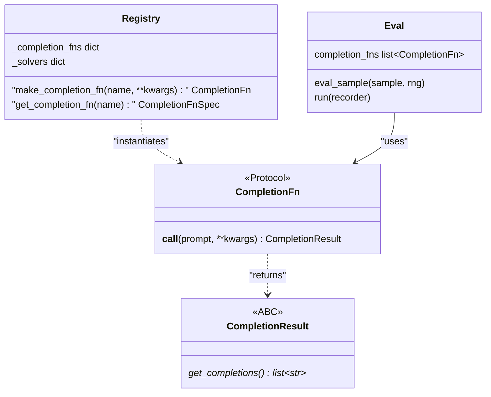
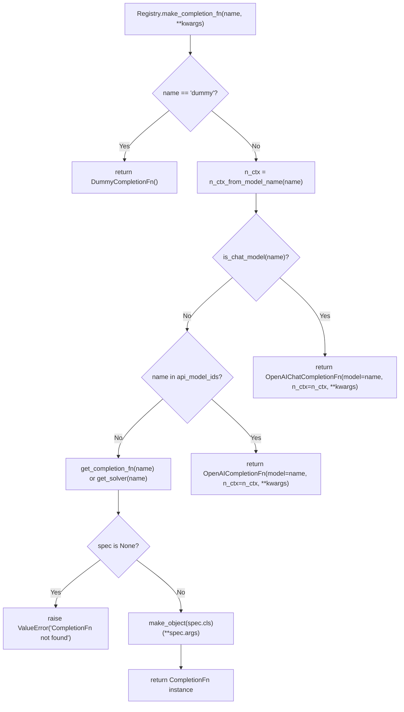
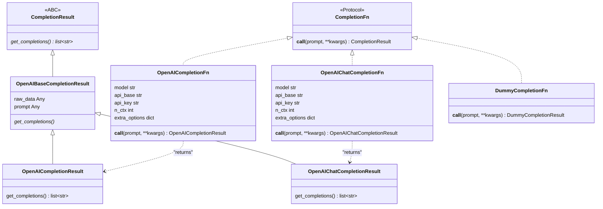
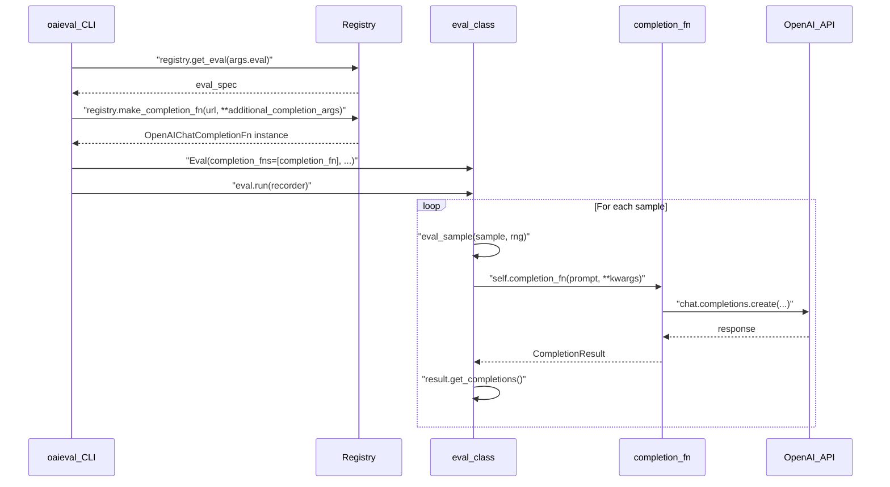

<!-- source: DeepWiki mcp.deepwiki.com · repo openai/evals · page 4.1 CompletionFn Protocol · fetched 2026-10-26 -->

# CompletionFn Protocol

<details>
<summary>Relevant source files</summary>

The following files were used as context for generating this wiki page:

- [.gitattributes](.gitattributes)
- [.github/config.yml](.github/config.yml)
- [MANIFEST.in](MANIFEST.in)
- [Makefile](Makefile)
- [README.md](README.md)
- [docs/build-eval.md](docs/build-eval.md)
- [docs/completion-fn-protocol.md](docs/completion-fn-protocol.md)
- [docs/completion-fns.md](docs/completion-fns.md)
- [docs/custom-eval.md](docs/custom-eval.md)
- [docs/run-evals.md](docs/run-evals.md)
- [evals/__init__.py](evals/__init__.py)
- [evals/api.py](evals/api.py)
- [evals/base.py](evals/base.py)
- [evals/cli/oaieval.py](evals/cli/oaieval.py)
- [evals/completion_fns/langchain_math.py](evals/completion_fns/langchain_math.py)
- [evals/completion_fns/openai.py](evals/completion_fns/openai.py)
- [evals/completion_fns/retrieval.py](evals/completion_fns/retrieval.py)
- [evals/elsuite/make_me_say/autoeval.py](evals/elsuite/make_me_say/autoeval.py)
- [evals/elsuite/make_me_say/utils.py](evals/elsuite/make_me_say/utils.py)
- [evals/registry.py](evals/registry.py)
- [evals/registry/completion_fns/cot.yaml](evals/registry/completion_fns/cot.yaml)
- [evals/registry/data/pattern_identification/samples.v0.jsonl](evals/registry/data/pattern_identification/samples.v0.jsonl)
- [evals/registry/data/word_association/corpus_tools/validators.py](evals/registry/data/word_association/corpus_tools/validators.py)
- [evals/registry/evals/pattern_identification.yaml](evals/registry/evals/pattern_identification.yaml)
- [evals/registry_test.py](evals/registry_test.py)
- [evals/utils/api_utils.py](evals/utils/api_utils.py)
- [examples/retrieval-completionfn.ipynb](examples/retrieval-completionfn.ipynb)

</details>


The CompletionFn Protocol is the core abstraction for interacting with language models in the OpenAI Evals framework. It provides a standardized callable interface that allows evaluations to work with various language model implementations without modification. The protocol is defined as a Python Protocol class in [evals/api.py:23-40]() and requires implementers to provide a `__call__` method that processes prompts and returns completions.

## Protocol Definition

The `CompletionFn` protocol and `CompletionResult` abstract class define the contract that all completion function implementations must follow.

Title: CompletionFn Protocol Core Components


Sources:
- [evals/api.py:16-52]()
- [evals/registry.py:103-151]()
- [evals/base.py:18-60]()

### CompletionFn Interface

The `CompletionFn` Protocol is defined in [evals/api.py:23-40]() and specifies a single required method:

| Method | Parameters | Return Type | Description |
|--------|-----------|-------------|-------------|
| `__call__` | `prompt: Union[str, OpenAICreateChatPrompt]`, `**kwargs` | `CompletionResult` | Process a prompt and generate completions |

The `prompt` parameter accepts multiple formats including raw strings or chat-formatted lists of dictionaries [evals/api.py:26-33]().

Sources:
- [evals/api.py:23-40]()

### CompletionResult Interface

The `CompletionResult` abstract class is defined in [evals/api.py:16-19]() and requires implementers to provide:

| Method | Parameters | Return Type | Description |
|--------|-----------|-------------|-------------|
| `get_completions` | None | `list[str]` | Extract completion strings from the result |

Sources:
- [evals/api.py:16-19]()

## Registry and Instantiation

The `Registry.make_completion_fn` method in [evals/registry.py:120-151]() is the standard way to create CompletionFn instances. It implements a resolution strategy that checks for built-in models before looking into the registry.

Title: CompletionFn Resolution and Instantiation Flow


### Resolution Strategy

The method resolves names in the following order:

1. **Special case**: `"dummy"` → returns `DummyCompletionFn()` [evals/registry.py:130-131]()
2. **Chat models**: Names matching chat model patterns (via `is_chat_model()`) → returns `OpenAIChatCompletionFn` [evals/registry.py:135-136]()
3. **Text completion models**: Names in `api_model_ids` → returns `OpenAICompletionFn` [evals/registry.py:137-138]()
4. **Registry entries**: Names defined in YAML files → loads from `_completion_fns` or `_solvers` registries [evals/registry.py:141-151]()

### Context Length Detection

The `n_ctx_from_model_name()` function [evals/registry.py:37-80]() detects maximum context length for known models, supporting recent models like `gpt-4-0125-preview` (128k) [evals/registry.py:67]().

Sources:
- [evals/registry.py:37-96]()
- [evals/registry.py:120-151]()
- [evals/api.py:43-52]()

## Built-in Implementations

Title: CompletionFn Implementation Class Hierarchy


### OpenAI API Implementations

#### OpenAICompletionFn

The `OpenAICompletionFn` class [evals/completion_fns/openai.py:83-131]() implements the protocol for OpenAI's text completion models:

- **Processing**: Converts prompts using `CompletionPrompt` [evals/completion_fns/openai.py:112-116]().
- **Execution**: Calls `openai_completion_create_retrying()` [evals/completion_fns/openai.py:118-123]().
- **Recording**: Logs the sampling event via `record_sampling()` [evals/completion_fns/openai.py:125-130]().

#### OpenAIChatCompletionFn

The `OpenAIChatCompletionFn` class [evals/completion_fns/openai.py:134-181]() implements the protocol for OpenAI's chat models:

- **Processing**: Converts prompts using `ChatCompletionPrompt` [evals/completion_fns/openai.py:162-166]().
- **Execution**: Calls `openai_chat_completion_create_retrying()` [evals/completion_fns/openai.py:168-173]().
- **Recording**: Logs the sampling event including usage data [evals/completion_fns/openai.py:175-180]().

**Retry Logic**:
Both implementations use `create_retrying()` [evals/utils/api_utils.py:15-22]() which handles specific exceptions like `RateLimitError` and `InternalServerError` [evals/completion_fns/openai.py:19-24]().

Sources:
- [evals/completion_fns/openai.py:1-181]()
- [evals/utils/api_utils.py:1-23]()

## Usage in Evaluations

Title: CompletionFn Execution Flow in oaieval CLI


The `oaieval` CLI orchestrates the lifecycle by resolving the `CompletionFn` from the registry and passing it to the `Eval` class [evals/cli/oaieval.py:164-171]().

Sources:
- [evals/cli/oaieval.py:118-239]()
- [evals/api.py:55-106]()

## Implementing Custom CompletionFn

To create a custom CompletionFn:

1.  **Implement the Protocol**: Define a class with a `__call__` method returning a `CompletionResult` [evals/api.py:23-40]().
2.  **Handle Prompts**: Use `evals.prompt.base` classes to handle both string and chat inputs.
3.  **Record Events**: Call `record_sampling` to ensure results are logged [evals/completion_fns/openai.py:16]().
4.  **Register**: Add your class to a YAML file in `evals/registry/completion_fns/` [evals/registry.py:2-5]().

### Implementation Template

```python
from evals.api import CompletionFn, CompletionResult

class MyResult(CompletionResult):
    def get_completions(self) -> list[str]:
        return ["My custom response"]

class MyCompletionFn(CompletionFn):
    def __init__(self, **kwargs):
        self.args = kwargs

    def __call__(self, prompt, **kwargs) -> CompletionResult:
        # Custom logic here
        return MyResult()
```

Sources:
- [evals/api.py:16-52]()
- [docs/custom-eval.md:26-58]()

## Conclusion

The CompletionFn protocol provides a flexible, standardized way to interact with language models. By abstracting the details of model APIs behind a common interface, it allows evaluations to be run against a wide variety of models while maintaining consistent logging and metrics through the registry and recording subsystems.

---

