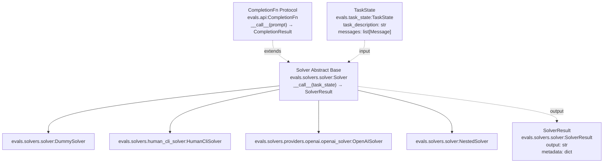
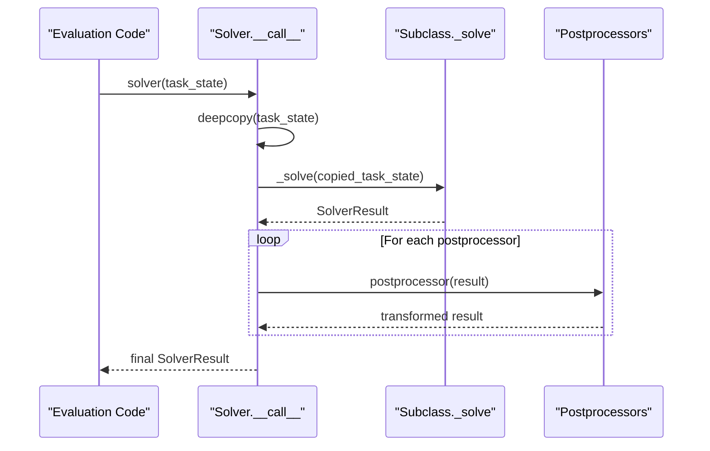
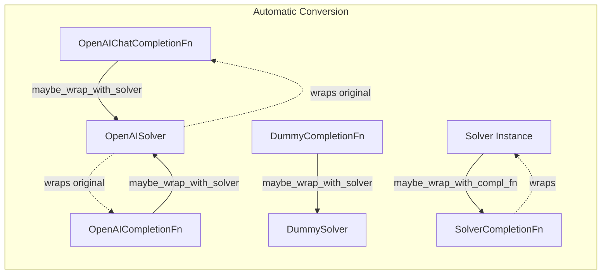
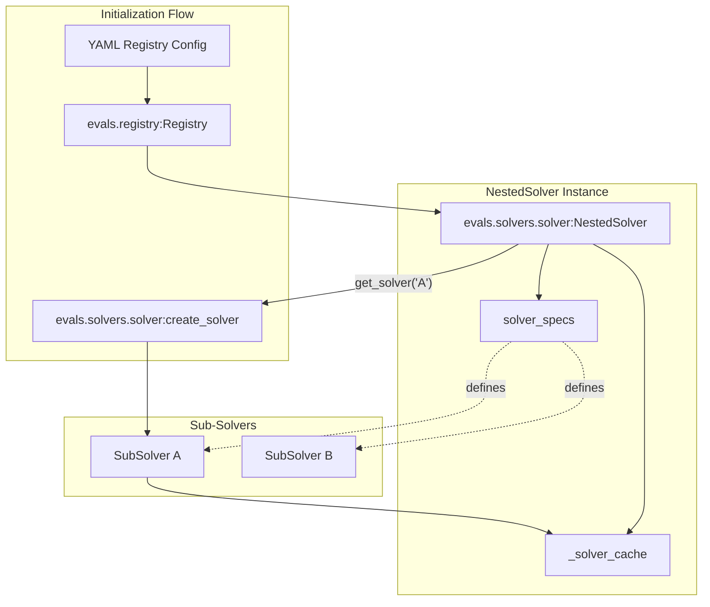

<!-- source: DeepWiki mcp.deepwiki.com · repo openai/evals · page 4.2 Solver Framework · fetched 2026-10-26 -->

# Solver Framework

<details>
<summary>Relevant source files</summary>

The following files were used as context for generating this wiki page:

- [evals/elsuite/basic/match_with_solvers.py](evals/elsuite/basic/match_with_solvers.py)
- [evals/eval.py](evals/eval.py)
- [evals/registry/solvers/bluff.yaml](evals/registry/solvers/bluff.yaml)
- [evals/registry/solvers/defaults.yaml](evals/registry/solvers/defaults.yaml)
- [evals/registry/solvers/make-me-pay.yaml](evals/registry/solvers/make-me-pay.yaml)
- [evals/registry/solvers/self_prompting.yaml](evals/registry/solvers/self_prompting.yaml)
- [evals/registry/solvers/theory_of_mind.yaml](evals/registry/solvers/theory_of_mind.yaml)
- [evals/solvers/README.md](evals/solvers/README.md)
- [evals/solvers/human_cli_solver.py](evals/solvers/human_cli_solver.py)
- [evals/solvers/nested/cot_solver.py](evals/solvers/nested/cot_solver.py)
- [evals/solvers/nested/self_consistency_solver.py](evals/solvers/nested/self_consistency_solver.py)
- [evals/solvers/postprocessors/README.md](evals/solvers/postprocessors/README.md)
- [evals/solvers/prompts/cot.py](evals/solvers/prompts/cot.py)
- [evals/solvers/prompts/hhh.py](evals/solvers/prompts/hhh.py)
- [evals/solvers/solver.py](evals/solvers/solver.py)
- [evals/solvers/utils.py](evals/solvers/utils.py)

</details>


## Purpose and Scope

The Solver Framework provides an abstraction for stateful, multi-turn interactions with language models and other decision-making systems. Solvers extend the [CompletionFn Protocol]() with state management, composition capabilities, and output postprocessing. This page covers the `Solver` base class, `TaskState` and `SolverResult` data structures, solver composition patterns, and the `SolverEval` base class for evaluations that use solvers.

For information about the stateless CompletionFn protocol, see [CompletionFn Protocol](). For specific provider implementations (OpenAI, Anthropic, Google Gemini), see [Provider Integrations](). For how to build evaluations using solvers, see [Solver-Based Evaluations]().

## Overview

Solvers represent an evolution of the CompletionFn abstraction that supports:

- **Statefulness**: Solvers can maintain internal state across multiple calls.
- **Structured Input**: Accept `TaskState` objects containing task descriptions and message history.
- **Structured Output**: Return `SolverResult` objects with output and metadata.
- **Composition**: Solvers can nest other solvers to create complex behaviors.
- **Postprocessing**: Apply transformation pipelines to solver outputs.
- **Per-Sample Isolation**: Each evaluation sample gets its own solver copy via `copy()`.

Importantly, **`Solver` inherits from `CompletionFn`**, enabling backward compatibility and seamless integration with existing evaluation code.



**Diagram: Solver Framework Class Hierarchy**

Sources: [evals/solvers/solver.py:41-41](), [evals/solvers/solver.py:18-18](), [evals/api.py](), [evals/task_state.py]()

## Core Components

### Solver Abstract Base Class

The `Solver` class is defined in [evals/solvers/solver.py:41-126]() and provides the foundation for all solver implementations.

#### Key Methods

| Method | Signature | Purpose |
|--------|-----------|---------|
| `_solve` | `_solve(task_state: TaskState, **kwargs) → SolverResult` | Abstract method that subclasses must implement [evals/solvers/solver.py:59-74](). |
| `__call__` | `__call__(task_state: TaskState, **kwargs) → SolverResult` | Public interface that deepcopies task_state and applies postprocessors [evals/solvers/solver.py:76-97](). |
| `copy` | `copy() → Solver` | Creates an independent copy of the solver for per-sample isolation [evals/solvers/solver.py:122-125](). |
| `name` | `@property name() → str` | Returns human-readable name for logging [evals/solvers/solver.py:99-108](). |
| `model_version` | `@property model_version() → Union[str, dict]` | Returns exact model version(s) used [evals/solvers/solver.py:110-120](). |

#### The _solve / __call__ Pattern

Solvers implement the template method pattern:

- **`_solve`**: Subclasses override this to implement solver logic.
- **`__call__`**: Public entry point that wraps `_solve` with:
  - Deep copying of `task_state` to prevent mutation [evals/solvers/solver.py:81-82]().
  - Sequential application of postprocessors [evals/solvers/solver.py:84-96]().



**Diagram: Solver Execution Flow**

Sources: [evals/solvers/solver.py:76-97]()

### SolverResult

`SolverResult` is a container for solver outputs defined in [evals/solvers/solver.py:18-38]().

**Properties:**
- `output`: String containing the solver's response [evals/solvers/solver.py:23-25]().
- `metadata`: Dictionary of arbitrary metadata (completion tokens, reasoning steps, etc.) [evals/solvers/solver.py:27-29]().

Sources: [evals/solvers/solver.py:18-38]()

### TaskState

`TaskState` is the structured input passed to solvers, defined in [evals/task_state.py]().

**Key Fields:**
- `task_description`: String describing the task or system prompt.
- `messages`: List of `Message` objects representing conversation history.

**Example Usage in MatchWithSolvers:**
```python
# From evals/elsuite/basic/match_with_solvers.py
task_state = TaskState(
    task_description=self.task_description,
    messages=messages,
)
```

Sources: [evals/elsuite/basic/match_with_solvers.py:52-55](), [evals/solvers/human_cli_solver.py:29-31]()

## Relationship with CompletionFn

Solvers inherit from `CompletionFn` [evals/solvers/solver.py:41]() to maintain backward compatibility. The framework provides bidirectional conversion utilities in [evals/solvers/utils.py]().

### Conversion Utilities

**From CompletionFn to Solver:** [evals/solvers/utils.py:28-55]()

The `maybe_wrap_with_solver` function wraps completion functions in appropriate solver implementations:

| CompletionFn Type | Wrapped As |
|-------------------|------------|
| `Solver` | Returned unchanged [evals/solvers/utils.py:34-36]() |
| `SolverCompletionFn` | Unwrapped to underlying solver [evals/solvers/utils.py:37-39]() |
| `OpenAIChatCompletionFn` / `OpenAICompletionFn` | `OpenAISolver` [evals/solvers/utils.py:42-50]() |
| `DummyCompletionFn` | `DummySolver` [evals/solvers/utils.py:51-52]() |

**From Solver to CompletionFn:** [evals/solvers/utils.py:10-25]()

The `maybe_wrap_with_compl_fn` function wraps solvers in `SolverCompletionFn` [evals/completion_fns/solver_completion_fn.py]() to present the CompletionFn interface.



**Diagram: Bidirectional Conversion Between CompletionFn and Solver**

Sources: [evals/solvers/utils.py:1-56]()

## Concrete Solver Implementations

### DummySolver

A minimal solver implementation for testing, defined in [evals/solvers/solver.py:128-134]():
```python
class DummySolver(Solver):
    def _solve(self, task_state: TaskState, **kwargs) -> SolverResult:
        return SolverResult("This is a dummy response.")
```

### HumanCliSolver

Enables human-in-the-loop evaluations by prompting a human via CLI, defined in [evals/solvers/human_cli_solver.py:8-48](). It prints the `task_description` and `messages` history before reading `input()` [evals/solvers/human_cli_solver.py:30-36]().

### Chain-of-Thought (CoT) Solvers

The framework provides advanced reasoning solvers like `CoTSolver` [evals/solvers/nested/cot_solver.py:9-86](). It uses a two-step process:
1. **Reasoning Step**: Uses a `cot_solver` to generate thoughts based on a `cot_template` [evals/solvers/nested/cot_solver.py:59-62]().
2. **Extraction Step**: Uses an `extract_solver` to pull the final answer from the reasoning using an `extract_template` [evals/solvers/nested/cot_solver.py:64-70]().

### Self-Consistency Solver

`SelfConsistencySolver` [evals/solvers/nested/self_consistency_solver.py:16-151]() implements self-consistency prompting:
- Generates multiple chain-of-thought completions [evals/solvers/nested/self_consistency_solver.py:77-82]().
- Extracts answers from each and selects the consensus answer via counting or a "judge" solver [evals/solvers/nested/self_consistency_solver.py:91-126]().

Sources: [evals/solvers/solver.py:128-134](), [evals/solvers/human_cli_solver.py:8-48](), [evals/solvers/nested/cot_solver.py:9-86](), [evals/solvers/nested/self_consistency_solver.py:16-151]()

## Nested Solvers and Composition

### NestedSolver Base Class

`NestedSolver` [evals/solvers/solver.py:137-209]() enables hierarchical composition by allowing solvers to contain other solvers as sub-components.

**Key Features:**
1. **Declarative Sub-Solver Specification**: Accepts `SolverSpec` dictionaries (containing `class` and `args`) [evals/solvers/solver.py:142-158]().
2. **Lazy Initialization**: Sub-solvers are cached and retrieved via `get_solver(name)` [evals/solvers/solver.py:160-186]().
3. **Proper Copying**: Overrides `copy()` to recursively copy sub-solvers, ensuring state isolation [evals/solvers/solver.py:191-197]().



Sources: [evals/solvers/solver.py:137-209]()

## Postprocessors

Postprocessors are output-tidying steps applied sequentially to `SolverResult`. They are useful for cleaning generative model outputs (e.g., removing quotes or periods) [evals/solvers/postprocessors/README.md:1-6]().

**Configuration:** Specified as a list of `path:Class` strings in the solver's YAML arguments [evals/solvers/postprocessors/README.md:7-11]().

**Execution:** Applied in `Solver.__call__` after `_solve` returns [evals/solvers/solver.py:84-96](). Each step is recorded as a `postprocessor` event [evals/solvers/solver.py:89-96]().

Sources: [evals/solvers/solver.py:44-57](), [evals/solvers/solver.py:84-96](), [evals/solvers/postprocessors/README.md:1-32]()

## Solver-Based Evaluations

### SolverEval Base Class

`SolverEval` [evals/eval.py:168-255]() is the base class for evaluations that interact with `Solver` objects. Unlike the base `Eval` class, it creates a fresh copy of the solver for every sample to ensure isolation [evals/eval.py:173-175]().

**Key implementation in `eval_all_samples`**:
Inside the worker thread, it creates a `per_sample_solver` using `copy()` [evals/eval.py:225](). This allows solvers to be stateful (e.g., maintain a memory) without interfering with other samples [evals/eval.py:174-175]().

### Example: MatchWithSolvers

`MatchWithSolvers` [evals/elsuite/basic/match_with_solvers.py:15-81]() demonstrates this pattern:
1. It takes a `task_description` (often from a file) [evals/elsuite/basic/match_with_solvers.py:31-35]().
2. In `eval_sample`, it prepares a `TaskState` [evals/elsuite/basic/match_with_solvers.py:52-55]().
3. It executes the solver: `solver_result = solver(task_state)` [evals/elsuite/basic/match_with_solvers.py:57]().
4. It records the result using `record_and_check_match` [evals/elsuite/basic/match_with_solvers.py:62-66]().

Sources: [evals/eval.py:168-255](), [evals/elsuite/basic/match_with_solvers.py:15-81]()

## Registry Integration

Solvers are instantiated using `create_solver(solver_spec)` [evals/solvers/solver.py:212-216](). The registry (e.g., `evals/registry/solvers/defaults.yaml`) defines these specs.

**Example YAML Structure:**
```yaml
generation/cot/gpt-4:
  class: evals.solvers.nested.cot_solver:CoTSolver
  args:
    cot_solver:
      class: evals.solvers.providers.openai.openai_solver:OpenAISolver
      args:
        completion_fn_options:
          model: gpt-4
    extract_solver:
      class: evals.solvers.providers.openai.openai_solver:OpenAISolver
      args:
        completion_fn_options:
          model: gpt-4
```

Sources: [evals/solvers/solver.py:14-14](), [evals/registry/solvers/defaults.yaml:94-112]()

---

