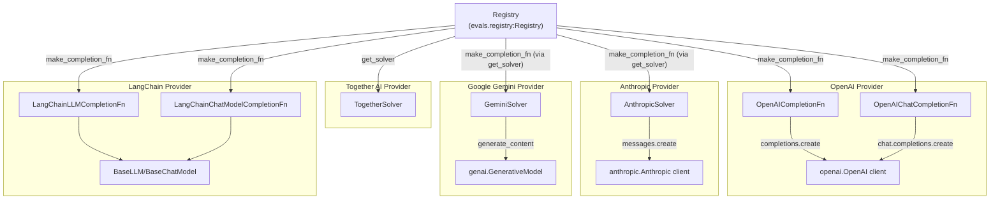
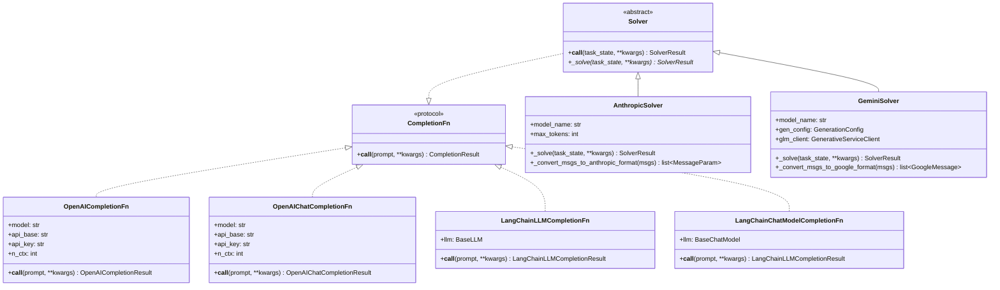

<!-- source: DeepWiki mcp.deepwiki.com · repo openai/evals · page 4.3 Provider Integrations · fetched 2026-10-26 -->

# Provider Integrations

<details>
<summary>Relevant source files</summary>

The following files were used as context for generating this wiki page:

- [.github/workflows/run_tests.yaml](.github/workflows/run_tests.yaml)
- [.github/workflows/test_eval.yaml](.github/workflows/test_eval.yaml)
- [.gitignore](.gitignore)
- [evals/completion_fns/cot.py](evals/completion_fns/cot.py)
- [evals/completion_fns/langchain_llm.py](evals/completion_fns/langchain_llm.py)
- [evals/registry/completion_fns/langchain_llms.yaml](evals/registry/completion_fns/langchain_llms.yaml)
- [evals/registry/solvers/anthropic.yaml](evals/registry/solvers/anthropic.yaml)
- [evals/registry/solvers/gemini.yaml](evals/registry/solvers/gemini.yaml)
- [evals/registry/solvers/together.yaml](evals/registry/solvers/together.yaml)
- [evals/solvers/providers/anthropic/anthropic_solver.py](evals/solvers/providers/anthropic/anthropic_solver.py)
- [evals/solvers/providers/anthropic/anthropic_solver_test.py](evals/solvers/providers/anthropic/anthropic_solver_test.py)
- [evals/solvers/providers/google/gemini_solver.py](evals/solvers/providers/google/gemini_solver.py)
- [evals/solvers/providers/google/gemini_solver_test.py](evals/solvers/providers/google/gemini_solver_test.py)
- [evals/solvers/providers/google/requirements.txt](evals/solvers/providers/google/requirements.txt)
- [pyproject.toml](pyproject.toml)

</details>


This page documents how the OpenAI Evals framework integrates with various large language model (LLM) providers: OpenAI, Anthropic, Google Gemini, Together AI, and LangChain. Each provider integration implements either the `CompletionFn` protocol or the `Solver` framework (or both) to enable consistent model evaluation. For details about the underlying abstractions, see pages [4.1 CompletionFn Protocol](4.1) and [4.2 Solver Framework](4.2).

## Overview

The framework supports five major provider categories:

| Provider | API Type | Abstraction Used | Key Classes |
|----------|----------|------------------|-------------|
| OpenAI | Completion & Chat | `CompletionFn` | `OpenAICompletionFn`, `OpenAIChatCompletionFn` |
| Anthropic | Messages | `Solver` | `AnthropicSolver` |
| Google Gemini | Generative | `Solver` | `GeminiSolver` |
| Together AI | Chat | `Solver` | `TogetherSolver` |
| LangChain | Various | `CompletionFn` | `LangChainLLMCompletionFn`, `LangChainChatModelCompletionFn` |

Sources: [evals/completion_fns/openai.py:83-181](), [evals/solvers/providers/anthropic/anthropic_solver.py:25-143](), [evals/solvers/providers/google/gemini_solver.py:70-212](), [evals/completion_fns/langchain_llm.py:28-89](), [evals/registry/solvers/together.yaml:1-31]()

## Integration Architecture

### Provider Integration Overview



Sources: [evals/registry.py:120-151](), [evals/completion_fns/openai.py:83-181](), [evals/solvers/providers/anthropic/anthropic_solver.py:25-74](), [evals/solvers/providers/google/gemini_solver.py:70-155](), [evals/completion_fns/langchain_llm.py:28-89](), [evals/registry/solvers/together.yaml:1-11]()

### Class Hierarchy



Sources: [evals/completion_fns/openai.py:83-181](), [evals/solvers/providers/anthropic/anthropic_solver.py:25-74](), [evals/solvers/providers/google/gemini_solver.py:70-155](), [evals/completion_fns/langchain_llm.py:28-89]()

## OpenAI Integration

OpenAI models are the primary integration, supporting both legacy Completion API models (`text-davinci-003`, etc.) and Chat Completion API models (`gpt-3.5-turbo`, `gpt-4`, etc.).

### OpenAICompletionFn

The `OpenAICompletionFn` class implements the `CompletionFn` protocol for legacy OpenAI completion models.

**Key Features:**
- Automatic retry logic with exponential backoff for rate limits and timeouts [evals/completion_fns/openai.py:27-38]()
- Custom API base URL and API key support [evals/completion_fns/openai.py:90-94]()
- Context length tracking via `n_ctx` parameter [evals/completion_fns/openai.py:95]()
- Usage metrics recording via `record_sampling` [evals/completion_fns/openai.py:125-130]()

Sources: [evals/completion_fns/openai.py:83-132]()

### OpenAIChatCompletionFn

The `OpenAIChatCompletionFn` class implements the `CompletionFn` protocol for OpenAI chat models.

**Key Features:**
- Handles both string prompts and chat message arrays [evals/completion_fns/openai.py:166-169]()
- Automatic prompt format conversion via `ChatCompletionPrompt` [evals/completion_fns/openai.py:167]()
- Same retry and recording infrastructure as `OpenAICompletionFn` [evals/completion_fns/openai.py:170-181]()

Sources: [evals/completion_fns/openai.py:134-181]()

## Anthropic Integration

Anthropic's Claude models are integrated through the `Solver` framework via the `AnthropicSolver` class.

### AnthropicSolver

The `AnthropicSolver` implements the `Solver` abstract class for Anthropic's Messages API.

**Key Features:**
- Converts OpenAI-style messages to Anthropic format [evals/solvers/providers/anthropic/anthropic_solver.py:89-116]()
- Merges consecutive messages with the same role [evals/solvers/providers/anthropic/anthropic_solver.py:110-114]()
- Handles system prompts separately via `system` parameter in `messages.create` [evals/solvers/providers/anthropic/anthropic_solver.py:57]()
- Automatic retry with exponential backoff for `RateLimitError` and `APITimeoutError` [evals/solvers/providers/anthropic/anthropic_solver.py:17-22]()

Sources: [evals/solvers/providers/anthropic/anthropic_solver.py:25-74]()

### Message Format Conversion

Anthropic requires specific message formatting:
- Only `user` and `assistant` roles (no `system` in messages) [evals/solvers/providers/anthropic/anthropic_solver.py:12-16]()
- Alternating `user` and `assistant` messages [evals/solvers/providers/anthropic/anthropic_solver.py:93]()
- System prompt passed as separate `system` parameter [evals/solvers/providers/anthropic/anthropic_solver.py:95-96]()

Sources: [evals/solvers/providers/anthropic/anthropic_solver.py:88-116]()

## Google Gemini Integration

Google's Gemini models are integrated through the Solver framework with the `GeminiSolver` class.

### Gemini Solver Implementation

Key implementation details:
- Authenticates using the `GEMINI_API_KEY` environment variable [evals/solvers/providers/google/gemini_solver.py:16-17]()
- Handles safety settings and retries for the Gemini API [evals/solvers/providers/google/gemini_solver.py:19-41]()
- Converts between Evals message format and Google's format via `_convert_msgs_to_google_format` [evals/solvers/providers/google/gemini_solver.py:157-188]()
- Records sampling for later analysis [evals/solvers/providers/google/gemini_solver.py:150-154]()

Sources: [evals/solvers/providers/google/gemini_solver.py:70-155]()

## Together AI Integration

Together AI models (like Llama-2 and Mixtral) are integrated via the `TogetherSolver` class and registered in `together.yaml`.

### Registry Configuration

Together AI models are configured as both direct and CoT (Chain-of-Thought) solvers:

```yaml
generation/direct/llama-2-70b-chat:
  class: evals.solvers.providers.together.together_solver:TogetherSolver
  args:
    completion_fn_options:
      model: meta-llama/Llama-2-70b-chat-hf
    postprocessors:
      - evals.solvers.postprocessors.postprocessors:Strip
```

Sources: [evals/registry/solvers/together.yaml:13-21]()

## LangChain Integration

LangChain integrations allow the Evals framework to use any model supported by LangChain.

### LangChain LLM Integration

The `LangChainLLMCompletionFn` class wraps LangChain's `BaseLLM` implementations to conform to the `CompletionFn` interface [evals/completion_fns/langchain_llm.py:28-46]().

### LangChain Chat Model Integration

The `LangChainChatModelCompletionFn` class wraps LangChain's `BaseChatModel` implementations, supporting chat-based interactions and message conversion [evals/completion_fns/langchain_llm.py:68-89]().

Sources: [evals/completion_fns/langchain_llm.py:28-89]()

## Common Patterns

### Retry and Error Handling

All provider integrations implement automatic retry logic for transient API errors:

| Provider | Retry Exceptions | Implementation |
|----------|------------------|----------------|
| OpenAI | `RateLimitError`, `APIConnectionError`, `APITimeoutError`, `InternalServerError` | [evals/completion_fns/openai.py:19-24]() |
| Anthropic | `RateLimitError`, `APIConnectionError`, `APITimeoutError`, `InternalServerError` | [evals/solvers/providers/anthropic/anthropic_solver.py:17-22]() |
| Gemini | `RetryError`, `TooManyRequests`, `ResourceExhausted` | [evals/solvers/providers/google/gemini_solver.py:37-41]() |

Sources: [evals/utils/api_utils.py:10-22]()

### Chain of Thought Pattern

The `ChainOfThoughtCompletionFn` [evals/completion_fns/cot.py:21-66]() and `CoTSolver` [evals/registry/solvers/together.yaml:34-53]() patterns allow wrapping any provider to add reasoning steps.

Sources: [evals/completion_fns/cot.py:9-66](), [evals/registry/solvers/together.yaml:34-92]()

---

