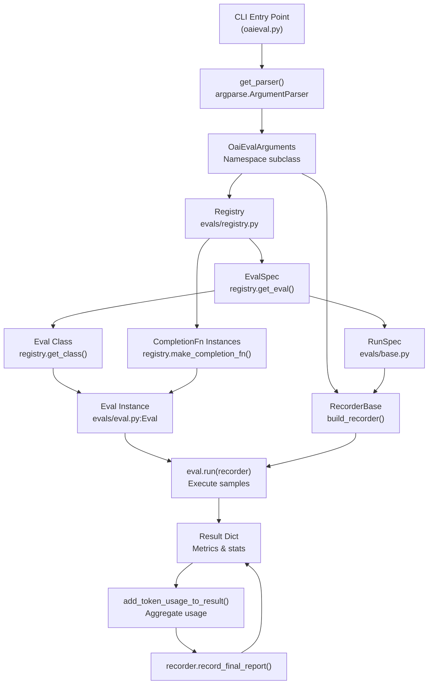
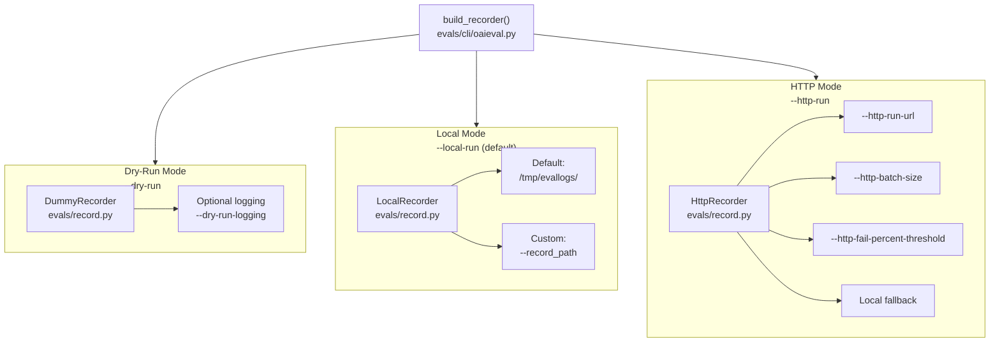

<!-- source: DeepWiki mcp.deepwiki.com · repo openai/evals · page 5 Running Evaluations · fetched 2026-10-26 -->

# Running Evaluations

<details>
<summary>Relevant source files</summary>

The following files were used as context for generating this wiki page:

- [MANIFEST.in](MANIFEST.in)
- [docs/run-evals.md](docs/run-evals.md)
- [evals/__init__.py](evals/__init__.py)
- [evals/api.py](evals/api.py)
- [evals/base.py](evals/base.py)
- [evals/cli/oaieval.py](evals/cli/oaieval.py)
- [evals/cli/oaievalset.py](evals/cli/oaievalset.py)
- [evals/completion_fns/langchain_math.py](evals/completion_fns/langchain_math.py)
- [evals/completion_fns/openai.py](evals/completion_fns/openai.py)
- [evals/completion_fns/retrieval.py](evals/completion_fns/retrieval.py)
- [evals/data.py](evals/data.py)
- [evals/data_test.py](evals/data_test.py)
- [evals/elsuite/make_me_say/autoeval.py](evals/elsuite/make_me_say/autoeval.py)
- [evals/elsuite/make_me_say/utils.py](evals/elsuite/make_me_say/utils.py)
- [evals/record.py](evals/record.py)
- [evals/record_test.py](evals/record_test.py)
- [evals/registry.py](evals/registry.py)
- [evals/registry/completion_fns/cot.yaml](evals/registry/completion_fns/cot.yaml)
- [evals/registry/data/word_association/corpus_tools/validators.py](evals/registry/data/word_association/corpus_tools/validators.py)
- [evals/registry_test.py](evals/registry_test.py)
- [evals/utils/api_utils.py](evals/utils/api_utils.py)
- [evals/utils/misc.py](evals/utils/misc.py)
- [examples/retrieval-completionfn.ipynb](examples/retrieval-completionfn.ipynb)
- [mypy.ini](mypy.ini)
- [scripts/battle_generator.py](scripts/battle_generator.py)
- [scripts/modelgraded_generator.py](scripts/modelgraded_generator.py)
- [scripts/pattern_identification_generator.py](scripts/pattern_identification_generator.py)

</details>


This document provides a comprehensive guide to executing evaluations in the OpenAI Evals framework. It covers the command-line tools, execution flow, configuration options, and different recording modes available for running evaluations.

For detailed information on creating and configuring evaluations, see [Creating and Configuring Evaluations](#7). For information on the registry system that loads evaluation configurations, see [Registry System](#3.1). For details on recording and metrics, see [Recording and Metrics](#3.3).

## Overview

The evals framework provides two command-line interfaces for running evaluations:

- **`oaieval`** - Runs a single evaluation against one or more completion functions. For details, see [Using oaieval CLI](#5.1).
- **`oaievalset`** - Runs multiple evaluations as a batch with parallelization and progress tracking. For details, see [Using oaievalset CLI](#5.2).

Both tools follow a similar execution pattern: they load evaluation specifications from the registry, instantiate the required completion functions and evaluation classes, execute samples through the evaluation logic, and record results to a specified backend.

## Basic Execution Pattern

```bash
# Run a single evaluation
oaieval gpt-3.5-turbo test-match

# Run an evaluation set
oaievalset gpt-3.5-turbo test
```

The basic arguments are:
1. **Completion function** - Either an OpenAI model name (e.g., `gpt-3.5-turbo`) or a registered completion function ID [evals/cli/oaieval.py:28-31]().
2. **Evaluation name** - The ID of the evaluation from the registry (for `oaieval`) or eval set (for `oaievalset`) [evals/cli/oaieval.py:32]().

**Sources:** [evals/cli/oaieval.py:25-32](), [docs/run-evals.md:5-11]()

## Execution Flow



**Execution Flow: oaieval Command to Results**

The execution follows these steps:

1. **Argument Parsing** - The CLI parses command-line arguments into an `OaiEvalArguments` object [evals/cli/oaieval.py:96-116]().
2. **Registry Resolution** - The `Registry` loads YAML configurations and resolves the eval specification [evals/cli/oaieval.py:127-134]().
3. **Completion Function Instantiation** - Creates completion function instances (e.g., `OpenAIChatCompletionFn`) from the provided names [evals/cli/oaieval.py:168-171]().
4. **RunSpec Creation** - Builds a `RunSpec` object containing execution metadata [evals/cli/oaieval.py:188-195]().
5. **Recorder Construction** - Instantiates the appropriate recorder (e.g., `LocalRecorder`) based on execution mode [evals/cli/oaieval.py:208]().
6. **Eval Instantiation** - Creates the eval class instance with completion functions [evals/cli/oaieval.py:217-225]().
7. **Execution** - Runs the evaluation through all samples [evals/cli/oaieval.py:226]().
8. **Token Usage Aggregation** - Collects token usage statistics from sampling events [evals/cli/oaieval.py:228-230]().
9. **Final Report** - Records the final metrics and results via `record_final_report` [evals/cli/oaieval.py:231]().

**Sources:** [evals/cli/oaieval.py:118-239](), [evals/registry.py:103-152]()

## Execution Modes



**Recording Modes and Configuration**

### Dry-Run Mode
Dry-run mode executes the evaluation without persisting results. This is useful for testing evaluation logic without consuming storage.
- Uses `DummyRecorder` [evals/cli/oaieval.py:246]().
- Optional logging with `--dry-run-logging` [evals/cli/oaieval.py:92]().

### Local Mode (Default)
Local mode stores evaluation results as JSONL files on the local filesystem.
- Uses `LocalRecorder` [evals/cli/oaieval.py:249]().
- Default path template: `/tmp/evallogs/{run_id}_{completion_fn}_{eval}.jsonl` [evals/cli/oaieval.py:197-201]().
- Enabled by `--local-run` (default: `True`) [evals/cli/oaieval.py:58-62]().

### HTTP Mode
HTTP mode sends evaluation events to a remote endpoint via HTTP POST requests.
- Uses `HttpRecorder` [evals/cli/oaieval.py:255-261]().
- Requires `--http-run-url` parameter [evals/cli/oaieval.py:71-76]().
- Batches events based on `--http-batch-size` [evals/cli/oaieval.py:78-83]().
- Falls back to local recording if the failure threshold (default 5%) is exceeded [evals/cli/oaieval.py:260]().

**Sources:** [evals/cli/oaieval.py:242-266](), [evals/record.py:54-200]()

## Key Configuration Options

### Common Flags
| Flag | Type | Default | Description |
|------|------|---------|-------------|
| `--max_samples` | int | None | Limit number of samples evaluated [evals/cli/oaieval.py:40]() |
| `--seed` | int | 20220722 | Random seed for reproducibility [evals/cli/oaieval.py:43]() |
| `--cache` | bool | True | Enable caching of API responses [evals/cli/oaieval.py:41]() |
| `--registry_path` | str[] | None | Additional registry paths to load [evals/cli/oaieval.py:49-55]() |

### Completion Function Arguments
Additional arguments can be passed to completion function instantiation using `--completion_args`:
```bash
oaieval gpt-3.5-turbo my-eval --completion_args "temperature=0.7,max_tokens=512"
```
These are parsed as comma-separated key-value pairs and passed to the `CompletionFn` constructor [evals/cli/oaieval.py:164-166]().

### Extra Evaluation Parameters
Additional parameters can be passed to evaluation instantiation using `--extra_eval_params`:
```bash
oaieval gpt-3.5-turbo my-eval --extra_eval_params "n_repeats=3,eval_type=cot_classify"
```
These are merged into the `EvalSpec` args [evals/cli/oaieval.py:136-162]().

**Sources:** [evals/cli/oaieval.py:25-93]()

## Registry and Completion Function Resolution

The `Registry.make_completion_fn()` method resolves names through several strategies [evals/registry.py:120-151]():
1. **Dummy Check**: Returns `DummyCompletionFn` if name is "dummy" [evals/registry.py:130-131]().
2. **Chat Model Check**: Uses `is_chat_model()` to instantiate `OpenAIChatCompletionFn` [evals/registry.py:135-136]().
3. **API Model Check**: Checks `api_model_ids` to instantiate `OpenAICompletionFn` [evals/registry.py:137-138]().
4. **Registry Lookup**: Searches for `CompletionFnSpec` or `Solver` in registry files [evals/registry.py:141-143]().

**Sources:** [evals/registry.py:120-151](), [evals/registry.py:37-96]()

## Retry and Error Handling

The framework includes retry logic for handling transient API errors using exponential backoff [evals/utils/api_utils.py:10-22](). This applies to:
- **OpenAI API**: Retries on `RateLimitError`, `APIConnectionError`, `APITimeoutError`, and `InternalServerError` [evals/completion_fns/openai.py:19-24]().
- **Utility functions**: `openai_completion_create_retrying` and `openai_chat_completion_create_retrying` wrap standard calls with this logic [evals/completion_fns/openai.py:27-52]().

**Sources:** [evals/utils/api_utils.py:1-23](), [evals/completion_fns/openai.py:19-52]()

## Advanced Configuration
For details on environment variables (like `EVALS_THREADS` or `EVALS_THREAD_TIMEOUT`) and advanced registry pathing, see [Configuration and Advanced Options](#5.3).

---

