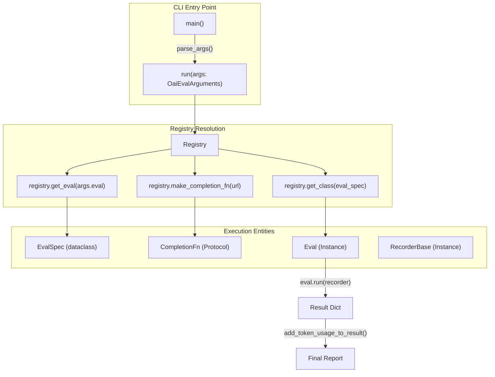
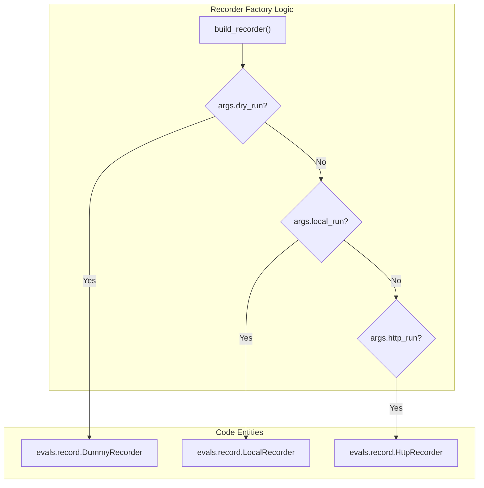

<!-- source: DeepWiki mcp.deepwiki.com · repo openai/evals · page 5.1 Using oaieval CLI · fetched 2026-10-26 -->

# Using oaieval CLI

Relevant source files

The following files were used as context for generating this wiki page:

- [MANIFEST.in](MANIFEST.in)
- [docs/run-evals.md](docs/run-evals.md)
- [evals/__init__.py](evals/__init__.py)
- [evals/api.py](evals/api.py)
- [evals/base.py](evals/base.py)
- [evals/cli/oaieval.py](evals/cli/oaieval.py)
- [evals/completion_fns/langchain_math.py](evals/completion_fns/langchain_math.py)
- [evals/completion_fns/openai.py](evals/completion_fns/openai.py)
- [evals/completion_fns/retrieval.py](evals/completion_fns/retrieval.py)
- [evals/elsuite/make_me_say/autoeval.py](evals/elsuite/make_me_say/autoeval.py)
- [evals/elsuite/make_me_say/utils.py](evals/elsuite/make_me_say/utils.py)
- [evals/registry.py](evals/registry.py)
- [evals/registry/completion_fns/cot.yaml](evals/registry/completion_fns/cot.yaml)
- [evals/registry/data/word_association/corpus_tools/validators.py](evals/registry/data/word_association/corpus_tools/validators.py)
- [evals/registry_test.py](evals/registry_test.py)
- [evals/utils/api_utils.py](evals/utils/api_utils.py)
- [examples/retrieval-completionfn.ipynb](examples/retrieval-completionfn.ipynb)

This page provides a detailed reference for the `oaieval` command-line interface (CLI), the primary tool for executing individual evaluations within the OpenAI Evals framework.

## Overview

The `oaieval` CLI connects a model (via a `CompletionFn`) with an evaluation definition from the registry, executes the evaluation lifecycle, and records results through a configurable recorder system.

### Data Flow and Execution Architecture

The following diagram illustrates the relationship between the CLI arguments, the registry system, and the core execution logic in `evals/cli/oaieval.py`.

Sources: [evals/cli/oaieval.py:118-239](), [evals/registry.py:120-151](), [evals/base.py:51-61]()

## Command-Line Arguments

The `oaieval` CLI supports a wide range of flags for controlling model behavior, evaluation parameters, and logging destinations.

### Required Arguments

| Argument | Type | Description |
| :--- | :--- | :--- |
| `completion_fn` | `str` | Comma-separated list of model IDs (e.g., `gpt-4`) or registry keys. |
| `eval` | `str` | Name of the evaluation as defined in the registry YAML files. |

### Core Configuration Flags

| Flag | Default | Description |
| :--- | :--- | :--- |
| `--extra_eval_params` | `""` | Parameters passed to the Eval class (e.g., `max_tokens=10`). |
| `--completion_args` | `""` | Parameters for `CompletionFn` instantiation (e.g., `temperature=0`). |
| `--max_samples` | `None` | Limit the number of samples processed from the dataset. |
| `--cache` / `--no-cache` | `True` | Toggle API response caching. |
| `--seed` | `20220722` | Seed for reproducibility in sampling and shuffling. |
| `--registry_path` | `None` | Path(s) to search for custom YAML registries. |

Sources: [evals/cli/oaieval.py:25-93](), [evals/cli/oaieval.py:136-171]()

## Execution Modes and Caching

The CLI determines how to store results based on the "run mode" flags. Only one recorder is active per run.

### Recorder Selection Logic

The `build_recorder` function in `oaieval.py` instantiates the appropriate `RecorderBase` subclass based on CLI arguments.

- **Local Mode (`--local-run`)**: Default behavior. Stores results in a local JSONL file at `/tmp/evallogs/` or the path specified by `--record_path` [evals/cli/oaieval.py:58-62]().
- **HTTP Mode (`--http-run`)**: Sends events to a remote URL. Requires `--http-run-url`. Supports `--http-batch-size` (default 100) and `--http-fail-percent-threshold` (default 5%) [evals/cli/oaieval.py:65-89]().
- **Dry-Run Mode (`--dry-run`)**: Uses `DummyRecorder` which discards events but can still log to the console via `--dry-run-logging` [evals/cli/oaieval.py:91-92]().

Sources: [evals/cli/oaieval.py:242-266](), [evals/cli/oaieval.py:45-55]()

## Implementation Details

### Completion Function Resolution
The `Registry.make_completion_fn` method determines which class to instantiate for a given `completion_fn` string:
1. If the name is "dummy", it returns `DummyCompletionFn` [evals/registry.py:130-131]().
2. If it matches a known chat model (via `is_chat_model`), it creates an `OpenAIChatCompletionFn` [evals/registry.py:135-136]().
3. If it is an OpenAI API model ID, it creates an `OpenAICompletionFn` [evals/registry.py:137-138]().
4. Otherwise, it looks up a `CompletionFnSpec` or `SolverSpec` in the registry and uses `evals.utils.misc.make_object` to instantiate the specified class [evals/registry.py:141-151]().

### Parameter Parsing
The CLI uses `parse_extra_eval_params` to convert a string like `key1=value1,key2=value2` into a typed dictionary. It attempts to cast values to `int`, then `float`, before defaulting to `str` [evals/cli/oaieval.py:136-155]().

### Token Usage Tracking
After an evaluation finishes, `run()` calls `add_token_usage_to_result()`. This function:
1. Retrieves all `sampling` events from the recorder [evals/cli/oaieval.py:274]().
2. Aggregates `prompt_tokens`, `completion_tokens`, and `total_tokens` from the `usage` field of each event [evals/cli/oaieval.py:279-286]().
3. Appends these totals to the final result dictionary with a `usage_` prefix [evals/cli/oaieval.py:288-295]().

Sources: [evals/cli/oaieval.py:118-239](), [evals/cli/oaieval.py:269-295](), [evals/registry.py:120-151]()

## Caching and Retries

- **Caching**: Controlled by the `--cache` flag. If disabled, `api_extra_options["cache_level"]` is set to `0` [evals/cli/oaieval.py:210-211]().
- **Retries**: Most completion functions use `create_retrying` from `evals.utils.api_utils.py`. This utility uses the `backoff` library to perform exponential backoff on specific exceptions like `RateLimitError` or `APITimeoutError` [evals/utils/api_utils.py:10-23](), [evals/completion_fns/openai.py:19-24]().

Sources: [evals/utils/api_utils.py:10-23](), [evals/completion_fns/openai.py:19-52]()

---

