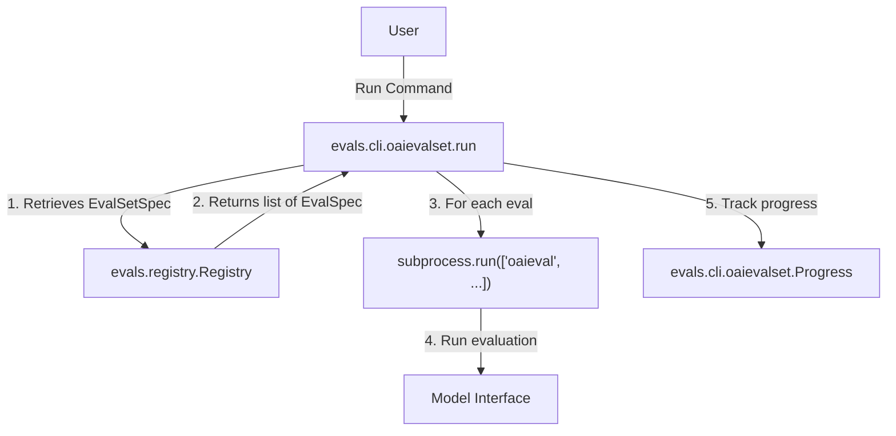
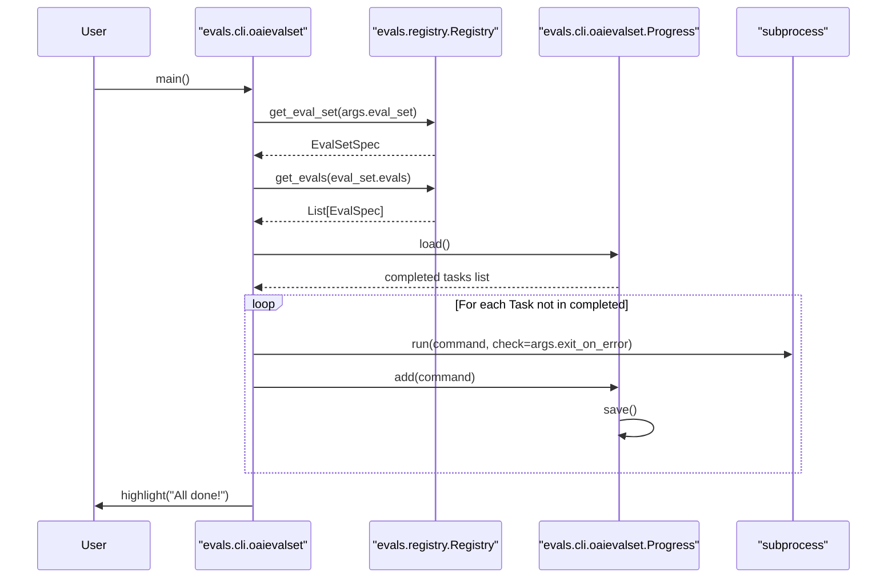
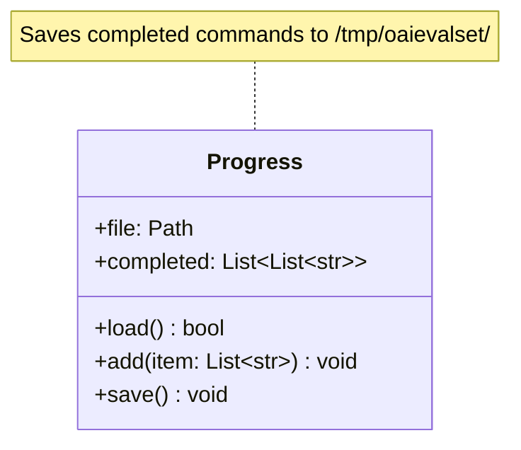

<!-- source: DeepWiki mcp.deepwiki.com · repo openai/evals · page 5.2 Using oaievalset CLI · fetched 2026-10-26 -->

# Using oaievalset CLI

<details>
<summary>Relevant source files</summary>

The following files were used as context for generating this wiki page:

- [MANIFEST.in](MANIFEST.in)
- [docs/run-evals.md](docs/run-evals.md)
- [evals/__init__.py](evals/__init__.py)
- [evals/api.py](evals/api.py)
- [evals/base.py](evals/base.py)
- [evals/cli/oaievalset.py](evals/cli/oaievalset.py)
- [evals/data.py](evals/data.py)
- [evals/data_test.py](evals/data_test.py)
- [evals/record.py](evals/record.py)
- [evals/record_test.py](evals/record_test.py)
- [evals/utils/misc.py](evals/utils/misc.py)
- [mypy.ini](mypy.ini)
- [scripts/battle_generator.py](scripts/battle_generator.py)
- [scripts/modelgraded_generator.py](scripts/modelgraded_generator.py)
- [scripts/pattern_identification_generator.py](scripts/pattern_identification_generator.py)

</details>


This page explains how to use the `oaievalset` CLI tool to run multiple evaluations in batch. While the `oaieval` CLI is used to run a single evaluation against a model, `oaievalset` allows you to run a pre-defined set of evaluations sequentially, with progress tracking and resumption capabilities.

## Overview

The `oaievalset` CLI is a utility that automates running multiple evaluations on a given model by leveraging the `Registry` system to locate evaluation sets and their constituent evaluations. It runs each evaluation in sequence by invoking the `oaieval` command with appropriate parameters via `subprocess.run`.



Sources: [evals/cli/oaievalset.py:81-132](), [evals/cli/oaievalset.py:134-141]()

## Command Line Interface

The `oaievalset` command is defined in `evals.cli.oaievalset` and accepts the following arguments:

| Argument | Description | Required | Default |
|----------|-------------|----------|---------|
| `model` | Name of the completion model to evaluate | Yes | - |
| `eval_set` | Name of the evaluation set from the registry | Yes | - |
| `--registry_path` | Path to custom registry location (can be repeated) | No | `None` |
| `--resume/--no-resume` | Resume from last checkpoint | No | `True` |
| `--exit-on-error/--no-exit-on-error` | Exit if any `oaieval` command fails | No | `True` |

Any additional arguments provided on the command line that are not recognized by the `oaievalset` parser are captured as `unknown_args` and passed through to each `oaieval` command.

Sources: [evals/cli/oaievalset.py:47-70](), [evals/cli/oaievalset.py:73-78](), [evals/cli/oaievalset.py:135-137]()

## How oaievalset Works

The `oaievalset` CLI functions as an orchestrator that manages a sequence of tasks:



Sources: [evals/cli/oaievalset.py:81-132](), [evals/cli/oaievalset.py:17-40]()

## Implementation Details

### Progress Tracking

The `Progress` class handles persistence to allow resuming batch evaluation runs. This is particularly useful for large evaluation sets or when running evaluations with computationally intensive models.

Progress is stored in a JSON Lines file at:
`/tmp/oaievalset/{model}.{eval_set}.progress.txt`

Each line in this file represents a completed evaluation command (a list of strings). When running with the default `--resume` option, the `run` function filters the `commands` list to skip any items already present in `progress.completed`.



Sources: [evals/cli/oaievalset.py:17-40](), [evals/cli/oaievalset.py:111-118]()

### Command Generation and Execution

The tool constructs `oaieval` commands dynamically:

1. **Resolution**: It uses the `Registry` to resolve the `eval_set` name into a list of evaluation keys. [evals/cli/oaievalset.py:92-94]()
2. **Construction**: For each evaluation, it builds a list: `[run_command, args.model, eval.key] + unknown_args`. [evals/cli/oaievalset.py:99]()
3. **Registry Propagation**: If `--registry_path` was provided to `oaievalset`, it is appended to the `oaieval` command to ensure the child process looks in the same locations. [evals/cli/oaievalset.py:100-102]()
4. **Execution**: Commands are executed using `subprocess.run` with `stdout=subprocess.PIPE`. If `exit_on_error` is `True`, a failure in one eval will stop the entire set. [evals/cli/oaievalset.py:128]()

## Configuration and Threading

While the `oaievalset` CLI itself runs evaluations sequentially in its main loop, the underlying `oaieval` calls may utilize threading. Users can configure the threading behavior of the individual evaluations being run by setting environment variables:

- `EVALS_THREADS`: Controls the number of threads used by the `Eval` class for parallel sample processing. Defaults to 10. [docs/run-evals.md:31-34]()
- `EVALS_THREAD_TIMEOUT`: Sets the timeout in seconds for individual threads. Defaults to 40. [docs/run-evals.md:31-34]()

## Usage Examples

### Basic Usage
To run all evaluations in the `test` evaluation set using `gpt-3.5-turbo`:
```bash
oaievalset gpt-3.5-turbo test
```
Sources: [docs/run-evals.md:25-27]()

### Resumption
If a run is interrupted, `oaievalset` will automatically detect the progress file in `/tmp/oaievalset/` and skip completed evals on the next run. To start fresh, delete the progress file or use `--no-resume`.
```bash
oaievalset gpt-3.5-turbo test --no-resume
```
Sources: [docs/run-evals.md:38-40](), [evals/cli/oaievalset.py:59-63]()

### Passing Through Arguments
Any arguments not recognized by `oaievalset` (like `--record_path`) are passed to `oaieval`:
```bash
oaievalset gpt-3.5-turbo test --record_path /custom/path/logs
```
Sources: [evals/cli/oaievalset.py:135-137](), [docs/run-evals.md:19-19]()

## Related Pages

- **Using oaieval CLI**: For details on the command being wrapped by `oaievalset`.
- **Registry System**: For how `eval_sets` and `evals` are defined in YAML.
- **Recording and Metrics**: For how the results of these batch runs are logged.

Sources: [evals/cli/oaievalset.py:1-141](), [docs/run-evals.md:23-42]()

---

